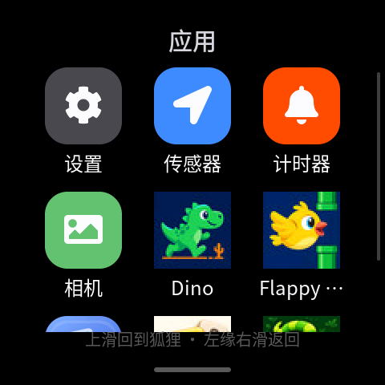
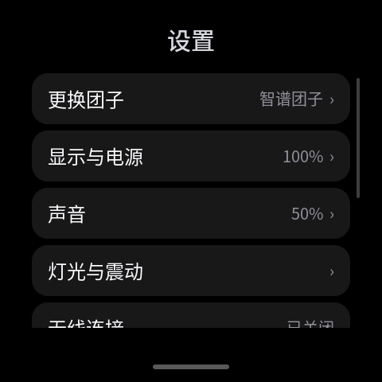
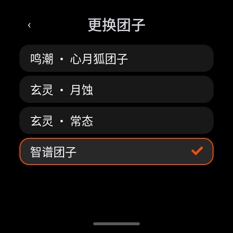

# dangoOS

住在 ESP-Mosaico 里的桌面小伙伴。

团子会对轻点、抚摸、晃动和周围环境作出反应，也会用表情告诉你正在充电、连接网络或播放音乐。从底部上滑打开应用，再次上滑回到团子；从左边缘右滑返回上一级。

[下载固件](https://github.com/umbrella22/dangoOS/releases) · [内置应用](apps/README.md) · [安装与发布](tools/release/README.md) · [更新日志](CHANGELOG.md)

## 四个团子，随时切换

| 鸣潮 · 心月狐团子 | 玄灵 · 月蚀 | 玄灵 · 常态 | GLM拟人团子 |
| :---: | :---: | :---: | :---: |
|  |  |  |  |

在 **设置 → 更换团子** 中选择喜欢的形象。设置首页会显示当前团子的名字，选中项以橙色边框和对勾标记；切换时显示加载动画，重启后保留选择。

每个团子拥有独立的配色和表情资源，覆盖日常情绪、Wi-Fi、蓝牙和音乐播放等状态。轻点会回应，连续点按会生气，安静下来也会慢慢恢复自己的节奏。

## 角色来源与图像制作

| 团子 | 角色来源与版权归属 |
| --- | --- |
| **鸣潮 · 心月狐团子** | 角色版权归 **广州库洛科技有限公司** 所有。 |
| **GLM拟人团子**（固件内显示为「智谱团子」） | 角色版权归 bilibili UP 主 **[ZipZipPipe](https://space.bilibili.com/4168597)** 所有。 |
| **玄灵 · 月蚀 / 玄灵 · 常态** | **玄灵**为本项目自创角色，月蚀与常态是该角色的两种形态。 |

本项目的团子图像与表情素材均使用 **GPT-IMAGE-2.5 家族模型**制作。上表标明各角色的来源与版权归属。

## 不止陪伴

|                                应用启动器                                 |                                   2048                                    |
| :-----------------------------------------------------------------------: | :-----------------------------------------------------------------------: |
|  |  |

- **随手玩一局**：内置 Snake、2048、Dino 和 Flappy Bird，支持触摸操作。
- **记录和查看**：连接左侧相机模块拍照，在 Photo 相册中浏览和删除照片。
- **看看周围**：传感器页面显示姿态、磁场和环境信息，计时器处理日常倒计时。
- **听点音乐**：开启经典蓝牙后连接 `ESP-Mosaico Audio`，通过板载扬声器播放手机或电脑的音频。
- **独立应用**：Lua 应用可通过 USB 单独安装和更新，照片与存档保存在设备中。

## 设置就在手边

|                                     设置首页                                      |                                       团子选择                                        |
| :-------------------------------------------------------------------------------: | :-----------------------------------------------------------------------------------: |
|  |  |

亮度、音量、灯光、震动、Wi-Fi、蓝牙、相机和存储集中在原生设置里。偏好自动保存，保存过程中显示转圈，完成后显示绿色对勾。连接 2.4 GHz WPA2 Wi-Fi 后，可以在 **设置 → 系统更新** 中检查并安装新固件。

上面的图片均由当前代码在主机上渲染：主页和设置使用真实 LVGL 界面，2048 使用仓库原始 Lua 应用。硬件状态以演示数据呈现。

## 安装到设备

支持 **ESP-Mosaico V1.2 / ESP32-S31**，配备 480 × 480 AMOLED 触摸屏、16 MiB NOR 与 128 MiB NAND。左槽相机等功能需要对应扩展模块。

v0.6.1 沿用 v0.5.0 引入的独立 Recovery 与单个 12 MiB 主应用分区，布局为 `S31ONE03`。**v0.4.4 及更早的 A/B 布局需要使用本版 `full.zip` 全量迁移，不能通过旧版无线 OTA 或本版 `main.bin` 迁移。** 使用包前核对 `SHA256SUMS` 和布局。

| 安装包       | 用途                                                                                 |
| ------------ | ------------------------------------------------------------------------------------ |
| `*-full.zip` | 首次安装、恢复或更新系统资源。包含完整系统镜像、四套 NAND 团子、应用与字体包和安装工具。 |
| `*-main.zip` | 采用 `S31ONE03` 的设备通过独立 Recovery 更新主应用。包含独立资源和 USB 工具。 |

首次安装：按住 BOOT，短按 RESET，再松开 BOOT，进入下载模式。在解压目录执行：

```sh
python3 -m pip install -r requirements.txt
python3 install.py --flash-port ROM_PORT --port RUNTIME_PORT
```

将 `ROM_PORT` 换成下载模式端口，将 `RUNTIME_PORT` 换成启动后的 USB 端口，例如 `/dev/cu.usbmodem…`、`/dev/ttyACM0` 或 `COM3`。安装器会依次刷入系统、等待启动、安装四套团子与匹配字体。全量刷写覆盖 NOR 系统内容，独立 NAND 中的照片、存档和偏好保留。全新 NAND 需要显式初始化，具体参数见包内 `INSTALL.md`。

已经采用 `S31ONE03` 的设备可以使用设置中的无线更新。无线更新保留现有团子资源；需要同步新版团子时，在任一发布 ZIP 的解压目录执行：

```sh
python3 install.py --port RUNTIME_PORT
```

安装器会校验并更新随包提供的四套团子与匹配字体，保留当前团子选择和其他用户文件。所有完整角色均为独立资源；缺少资源时显示内置的[狐狸团子虚影与问号](docs/media/screenshots/placeholder.png)。首次从 system 默认心月狐迁移时，补装 `default` 资源包即可恢复原角色。USB 固件升级步骤同样见包内 `INSTALL.md`。

## 源码与构建

dangoOS 使用 Rust、LVGL 和构建时选择的 Lua / TS 引擎。应用代码、界面与资源可以独立维护。

| 目录                                             | 内容                           |
| ------------------------------------------------ | ------------------------------ |
| [firmware/boot](firmware/boot/) | 引导程序、Recovery 与启动契约 |
| [firmware/platform/s31](firmware/platform/s31/) | S31 板级支持 |
| [firmware/os](firmware/os)                          | 系统、驱动、团子交互与原生界面 |
| [firmware/runtime/lua-engine](firmware/runtime/lua-engine/README.md) | Lua 运行时与硬件接口           |
| [firmware/runtime/app-host](firmware/runtime/app-host/README.md) | 引擎共享的数据契约与图像编解码 |
| [firmware/storage](firmware/storage)                          | 文件系统与 NAND 存储           |
| [apps](apps/README.md) | `builtin/` 内置应用与 `examples/` 开发示例 |
| [resources](resources/README.md)                  | 可分发团子和 EmbedTS 字节码 |
| [tools](tools/README.md) | 检查、设备、素材和应用打包工具 |
| [tools/release](tools/release/README.md)     | 固件打包、校验与发布工具       |

构建需要 `rust-toolchain.toml` 指定的 Rust、Espressif RISC-V GCC / newlib 和主机 libclang。其他机器需用环境变量覆盖 [工具链配置](.cargo/config.toml) 中的本机路径；Linux CI 的固定版本与安装过程见 [Firmware 工作流](.github/workflows/firmware.yml)。

```sh
cargo fetch --locked
./tools/check.sh
cargo recovery --locked --offline
python3 tools/release/build_bootloader.py --idf /path/to/pinned/esp-idf \
  --tools /path/to/idf-tools --build target/bootloader
python3 tools/release/package.py build --out target/release-local \
  --bootloader target/bootloader/bootloader/bootloader.bin --allow-dirty
```

显示使用 40 MHz 四线 QSPI，默认 RGB565，原生页面按变化区域刷新。`display-rgb888` 提供局部控件保留 24 位颜色的候选构建，`display-low-latency` 单独控制小区域的 TE 等待实验；两者均需按设备对照结果验收。实现、帧间隔、输入延迟口径与验证边界见[显示管线](firmware/os/DISPLAY_PIPELINE.md)。

v0.6.1 将显示 DMA 数据改经两块各 16 KiB 的片内暂存，修复 PSRAM 供给路径中发送 FIFO 读空造成的画面错层，并拒绝将错误传输计为成功。修复计量候选连续采样约 22.55 软件完成 FPS，尚未达到稳定 30 FPS；此前 12.45 → 24.33 FPS 的历史对照未检查 FIFO 错误，不能代表完整像素帧。默认仍使用 450 KiB PSRAM PARTIAL 绘制缓冲，发布固件关闭显示计量与 EmbedScope 诊断。升级变化与验证范围见 [v0.6.1 发布说明](tools/release/notes/v0.6.1.md)。

团子行为由固件内的 Rust 运行时提供，随固件更新；不再加载 Lua 或 TS 行为脚本。
默认前台应用引擎使用 Lua。`cargo fw-ts` 关闭默认 features 并接入外部 EmbedTS 引擎；每份固件只链接一个脚本引擎，同时选择或均未选择时构建失败。

TypeScript 构建器、引擎、SDK 和应用源码维护于独立的 [EmbedTypescript](https://github.com/umbrella22/EmbedTypescript) 仓库，按 `builder/`、`engine/`、`sdk/`、`examples/` 组织。本仓库仅保留 Rust 宿主适配及 `resources/embedts/` 预编译输入，固件构建和测试不编译 TS。应用入口使用 **EmbedTS Bytecode（`.etb`）**。接入与更新流程见 [EmbedTS 接入](firmware/os/EMBEDTS.md)。

引擎依赖在根 `Cargo.toml` 中固定到 GitHub 的完整 commit SHA，OS 与基准 runner 共用该版本，`Cargo.lock` 记录来源。构建本仓库无需相邻的 EmbedTypescript checkout；首次运行 `cargo fetch --locked` 后可离线检查。CI 直接使用锁定依赖，OS 中不安装 pnpm 或构建 TS 源码。

私有制作资料保存在本地 `design/`，由 Git 忽略。公开界面图片位于 `docs/media/screenshots/`；其他本地 `docs/` 资料继续忽略。已有 `target/` 构建记录和发布说明中的旧路径反映记录生成时的目录。
