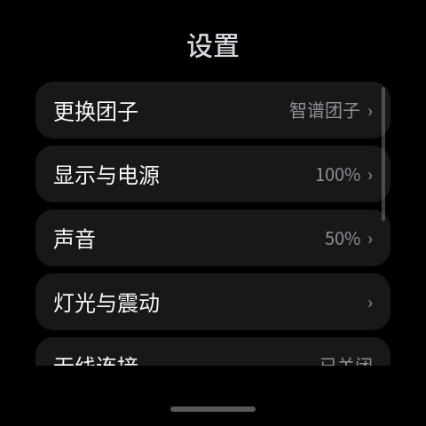
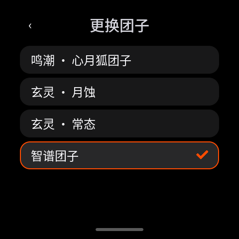

# dangoOS

住在 ESP-Mosaico 里的桌面小伙伴。

团子会对轻点、抚摸、晃动和周围环境作出反应，也会用表情告诉你正在充电、连接网络或播放音乐。从底部上滑打开应用，再次上滑回到团子；从左边缘右滑返回上一级。

[下载固件](https://github.com/umbrella22/dangoOS/releases) · [内置应用](apps/README.md) · [安装与发布](scripts/release/README.md)

## 四个团子，随时切换

| 鸣潮 · 心月狐团子 | 玄灵 · 月蚀 | 玄灵 · 常态 | GLM拟人团子 |
| :---: | :---: | :---: | :---: |
|  |  |  |  |

在 **设置 → 更换团子** 中选择喜欢的形象。设置首页会显示当前团子的名字，选中项以橙色边框和对勾标记；切换时显示加载动画，重启后保留选择。

每个团子拥有独立的配色和表情资源，覆盖日常情绪、Wi-Fi、蓝牙和音乐播放等状态。轻点会回应，连续点按会生气，安静下来也会慢慢恢复自己的节奏。

## 角色来源与图像制作

| 团子 | 角色来源与版权归属 |
| --- | --- |
| **鸣潮 · 心月狐团子** | 角色版权归 **广州库洛科技有限公司** 所有。 |
| **GLM拟人团子**（固件内显示为「智谱团子」） | 角色版权归 bilibili UP 主 **[ZipZipPipe](https://space.bilibili.com/4168597)** 所有。 |
| **玄灵 · 月蚀 / 玄灵 · 常态** | **玄灵**为本项目自创角色，月蚀与常态是该角色的两种形态。 |

本项目的团子图像与表情素材均使用 **GPT-IMAGE-2.5 家族模型**制作。上表标明各角色的来源与版权归属。

## 不止陪伴

|                                应用启动器                                 |                                   2048                                    |
| :-----------------------------------------------------------------------: | :-----------------------------------------------------------------------: |
|  |  |

- **随手玩一局**：内置 Snake、2048、Dino 和 Flappy Bird，支持触摸操作。
- **记录和查看**：连接左侧相机模块拍照，在 Photo 相册中浏览和删除照片。
- **看看周围**：传感器页面显示姿态、磁场和环境信息，计时器处理日常倒计时。
- **听点音乐**：开启经典蓝牙后连接 `ESP-Mosaico Audio`，通过板载扬声器播放手机或电脑的音频。
- **独立应用**：Lua 应用可通过 USB 单独安装和更新，照片与存档保存在设备中。

## 设置就在手边

|                                     设置首页                                      |                                       团子选择                                        |
| :-------------------------------------------------------------------------------: | :-----------------------------------------------------------------------------------: |
|  |  |

亮度、音量、灯光、震动、Wi-Fi、蓝牙、相机和存储集中在原生设置里。偏好自动保存，保存过程中显示转圈，完成后显示绿色对勾。连接 2.4 GHz WPA2 Wi-Fi 后，可以在 **设置 → 系统更新** 中检查并安装新固件。

上面的图片均由当前代码在主机上渲染：主页和设置使用真实 LVGL 界面，2048 使用仓库原始 Lua 应用。硬件状态以演示数据呈现。

## 安装到设备

支持 **ESP-Mosaico V1.2 / ESP32-S31**，配备 480 × 480 AMOLED 触摸屏、16 MiB NOR 与 128 MiB NAND。左槽相机等功能需要对应扩展模块。

从 [Releases](https://github.com/umbrella22/dangoOS/releases) 下载并解压适合的 ZIP，先核对发布页的 `SHA256SUMS`。

| 安装包       | 用途                                                                                 |
| ------------ | ------------------------------------------------------------------------------------ |
| `*-full.zip` | 首次安装、恢复或更新内置应用及默认形象「鸣潮 · 心月狐团子」。包含完整系统镜像、三套 NAND 团子和安装工具。 |
| `*-ota.zip`  | 已采用当前 A/B 布局的设备日常升级。包含固件、三套 NAND 团子和 USB 更新工具。         |

首次安装：按住 BOOT，短按 RESET，再松开 BOOT，进入下载模式。在解压目录执行：

```sh
python3 -m pip install -r requirements.txt
python3 install.py --flash-port ROM_PORT --port RUNTIME_PORT
```

将 `ROM_PORT` 换成下载模式端口，将 `RUNTIME_PORT` 换成启动后的 USB 端口，例如 `/dev/cu.usbmodem…`、`/dev/ttyACM0` 或 `COM3`。安装器会依次刷入系统、等待启动、安装三套团子。全量刷写覆盖 NOR 系统内容，独立 NAND 中的照片、存档和偏好保留。全新 NAND 需要显式初始化，具体参数见包内 `INSTALL.md`。

已有设备可以直接使用设置中的无线更新。无线更新保留现有团子资源；需要同步新版团子时，在任一发布 ZIP 的解压目录执行：

```sh
python3 install.py --port RUNTIME_PORT
```

安装器会校验并更新随包提供的三套资源，保留当前团子选择和其他用户文件。USB 固件升级步骤同样见包内 `INSTALL.md`。

## 源码与构建

dangoOS 使用 Rust、LVGL 和 Lua。应用代码、界面与资源可以独立维护。

| 目录                                             | 内容                           |
| ------------------------------------------------ | ------------------------------ |
| [crates/os](crates/os/)                          | 系统、驱动、团子交互与原生界面 |
| [crates/lua-engine](crates/lua-engine/README.md) | Lua 运行时与硬件接口           |
| [crates/fs](crates/fs/)                          | 文件系统与 NAND 存储           |
| [apps](apps/README.md)                           | 五个内置 Lua 应用的源码        |
| [dango-skin](dango-skin/)                        | 三套可分发团子的 BIN / JSON    |
| [scripts/release](scripts/release/README.md)     | 固件打包、校验与发布工具       |

构建需要 `rust-toolchain.toml` 指定的 Rust、Espressif RISC-V GCC / newlib 和主机 libclang。其他机器需用环境变量覆盖 [工具链配置](.cargo/config.toml) 中的本机路径；Linux CI 的固定版本与安装过程见 [Firmware 工作流](.github/workflows/firmware.yml)。

```sh
cargo fetch --locked
./scripts/check.sh
python3 scripts/release/package.py build --out target/release-local --allow-dirty
```
