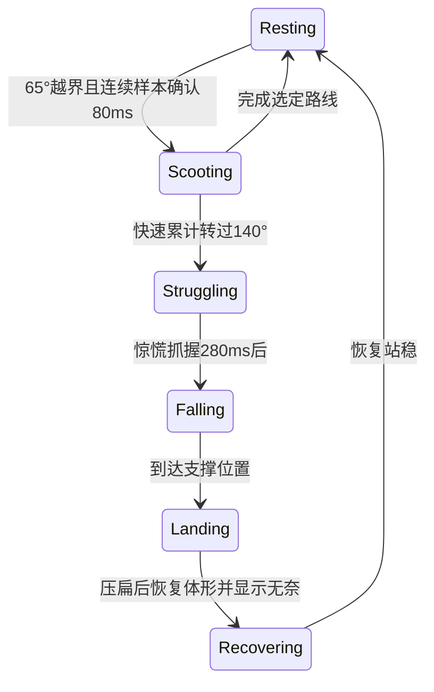

# 团子姿态、抓握与滑落

设备竖起时，团子依据屏幕平面内的重力投影调整位置。转过约一侧后触发一次完整爬行，快速半圈触发短暂抓握与惊慌，然后下落、压扁、无奈并恢复；停手不会取消已经触发的半圈掉落。角色表情与身体动作分别计算，关机和紧急表情继续执行原有优先级。

## 运行路径

`services/input/sensors.rs` 发布带物理单位和采样时间的 `Accel` / `Gyro`。`Runtime` 将同一事件交给情绪引擎、常驻 brain 和 `behavior::balance::Balance`。每次 UI 更新，`Balance::tick` 发布 `BalanceVisual` 到 `FoxControl`，控件将其与入场、触摸和呼吸组合为 `FoxInput`。

静止时相对上次选定侧累计转角；达到 65°并确认 80 ms 后选择最近的 90°侧，确认前回到 50°内取消。爬行沿固定路径按时间推进，只有继续转过相邻侧才更新目标；小幅噪声不改变路线或结束时间。到位即锁定，不再等待精确传感器角度。角度差使用最短圆周距离，跨越 ±180° 不产生整圈跳变。加速度模长偏离重力时不更新朝向；设备接近平放时停用平面姿态，采样过期后清除外推状态。IMU 到屏幕的映射集中在 `balance.rs`；当前约定传感器 X 向右、Y 向上，对应屏幕重力 `(-ax, +ay)`。该安装方向尚需实体设备确认。

`FoxAnimator` 在 Idle 上组合补全底图、局部表情、双手和耳朵。慢转时双手交替挪动，发力的小手轻微纵向伸长；进入挣扎时记录抓握侧，主手轻微纵向拉长，身体向另一侧偏移并摆动。手与身体允许少量分离，角色轮廓仍由头部与圆润小手构成。爬行的小手交替周期约 0.75 秒，纵向伸长最多 12%，动作首尾平滑收回。

表情由独立的 `BalanceFace` 推进：普通爬行保持自然表情，快速半圈先惊慌，下落与落地最初 120 ms 保持惊慌，之后显示无奈，恢复站稳后返回正常；持续大幅旋转可显示晕眩。该时间线独立于抓握、下落和落地阶段，落地压缩不会倒退表情。`Runtime` 保留 Affect 的反应来源；由同一次 IMU 转动触发的 Confused 在 v4 皮肤中使用这套动作图层，包含 Affect 剩余持续时间和回到 Idle 的切换窗口。其他来源的 Confused、业务与紧急表情继续使用各自姿态。

落地压缩由挣扎阶段记录的转动强度决定，强烈转动产生更明显的压扁；落地最初 120 ms 保持压缩，再平滑恢复原始比例。

`FoxRenderer` 先合成索引图，再应用身体呼吸、屏幕平面旋转和位移。普通呼吸使用原有按行采样路径；旋转使用逆向仿射采样。双手仅遍历变形后的包围盒，解码与采样复用已有缓冲。输出视口改为 480×480，原有 352×336 图像以原尺寸放置，旋转时不再统一缩小。旋转采样只遍历角色变换后的包围盒，普通呼吸继续按行缓存。两槽 `CanvasPool` 的像素缓冲合计增加 448,512 字节运行内存；资源图像尺寸、线程与传感器采样频率不变。

## 皮肤格式 v4

v4 使用 v2 的逐图 zlib 编码和原有调色板、姿态表。在姿态元数据末尾追加 216 字节：

| 记录 | 字节数 | 内容 |
| --- | ---: | --- |
| 无手、无耳底图 | 20 | 全画布 `Img`；透明索引 255 表示背景与已拆分部件区域 |
| 左手、右手 | 48 | 每项为 `Img` + `i16 pivot_x, i16 pivot_y` |
| 用力、晕眩、无奈、惊慌 | 80 | 四个局部脸部补丁的 `Img` |
| 左耳、右耳 | 48 | 每项为 `Img` 与局部支点 |
| 眨眼 | 20 | 局部眼睛补丁的 `Img` |

支点采用部件图像内的局部像素坐标。所有图像引用同一个压缩数据区，元数据长度、数据区长度和 CRC 覆盖新增内容。解析器在资源激活前验证底图尺寸、支点、补丁边界、标志、解压长度及调色板索引。耳根带有藏在头部下方的重叠区域；绘制耳朵只填充底图中的透明像素。

新固件继续读取 v1/v2/v3。v1/v2 提供整体姿态跟随，v3 保留无手底图、双手与四张脸部补丁的 148 字节记录。v3 底图保持不透明约束；v4 的底图允许透明索引，用于耳朵与身体的合成。v4 皮肤需要与支持该格式的固件配套安装，旧固件不能读取 v4。`skin.json` 的 schema 和安装文件集合保持原有契约：每只角色仍为 `fox.bin` 与 `skin.json`。

## 素材与验证入口

本地 `assets/companion-articulated/<id>/` 保存补全底图、透明小手、耳朵、局部表情，以及可编辑的 `.pcraft` / `.psd`。每只角色包含 20 个编辑图层。PhotoCraft 沿原稿小手的墨线轮廓建立路径选区并复制导出；`gpt-image-2.5-sunburst` 补全手部遮挡区域并绘制动作表情。该目录保留早期分层稿。当前设备资源使用 `assets/companion-image26/` 中的 image 2.6 精修版本，覆盖四只角色各 25 种常规表情与动作图层。

`scripts/assets/prepare_articulated_art.py` 注册补全稿、提取眼睛与嘴部区域并生成分层工作文件。`refine_articulated_faces.py` 将 image2.5 补全的无眼底图按发丝区域配准，再通过 PhotoCraft 路径遮罩隔离修补区域、绘制闭眼与晕眩线条，避免残留眼白和旧睫毛。更换底图时传入新的 `--eye-clean-sheet`；已有素材可复用注册后的修补图。它需要 Pillow、NumPy、OpenCV 与 PhotoCraft CLI。`scripts/assets/build_articulated_skin.py` 以 v2/v3 包为输入，使用 Zopfli 重压缩原有索引图，并为相同图像复用数据流；运行时仍由原有 zlib 解码器读取。打包器逐张验证旧图像解码后的 SHA-256，调色板和像素保持一致。Zopfli 仅是主机打包依赖。当前精修流程使用 `scripts/assets/build_image26_components.py`、`refine_dizzy_animation.py` 与 `pack_image26_skins.py`。月蚀、常态和 GLM 的常规眩晕使用四组独立圈圈眼，每组显示 100 ms；补帧沿用已保存调色板并逐图核对原有数据流。`refine_startled_faces.py` 从当前包的惊讶表情与既有 image 2.6 干净肤色底板提取惊慌眼睛和嘴巴，通过 PhotoCraft 保存独立遮罩；该工具只替换原来重复无奈的第四个补丁描述与新增数据流，逐字节保留其他元数据、图像流和调色板，重复执行不会增加相同图像流。可分发产物位于 `resources/skins/`。

`cargo run -p os --example balance_preview -- OUTPUT [SKIN_ID] [SKIN_ROOT] [CASE]` 用模拟 IMU 输入驱动实际 `Runtime`、动画器和渲染器，以 25 fps 输出 480×480 PPM 帧与时间线，覆盖宽松转角、爬行中抖动、快转半圈立即停止、慢转半圈和慢转一整圈等场景。`scripts/assets/export_articulated_review.py --root OUTPUT` 生成可切换角色、动作和播放速度的 HTML、MP4 与 GIF。视频中的设备外框用于示意旋转方向；右侧保留实际屏幕渲染内容。

主机回归覆盖圆周接缝、不同转速与不精确终点、噪声不改变爬行路径、快速半圈立即停止仍完成掉落、落地压扁、平放、样本中断、旧样本、新旧皮肤解析、部件支点和旋转采样边界。主机预览与固件构建不构成传感器安装方向、实体帧率或设备手感验收。
