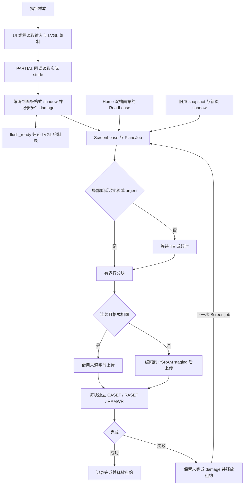

# 显示管线：局部更新与 RGB888

CO5300 使用 40 MHz 四线 SDR QSPI。默认固件采用 RGB565；`display-rgb888`
构建使原生 LVGL 使用 RGB888 绘制，并以 BGR888 字节存储 shadow、snapshot 和面板输入。
设置页滑块等原生控件保留 24 位颜色精度，上传只覆盖发生变化的区域。
Home、Lua framebuffer、相机及既有 RGB565 图片继续提供 RGB565 像素，在 shadow 或
驱动边界编码为所选面板格式；扩展到 RGB888 不会恢复这些来源已经丢失的颜色精度。

显示源在整个上传过程中保持不可变。LVGL 的 PARTIAL 绘制块可以在复制结束后复用，
shadow 和 snapshot 必须等到对应屏幕租约释放后才能重写。设备端仍使用发布的
`rs_lvgl / rs_lvgl_sys / rs_lvgl_ui 0.7.0`，不依赖上游尚未发布的新接口。

## 运行路径与边界



`lvgl_port.rs` 从 `lv_display_get_buf_active(display).header.stride()` 读取当前
PARTIAL 缓冲的实际行距。`copy_to_shadow` 只编码回调包含的像素，随即调用
`lv_display_flush_ready`；原生像素指针不会保存到上传任务。
`ScreenLease::pixels` 和 `SnapshotLease::pixels` 返回的 `PixelSource` 借用租约本身。
普通 LVGL handler、主动指针读取和外部 framebuffer 写入在 shadow 被借用时暂停。
`DisplayPort` 的析构要求所有租约和原生对象先释放。

`PixelSource` 区分数值 RGB565、RGB565 LE、RGB565 BE 和 BGR888，显式携带尺寸与
字节行距。RGB565 的位扩展复制高位，反向量化保持原始 16 位值。BGR888 到 BGR888
传递完整的三个颜色字节。现有 EmbedScope 最终画面捕获协议仍输出 RGB565，
`embedscope/frame.rs` 在诊断边界执行量化，诊断截图不能证明 RGB888 的低位颜色精度。

## Damage、页面恢复与输入

`Damage` 保存最多 16 个 inclusive 矩形。横向扩大到 CO5300 所需的四列对齐，
额外列取自已经初始化的 shadow。仅当包围矩形的像素量不大于分别发送时合并；
矩形数量达到上限时回退为覆盖全部变化的包围矩形。

`PlaneUi::submit` 合并被替换 Screen job 的 damage。上传失败时 plane 累积
`pending_screen`；下一次 Screen 提交覆盖这些区域。完成 Home 或 Slide 上传后，
`pending_screen` 标为全屏，使缓存的普通页面能够恢复完整内容。
失败本身不生成新帧，重试仍需要后续 job。SPI 超时沿用驱动的 `faulted` 状态，
后续上传拒绝执行，直到硬件重新初始化；普通可重试错误会在当前矩形上重试一次。

Home 状态带缓存最后成功上传的实际像素。相同状态带跳过上传；其他页面、清屏、
传输失败和 sleep/wake 会使缓存失效。团子主体仍沿用现有双槽画布与动画节奏。

指针样本设置 pending 标记，UI 线程在 shadow 空闲时主动调用 LVGL indev 读取，
无需等待下一次 indev timer。两轮之间完成的短按通过 latch 先报告 press，下一轮
补发 release。原生刷新与 indev timer 周期均为 16 ms；这不等于设备达到 60 FPS。
静态页无需提交像素，输入处理继续按 UI 循环执行。

## 上传、面板配置与内存

`board-s31/src/pixels.rs::RowChunks` 按整行分块，单块上限 32,736 B。
480×480 全屏 RGB565 / RGB888 分别需要 15 / 22 块。push 的两个页面横带分别分块，
可能多出一块；新页只绘制一次，每个动画位置仍需传完整屏幕。
当前实现不额外分配 push 合成帧。

连续且格式匹配的来源字节直接传给锁定 HAL 的 `half_duplex_write_async`。
该 HAL 对可访问的 DRAM/PSRAM 使用 InPlace TX，负责发送前 cache writeback，
future 的借用持续到 DMA 完成。窄区域或格式不同的来源先编码到驱动独占的
32,736 B、128 B 对齐 PSRAM staging。短于 32 B 的异步命令使用 HAL FIFO 路径。
每个像素块独立设置 CASET/RASET 并使用 RAMWR，未采用依赖连续写游标的 RAMWRC。

阻塞启动写入仍经 HAL 内部 TX 缓冲。TX 缓冲为 4,096 B，因此冷启动清黑按容量
选择 RGB565 四行或 RGB888 两行的小带，不能直接套用异步 DMA 分块尺寸。
默认 RGB565 配置为 `COLMOD=0x55, MADCTL=0x00`；RGB888 为
`COLMOD=0x77, MADCTL=0x08`，匹配 BGR888 字节顺序。
冷启动、RGB565 bootloader handoff 接管和 sleep-out 均应用运行时格式。
bootloader handoff 协议仍为 RGB565。已有 GRAM 内容、颜色顺序和唤醒效果需要面板验收。

原内部 staging 30,720 B 和 TX 30,720 B 共占 61,440 B；当前 TX 4,096 B，
staging 移到 PSRAM，相关内部缓冲减少 57,344 B（56 KiB）。双核构建的 RGB888
24 行 draw buffer 比 RGB565 多 11,520 B；shadow 与 snapshot 合计增加
460,800 B（450 KiB）PSRAM，另分配 32,736 B PSRAM staging 和普通堆中的
5,440 B Home 状态缓存。
堆元数据、线程栈、最大连续块和无线/音频争用后的实际余量以设备记录为准。

`display-low-latency` 是单独的 A/B 实验：仅 Screen damage 像素总量不超过半屏时
跳过 TE。整页、push 和 Home 继续等待 TE，urgent 沿用既有旁路。
阈值仅控制等待策略，不使较大的 damage 回退成整屏。
`display-metrics` 在每个 job 记录 `display.frame`：完成状态、格式、总耗时、
TE 等待、提交字节、直接来源字节、窗口数、编码时间和传输时间。
`bytes`/`windows` 记录尝试提交的工作量，失败或重试不能当作成功到达面板的净像素量。

## 主机复现与证据

```sh
# RGB888：生产页面、真实 LVGL 指针与回调、内存面板
cargo sim-display --locked --offline -- target/display-rgb888-20261112/simulator-rgb888
# 相同操作的 RGB565 对照
cargo run -p os --example display_pipeline --features display-simulator --locked --offline -- target/display-rgb888-20261112/simulator-rgb565
# Pillow 导出自包含播放器、PNG 与 GIF
python3 scripts/assets/export_display_replay.py \
  --rgb888 target/display-rgb888-20261112/simulator-rgb888/replay.json \
  --rgb565 target/display-rgb888-20261112/simulator-rgb565/replay.json \
  --out target/display-rgb888-20261112/review
```

`display_pipeline` 回放设置音量、设置亮度与返回启动器的 push。
每个局部上传后逐字节比较内存面板与完整 shadow；每个 push 中间位置另用
不依赖 `transition::bands` 的逐像素映射核对旧、新页位置。
两个设置页均等待松手动画结束，再执行 10 轮空闲循环，要求零像素提交。
播放器的展示速度由 HTML/GIF 指定，不能作为上传帧率或实际触控延迟。

2026-11-12 的主机验证结果：

| 检查 | 结果 |
| --- | --- |
| 默认 RGB565 board / OS 库 | 18 / 386 通过；OS 2 项 ignored |
| RGB888 + simulator board / OS 库 | 18 / 386 通过；OS 2 项 ignored |
| 原生 UI 可靠性集 | 4 通过 |
| 独立驱动集 | 103 通过 |
| RGB565 / RGB888 回放 | 各 107 帧、107 次完整画面对照通过 |
| RGB888 examples、RGB565 / RGB888 固件、EmbedScope、TS、recovery | 构建通过 |

本轮修改的 Rust 文件通过 rustfmt，diff 无空白错误。全仓 `cargo fmt --all -- --check`
仍报告先前提交中 6 个 companion/preview 文件的格式差异，详情保存在
`workspace-rustfmt.log`；这些文件没有纳入本轮显示改动。

主机回放得到的音量、亮度拖动提交量为 RGB888 50,328–60,504 B，
RGB565 33,552–40,336 B。40 MHz quad SDR 的纯像素数据时间分别为
2.516–3.025 ms 和 1.678–2.017 ms。全屏 push 分别为 691,200 / 460,800 B，
纯数据时间为 34.56 / 23.04 ms。以上时间均为字节量计算，未计命令、DMA、
TE、调度、PSRAM 争用和屏幕光学响应。

本地证据位于 `target/display-rgb888-20261112/`：`validation.json` 保存构建/测试
命令与日志指纹，`simulator-validation.json` 保存回放命令，两个
`simulator-*/replay.json` 保存逐帧区域与数据量；`review/index.html` 包含完整 PNG
回放。固件 ELF 按配置另存，避免后一次构建覆盖前一次候选。
这些主机证据未覆盖真实 DMA 完成、面板扫描、设备内存余量和光学效果。

## 设备对照入口

以下命令只构建。配对比较先保持 TE 策略相同，再独立比较局部低延迟实验：

```sh
# 40 MHz RGB565 + metrics
cargo fw --features display-metrics --locked --offline
# 40 MHz RGB888 + metrics，保留 TE
cargo fw --features display-rgb888,display-metrics --locked --offline
# 40 MHz RGB888 + metrics + 局部 TE 旁路
cargo fw-rgb888 --locked --offline
```

设备接入后的验收包括：

1. 纯红绿蓝、灰阶、高精度渐变、照片、透明边缘、四角小窗及非整行局部刷新，
   核对颜色通道、低位精度、源 stride、窗口边界和残影。
2. 冷启动、bootloader splash 接管、反复 sleep/wake；完整画面恢复后才恢复亮度。
3. 音量/亮度连续拖动、极短点击、松手、快速往返导航和 Home 状态更新；记录
   帧间隔及触摸到提交/首字节的 p50/p95，并检查按下/释放完整性。
4. 同格式 TE 开/关对照，采集实际 TE 周期和 SCLK，结合光学记录判断撕裂，
   不以最终画面截图替代扫描过程验收。
5. 无线与音频同时运行，记录 PSRAM/DMA 耗时、堆最低水位及最大连续块；
   失败重试、未完成 damage 和唤醒全屏恢复单独核对。

40 MHz 下全屏 RGB888 已超过 16.67 ms 的纯传输预算，当前工作不设整屏 60 FPS
承诺。局部控件的画质、输入等待和提交工作量是本轮设备对照的重点；增加 shadow、
DIRECT 或合成流水的必要性由这些设备数据决定。
