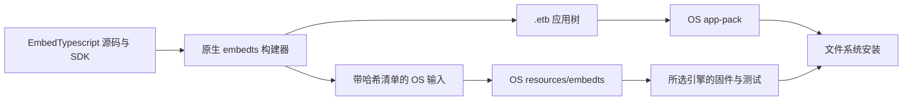

# EmbedTS 接入与产物边界

团子 OS 默认选择 `lua-engine`。`ts-engine` feature 通过依赖别名接入外部 `embedts-engine`，与 Lua 互斥。OS 的 Rust 适配层提供存储、原生 LVGL、显示、硬件、调度和常驻 brain；引擎本体、SDK 与 TS 源码在 EmbedTypescript 仓库。

## 交付路径



应用由外部 `scripts/build_examples.py` 生成，OS 的 app-pack 校验、打包并安装编译后的目录。`system` 使用与固件一致的引擎选择，TS 镜像命令为 `cargo run -p app-pack --no-default-features --features ts-engine -- system INPUT OUTPUT --size SIZE`。OS 构建与测试不调用源编译器，也不安装 TS 工作区。

外部引擎通过根 `Cargo.toml` 的 workspace dependency 固定到 GitHub 完整提交 `98eaf67207874467eaffcc725780ed319f65a5ee`，OS 和基准 runner 继承同一个定义。Cargo 拉取该提交并写入锁文件，无需相邻 checkout 或 CI 中额外 clone。仅重新构建 TS 应用、导出夹具或执行源码侧设备探针时需要 EmbedTypescript 工具链。

## 固定输入

`resources/embedts/manifest.json` 记录构建器版本、TSRS 提交、引擎 ID、宿主 ABI、每个源码摘要和产物摘要。`brain/default.etb.hex` 提供默认常驻行为，`selftest.etb` 用于设备引擎自检，`fixtures/` 供 OS 宿主集成测试使用。

在 EmbedTypescript 仓库运行：

```sh
cargo run -p embedts-builder --locked --example export-dangoos -- target/dangoos-inputs
```

审核后整体替换 OS 的 `resources/embedts`。OS 运行 `python3 scripts/check/compiled_apps.py` 验证清单、容器、摘要和源码边界，再执行两种引擎选择的测试。TS 测试使用当前引擎解析包，防止构建器和运行时漂移。引擎配方变化时重新导出；不对旧字节码修改魔数后复用。

## 文件与状态

应用入口为 `.etb`，魔数为 `EMBEDTS\0`。包头校验格式、长度、引擎指纹、宿主 ABI 与 SHA-256。扩展名决定注册表路由，兼容性和完整性由引擎检查。QuickJS 字节码要求可信构建来源。

brain 字符串接口使用 `etb1:` 加小写十六进制，可写路径使用 `.etb.hex`，Lua 路径独立。旧 `.rsts` 产物需要重新构建和安装；迁移不删除设备旧文件，也不将旧持久选择作为新格式加载。引擎或候选初始化失败仍按现有控制器回退到原生行为。

## 验证与发布

`./scripts/check/engines.sh` 执行 TS 宿主集成、无效 feature 选择、两种固件构建与符号隔离，最终留下默认 Lua 固件。固件普通依赖不启用引擎 `compiler`，也不依赖构建器。设备验收要求相同引擎 ID 的最终 `.etb`，主机与设备报告分别记录。

引擎来源检查同时核对 workspace 的完整 Git revision、两个消费方的继承关系及锁文件。更新引擎时同步更新依赖与预编译输入，并分别验证 GitHub 源码、固件、应用与设备。版本发布是独立步骤。

## GitHub 依赖与设备验证 · 2026-11-04

EmbedTypescript 已发布提交 [`98eaf67207874467eaffcc725780ed319f65a5ee`](https://github.com/umbrella22/EmbedTypescript/commit/98eaf67207874467eaffcc725780ed319f65a5ee)，该提交的[独立 CI](https://github.com/umbrella22/EmbedTypescript/actions/runs/41843577282)通过，覆盖 82 个 Rust 测试、SDK 类型与子集检查、7 个应用构建和 OS 固定输入导出。

OS 实际解析到 Cargo 的 Git checkout，未使用本机 EmbedTypescript 路径。在无相邻 EmbedTypescript checkout 的临时 OS 源码副本中，Lua 与 TS 两种配置均通过锁文件离线解析。切换后 `./scripts/check.sh` 通过：954 次 Rust 测试执行通过、4 次忽略，123 个 Python 测试通过；跨配置数量包含重复执行。两种固件、资源预算、互斥选择和 3241 个 C 符号检查通过。基准 runner 使用同一 Git 依赖的一轮主机 smoke 校验和通过，该轮不用于性能结论。

设备通过 A/B OTA 验证以下镜像：

| 配置 | 镜像字节数 | SHA-256 | 启动结果 |
| --- | --- | --- | --- |
| TS | 5663520 | `681612f599485aaaec63605a7dc7f4ab17203dc409f35a47f67878c86d0893eb` | 槽 0，`Valid seq=149`，系统/存储/显示/VM 就绪 |
| Lua | 5388544 | `df0f30d9e081f0e7e4b99b17366431eaf6d0e5f15708fe1e650d67e05a659de6` | 最终槽 1，`Valid seq=150`，内置 Lua brain 正常 |

TS 的标准 `.etb` 设备探针完成存储、字体、PNG/JPEG、双缓冲显示、传感器、音量/静音控制、worker 同步/超时/停止/异常隔离和原生 LVGL 检查，关闭后 VM 记账 `used=0`。人工观察确认点击计数变化，补读串口记录到一次重跑的 11 次点击。一次扩大人工窗口的独立重跑未收到新的输入，该轮未核实 AI 键事件；LED 扩展板不可用，振动体感未人工确认。

brain 事务测试通过：初始化及首 tick 错误候选未提交，原选择保持；自定义选择重启后保留；后续异常回退原生；最后恢复内置 TS 行为。临时探针已清理。恢复 Lua 后，System Snake 成功启动、运行并停止，健康标记维持正常。

旧 TS 固件、新 TS 固件和恢复的 Lua 固件均可见 CST9220 `invalid report: Header` 警告；本轮触摸实测正常，该警告未在本次依赖切换中修复。设备保留的旧 `.rsts` 下载应用仍需重建后安装，未作为新格式的验收输入。

上述设备验证使用发布前的工作区镜像。机器可读回执与原始日志位于 `target/embedts-github-20261104/`，源仓库 CI、OS 本地检查和设备结果分别记录。v0.4.1 的发布制品包含后续 LVGL 升级，其硬件验收状态以发布 manifest 为准。

随后人工交互复测复用相同 TS 镜像，通过 A/B OTA 启动于槽 0，`Valid seq=151`。临时探针仅将人工输入窗口由 180 秒扩大至 600 秒；实时串口记录到 16 次原生 LVGL 点击，以及 GPIO7 AI 键完整的 `press_down → press_up → single_click` 事件。人工确认已短按 AI 键，探针正常结束，VM 关闭记账为 `used=0`、`failures=0`，触摸与 AI 键的设备验收通过。

复测后已删除临时 `ts-parity` 应用，恢复相同默认 Lua 镜像至槽 1，`Valid seq=152`；`sys/data/frame/vm/valid` 均为 1，内置 Lua brain 为 `active=lua source=default error=0`。本次独立回执与日志位于 `target/embedts-input-retry-20261104/`，保留前轮记录。CST9220 Header 警告仍可见。
