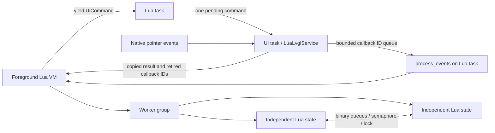

# Lua image, LVGL and worker runtime

The foreground Lua VM communicates with native LVGL through a typed command
boundary. Native widgets run exclusively on the existing UI task; Lua callback
closures run exclusively on the Lua task. Workers execute in separate Lua states
and exchange bounded byte messages through their parent VM group.



## Image frames

`image.load_file` accepts baseline JPEG and PNG data. JPEG retains compressed
bytes until conversion or resize; PNG decodes to RGB888. PNG alpha is composited
over black with `(channel * alpha + 127) / 255` per channel. EXIF orientation is
not applied. TJpgDec determines supported baseline JPEG variants; progressive
JPEG is unsupported.

Frames expose `info`, `data`, `release`, GC and Lua `<close>` cleanup. Returned
strings and converted/resized frames remain independent after source release.
Native image buffers and decoder temporary allocations count against the same
per-VM heap cap as Lua allocations. Reallocation headers retain the allocating
VM identity. File input and JPEG encoded output are limited to 4 MiB; image
geometry is limited to 1920 × 1080 pixels and dimensions to 65535.

Conversion supports RGB565 LE/BE, RGB888, BGR888, GRAY8 and baseline JPEG/MJPEG.
JPEG encoding uses stb_image_write at quality 90. YUYV and UYVY constants remain
available for compatibility, but conversion to those formats raises an error.
Resize supports nearest and bilinear filters and outputs RGB565LE or GRAY8;
default output is RGB565LE, or GRAY8 for a GRAY8 source. `save_file` supports
`.jpg`/`.jpeg` and converts raw frames before writing. It rejects PNG output;
PNG encoding is unsupported. BIN uses the native LVGL decoder and is not an
`image.load_file` format.

## Native LVGL bridge

`mosaico-lua/src/ui.rs` carries command JSON, an optional copied pixel blob and
the per-VM storage root. `tasks/lua.rs` suspends the VM until the UI task replies.
`lua_lvgl.rs` applies the command through LVGL 9.6. Handles contain monotonic
numeric IDs validated by a registered Lua userdata metatable; they never expose
native pointers. Display framebuffer mode and native LVGL mode are mutually
exclusive. Workers cannot acquire either display mode.

The supported widgets are screen, object/container, label, button, canvas, image
and message box. The facade supports geometry, alignment, basic RGB/opacity/
border/padding style fields, flex, scrolling, text, screen loading, flags,
foreground ordering, canvas RGB565 upload and pixel operations, raw RGB565 image
upload, image pivot/rotation, message box footer buttons and event registration.
Unknown widget operations raise an explicit error. The full upstream widget,
font, chart and animation catalog is unsupported. `init` attaches to the
existing display runtime; upstream buffer/tick/task initialization options do
not reconfigure that runtime. Unknown style and widget-option keys raise errors. Message boxes require a
parent from the same service; screen creation requires no parent.

Canvas and raw image pixels are copied before a command completes. The aggregate
pixel budget is 2 MiB, including a conservative four bytes per pixel reservation
for decoded file images. There are at most 512 tracked objects, 32 callbacks per
object and 256 queued event IDs. Event overflow discards the oldest queued ID.
`process_events` dispatches callbacks with `pcall` so one callback error does not
stop subsequent callbacks. Deleting/cleaning native trees reports retired IDs to
release Lua closures. Native deletion callbacks only mark records dead; record
storage remains valid until the command completes. File-image cache entries are
dropped before their source strings or descriptors are released.

The service registers a read-only `D:` LVGL filesystem driver for the foreground
VM storage root. Relative paths reject empty, dot, parent and backslash segments.
Release restores the previous native screen, deletes tracked screen trees,
clears callback records and pixels, drops image caches and removes the drive.
The embedding must retain the previous screen throughout the service lifetime.
Leaving the Lua page, app teardown and shutdown request release through the UI
task. Host acceptance mirrors test data into libc and littlefs backends;
firmware uses the single VFS through libc syscall shims.

## Independent workers

`mosaico-lua/src/workers.rs` schedules up to eight cooperative worker VMs per
foreground parent. Each state has a separate global environment and heap capped
at 1 MiB, inherits the parent storage root, receives JSON-decoded `args`, and
captures up to 8 KiB of print output. The group retains at most 32 job summaries;
errors are limited to 2048 Unicode scalar values. Jobs report textual status and
logs through `thread.start/run/list/get/stop`. Names support replacement and a
string exclusive group. Async timeout zero means no deadline. No operating
system threads or cross-state Lua object references are used.

Workers provide pure Lua libraries, JSON, delay and thread synchronization.
Hardware, image, display, LVGL, storage, IO, OS, debug, package searchers and
filesystem loading from worker code are unavailable. The trusted parent loads
the entry source before applying these restrictions. Nested worker creation is
unsupported. This capability boundary prevents native handles from escaping the
bounded shutdown path. Arbitrary script finalizers are skipped when the worker
state is destroyed, and unyieldable Lua execution has an uncatchable budget.
Ordinary foreground VMs retain their existing finalizer behavior.

Queues carry binary strings, including NUL bytes, with depth 1–32 and item size
1–4096. Queue capacity reservations total at most 256 KiB, with at most 32 queues.
Semaphores have maximum count 1–255; locks record the acquiring job ID. Each
registry has at most 32 entries. Sync names contain 1–31 ASCII letters, digits,
underscore, dot or hyphen and cannot refer to different resource types.
Timeout zero is nonblocking; finite waits retry cooperatively. Deletion rejects
queued messages, held locks or pending waiters with `busy`. A job stop completes a pending wait with `stopped`, allows one bounded
resumption, drops further requests and releases its locks before returning; parent interrupt, completion or
VM drop destroys the group and every child. The foreground driver must call
`poll_workers` during foreground sleeps and UI waits. Firmware does this at
one-millisecond intervals; `Vm::resume` also progresses the group each slice.
Deadlines use `Limits.clock` in firmware. Embeddings without that clock use a
deterministic logical millisecond per group tick and do not establish wall-clock
timeout behavior.

## Verification boundaries

The byte-identical original album and its Apache-2.0 license are stored under
`crates/mosaico-lua/vendor/album_app`. It enumerates JPG/JPEG/BIN and does not use
workers or enumerate PNG. Image and worker tests are independent of album tests.

Core host tests exercise exact PNG/alpha/RGB565 bytes, JPEG decode and encode,
corrupt input, frame independence, integer bounds and image limits. The unchanged
upstream thread harness covers API shape, nested JSON args, binary messaging,
named replacement, exclusive groups, contention, timeouts, stopping, 16 cleanup
cycles and concurrent producers/consumers. A hostile fixture checks capability
isolation, lock attribution and a nonterminating script finalizer during stop.
Native host probes exercise actual LVGL pointer events and repeated navigation.
Host results and firmware compilation do not establish physical display,
PSRAM pressure, real filesystem timing or on-device scheduler acceptance.

## Album photo delivery

`scripts/push-app.py photo-push image.jpg --name vacation/image.jpg --run`
publishes to `/data/appdata/album_app/photos/vacation/image.jpg` and optionally
opens the album. Names use the existing safe relative-path contract, at most
six components, and JPG/JPEG/PNG/BIN extensions; each upload is 1–1048576 bytes.
The original album enumerates JPG/JPEG/BIN only. A delivered PNG is available to
other image consumers but does not become an album tile.

The protocol is `photo-begin`, the existing CRC-protected `file` payload, then
`photo-commit <relative-name>`. Commit requires this session's successful
close-and-CRC receipt. A stale staging file alone cannot be published. A
same-filesystem rename preserves the old photo until commit. Disconnect,
explicit abort and N7 clear-data invalidate staging; a failed commit never
starts the album. Photo content is decoded by its consumer after delivery.

## 2026-10-23 independent acceptance receipt

Base: `ab1be60772f26ec75bf8f5ffda794cb5c286a7e6`. Local artifacts and full source
manifest: `target/n5-acceptance-20261023/receipt.json`. The final host gate passed
347 tests (242 S31, 53 Lua, 10 FS, 42 pure drivers), both existing previews,
release firmware and the ROM collision check (713 C symbols). The Python tool
suite passed 25 tests. `git diff --check` passed.

Implementation manifest SHA-256:
`d3a76a7f1354feec658cec21a36f621d703f1d4f2a21973357c999ce9645b0e7`.

Three separate executable probes ran in external processes with a 30-second
timeout. `n5_album_preview` drove the unchanged factory script using real LVGL
pointer events: grid scrolling, JPEG/grayscale/BIN, corrupt image handling,
previous/next, deletion cancel/confirm, 48 grid/view cycles, external stop and
clean-then-set-text. All 11 screenshots were inspected after the button-label
fix. Late Lua heap low-water use was 186590 bytes, versus 186567 in the earlier
steady interval. Teardown restored the native screen, reported zero tracked
objects/pixels, and returned the counted Lua/native-image allocator to zero.

`n5_image_probe` and the independent Pillow oracle verified PNG RGB/alpha and
RGB565 bytes exactly. JPEG decoding/resizing had mean channel error 0.9271–3.2292
and zero pixels with channel error above 32. Encoded and saved JPEGs decoded in
Pillow with the correct geometry and orientation; comparison with Pillow's
quality-90, 4:2:0 encoding had mean error 0.0321/0.5938 and no pixels above 16.
The sharp color fixture's 3.16% of pixels above delta 48 against uncompressed
RGB565 also occurs with Pillow's own 4:2:0 encoder; raw-pixel equality is not an
appropriate JPEG encoding criterion.

`n5_worker_probe` verified progress during parent sleep, OOM containment,
deadline lock release, bounded history, two simultaneous groups with identical
resource names, and destruction of a blocked parent with a nonterminating
child/finalizer. All counted VM allocations returned to zero. The unchanged
upstream thread harness passed 14 cases independently of the album.

Firmware serialization explicitly used **16 MiB / DIO / 40 MHz**, and esptool
validated chip 32, checksum and embedded SHA. BIN: **2987056 bytes**, leaving
**158672 bytes** in a 3 MiB slot. SHA-256:

```text
BIN ac2b42b743c2eb76e01d8c93ba982c57e78ca93a3325b7439ff3533105100885
ELF 3f616cc070a6dfdae96ada1821fa6c3835bd53c15b64b426da9ac105e6bf55a3
```

Reproduce the native probes after building their examples with Cargo. Image
fixtures are tracked under `crates/mosaico-lua/testdata/n5-images`; the original
script is `crates/mosaico-lua/vendor/album_app/scripts/album_app.lua`. Album and
worker output directories must be new. Run
`python3 scripts/n5-check-images.py <image-probe-output>` with Pillow installed.
The host album harness mirrors photos into libc and LittleFS for the native
`D:` driver; on-device filesystem routing and timing remain **not-run**.
