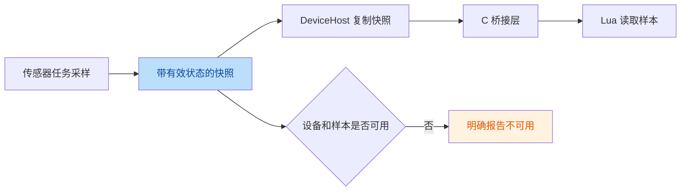
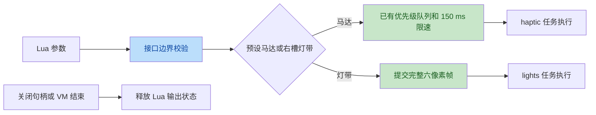

# Lua 硬件接口（N1）

Lua 应用通过传感器快照读取板载硬件，通过受限请求使用马达和右槽灯带。
传感器任务继续独占 I2C、ADC 和电容触摸外设；`haptic`、`lights` 任务继续执行输出。
Lua 的读操作不访问总线，也不重新配置传感器。

## 数据流



设备存在与样本有效是不同的状态。尚未收到样本、读数失败、交互板拔出都不能通过
返回零值伪装成有效测量。快照中的数值保留传感器单位；磁铁接近状态与磁场向量分开表示。



请求成功表示已接受执行，不表示马达动作或灯带传输已完成。
集成修复 `50ed8c7` 起，关闭震动会清空等待请求并取消执行中的输出；快速重新开启不
重放旧请求。RMT start / stop 报错会使后端不可用，直到重启，避免故障后继续排队或
误报已静音；实际停机时序仍需真机验证。

## 官方接口基线与板级限制

公开接口以 esp-claw
[`345073de68179542c307e303df81e38baadf77f0`](https://github.com/espressif/esp-claw/tree/345073de68179542c307e303df81e38baadf77f0/components/lua_modules)
的源码、README 和示例为准。官方镜像提取出的旧说明存在不同版本的签名与温度语义，
不能替代这个固定版本的契约。

| 模块 | 数据或操作 | 板级限制 |
| --- | --- | --- |
| `imu` | BMI270 原始加速度、角速度、温度与传感器计数 | 板载 `imu_sensor`，不开放外部总线构造 |
| `magnetometer` | BMM150 磁场向量、接近 / 接触状态 | 板载 `magnetometer_sensor`；BMM150 没有温度传感器 |
| `fuel_gauge` / `lib_fuel_gauge` | BQ27220 电量、电压、平均电流与充电状态 | 两个名字使用同一个快照适配器，不开放任意 I2C |
| `haptic` | 情绪引擎已有的预设震动图案 | 本项目扩展；固定版本的 esp-claw 没有该模块 |
| `led_strip` | 设置 RGB / HSV 像素、刷新、清空、释放 | 活动交互板在右槽时可用，GPIO38、最多 6 颗 LED |
| `button` | 两个交互板键的电平和回调 | 当前活动交互板；AI / BOOT 由 N2 板载域提供 |

IMU 的 `accel` / `gyro` 字段是芯片原始整数，不是传感器页面使用的 mg / dps。
`sens_time` 是采读辅助寄存器时的 BMI270 硬件计数；FIFO 中的加速度、角速度帧先于这次
采读，不能把该计数当作 FIFO 帧的精确时间戳。读取必需字段不完整时，`read()` 报告
样本不可用。
磁力计的 `raw_magnetic` 是经过芯片补偿、尚未应用 Lua 校准的磁场向量，不是寄存器整数。
`magnetic` 是应用 Lua 校准后的向量。BMM150 样本不提供 `temperature` 字段，
调用 `read_temperature()` 会报告不支持。
`proximity` 保留已有磁铁分类事件最近报告的状态；模块拔插引起基线重学时，原有分类器
不会自动产生释放事件。

`arg_schema` 的上游实现用于脚本参数默认值和归一化，会取整、截断到范围边界。
硬件 GPIO、像素下标和颜色通道使用严格校验，非法值直接报错，避免归一化后控制另一资源。
`arg_schema` 本身继续向应用提供原有接口。

## 调用方式与生命周期

```lua
local imu = require("imu").new({ device = "imu_sensor" })
local sample = imu:read()
print(sample.accel.x, sample.gyro.z, sample.sens_time)
imu:close()

local mag = require("magnetometer").new({ device = "magnetometer_sensor" })
print(mag:read().proximity) -- away / near / contact
mag:close()

local gauge = require("fuel_gauge").new({})
local battery = gauge:read()
print(battery.soc, battery.voltage_mv, battery.current_ma, battery.charging)
gauge:close()

require("haptic").play("happy")
local strip = require("led_strip").new(38, 6)
strip:set_pixel(0, 32, 0, 0)
strip:refresh()
strip:close()
```

`current_ma` 使用 BQ27220 的平均电流。`charging` 表示该平均电流大于零，不表示 USB
连接状态。`imu:read_int_status()` 与 `mag:read_int_status()` 不执行中断寄存器读写，
接口明确报告不支持。磁力计的校准只保存在当前句柄中，关闭后重置；它不会修改狐狸
情绪引擎的磁铁分类基线，也不写入持久存储。

马达只接受 `haptic.presets()` 列出的预设名称。灯带的 `set_pixel` 和 `set_pixel_hsv`
暂存颜色，`refresh` 提交完整帧，`clear` 提交全黑帧。系统灯光开关仍然控制最终输出。
应用退出、脚本失败、灯带句柄关闭或交互板拔出时释放 Lua 帧。

`button.new(pin [, active_level [, long_press_ms [, short_press_ms]]])` 接受当前活动交互板的
两个引脚（右槽 11 / 10，左槽 13 / 12）以及板载 AI GPIO7 / BOOT GPIO61。
省略或传入 0 时，长按阈值为 1500ms；交互板连击间隔默认为 400ms，板载 AI / BOOT
保持与原生按键一致的 180ms。显式非零 `short_press_ms` 仍按指定值生效。
连击要求上一次短按松开到下一次按下的间隔严格小于该阈值；达到或超过阈值时结束前一组
点击，不限制两次按下之间的总时长。长按独立处理，不计入短按连击；连续三次及以上短按
仍产生 `multiple_click`。`press_up` 的 `pressed_time_ms` 是该次按住时长，不是连击间隔。
事件先记录时间戳和顺序，只有 `button.dispatch()` 执行 Lua 回调；溢出明确报错。
活动交互板变化后旧按键句柄失效，应用需重新打开句柄。回调可以关闭句柄，关闭后同批
剩余回调不再执行；递归调用 `dispatch` 会报错。

硬件方法分别放在 `mosaico-lua/csrc/hardware/`，通过 `mosaico_hardware.c` 访问 Rust Host。
构建时将 Lua 方法嵌入固件，无需在设备文件系统部署这些模块。

## 示例兼容边界

| 官方示例 | 验证方式 |
| --- | --- |
| `imu_read.lua` | 保留原文件，用板载快照驱动 |
| `magnetometer_read.lua` | 保留原文件；BMM150 的温度显示为 `unavailable` |
| `button_events.lua` | 保留原文件，通过 `args.pin` 指定实际交互板按键 |
| `led_strip_rainbow.lua` | 原版固定 `LED_COUNT = 16`，板级示例改为 6；原版应被明确拒绝 |
| `fuel_gauge_read.lua` | 原版依赖 `i2c.new`；板级示例使用只读快照构造器 |
| `haptic` | 本项目预设模式测试，无对应官方示例 |

官方文件原样保留在 `mosaico-lua/vendor/esp-claw/hardware-contracts/`；LED 测试只替换
官方脚本中的颗数常量，fuel-gauge 测试单独执行板级构造。可推送的综合板级示例位于
`examples/lua-apps/hardware_probe/`。测试名称和验收记录区分原文与适配证据。
主机模拟快照上的脚本成功，只验证接口行为；板载读数、真实按键时序、马达波形和灯带显示
仍需通过真机验证。

## 验证入口

```sh
cargo test -p mosaico-lua --offline
cargo test -p mosaico-s31 --offline
./scripts/check.sh
```

`check.sh` 覆盖三个 crate 的主机测试、纯驱动测试、预览程序、ESP32-S31 release 构建和
ROM 符号冲突检查。真机验收还需覆盖模块拔插、应用退出 / 异常后的输出释放、150 ms
马达限速，以及新增采样对触摸延迟和显示帧率的影响。

## 2026-10-22 主机验收记录

基线提交：`80e362ebcccaed80c29fcb7c09ec4ebf5541f171`。工作树实现源码指纹：
`404088da88b24fc2a1eed6014b73d5cb396d5766898067e51b0d5da5908b2172`。
指纹对基线之后的修改及新增实现文件计算，排除 `docs/` 和 `*.md`：路径排序后逐项连接
`路径 + NUL + 文件 SHA-256 + LF`，再计算 SHA-256，共 33 个文件。

| 检查 | 结果 |
| --- | --- |
| `./scripts/check.sh` | PASS |
| mosaico-s31 主机测试 | 201 / 201 |
| mosaico-lua 主机测试 | 45 / 45，其中本轮新增 17 项 |
| mosaico-fs 主机测试 | 10 / 10 |
| 纯驱动测试 | 42 / 42 |
| preview / splash_preview | 均成功运行 |
| `cargo fw --offline` | ESP32-S31 release 构建成功 |
| ROM 符号冲突 | 627 个 C 符号，无冲突 |
| `cargo fmt --all -- --check`、`git diff --check` | PASS |
| 11 份官方参考文件 | 与固定 revision 参考文件逐字节一致 |
| 真机读数、按键、马达、灯带、拔插、触摸延迟与帧率 | **not-run**：未检测到 USB 串口，未烧录 |

固件 ELF：`target/riscv32imafc-unknown-none-elf/release/mosaico-s31-fw`。
SHA-256：`d84f945a93b5096cfe0376ecf13757cd17045e3a82b77db594cc689c9e3ea813`。
测试覆盖官方脚本兼容、非法参数、未知样本、正常零值、磁状态生产路径、按键时间线与
溢出、校准往返、灯带 GC / VM 退出 / 错误清理，以及综合示例的实际文本像素。

## 2026-10-23 真机验收记录

本记录使用北京时间。主机已验收的实现指纹仍为
`404088da88b24fc2a1eed6014b73d5cb396d5766898067e51b0d5da5908b2172`；
当日首次烧录的 ELF SHA-256 为
`d84f945a93b5096cfe0376ecf13757cd17045e3a82b77db594cc689c9e3ea813`。
后续诊断代码及诊断镜像须单独记录，不能覆盖这组已运行证据。

烧录使用 `scripts/flash-app.sh`。镜像 `target/mosaico-s31-n1-20261023.bin`
为 2,627,792 B，小于 `/data` 前 6,094,848 B 的限制，SHA-256：
`521fc8cfa198cbd80d0b9d4c28c319e173b3869a760d01cc3a54654da0bc8356`。
esptool 仅写 `0x210000`，实际擦除区间 `0x210000..0x491FFF`，返回
`Hash of data verified`。未改写 bootloader、分区表、出厂 `vibe_mode` 或 `/data` 区域。
之后通过正常推送协议向 `/data/apps` 安装验收应用。

| 检查 | 当前证据与边界 |
| --- | --- |
| 启动与存储 | BMI270、两颗 BMM150、BQ27220、Lua 任务在线；`/system` 与 `/data` 挂载成功，原 `hello_push` 保留 |
| 板级示例 | `hardware_probe` 正常结束，47,544 ms、600 帧；真实 `Key clicked` 回调已记录 |
| 接口探针 | `n1_contract_probe`：14 PASS / 0 FAIL / 0 SKIP；包含完整 IMU、磁状态、无温度接口、校准往返、电池别名与充电状态、LED 和两键 API |
| 实际读数示例 | 加速度原始值 `(2857,-1247,16084)`，陀螺仪 `(-1,3,-2)`，温度原始值 `5168`，IMU 状态 `0xD0`；磁场 `(-467.501,133.199,139.519)` µT，状态 `0x00`、`away`；电量 8%、3925 mV、平均 +64 mA、`charging=true` |
| 两枚右槽按键 | 首轮 GPIO11 / GPIO10 分别记录 22 / 17 个回调；含两键单击、右键双击、左键长按。后续生命周期窗口补获右键约 2080 ms 长按；左键双击仍未观测 |
| 灯带 | 操作者确认初始第 1 颗低亮红、第 6 颗低亮绿正常；API 清空与关闭成功。请求成功与实物颜色证据分别保留 |
| 交互板拔插 | 旧 LED 在拔出时报告 `hardware unavailable`，重插后报告 `LED board changed`；旧按键持续被拒绝。新 LED 和两键重新打开成功，操作者确认恢复后两端均为绿色 |
| 生命周期探针 | `n1_lifecycle_probe`：27 PASS / 0 FAIL / 5 SKIP；SKIP 包含该窗口未做出的双击及脚本无法自行测量的物理输出，不能把此汇总当作全部实物验收通过 |
| 异常退出 | `n1_error_probe` 在红绿灯请求后主动抛出 `N1_EXPECTED_FAILURE`，未主动清理；runner 3080 ms 后退出并回到 Launcher。异常后实物熄灭与再次打开还需独立证据 |
| 马达 | **实物验收未通过**：5 次 `haptic.error` 均被接受，任务记录 `3 × 60 ms, 100%` 且无 start/stop failure，但操作者手持仍报告完全无震动。不得将调度日志当成 PWM 波形或触感成功 |
| 更长马达预设 | 已运行 4 次 `Angry`，任务记录 `2 × 160 ms, 90%`，脚本正常结束；触感反馈待确认 |
| 帧率与丢帧 | 狐狸主页稳定区间 18–19 fps，启动/挂载阶段见 15 fps；全屏文本探针 11–13 fps，采样日志 `drop=0`。两种场景不能互相充当性能基线 |
| 传感器稳定性 | 首轮示例 IMU / BMM 读取错误计数均 0；接口探针阶段 IMU 累计读取错误由 0 增至 1，后续拔插与异常测试仍为 1，较长马达预设探针抓取中累计为 2。磁力计与传感器队列丢弃计数保持 0；日志没有 IMU 错误原因，不能认定零错误 |
| 触摸与时序 | 采样中屏幕触摸 `n=0`，触摸延迟尚未验收。CST9220 有周期性 `invalid report: Header` 警告，未取得同场景旧固件对照。马达物理脉宽/150 ms 间隔未测量 |

首次启动抓取在约 30 秒后发生 USB 断连，随后枚举为下载口；该次原因没有确认。
执行只读 `read-mac` 并复位后恢复应用，此后的多轮应用运行与交互板拔插未再出现
该断连。早期启动日志不完整，不能据此排除所有启动阶段错误。

原始日志、临时探针源码与首版 ELF 备份保存在本机
`target/n1-acceptance-20261023/`（Git 忽略目录）：`flash.log`、`boot.log`、
`boot-retry.log`、`hardware-probe.log`、`hardware-probe-exit.log`、
`contract-probe.log`、`lifecycle-probe.log`、`error-probe.log`、`haptic-angry.log`。
`source-manifest.json` 保留上述 33 个实现文件逐项指纹。

静态审查确认 100% duty 被编码为非零的 199 / 1 tick、ch0/ch1 RMT 内存区间不重叠、
S31 wrap 按通道配置；对照 BSP 未发现明确的 GPIO8 引脚或独立 enable 配置错误。
这些检查没有验证外设运行时状态。HAL 的连续发送成功和 immediate-stop 成功均不能
证明 PWM 持续输出。下一步用默认关闭的
`haptic-diagnostics` 功能读取 RMT 状态、中断、GPIO8 路由和触摸通道掩码；保留
现有波形、预设与限速，待运行寄存器证据定位后再决定修复。

### 原生 / Lua Angry 现场对照与预设差异

后续现场记录见 [2026-10-23 马达对照](N1_HAPTIC_LIVE_20261023.md)。同一运行镜像中，
原生 Angry → Lua Angry 四次 → 原生 Angry 的任务记录数分别为 1 / 4 / 1，操作者三段
均确认清晰震动。该场景触感对照通过；上表首次 Error 无触感及当时 Angry 缺反馈的
历史记录保留，不追改为当时已经通过。

随后四次 Lua Error 均进入任务，操作者仍报告无触感；带屏幕时点的同应用
Angry / Error 交替再次确认 Angry 有、Error 无。可见矩阵结果为首尾 Angry 正常、
Happy 微弱、Error / Panic 无触感。差异在同一 Lua 路径复现，尚无已证实的电气根因。

更新诊断版前读得的旧 main_app 首 512 字节与历史 BIN 匹配；它不等于完整旧应用
读回或全镜像校验通过。归档文件指纹、逐次日志、操作者观察及临时应用清理规则见
现场记录。集成诊断版已独立记录正常 Angry / Happy、无触感 Error / Panic；随后实验
单段 160 ms 各占空比均有触感的历史结果保留。最新同镜像对照中，旧 100% 三次均无，
两段高电平的新 100% 三次均有，且新 60/80ms 和原三段节奏均正常、结束能停振。
正式默认镜像 Angry/Happy/Error/Panic、震动设置关闭拒绝 / 重新开启恢复、左右槽
双击与长按已通过；真实执行中取消与电气时序仍待测。时钟修复后普通镜像的右槽
主页采样 n=65、P95=51ms（修复前74ms），50ms性能门槛仍未达标。操作者确认
约60次点按、主观无卡顿；日志65组down/up匹配。逐样本已确认
触摸释放被第二层去抖合并，相关修复的主机回放与后续设备结果分别保留。
操作条件见 [N1 清单](N1_TEST_CHECKLIST.md)，静态核对见
[测试前核对](lessons/n1-n7-preflight.md)。

### 历史 N1 马达诊断包

诊断改动仅包括默认关闭的 Cargo feature、`tasks/haptic/diagnostics.rs` 和三个调用点。
在前 10 个预设的第一段脉冲 `start` / `prestop` / `stop` 阶段读取寄存器，
不写寄存器、不清中断、不增加等待。`hd` 行中的 `t` 是单调毫秒，`c/s/i` 是
RMT ch0 CONF0 / STATUS / INT_RAW，`oe8` 是 GPIO8 输出使能，`m/o` 是引脚
mux / matrix，`tp` 是电容触摸扫描与输出掩码。它们是顺序读取，并非跨外设原子快照。

诊断改动后的实现指纹：
`bb512be223f0011d3994184d9006008c49134d89bbfda684736ac033b53c9469`，35 个文件，
逐项记录在 `target/n1-acceptance-20261023/diagnostics-source-manifest.json`。
此清单排除生成的 Python 缓存；后续归档到仓库的测试工具与探针另列最终工作树清单。

| 产物 | 大小 / SHA-256 |
| --- | --- |
| `target/n1-acceptance-20261023/haptic-diagnostics.elf` | `20a036a3abad867dd6e0917c2bca4bdd09b067a96c06b89e045e31426922f918` |
| `target/n1-acceptance-20261023/haptic-diagnostics.bin` | 2,628,944 B；`a2e1962c142fcd80418bbb4a88e3dca295822b915992b3ffb89be7936a6ebb9d` |
| `target/n1-acceptance-20261023/haptic-default.elf` | `a69fd66cc663e0bfa89a4f3932faba76d51b058f65e3ac4ce1a04e5f27e40d7b` |
| `target/n1-acceptance-20261023/haptic-default.bin` | 2,627,792 B；`29fbfd4a3ffcc599bd1fe6b91f0d6c7b454937fb9bfc34797277f8b05f6e6d30` |

`cargo fw --offline --features haptic-diagnostics` 和默认 `cargo fw --offline` 均通过，
两种构建的 ROM 检查均为 627 个 C 符号无冲突；格式检查、`git diff --check` 通过。
最终默认源码的 `./scripts/check.sh` 再次通过，共 298 项主机测试；主机预览、release 和
ROM 检查均通过，日志为 `target/n1-acceptance-20261023/final-host-check.log`。
常规 release 路径的 ELF 与上表 `haptic-default.elf` SHA-256 一致。

该轮结束时尚未将诊断包烧入设备，常规 release 路径为当时默认版；
`flash-app.sh` 会重新构建默认版，不能用它选择诊断功能。上表仅记录历史 N1 镜像，
只适用于旧布局；当前集成诊断包见 [测试前核对](lessons/n1-n7-preflight.md)。
ROM 写入前必须确认布局、镜像大小及目标地址；旧布局仍仅写 main_app `0x210000`。

### 集中复测入口

四个已实际运行的探针已原样保存到 `examples/lua-apps/n1_*_probe/`，并补充有限的密集
马达请求探针供后续物理限速测量。具体行为见 [N1_PROBES.md](../examples/lua-apps/N1_PROBES.md)。
`scripts/n1-device-session.py` 复用现有推送 API，增加有限写入 / 连接 / 日志采集时间、
UTC 起止标记与已有日志保护；11 项离线传输模拟通过，后续现场日志由该包装器采集。
新的限速探针也尚未在设备上运行。

主代理使用仓库的 Lua 5.5.1 源码编译仅解析、不执行的检查器，五个探针语法均通过，
日志为 `target/n1-acceptance-20261023/probe-syntax-check.log`。四个历史探针的八个文件
与原始真机记录目录逐字节相同。

包含固定探针和采集工具的最终实现清单为
`target/n1-acceptance-20261023/final-source-manifest.json`：47 个文件，指纹
`58e198e7f5acb7b7af76f15f21b77c7f2d565ad8203faf059edc0df07c134835`。
使用前述相同聚合算法、排除文档和生成缓存；其中诊断固件对应的 35 个实现文件未改变。

[N1_TEST_CHECKLIST.md](N1_TEST_CHECKLIST.md) 给出按顺序执行的命令、诊断镜像校验、
默认镜像恢复、人工观察表与通过条件。Lua 马达触感差异、异常 / 正常 / stop 后熄灭、
缺失手势、屏幕触摸、传感器错误及物理时序都继续保留为待解决项。
