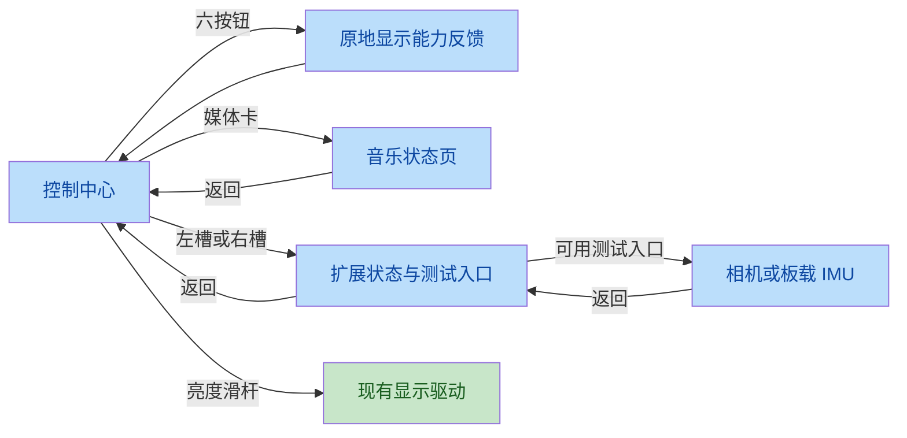

# ESP-Mosaico 官方 UI 设计规格（从官方场景源码提取）

> 来源：官方 esp-mosaico-claw 仓库 `components/mosaic_ui/` 的场景生成器（Python）
> 与出厂镜像解包资产。本文件是 Slint UI 重写的设计依据。
> 结构预览：`docs/mosaico-ui-preview.html`。控件的方向、遮罩和运行时显隐以官方生成器及 C 绑定为准。
> 提取日期：2026-09-30。

## 0. 官方 UI 的架构（决定我们抄什么、不抄什么）

```
GSP 场景包 (.gspb)  ←  gen_scene.py 场景定义  →  gspc 编译
      ↓ 设备端: GSP 引擎渲染
C 逻辑层 (mosaic_hub_app.c …)  ←  GSP_BIND_* 按 ID 绑定运行时数据
Lua 应用层  ←  require("display") screen API
```

**我们抄左边的"设计"（tokens/布局/组件/字体），不抄引擎**：渲染引擎换成 Slint 软件渲染器，逻辑绑定换成 Rust 属性驱动。场景生成器的 Python 代码 = 官方的"设计图纸"，坐标尺寸逐像素可抄。

## 1. 设计 Tokens（全部来自 `scene_common.py`）

### 1.1 颜色

| Token | 值 | 用途 |
|---|---|---|
| 屏幕底色 | `#000000` | 全局背景 |
| 文字主色 | `#FCFCFF` | 标题/数值/按钮字 |
| 文字次级 | `#91919B` | 标签/说明/副标题 |
| 文字弱化 | `#595959` | 提示、chevron |
| 文字禁用/标题栏 | `#D6D6DE` | 页面标题、次要项 |
| **强调橙** | `#FF4C01` | 品牌/激活态/滑块/进度（官方唯一的品牌强调色） |
| 深橙 | `#ED4600` / `#FF5B24` | 环境卡片圆点 |
| 成功绿 | `#63C270` / `#4FD66D` | 充电状态/有效指示 |
| 警告黄 | `#FFB020` | IMU 水平泡 |
| 危险红 | `#FF0000` | 低电量 |
| 卡片底 | `#181819` | 列表行/数据卡 |
| 卡片亮底 | `#282829` | 相机菜单按钮 |
| 浅色卡 | `#F9FAFB`（配 `#1A1A1A` 深字） | 环境温度卡/IMU 水平仪（深底页面里的亮卡） |
| 胶囊/遮罩 | `#3B3C3D`（边 `#9A9A9F`） | 顶部通知、相机工具条（opacity 160） |
| 下拉面板 | `#101011` | Quick Settings 抽屉 |
| 通知投影 | `#050505`（opacity 150，+2px 偏移） | 通知胶囊的阴影层 |

### 1.2 字号体系（NotoSansSC + DejaVu Sans）

| 字号 | 用途 |
|---|---|
| 16 | 行内标签/说明/按钮小字 |
| 18 | 默认正文/数值 |
| 20/22/24 | 值/页标题（状态栏时间 24） |
| 26/30 | chevron/列表页大标题 |
| 36/48 | 大数值（IMU 卡） |
| 75 | 环境数据大数字 |
| **120** | TOF 英雄数字（bold 字体） |

### 1.3 几何

- 帧缓冲 480×480，无逻辑偏移（`CONTENT = SCREEN = 480`）；物理屏角存在黑色圆弧遮挡，关键内容需保留安全区。
- 圆角体系：按钮 12/16/19、卡片 20/28/40、通知胶囊 24、IMU 水平仪 43。
- 设置列表：**行高 68 + 间距 8（步距 76）**，标题 30px，行标签 24px，值 22px 右对齐，chevron `›` 26px。
- 状态栏：时间 24px @(20,12)，右侧图标 40×40 间距 7px，电池贴右 24px。
- `scene_common.py` 的 `page_dots()` 工具函数定义了页点和 Home 按钮，但当前官方 Hub 生成器未调用，实际场景没有该 Home 对象。当前适配删除误加的 Home，使用横滑和居中页点切页。

## 2. 屏幕清单（本次从场景源码 JSON 化的全部 12 个）

| 场景 | 对象数 | 内容 |
|---|---|---|
| **Mosaic Hub** | 554 | 主界面：StackView（launcher/通知中心/插入通知）+ PageFlow（Home\|Apps 两页）+ 顶部 Drawer + 169px Atelier 模拟时钟（15 个 arc 组成）+ 磁贴网格 |
| Settings | 391 | 多级列表（StackView 推入/弹出）+ toggle/dropdown/键盘 + 亮度/音量 Quick Shade |
| Setup Center | 343 | 开机引导向导 |
| AI Create | 233 | AI 对话/生成（message_list） |
| Music | 83 | 播放器（封面/滑杆/进度） |
| Works | 73 | 作品集 |
| Album | 42 | 相册（grid 九宫格） |
| Weather | 36 | 天气（forecast 图标族） |
| Breakout | 35 | 打砖块游戏 |
| Env | 29 | 环境传感器（大数字卡） |
| TOF | 20 | 测距（120px 英雄数字 + 标尺 + 阈值滑杆） |
| IMU | 19 | 水平仪（亮色表盘 + 气泡 + 三卡） |

## 3. 官方组件库（`scene_common.py` 提供的标准件）

| 组件 | 规格 |
|---|---|
| `status_bar` | 时间 + Agent 图标 + WiFi 五档 + 电池（idle/low/charging 三态，连续填充，充电整体变绿） |
| `top_notice` | 顶部通知胶囊：投影层+胶囊+橙色"i"圆点+标题(20px 橙)+消息(18px 白)，几何固定全局一致 |
| `settings_list_row` | 68px 行：左 24px 标签、右 22px 值 + `›`；可导航行是 button(bg #181819 r20) |
| `settings_nav_header` | 根页：橙方块 22×22 + 30px 标题 #D6D6DE；子页：96×64 返回热区 + 居中 24px 标题 |
| `build_settings_quick_shade` | 下拉快捷面板：456px 高面板 + VOLUME/BRIGHTNESS 双卡(222×128 r28) + 滑杆(橙) |
| `page_dots` | 未被当前官方 Hub 调用的工具函数；不能据其定义向页面添加 Home 按钮 |
| `imu_horizon` | 亮色仪表：#F9FAFB r43 + 十字线 + 76px 琥珀气泡(数字绑定) + 三张数据卡(141×106 r20) |

## 4. Slint 重写映射方案

| 官方 | 我们的对应 |
|---|---|
| GSP 场景 JSON（554 对象） | `.slint` 组件树（视觉 1:1 按 scene JSON 坐标） |
| `GSP_BIND_*` 运行时绑定 | Slint `in-out property` + Rust 主循环驱动（现有模式） |
| stack_push/pop / drawer / page_flow | Slint 状态机 + `states` + 位移动画（或先用显隐切换） |
| arc 时钟 | Slint `Path` 或预渲染指针贴图旋转 |
| NotoSansSC sub.ttf | `.slint` `import` 字体内嵌（现有字体管线） |
| 场景包热装 | 不做（我们编译进固件；Lua 工具层承担运行时可变性） |

### 已知差异/取舍

1. 官方字体是双字体（DejaVu Sans 拉丁 + NotoSansSC 中文）+ 按字符集子集化（font_charset 策略）——我们统一 NotoSansSC 子集，Slint 嵌入规则沿用现有 `import` 内嵌。
2. 官方 arc/progress/slider 带运行时绑定（时钟走秒、电量连续填充）——第一版 Slint 静态呈现，交互后补。
3. 图片资产（175 张 PNG：图标/背景/预测图）在官方仓库，可直接拷入我们 `assets/`（Apache-2.0）。

## 5. 验收基准

官方 `hub/scene/gen_scenes.py`、`common/scene_common.py` 和 `hub/mosaic_hub_app.c` 分别提供布局、资产和交互依据。源码基线提交为 `9ea326da1f2a017ba81f1d391862f977b355a03e`。

`docs/mosaico-ui-preview.html` 内嵌图标、字体和场景数据，可用于结构检查；其通用渲染器未完整处理竖向 progress/slider 和透明输入层，不能直接用作控制中心的像素验收结果。控制中心对照应包含真实 `control_center/capsule_mask_72.png`，并按底部向上填充滑杆。

## 6. 圆角屏与控制中心适配

控制中心保留官方四组卡片、六按钮顺序、媒体转盘、左右槽位和胶囊滑杆。以下几何为圆角屏适配值；官方原值用于逐项核对，避免父层坐标、缩放和素材语义混淆。

| 部位 | 官方基线 | 适配约定 |
|---|---|---|
| 顶栏 | 高 54px，时间 x=20 | 高 48px，时间内收至 x=32 |
| 六按钮卡 | `(12,54,220,286)`，r60 | `(24,48,208,270)`，保留 72px 按钮及官方图标 |
| 媒体卡 | `(248,54,220,206)`，r60 | `(248,48,208,190)`，转盘和播放图标恢复；整卡进入音乐状态页 |
| 槽位卡 | `(12,356,220,116)`，r44 | `(24,334,208,112)`，左右图标分别打开扩展测试入口 |
| 滑杆卡 | `(248,276,220,196)`，r60 | `(248,254,208,192)`，滑杆位于全局 y=274…426 |
| 胶囊滑杆 | 72×152，r36，官方遮罩 | 尺寸及遮罩保持；音量图标 40px、亮度图标 32px，底部留 13px |
| 屏角 | 官方源码未提供物理半径 | 默认 60px 作为可调整的显示与输入安全区假设，待实机校准 |
| Hub 底部 | 实际场景无 Home 对象 | 删除误加的 Home，居中页点保留明确、不重叠的点击范围 |

按钮顺序为 Wi-Fi / Join、Bluetooth / Low Power、Ringtone / Vibration。官方 Join、Bluetooth、Low Power、Ringtone 本身只显示 `Not Supported`；当前 Rust 固件尚无 Wi-Fi、音频、振动等后端时，点击必须给出具体不可用反馈，激活色只表示已确认的实际状态。音量可保留 UI 设定值，实际输出需要音频驱动；亮度继续连接显示驱动。

扩展测试页区分左槽、右槽与板载 IMU。槽位尚未扫描时显示 `Not checked`，不能显示虚构的已连接模块或把未扫描等同于空槽。相机沿用左槽采集路径；测试页返回恢复入口，覆盖层继续控制相机及游戏的暂停与恢复。


