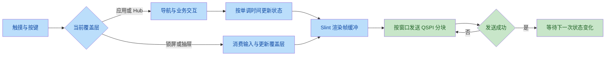
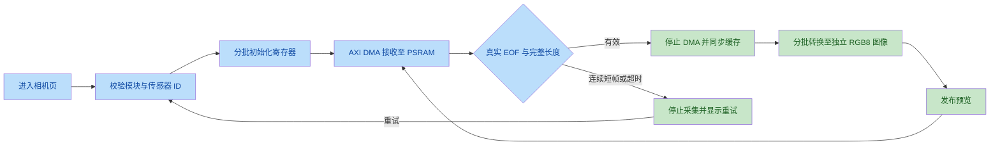

# Mosaic UI 审查与验收（2026-09-30）

基线为 `MOSAICO_UI_ROADMAP.md` 所描述的 v27 工作区：Slint Mosaic 固件界面、ESP32-S31 平台层和显示/触摸/IMU/游戏驱动。桌面保留旧风扇界面；固件只能编入 Mosaic 根组件。M4 网络依赖阻塞、M5 Lua 立项、动态时钟指针及 TOF/NAND 驱动继续按路线图单列；左槽相机预览的新增接入与验收见下文。

## 修复计划与范围

1. 统一 Hub、应用页和返回路径，消除不可达入口与覆盖应用内容的导航层。
2. 完成抽屉打开、亮度调节、锁屏上滑和覆盖层输入隔离；接通 TOF 阈值状态。
3. 修正 CO5300 命令格式、分块窗口与失败重试，接通亮度寄存器。
4. 完成 BMI270 配置装载、就绪检查和真实加速度读取，统一水平仪坐标与无数据状态。
5. 按单调时间调度游戏和采样，暂停隐藏游戏，支持游戏结束后重开，移除游戏回调中的裸指针。
6. 解除 GPIO12 的默认 PWM 占用，保留可见的风扇数据卡。
7. 恢复检查脚本，分别验证桌面 UI、Mosaic UI 和 MCU 固件。

## 审查记录

以下问题由主审查及两次独立复核确认；严重度以实际功能影响为依据。P1 表示阻止硬件或主要功能正确运行，P2 表示局部交互、计时或恢复错误。

| 编号 | 级别 | 基线问题与触发条件 | 修复验收条件 |
|---|---|---|---|
| R1 | P1 | `platform_mosaic.rs` 只处理 Apps 的 0/1/4，Album、Weather、Breakout 不能从网格进入；Music/Bricks 编号与页面不一致。Home 不清应用状态，状态栏和页点覆盖应用，游戏触摸层覆盖退出按钮。 | 每个入口到达对应页面；返回恢复正确 Hub 页；游戏退出可点击。 |
| R2 | P1 | 抽屉没有打开路径，Settings 亮度行为空操作；锁屏提示上滑却点击即解锁；抽屉空白区域未阻断底层触摸。 | 抽屉可打开/关闭；锁屏点击不解锁、向上滑动解锁；覆盖层不会触发底层操作。 |
| R3 | P1 | BMI270 从 `0x3C` 读取加速度，复位后未装载配置或完成 INIT；水平仪在无数据时显示 0°，气泡的绝对/局部坐标混用。 | 装载真实 Bosch 配置并检查状态；从 `0x0C` 读取 16 位加速度；故障显示无数据，水平时气泡居中。 |
| R4 | P2 | 游戏和 IMU 以循环次数计时，渲染耗时改变实际速度；锁屏/抽屉期间游戏继续且触摸仍影响挡板；循环重复注册持有裸指针的回调。 | 单调时间调度；暂停期间不推进游戏；回调安全且只注册一次。 |
| R5 | P2 | 耗尽三条生命后仍提示开始，但 `Game::start()` 拒绝 `lives == 0`，无法再次游戏。 | 游戏结束后的开始操作恢复初始生命、分数、砖阵和球。 |
| R6 | P1 | CO5300 地址使用 `reg << 16` 且地址/参数走四线，与官方单线 `[opcode, 0, reg, 0]` 格式不符；每个分块重复全窗 RAMWR，失败后静止 UI 没有重试。 | 命令格式与官方源一致；分块覆盖各自区域；失败帧在没有新渲染时仍重试。 |
| R7 | P1 | 检查脚本引用已删除 `wide` feature、已删除的触摸协议文件；embedded 测试仍引用桌面的 `FanControlUI`。 | 检查入口可执行，测试实际代码；固件依赖和编译产物不包含桌面后端/旧 UI。 |
| R8 | P2 | UI 的亮度属性没有送到 `Display::set_brightness()`，数值与面板不一致。 | 启动时和数值变化时下发 `0x51`；失败可重试；百分比状态一致。 |
| R9 | P1 | GPIO12 默认初始化 RMT 并持续驱动 75%，与左槽相机 D5、交互模块 KEY_R、摇杆键 3 复用。 | 未建立槽位仲裁时不默认驱动 GPIO12；显式外部风扇配置有明确前提。 |
| R10 | P2 | TOF 阈值回调未接到根状态，414px 滑杆把鼠标像素直接截到 100，无法按全长调节。 | 阈值按滑杆全长映射到 0–100，并在 UI 保存和显示。 |
| R11 | P1 | CST9220 的 `write_reg_raw()` 丢弃 16 位地址低字节，`0xD101` 只发送 `D1`，报告 ACK 发送 `D0 AB`；寄存器读取也经过此路径。 | 初始化、读取和 ACK 均发送完整高/低字节；测试调用生产代码的编码与解析函数。 |
| R12 | P2 | 软件截图中 AtelierClock 两条路径按各自包围盒拉满 169×169，细指针变为巨大交叉；抽屉图标按原始 118px 绘制，越出 72px 磁贴并覆盖相邻项。 | 时钟使用固定 viewbox 保留指针坐标；抽屉图标限制在磁贴内；截图验证对应几何范围。 |
| R13 | P1 | 板端主界面显示正常但触摸完全无效。`board.rs` 和 `touch.rs` 将已是 7-bit 的 `0x5A` 再右移为 `0x2D`，无法寻址实际触摸控制器；初始化失败后 `touch=None`，平台不再轮询触摸。 | `TOUCH_I2C_ADDR=0x5A`，驱动统一引用；刷入后实际点击、抬起与拖动能操作界面。 |
| R14 | P2 | Hub 的 `page` 只有页点和 Home 按钮入口，没有横滑切页；实机触摸恢复后仍无法左右切换 Home/Apps。 | 横滑在抬手时切换一页；图标起手、短拖、反向和页面边界不误触应用。 |
| R15 | P2 | 控制面板只有底部把手点击关闭，没有上滑收起；与亮度/音量滑杆共用纵向触摸区域。 | 滑杆起手始终调节原滑杆，其余区域可上滑收起；关闭后的释放事件不触发底层按钮。 |
| R16 | P1 | 左槽已安装相机，页面的 `detected` 却固定为 false；固件没有模块识别、传感器初始化、DVP 采集和图像发布路径。 | 校验左槽模块身份和传感器 ID，按实际像素格式发布完整帧；错误可区分、重试可用、退出可取消采集。 |
| R17 | P2 | Home/Apps 漏掉官方 `launcher_flow.y=56` 的父层偏移，状态栏与 Apps 首行图标重叠；天气文案和时钟误嵌入背景卡片，另多出 `(13,10)` 偏移；浅色表盘上的指针误用白色。 | 内容位于状态栏下方，天气和时钟坐标按官方父层还原；指针及中心点使用官方深色 `#202124`，修正后的入口仍通过输入回归。 |
| R18 | P2 | 控制中心用相机、烧瓶等应用图标代替控制图标；竖滑杆依赖软件渲染器不支持的圆角子元素裁切，填充露出方形端部；媒体卡为空。 | 使用官方 control_center 素材和 72×152 抗锯齿胶囊遮罩；五档填充不越出端帽，音量/亮度图标完整，媒体入口可见。 |
| R19 | P2 | 六按钮只有部分回调且无后端反馈，左右槽位是不可点击的图像；设置 WLAN/About 也不能提供有效状态。 | 六按钮有原地反馈，不伪造已开启；媒体、左右扩展测试和设置状态入口可达，返回恢复原页面与抽屉。 |
| R20 | P2 | 从未被官方 Hub 调用的 page_dots helper 误引入 Home 按钮；布局及触点未考虑物理屏角的黑色圆弧。 | 移除 Home，居中页点；滑杆与槽位内收，显示和输入采用同一可调安全区，圆弧外起手不能移入后触发控件。 |
| R21 | P2 | 未扫描槽位的官方空槽素材包含 EMPTY；风扇未测量却可显示 28°C/0 RPM；未接入存储却显示 empty。 | 槽位显示中性 TEST 与未检查状态；风扇按有效性显示 `--`；存储显示 unavailable，不推断硬件缺失。 |
| R22 | P2 | Home 天气卡遗漏官方 app_weather 点击入口；Apps 标签、锁屏日期前缀和设置列表的文字布局与对应官方结构不一致。 | 天气卡点击可达且拖动取消点击；Apps 恢复 18px 主色标签，日期前缀右对齐，设置列表文字竖向居中。 |

显示协议证据来自官方 `esp-mosaico-claw` 提交 `9ea326da1f2a017ba81f1d391862f977b355a03e` 的 `components/mosaico_boot_splash/bootloader/mosaico_boot_splash.c`：`lcd_command()`、`lcd_begin_pixels()` 和 `spi_tx()`。引脚及 BMI270 初始化依据来自官方 BSP 提交 `a4bfb426afcf2911c01fdd9b6d6f024019f00f8f` 的 `onboard/sensors.c` 及 [硬件说明](MOSAICO_V12_HARDWARE.md)。

## 运行流程与验收边界



```mermaid
sequenceDiagram
    participant UI as Slint 状态
    participant FB as RGB565 帧缓冲
    participant Loop as 平台循环
    participant LCD as CO5300
    UI->>FB: 按脏区渲染
    FB->>Loop: 标记帧待发布
    Loop->>LCD: CASET + 逐块 RASET/RAMWR
    alt 任一事务失败
        LCD-->>Loop: 失败结果
        Loop->>FB: 保留当前帧与待发布状态
        Loop->>LCD: 下一轮重新发送完整帧
    else 完整帧成功
        LCD-->>Loop: 成功结果
        Loop->>FB: 允许下一次渲染
    end
```

基线结果：`fan-core` 两项测试通过，MCU release 构建通过；`cargo fmt --all -- --check` 未通过，软件渲染命令因缺少 `wide` feature 提前失败。这说明构建成功不能代表页面可达、协议正确或验收入口有效。

## 修复结果与代码入口

R1–R17 已完成代码修复和软件回归。R13 来自首次刷入后的触摸故障复查，已通过板端确认；R14–R17 来自随后操作验收及截图复查，新版板端验证尚未完成。审查后补充的触点规则同样落地：在锁屏开始的上滑手势，即使已经解锁，也不能在抬手前接管游戏挡板；游戏触点在显示覆盖层时立即失效。

| 范围 | 实现入口 |
|---|---|
| 导航、覆盖层、亮度和阈值 | [`mosaic.slint`](../crates/fan-ui/ui/mosaic/mosaic.slint)、[`quick-drawer.slint`](../crates/fan-ui/ui/mosaic/quick-drawer.slint)、[`lock-screen.slint`](../crates/fan-ui/ui/mosaic/lock-screen.slint) |
| 显示协议、分块及发布结果 | [`display.rs`](../crates/fan-firmware/src/drivers/display.rs) |
| 触摸命令和解析 | [`touch/protocol.rs`](../crates/fan-firmware/src/drivers/touch/protocol.rs)、[`touch.rs`](../crates/fan-firmware/src/drivers/touch.rs) |
| BMI270 初始化与读取 | [`imu/protocol.rs`](../crates/fan-firmware/src/drivers/imu/protocol.rs)、[Bosch 配置来源](../crates/fan-firmware/src/drivers/imu/SOURCE.md) |
| 定时、触点和重试状态 | [`runtime.rs`](../crates/fan-firmware/src/runtime.rs)、[`platform_mosaic.rs`](../crates/fan-firmware/src/platform_mosaic.rs) |
| GPIO12 初始状态 | [`app.rs`](../crates/fan-firmware/src/app.rs)、[`fan.rs`](../crates/fan-firmware/src/drivers/fan.rs) |
| 软件渲染与交互回归 | [`mosaic_rendering.rs`](../crates/fan-ui/tests/mosaic_rendering.rs)、[`software_rendering.rs`](../crates/fan-ui/tests/software_rendering.rs) |

## 验收结果

**R14–R17 修复包通过统一检查，共 50 项测试，默认 release 构建无警告；已写入板端并通过设备摘要校验，已执行 watchdog 复位，等待新版板端验收。** 前一版 R13 的触摸和亮度已通过现场确认；新增手势、布局与相机预览仍需实机操作确认。

前一轮 R13 修复包的 `./scripts/check.sh` 完整通过，共 39 项测试，检查项目如下。新增的 11 项相机测试及本轮扩展输入回归见“手势、布局与相机预览修复包”。宿主触摸测试覆盖报文编码和解析，不验证物理控制器是否响应 I2C 地址。

| 检查 | 结果 |
|---|---|
| 全仓 Rust 格式 | 通过 |
| 核心风扇策略与 UI 状态单元测试 | 2 + 6 项通过 |
| 桌面 RGB565 渲染 / Mosaic 输入与渲染 | 各 1 项综合回归通过 |
| 渲染器脏区/路径单元测试 | 7 项通过 |
| CST9220 生产协议 | 4 项通过 |
| 调度/暂停/触点/帧与亮度重试 | 6 项通过 |
| 游戏重开/边界/暂停 | 3 项通过 |
| BMI270 配置装载、就绪、失败及有符号换算 | 4 项通过 |
| 桌面模拟器 | 5 项测试及 `cargo check` 通过 |
| MCU 默认 release | 通过 |
| `fan-pwm-gpio12,lcd-color-test` 组合 release | 通过 |
| MCU 运行时依赖隔离 | 通过；无桌面窗口后端或 IDF 运行时库 |

Mosaic 综合回归通过实际指针事件覆盖所有 Apps/Home 入口与返回、抽屉打开/关闭与空白隔离、锁屏点击/短移/上滑、亮度回调、TOF 五档与越界拖动、天气属性透传和 IMU 气泡像素质心。关键页面与覆盖层的 `ReusedBuffer` 帧与独立 `NewBuffer` 根逐像素相同。软件截图复查确认细时针和抽屉图标不再溢出。

首次审查修复包的本地验证产物：

- `target/mosaico-review/check.log`：完整检查日志。
- `target/mosaico-review/frames/`：Mosaic 页面的 PPM/PNG 和 `mosaic-review-contact-sheet.png` 汇总图；数据为主机测试夹具。
- `target/mosaico-review/fan-control-review-app.bin`：默认 release 的 app 镜像，已写入板端 `0x20000` 并通过摘要校验。
- `target/mosaico-review/esptool-verify-final.log`：板端全部 app 字节与镜像的摘要匹配记录。
- `target/mosaico-review/reset.log`：校验后的 watchdog 复位记录。

ELF 为 4,958,344 字节；app 为 3,869,376 字节（3.690 MiB）。app 的 ESP image magic 和尾部 SHA-256 校验通过，占实际 factory 分区 `0x20000 / 0x7D0000` 容量的 47.23%。ELF 存在 `MosaicApp` 符号且未发现 `FanControlUI` 符号；编译根和依赖检查共同确认了双 UI 分流。

app SHA-256：`6ab463c528c0daaaf52478f138f1d9df31c762f98d556824b0fdb94600311d3f`。

### 固件写入与启动记录（2026-09-30）

设备识别为 ESP32-S31 revision v0.0，Flash 为 16 MB，下载连接为 USB-OTG `/dev/cu.usbmodem11201`。本次仅写入 app `0x20000`，未改写官方 bootloader 和分区表。

`espflash 4.6.0` 的默认 stub 上传在 `MemData` 超时；切换 ROM 模式写入后，结束阶段报告 `FlashEnd / Other (0x1)`。重新进入 BOOT 后，`esptool 5.4.0` 对 `0x20000` 起始的全部 3,869,376 字节执行 `verify-flash`，返回 `Verification successful (digest matched)`，确认板端镜像完整。随后 watchdog 复位成功执行，现场人工确认屏幕显示 Mosaic 主界面。

复位后下载用的 USB-OTG 串口消失，本次未采集到应用启动日志。主界面显示确认了基本启动；DMA 心跳、触摸、亮度和 IMU 等运行状态仍按下列板端项目验收。

### 触摸无响应复查与修复

初版启动后，现场操作确认触摸无效。官方 Claw 提交 `9ea326da1f2a017ba81f1d391862f977b355a03e` 的 `boards/esp_mosaico/board_devices.yaml` 将触摸地址配置为 `0xB4`；`app_claw_hw_bridge.c` 明确将该 8-bit 地址右移一位得到 7-bit 地址。锁定的 `esp-hal` revision `bb239a0` 接口接受右对齐的 7-bit 地址，并自行编码读写位。原驱动误将 `0x5A` 再右移一次，是两次独立复核均确认的寻址错误。

官方 `esp_lcd_touch_cst9220` v0.1.1 对应 `esp-iot-solution` 提交 `8eee17c20da66048faa20c683ffeb80bfa85d723`；其头文件直接定义地址宏为 `0x5A`。该版本源码同时确认了现有双字节命令、分离读事务、报告 ACK、身份探测和触点格式，未发现第二个可解释全触摸失效的协议差异。核验副本保存在 `target/mosaico-touch-fix/upstream/cst9220-0.1.1/`。


代码修复集中于 `board.rs`、`drivers/touch.rs` 和 `drivers/shared_i2c.rs`：更正地址、删除重复定义并修正文档注释。所有寄存器命令、报告读取及 ACK 均使用同一板级地址。原有报文协议、平台事件和 Slint 页面保持原实现；独立复核确认初始界面没有吞掉全屏输入的覆盖层。

官方 `ESP-Mosaico-Claw_v0.4.0.bin` 已只读检查，包含 CST9220 初始化及 HYN212 协议实现标识；文件 SHA-256 为 `4f824d92dded187109e35115db1336bda9b9032b3313dad1b7baa1252118b76b`。设备地址结论来自上述官方配置与 HAL 接口，未将固件中的字符串识别视为总线实测。

修复版产物位于 `target/mosaico-touch-fix/`：`check.log` 为完整检查日志，`fan-control-touch-fix.elf` 为对应 release ELF，`fan-control-touch-fix-app.bin` 为应用镜像，`image-manifest.json` 保存镜像及修改源文件摘要。app 为 3,869,376 字节，ESP image 尾部校验及实际 factory 分区容量检查通过；SHA-256 为 `4babd2832f03e4282c57fe2cfae6141ebedbc59b2643e8528e41ce19f78e4ba6`。

修复版已通过 `esptool 5.4.0 --no-stub write-flash --compress` 写入 `0x20000`。工具报告完整写入 3,869,376 字节，返回 `Hash of data verified`，随后 watchdog 复位成功执行；完整记录为 `target/mosaico-touch-fix/flash.log`。

现场反馈确认触摸和实际亮度调节已恢复，下拉面板可以打开。进一步验收发现：Home/Apps 缺少左右滑动切页，控制面板缺少上滑收起；左槽已安装相机，但相机页仍显示未检测。界面样式问题待实机照片比对，整体功能验收仍未通过。

该轮操作验收触发的修复范围与验收条件：

| 项目 | 已确认的代码原因 | 验收条件 |
|---|---|---|
| Hub 横滑切页 | `page` 只有页点点击入口，没有横向手势处理。 | Home/Apps 可左右滑动；从图标起手的滑动不误点击，短拖与边界手势行为明确。 |
| 控制面板上滑收起 | 仅底部把手的 `clicked` 触发关闭，没有上滑处理。 | 面板可上滑关闭；亮度和音量滑杆保留拖动控制权；关闭手势不触发底层页面。 |
| 左槽相机预览 | `AppCamera.detected` 默认 false，根未提供真实检测结果，固件未实现传感器初始化与采集。 | 读取真实传感器 ID，按官方配置启动，校验完整帧后发布预览；失败可重试，退出相机后触摸可用。 |

相机接入以真实预览为范围。NAND 持久存储仍待实现，拍照保存不计入完成状态。

### 手势、布局与相机预览修复包

Hub 和控制面板使用 Slint 的 `SwipeGestureHandler` 处理子控件上的拖动。Hub 在释放时检查 60px 位移和 1.5 倍主轴优势，再切换 Home/Apps；识别到拖动后取消子控件点击。控制面板按按下位置确定滑杆或关闭操作：滑杆起手即使移出轨道仍更新原滑杆，其他区域的上滑关闭面板并消费释放事件。Hub 导航也位于同一识别容器内，顶部下拉入口保留优先处理。

布局依据为官方 Hub 场景的完整父子坐标：`launcher_flow=(0,56,480,424)`；天气文案和时钟直接属于 tab。修复恢复这层 56px 偏移，去掉错误卡片嵌套产生的 `(13,10)` 偏移，并将静态指针和中心点改为官方 `#202124`。软件截图确认 Apps 状态栏不再压住首行图标，浅色表盘上的指针可见。

相机由 `drivers/camera.rs` 和平台循环接入。I2C1 使用 100ms 事务超时，先校验左槽 EEPROM 的 magic、三段 CRC 和相机类型，再按两种传感器的 SCCB 地址、寄存器宽度及 PWDN 极性检测。初始化每轮最多写四条寄存器，采集和转换均分阶段运行；显示继续使用 AXI CH0，相机使用 AXI CH1。进入相机后保存 USB 复用状态，退出或失败时停止 DMA、暂停传感器并恢复相关 USB pad/中断设置。启用 `fan-pwm-gpio12` 时，相机显示资源冲突并保持禁用。



OV3640 使用官方 RGB565_LE 640×480 表，SC101IOT 使用 UYVY 640×480 表。两个寄存器表分别有 89 和 198 条，已独立核对顺序和值，来源、许可及 SHA-256 见 [`camera/SOURCE.md`](../crates/fan-firmware/src/drivers/camera/SOURCE.md)。有效帧必须有首个 VSYNC EOF，长度在 614,400 字节及官方 64 字节尾缓冲范围内；停止后再同步缓存并复核接收长度。短帧最多尝试三次同步，1 秒超时或 DMA 错误立即进入错误状态。转换按每轮 16 行执行，将中央裁剪区域逆时针旋转 90°，生成 320×320 RGB8 图像；全部转换完成后才设置预览就绪。

两次独立复核确认 R14–R17 的问题存在，并核对修复实现；主审检查了 DMA 通道、缓存同步、帧边界、取消/重试与官方初始化表。回归覆盖实际指针事件、方向和阈值、已转交给图标的按下事件取消、按钮/页点起手、滑杆越界、关闭防误触、Camera 图像与 ready/retry 绑定。新增 11 项相机测试验证两种地址/协议、ID、EEPROM、初始化失败、取消/重试、帧长/超时/错误，以及像素色序和旋转。测试图像是主机夹具，不能视为板端采集证据。

本轮产物目录为 `target/mosaico-gesture-camera/`：

- `check.log`：最终统一检查日志，共 50 项测试，默认 MCU release 无警告。
- `source/` 与 `source-manifest.json`：冻结源码及文件摘要。
- `frames/`：输入回归生成的 Home/Apps/Drawer 和相机状态截图。
- `fan-control-gesture-camera.elf`：5,075,564 字节。
- `fan-control-gesture-camera-app.bin`：3,935,376 字节，占实际 factory 分区 `0x20000 / 0x7D0000` 的 48.04%。
- `image-manifest.json`：ESP image 校验和、尾部 SHA-256、分区容量及产物摘要。
- `flash.log` 与 `flash-result.json`：esptool 5.4.0 写入、设备摘要校验及 watchdog 复位记录，进程退出码为 0。

app SHA-256：`758d0cbd97367376c6772beb9a437f91bdbcb3199b8b1a3589e739ac482aec6c`。该包已写入 `0x20000`，日志确认 `Hash of data verified.`；新版手势、布局与相机预览待板端验收。

## 控制中心与圆角屏重构（R18–R22）

本轮按官方生成器的实际调用链、运行时回调和原始素材复核。`common/scene_common.py` 虽定义带 Home 的 `page_dots()`，当前 `hub/scene/gen_scenes.py` 未调用，554 个 Hub 场景对象中没有 `back_home`。旧预览 HTML 的竖向 progress/slider 渲染也不完整；此次控制中心参考图直接按场景方向和原始胶囊遮罩重建，不能将其称为官方固件实拍。

几何及交互合同见 [设计规格的圆角屏适配](MOSAICO_UI_DESIGN.md#6-圆角屏与控制中心适配)。控制中心保留官方图标、四卡分组和六按钮顺序，缩短顶栏与上部卡片，把两条滑杆的底边从 y=450 上移到 y=426。圆角半径 60px 是可调整的布局假设，尚无物理测量依据。四个小 Path 只绘制屏角；实际指针分发根据同一半径决定起手是否有效，可见区域起手后移到屏角仍保留滑杆归属，单次 I2C 失败不解除该归属。

六个快捷按钮在抽屉内显示具体反馈，单个 2.5 秒计时器负责清除；重复点击重新计时。Wi-Fi、Join、Bluetooth、Low Power、Ringtone、Vibration 的实际后端能力仍按驱动状态判定，本轮没有把提示反馈算作硬件功能完成。音乐卡进入状态页；左右槽位进入测试选择页，相机沿用左槽采集，IMU 明确标为板载传感器，TOF/Interact 显示当前不可用。返回路径覆盖设置→抽屉→槽位→测试页→槽位→抽屉→设置。

软件截图复查还发现新状态页的 Header 和屏角 Path 未显式定位时会被 Slint 居中；两者都已指定坐标，并通过真实点击和像素比较验收。风扇转速和温度由有效性字段控制，存储不可用与空存储分开呈现。

本轮验证与产物记录位于 `target/mosaico-ui-refactor/`；最终统一检查、镜像及板端状态随产物完成更新。

## 板端验收与剩余范围

主机上的输入、渲染和模拟总线测试覆盖软件行为，以下板端项目仍待执行：

1. 冷启动后 CO5300 全屏 15 块位置正确，连续切页没有重复行、缺块或持续 DMA 错误。
2. CST9220 坐标、按下/抬起、抽屉滑动、上滑解锁和游戏挡板操作符合软件回归。
3. 亮度改变与 `0x51` 数值一致，显示总线恢复后能重试。
4. BMI270 配置装载成功，水平读数和倾斜方向正确，传感器故障显示无数据。
5. 默认固件不产生 GPIO12 风扇 PWM；显式 feature 仅初始化零目标通道。模块仲裁与调速入口另行接入。

6. 新版 Home/Apps 横滑、抽屉上滑及滑杆拖动均正常，连续操作后无误触或失灵。
7. 左槽相机显示实时画面，方向、颜色和更新正常；返回、重试及锁屏期间采集可停止，触摸保持可用。

动态时钟指针、TOF 驱动及实测、相机板端采集验收、NAND 存储、通用槽位发现与仲裁、联网/天气/NTP 和 Lua 仍按路线图执行。M2/M3 保持“部分完成”；软件验收不把占位页或未执行的板端验证计为完成。
