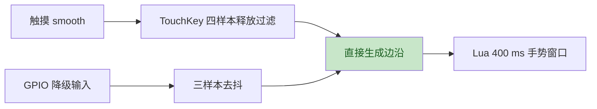

# N1 马达现场对照：2026-10-23

本轮在历史 N1 固件的同一运行镜像中完成原生 Angry / Lua Angry / 原生 Angry 对照，
三段均获得清晰触感。随后在同一 Lua 应用内复现预设差异：Angry 正常、Happy 微弱、
Error 与 Panic 无触感。后续已定位到可复现的新旧编码差异，正式固件的 Error/Panic、
快速双击和震动开关功能均已复测通过。任务日志与操作者触感分别记录；当前没有
物理 PWM 测量或已证实的电气机制，N1 全部预设、稳定性及整体验收仍未完成。

## 当前运行镜像

2026-10-24 当前为 `0b1b211` 的普通固件
`target/slot-descriptor-retry-20261024/default.bin`，3,058,496 B，SHA-256
`dce2f5f0bfaeb56806d933b3266dc9a11df3ea3b1c309e43f05c0abe58d9ca56`，
无诊断 feature。该版在前版基础上增加扩展板描述符传输失败后的有限重试。
`target/slot-recovery-live-20261024/flash-01/` 保存 main_app 完整回读与引导区一致
收据；`01-startup` 自动启动查询为默认脑、默认皮肤、原四个下载应用，右槽
`R=interact* derr=0`。`02`／`03` 一轮默认脑下的 AI 关机、独立 POWER 开机后的
灯光、双键与设置预览已获实物确认；`06`／`07` 自定义脑与前台应用并发关机及
POWER 后 Happy／红灯／周期震动恢复也通过。`08` 已清理为默认基线。三次启动的
首次读取均成功，没有覆盖失败后重试恢复分支。详见
[描述符重试复盘](lessons/subboard-descriptor-retry.md)。

前一版为 `c86811b` 的普通固件
`target/lights-early-reset-clear-usb-first-20261024/default.bin`，3,057,568 B，
SHA-256 `c8e4f00de7a31aec5936ffc3f54cedd0b0fc992a595beee07949365f54f9af42`，
无诊断 feature。在前版基础上增加常驻脑运行时故障原因日志，并将启动黑帧提前到
LCD 初始化之前。`target/usb-session-live-20261024/flash-06/` 保存完整应用读回和
引导区一致收据；自动启动及后续物理 RESET 均有默认脑、默认皮肤查询。操作者确认
RESET 后主页恢复时灯已熄灭、点按有效。此结果不证明 RESET 边沿或 ROM 期间断电；
详细镜像、N4 故障验收与清理见 [N4 现场记录](N4_BRAIN_LIVE_20261024.md)。

前一版是 `14316ff` 的普通固件 `target/usb-upload-yield-20261024/default.bin`，
3,055,792 B，SHA-256 `7b7b65b0c5575e6734b332f0804ba3065c602cecac8f349b97e7416535d20fe7`。
它包含旧IN传输复位修复、类型化大脑输入及USB包间yield，无诊断feature。
`target/usb-session-live-20261024/flash-05/`完整应用读回、引导区前后与原备份逐字节
一致；自动WDT重启成功，`26-default-startup`的hello、存储、默认脑error=0及皮肤
default均正常。该版半包 USB 重连、完整重传及清理已完成一轮设备验收；上传时仍有
sensor 错误／丢弃／积压，整体上传实时性未通过，新触摸性能待测。

上一轮为验证 N3 的 USB 拔线重连修复，刷入 `c18d0ca` 对应的
`target/usb-in-reset-fix-20261024/diagnostic.bin`，3,073,376 B，SHA-256
`4aee8d17c4a4dfde9d5067712ca88f3c85302dee763b39ec9bc2e757ab56e576`，
仅开启 `usb-session-diagnostics`，包含 `8d49214` 类型化大脑输入。
`target/usb-session-live-20261024/flash-04/` 保存旧布局 main_app 完整回读和引导区
三份逐字节一致的收据。自动启动、hello、存储、默认脑与皮肤查询正常，诊断定时器
默认未启用；本版修正USBRST旧IN传输清理顺序，保留只读端点寄存器快照及显式单次
120秒软件重启。一次无半包拔插后四项查询恢复，期间无需再次RESET；重配置端点
EPENA=0且有禁用确认。随后4096字节半包拔插自行恢复、完整重传及清理通过；
`n3-half-reconnect-live-20261024-cleanup-state`确认default皮肤、原四个应用和timer active=0。
`14316ff`上传包间yield候选已核验，普通构建与上传性能待复测。
USB诊断与RESET保留性校准见 [N3现场记录](N3_SKIN_LIVE_20261024.md)。
新类型化输入尚无普通镜像触摸性能结果，不能用这次启动替代下面的稳定性门槛。

此前完成触摸统计的普通固件为 `target/touch-clock-lights-20261023/default.bin`，3,054,720 B，
SHA-256 `77f145cb9e755c041ee2463ab7e093600becaf9cdadb998ab43f6073bea32414`，无诊断 feature。
源码内容对应 `1c793c5`、`cc949c9`。`single-handle-flash-08/receipt.json` 及独立
`root-verified.json` 确认应用完整读回一致、引导区写前 / 写后 / 原始备份逐字节相同。
自动启动日志 `71` 的默认脑首次执行4885µs，Startup 黑帧 / latch 回执正常。
恢复会话 `72` 重新到主页、计数 n=0；`73` 已删除 `n2_lights_shutdown_probe`，
`brain-status` 为默认 Lua 脑且 error=0，应用列表只保留原四个 `/data` 应用。
普通镜像右槽性能复测已完成：74日志约210秒，n=65、P50=42ms、P95=51ms、
max=54ms，仍高于50ms门槛。操作者确认约60次点按且无卡顿，详见下节。

前一轮实物验证使用 `target/touch-clock-lights-20261023/diagnostic.bin`，
3,061,072 B，SHA-256 `2d0895c97fdeee37b11c82b223d8617daebe2f2966c01849e8466a4602a73762`，
只开启 `touch-latency-diagnostics`，源码内容对应 `1c793c5`、`cc949c9`。它增加终态
关机黑帧回执，并在事件 drain 之后用新鲜时钟推进动画；预设、按键、事件顺序和
测量端点保持原有定义。`single-handle-flash-07/receipt.json` 与 `root-verified.json`
确认完整应用读回、引导区三份逐字节一致。`66` 启动成功，首次脑执行4753us，
有 Startup 黑帧 / latch 回执。下列分段数据和三页面关机结果绑定此诊断镜像。

## 触摸分段诊断与最小时钟修复

修复前诊断镜像为 `target/touch-latency-20261023/diagnostics.bin`，3,055,728 B，
SHA-256 `e46790ace17acf92c2a233dea9935848faaa7d38b81e0cb4729ad8a8e7d34491`，
源码 `2265e33`。完整写回与保护区验证见 `single-handle-flash-06/receipt.json`；
`64` 自动启动默认脑首次执行4823us、ok=true。

`65-touch-phases.log` 得到53个连续序号的完整a/b/c样本，completed=emitted=53、
merged=0，无缺失分段。P50=44ms、P95=77ms、max=80ms，仍高于50ms。
出队前等待中位25.771ms，pointer处理1.868ms，之后等待3.850ms，绘制10.471ms；
16个样本跨一轮UI，等待段P95为30.336ms。plane队列等待中位77us、max90us，
pool miss为0，本轮主要耗时不是送屏队列。输入所在轮sensor drain中位17.231ms，
与出队前等待存在包含关系，不额外相加。仍需基于这些证据修复并在普通镜像复测。
操作者反馈“看起来没卡顿”；完整逐样本与边界见
[`touch-phase-results.json`](../target/n1-live-20261023-143145-nmf7roas/touch-phase-results.json)。

`cc949c9` 在原 `runtime.tick` 调用位置重新读取时钟，避免使用 sensor / pointer
处理之前的循环起点。真实默认 Lua 脑、Runtime 和 LVGL 回归证明：旧时间的 pulse
为零且不提前发布帧，新时间使 pulse 非零，并由既有 urgent 策略发布不同像素。
它不靠标记空响应帧来改善统计。

组合诊断版 `67` 记录前100个完整样本，序号连续、merged=0、pool miss=0，全部
在同一轮 UI 绘制，99/100 urgent，跨轮等待从16/53降为0/100。实际记录有102次
input down / release，操作者反馈“点了”；不推断精确物理动作次数或主观流畅度。

| 分段 | 修复前 P50 / P95 / max，µs，n=53 | 修复后 P50 / P95 / max，µs，首100 |
| --- | --- | --- |
| 总延迟 | 44971 / 77958 / 80565 | 40900 / 50756 / 66694 |
| 出队前等待 | 25771 / 33913 / 36907 | 24933 / 32644 / 45960 |
| pointer 处理后到绘制 | 3850 / 30336 / 35052 | 2494 / 4399 / 8197 |
| 绘制 | 10471 / 14795 / 14856 | 10339 / 14590 / 14758 |

同一日志末尾原滚动 ring 为 n=100、P50=40、P95=50、max=66ms；它是最后100个样本
且先截断到整数毫秒，不能与固定诊断的首100个样本混称。固定集合严格 P95=50.756ms，
仍高于50ms；随后普通镜像P95为51ms。两次手动输入节奏与样本数不同，不宣称统计显著。
一次 Header 警告继续保留，完整原始行、哈希和比较边界见 `clock-touch-phase-results.json`。

## 普通镜像的右槽触摸复测（2026-10-24）

`74-default-right-stability.log` 收集约210秒，右槽交互板、默认Lua脑和默认皮肤，
计数从0开始。最终65个样本、65次按下和65次释放，P50=42ms、P95=51ms、max=54ms。
操作者反馈“看起来没有卡顿，日志怎么说”，并确认“点了更多，大约 60 次”。
这个近似动作数量与日志相符，没有据此认定触摸被拆分，也不宣称精确零漏计。

触摸后的123条周期摘要为19fps 119条、20fps 4条；frame drop最大0，传感器队列
drops/edrops均为0，ierr/berr增量为0。IMU iskip仍增加4964，属于轮询调度统计，
不能与I/O错误混称。末尾sensor行达到158字节容量，bskip尾值可能截断，不计算其增量。
有两次启动sensor drain警告及一次CST9220 Header警告；logger ldrop从首条到末条
均为255，不能据此补全启动时丢失的日志。

相比旧普通镜像47日志的P95=74ms，记录值降至51ms；手动节奏和样本数不同，
不宣称统计显著。现有固件侧50ms门槛仍失败，测量端点仍为报告读完到带tag帧的
首个QSPI提交，没有改成光学端到端延迟。收据为
[`clock-default-stability-results.json`](../target/n1-live-20261023-143145-nmf7roas/clock-default-stability-results.json)，
原始日志SHA-256为`1aeae6c233bd543d28238db556dfad0f596abaaa171adcd88d6dccaefdf455bb`。

## 关机清灯修复的实物回归

`1c793c5` 在首次 AI 长按时锁存灯带终态，新的全黑帧 TX 成功并留足280µs锁存时间后
才发布清零回执；GPIO57还必须等到原 Sleep 帧计时满足。失败不伪造回执或超时绕过。
清零不受板检测、设置开关或缓存黑色影响。物理 RESET / BOOT 进 ROM 不执行该清理。

组合诊断版的 `68`、`69`、`70` 分别从 Lua 六灯交替红绿页、Settings 预览和 Home
请求关机，均捕获一次 shutdown latch、一次 Shutdown 黑帧 / latch 回执，随后 Sleep
和 USB 断开；操作者分别反馈“全部正常，关机以后表情显示，灯也熄灭了”、
“ok是正常的”、“一切正常”。三页面应用关机残灯复现用例通过；不据此宣称关机电流、
GPIO57波形或精确光学时间通过。证据见 `lights-shutdown-results.json`。

## 已验收正式默认镜像

前一轮功能验收运行 `target/haptic-fixed-20261023/default.bin`，3,049,840 B，SHA-256
`92fbffad3f5c69d3cb62c581cd897cdef1246c907ae06746f1d11772fd8d0be9`。
这是无实验或诊断 feature 的正式默认镜像，13 个预设的时长、段数和占空比参数保持
原规格；100% 改为 100H/100H 编码。三个实验 feature 和映射已移除，历史实验归档保留。
对应 ELF SHA-256 为 `6646b81d34464513dbcc2f6bec7b27e6c58c369a016cd337f1b903320c363e79`，
361 文件源码清单聚合 SHA 为 `996300a8b8ea8000a3540e7bb019a25ea8180c90c41a2ea599fc99800cde7216`。
构建、ROM 714 符号及严格镜像验证见同目录 `receipt.json`。
这组源码随后原样提交为 `bac9e27`（快速双击）、`c6c1e95`（大脑单次编译）、
`1f97924`（100% 高电平编码）；构建收据保留构建时的工作树基线，不改写历史。
`single-handle-flash-05/receipt.json` 证明旧布局 main_app 完整读回相同、引导区不变，
并通过原 stub 句柄自动 watchdog 重启。未执行 N6 迁移。

交互板双击默认值为 400 ms，已包含单次编译和触摸去重滤波修复。
`36-fixed-default-autoboot.log` 记录 board v1.2、默认脑 prepare=4193us、compile=79211us、
first_finish=4807us、ok=true；`brain-status` 为 active=lua、source=default、error=0。
正式 Error/Panic、双键与设置功能的实物结果见本页“正式默认固件回归”。

## 运行镜像与证据身份

现场证据目录为 [`target/n1-live-20261023-143145-nmf7roas`](../target/n1-live-20261023-143145-nmf7roas/)。
会话开始时间为北京时间 2026-10-23 14:31:45；现场记录见
[`session.json`](../target/n1-live-20261023-143145-nmf7roas/session.json)、
[`observations.jsonl`](../target/n1-live-20261023-143145-nmf7roas/observations.jsonl)。

前三段 Angry 对照之间没有刷机、复位或更改运行镜像。
[`angry-comparison.json`](../target/n1-live-20261023-143145-nmf7roas/angry-comparison.json)
保存当时的日志计数和观察。该收据记录的是测试当时的身份边界：运行控制台没有暴露
ELF / BIN 校验和，尚未独立读取应用。

进入下载模式后，更新诊断版之前另读得旧 `main_app` 起点 `0x210000` 的 512 字节，
与历史 BIN 的前 512 字节完全一致。该比对及原始数据见
[`single-handle-flash-01/receipt.json`](../target/n1-live-20261023-143145-nmf7roas/single-handle-flash-01/receipt.json)
和 [`main-header-before.bin`](../target/n1-live-20261023-143145-nmf7roas/single-handle-flash-01/main-header-before.bin)。
**512 字节匹配支持历史镜像身份关联，不等于完整旧应用读回或全镜像校验通过。**
因此以下 SHA 标识归档文件，不直接当作已测运行镜像的全量读回指纹。

| 历史产物 | 大小 | SHA-256 |
| --- | ---: | --- |
| `target/mosaico-s31-n1-20261023.bin` | 2,627,792 B | `521fc8cfa198cbd80d0b9d4c28c319e173b3869a760d01cc3a54654da0bc8356` |
| `target/n1-acceptance-20261023/accepted-before-diagnostics.elf` | 4,840,172 B | `d84f945a93b5096cfe0376ecf13757cd17045e3a82b77db594cc689c9e3ea813` |

旧启动区域 `0x0..0x20000` 保存为
[`before-boot-region.bin`](../target/n1-live-20261023-143145-nmf7roas/before-boot-region.bin)，
SHA-256 为 `30a058b611fa3df7503e12a84dfdb4bd6025c60aac897b7d798f52491c89aaaa`。
读取分区表经 `require_legacy` 确认为旧布局；它不构成新 A/B 布局或回滚能力的设备验收。

## 同运行镜像的 Angry 对照

三段在北京时间约 14:33–14:36 完成，任务记录均为 `2 × 160 ms, 90%`。

| 顺序 | 刺激与日志 | Angry 任务记录数 | 操作者触感 |
| --- | --- | ---: | --- |
| 原生前测 | Home 触发生气；[`01-native-angry-before.log`](../target/n1-live-20261023-143145-nmf7roas/01-native-angry-before.log) | 1 | “生气了，有清晰震动” |
| Lua | `n1_haptic_probe` 四次 `haptic.play("angry")`；[`02-lua-angry.log`](../target/n1-live-20261023-143145-nmf7roas/02-lua-angry.log) | 4 | “四组都有清晰震动” |
| 原生后测 | 返回 Home，再触发生气；[`03-native-angry-after.log`](../target/n1-live-20261023-143145-nmf7roas/03-native-angry-after.log) | 1 | “有清晰震动，与第一段一致” |

三段日志没有 PWM start / stop failure。Lua 探针正常完成，四次请求间隔 3 秒。
本场景的 Angry 原生 / Lua 触感对照通过，排除了“Lua 请求一律不能产生震动”的说法。
它没有测量两段脉冲的电气时长、PWM 占空比或 150 ms 调度启动间隔，也不证明全部预设可感。

## Error 复测与可见预设矩阵

首次独立 Error 复测发出四次请求，任务均记录 `3 × 60 ms, 100%`，脚本正常结束。
操作者回报“诶？你启动了吗？我这边没有震动喔”。证据为
[`04-lua-error.log`](../target/n1-live-20261023-143145-nmf7roas/04-lua-error.log)。
为消除启动时间不明确的影响，后续应用增加可见倒计时、预设名称和请求编号。

| 应用与证据 | 请求顺序 | 操作者结果 |
| --- | --- | --- |
| `n1_haptic_compare_probe`；[`05-visible-comparison.log`](../target/n1-live-20261023-143145-nmf7roas/05-visible-comparison.log) | Angry、Error、Angry、Error | “ANGRY 有震动，ERROR 没有” |
| `n1_haptic_matrix_probe`；[`06-visible-matrix.log`](../target/n1-live-20261023-143145-nmf7roas/06-visible-matrix.log) | Angry、Happy、Error、Panic、Angry | 首尾 Angry 正常，Happy 微弱，Error / Panic 无触感 |

可见矩阵的每一步均有对应任务记录；预设参数如下，未引入自定义 PWM：

| 预设 | 段数 × 时长 | 段间隔 | 名义占空比 | 本轮触感 |
| --- | --- | --- | --- | --- |
| Angry | 2 × 160 ms | 100 ms | 90% | 正常 |
| Happy | 1 × 60 ms | 无 | 50% | 微弱 |
| Error | 3 × 60 ms | 40 ms | 100% | 无 |
| Panic | 3 × 80 ms | 60 ms | 100% | 无 |

这些观察在同一 Lua 调用路径中复现差异，不能归结为 Lua 桥接整体失效。Error / Panic
名义 100% 在当时实现中编码为 199 / 1 tick，编码占空比为 99.5%；锁定 HAL 的 PulseCode 将
非零 duration 1 视为合法表示。尚无证据确认近全高波形、马达电气响应或 RMT 连续发送
中的哪一项导致触感差异。任务日志与显示的 PLAYED 只表示请求已执行 API 调用，不能
充当 GPIO 波形或物理触感证据。

## 集成诊断版复测

北京时间 15:02–15:04，仅更新旧布局 `main_app 0x210000` 为
`target/haptic-followup-20261023/haptic-diagnostics.bin`（实现 `50ed8c7`），
大小 3,048,816 B，SHA-256
`c18da714a4f3bff78c6c984c3a456f69121b446d7618f40d2e0d3581f2363d6d`。
完整应用读回逐字节一致，写前 / 写后 / 备份三份 `0x0..0x20000` 完全一致。
未做 N6 分区迁移。刷机、观察、寄存器及日志指纹见
[`integrated-results.json`](../target/n1-live-20261023-143145-nmf7roas/integrated-results.json)。

操作者确认返回主页。`07-diagnostic-boot.log` 显示 `/system` 和旧 `/data` 挂载，
原应用可列举；不代表全部旧文件已作内容校验。启动期间默认 Lua 大脑两次因
`callback budget exhausted` 失败，退回原生逻辑。这是 N4 的独立设备缺陷，待修复后复测。
CST9220 Header 警告、启动 IMU 错误继续保留，未将这次启动记为完整稳定性通过。

可见矩阵的 `09-diagnostic-matrix.log` 与操作者反馈一致：Angry 正常、Happy 正常、
Error / Panic 无震动。此版本的 Happy 结果与历史版本的“微弱”分别保存，不能混为同一观察。

| 首段停止前读数 | Angry / Happy / Angry（p2、p3、p6） | Error / Panic（p4、p5） |
| --- | --- | --- |
| `INT_RAW` | `0x00000102` | `0x00000103` |
| 通道 0 transmission-end bit0 | 0 | 1 |
| 通道 0 error bit4 | 0 | 0 |
| FSM 字段 | 1 | 1 |
| GPIO8 enable / mux / matrix | `1 / 0x1800 / 0xF6` | 相同 |
| Touch scan / out mask | `0x0030 / 0x0030` | 相同 |

End 标志与预设差异相关，但 FSM 没有显示为 idle。锁定 HAL 对 continuous 模式 End
是否逐轮触发仍有 FIXME，不能单凭 bit0 认定输出早停或确诊 1 tick 不合法。
随后采用单段 160 ms、50/90/95/99/名义100/90% 的受控实验，并补 RMT RAM 与 TX_LIM
读数，结果如下。实验 feature 默认关闭，独立镜像与收据记录，不改写正常预设结果。

## 单段 160 ms 实验与快速双击逐样本证据

`23-duty-sweep.log` 记录六次请求，操作者确认全部有震动，99% 与名义 100% 触感没有
明显差别。这一轮使用历史实验镜像 `target/haptic-duty-keys-20261023/sweep.bin`
（SHA `bac05d56d727e1dd77f09bf0321b1b140360dd8565f40820b0276efcd542ff29`），完整读回见
`single-handle-flash-02/receipt.json`。`hdx` 中 RAM 首字依次为 `00648064`、`001480b4`、`000a80be`、
`000280c6`、`000180c7`、`001480b4`，第二字均为结束标记，TX_LIM 均为 `0x18`。
名义 100% 的 `prestop INT_RAW` 仍为 `0x103`，同时存在实物触感，因此 End 标志不能
作为提前停机的证据。下一项受控实验比较 90% / 100% 下单段 60 / 80 / 160 ms；尚未
改变正常预设规格表。观察和文件哈希见
[`duty-keys-results.json`](../target/n1-live-20261023-143145-nmf7roas/duty-keys-results.json)。

`24-fast-keys-trace.log` 包含 1,936 个逐样本读数。连续活动段内的相邻间隔中位数为
40 ms、范围 18–59 ms。整份文件的一段约 85.6 秒缺口来自未连续收集的日志，不能
当作采样任务停顿。操作者确认惯常快速双击仍漏计；汇总有左键 5 次、右键 6 次双击，
总计数不能证明每次动作都被识别。旧 probe 开头误写 default180ms，实际构造参数
short=0，所刷固件的交互板默认值为 400 ms；后续探针改为打印句柄中的实际阈值。

三段已确认的信号表明，二次去抖会吞掉 TouchKey 已识别的释放：

| 通道 | 连续 quiet 区间（设备毫秒） | TouchKey 松开 | 第二次按下 | 后级结果 |
| --- | --- | --- | --- | --- |
| 右键 | 182127–182283，5 样本 | 182240 | 182318 | 只收到两次 false，无 up |
| 右键 | 195519–195679，5 样本 | 195640 | 195720 | 只收到两次 false，无 up |
| 左键 | 178602–178760，5 样本 | 178723 | 178813 | 只收到两次 false，无 up |

修复将 TouchKey 已过滤的状态直接转为边沿，GPIO 降级仍使用三样本去抖。四个 quiet
样本、双向偏差和基线冻结保护仍保留。真实三段 smooth 序列的主机回放均得到
down/up/down/up，旧路径负对照只产生一次 down。另一段左键只有三个 quiet 样本，
仍可能被四样本防噪规则合并；尚不能据此确认模拟电容恢复速度或全部快速双击通过。

`22-duty-keys-boot.log` 进一步记录默认脑 outer_load 约 13 ms、首次执行约 66 ms，
执行预算在内层 `load(SOURCE)` 编译时耗尽。主机修复预先独立编译用户 chunk，受限
环境绑定后再执行；顶层、create 和首次 tick 共用原 20 ms / 2000 hooks 预算。
源码隔离、原行号、64 KiB 边界、真实分配延时负对照和恶意脚本回归已通过，下一版的
首次设备启动在 `26-timing-keys-boot.log` 中获得 4924us 成功记录。

## 时长实验、软件重启与去重滤波复测

`27-haptic-timing.log` 依次执行 90%/160ms、90%/60ms、100%/60ms、90%/80ms、
100%/80ms、100%/160ms、90%/160ms，全部为单段。操作者报告 90% 各项均有触感，
100% 各项均无触感。上一镜像的 100%/160ms 有触感记录继续保留；跨轮结果表明当前
编码的输出体验不稳定，不能把原因简化为短脉冲不足。

`00400000`、`00400001`、`00400002` 状态值的差别是 RAM 读地址，三者 FSM 字段都为 1。
上一轮“100%/160ms 有触感”的 prestop 实际为 `s=00400000 i=00000103`，进一步说明
读地址 0 和 End=1 都不足以判定是否产生实物输出。当时 100% 实际编码为 199H/1L；
待验证候选为 100H/100H，与 90%、99% 和旧编码在同一镜像交错比较。正常编码尚未替换。

`28-runtime-reboot-command.log` 在删除时长探针后记录 reboot requested；USB 断开使
本次命令会话退出 2，没有拿到 ACK。随后的 `29-auto-reboot-boot.log` 重新连接并记录
CoreSw、正常启动及 bundled brain。这条完整链路证明普通 USB 软件重启成功，单独的
串口退出码不代表重启失败。下载 stub 经 watchdog 自动回应用的后续结果见下一节。

`30-filtered-fast-keys.log` 明确打印两键 short=400ms、long=1500ms。左键 21 down / 21 up，
包含 4 single、8 double、1 long；右键 13 down / 13 up，包含 4 single、4 double、1 long。
两次长按释放分别为 2080ms / 1961ms，均有完整 long start/up。操作者反馈手感已经不错；
没有提供精确动作次数，不能计算漏计率，也不能将约 2 秒观察记成请求的 5 秒保持测试。
证据与哈希见 [`timing-keys-results.json`](../target/n1-live-20261023-143145-nmf7roas/timing-keys-results.json)。

## 同镜像新旧编码对照与下载后自动重启

本节实验镜像为 `target/haptic-waveform-20261023/waveform.bin`，3,054,224 B，SHA-256
`38569747809d78ca8b0bc64316ee907e19234eb45a6380bc442e1141940e43b7`，启用
`haptic-waveform-sweep,touch-key-diagnostics`。它已被当前正式默认镜像替换。

`single-handle-flash-04/receipt.json` 保存仅写 main_app、完整回读、引导区逐字节一致的
记录。原下载 stub 句柄执行一次 `watchdog-reset`，此前已启动有界运行口采集器；
`32-waveform-autoboot.log` 自动连接并记录正常任务启动与默认 Lua 大脑成功。
此过程没有人工 RESET，验证范围为这块 S31 的 USB OTG 下载路径。

同一次启动、同一镜像下交错重复四种 160ms 单段条件，`33-waveform-comparison.log`
记录 12 次请求、每次完整 start/prestop/stop。操作者确认旧 100% 三次均无震动，
新 100% 三次均有震动，90% 和 99% 稳定。

| 条件 | RMT 两段编码 | RAM 首字 | 160ms 触感 |
| --- | --- | --- | --- |
| 90% | 180H / 20L | `001480b4` | 3 次稳定 |
| 99% | 198H / 2L | `000280c6` | 3 次稳定 |
| 旧名义 100% | 199H / 1L（99.5%） | `000180c7` | 3 次均无 |
| 新 100% | 100H / 100H | `80648064` | 3 次均有 |

随后未刷机或复位，`34-waveform-short.log` 完成 8 步、12 个 burst 的短脉冲对照。
操作者确认旧编码 60/80ms 均无响应；新编码 60/80ms 单次、3×60ms 间隔 40ms、
3×80ms 间隔 60ms 均正常，首尾 90% 对照正常，各步骤之间和结束完全停振。
新编码的每个 burst 均读得 `80648064`，第二字为结束标记，TX_LIM 为 `0x18`。

本轮支持把名义 100% 的编码改为两段高电平；未测实际引脚波形，不能据此断言
1 tick 低电平非法、精确电气占空比或马达内部响应机制。此前 `23-duty-sweep.log`
中名义 100%/160ms 有触感的跨镜像观察继续保留。
实验别名只验证候选编码，正式 Error/Panic 与设置取消仍需在最终普通镜像验收。
文件指纹、逐段寄存器、原始观察和自动重启证据见
[`waveform-results.json`](../target/n1-live-20261023-143145-nmf7roas/waveform-results.json)。

## 正式默认固件回归

`37-fixed-normal-presets.log` 执行 Angry、Happy、Error、Panic、Error、Panic、Angry，
每次任务记录均匹配原规格。操作者确认全部正常，间隔和结束都停振。
主页生气亦有震动和闪光、无明显卡顿；该动作晚于 `38-fixed-home-angry.log` 窗口，
其缓存的 Angry 任务与表情日志在 `39-fixed-fast-keys.log` 上传按键脚本之前收到。
当前主页运行默认 Lua 大脑，此项是主页与前台 Lua 的对照，没有强制切换原生兜底引擎。

同一正式镜像的双键回归结果：

| GPIO | down/up | single | double | long start/up | 实际长按时长 |
| --- | --- | --- | --- | --- | --- |
| 左 11 | 9/9 | 1 | 3 | 2/2 | 2445、2356ms |
| 右 10 | 10/10 | 2 | 3 | 2/2 | 1921、1919ms |

操作者确认手感正常。默认阈值实测打印为 short=400ms、long=1500ms；不将请求的
3 秒保持写成实际测得 3 秒，也不据总计数推广零漏计率。

断电换槽后，`54/55`补测左槽。GPIO13有8/8 down/up、2single、2double、2完整long
（2128/2080ms）；GPIO12有7/7 down/up、2single、2double、1完整long（1761ms）。
两键默认400/1500ms，操作者确认正常。另一项GPIO13的1478ms保持按门槛归为single，
不改写为长按。非活动GPIO11/10被拒绝、右槽专用LED API返回不可用。`56`删除探针。
详见同目录`n2-left-results.json`；未据请求的三次双击或三秒保持填写实测次数/时长。

设置功能在 `41`–`44` 号日志完成：关闭震动后主页进入 Angry 但无触感；前台 Lua 的
Angry/Error/Panic 三次请求均被 `INVALID_STATE=259` 拒绝且无震动；重新开启只记录
一次 Satisfied 提示，静置没有补播被拒绝的请求；后续三个新请求恢复震动并正常停振。
`41`、`43` 采集器在收到实物反馈后主动 SIGINT 提前结束（exit 130），并非串口故障。
这组测试未在 burst/gap/限速等待期间切换开关，尚不验证这些阶段的取消时序与 pending 清空。

清理回执 `38`、`40`、`43`、`45` 分别确认正式矩阵、快速键、静音、重新开启探针已删除。
设备不保留这些已完成的临时应用。原始观察、逐项计数及文件哈希见
[`fixed-normal-results.json`](../target/n1-live-20261023-143145-nmf7roas/fixed-normal-results.json)。

旧统计 n=7/18 时 p95=max=61ms，超过既定 50ms 门槛；本次没有把主观无卡顿当作
延迟验收通过。统计是最近 100 样本窗口，串口重连不清空，后续通过运行时重启取得
n=0 的稳定性复测起点。CST9220 Header 警告和历史 IMU 读错误继续记录。

### 正式镜像重启后稳定性采样

`46-stability-reboot-command.log` 发出普通重启，USB 在 ACK 前断开；随后
`47-default-stability.log` 完整采集约 230 秒，起点为 n=0。该窗口包含 211 条 n=0 的
周期摘要及 19 条触摸后的摘要，最终 **n=78、P50=45ms、P95=74ms、max=79ms**。
每条周期摘要是同一环形窗口的状态，不是独立新增样本；78 次 down/up 均有日志，
不能将要求的“约 30 次”当成实测动作数。操作者反馈“看起来没有卡顿”。

触摸期间 19–20 fps，drop 始终为 0；全窗口启动阶段另有 12/16/18 fps 记录。
IMU / BMM 的 ierr、berr 起止均为 0，队列 drops/edrops 增量均为 0；另有两次
sensor drain 达到 24 的警告、一次 CST9220 Header 警告。iskip 增量 4356，miss 最终 2904；
末条 sensor 日志达到 158 字符上限，bskip 尾值可能截断，增量不可判定。这些调度/空读
计数与 I/O 错误分别记录。
logger 的 ldrop 从第一条到最后一条均为 21，启动日志完整性有限。

**本轮 P95 超过既定 50ms，性能验收失败。** 统计测量触摸报告读完到带 tag 帧的
首个 QSPI 提交，不含触摸控制器此前的扫描或面板出光；tag 也没有独立证明视觉 pulse
上涨时点。原 gate 不变，后续仅增加默认关闭的同一样本分段诊断，以区别输入排队、
brain RPC、cadence、raster 与 plane 等待。当前没有同场景旧版 A/B，未归因于单一模块。
原始计数、警告、采样边界和文件哈希见
[`stability-results.json`](../target/n1-live-20261023-143145-nmf7roas/stability-results.json)。

## 未测项目与临时应用清理

物理波形、150 ms 限速、关闭 / 重新开启在 burst / gap / 限速等待中的真实取消时序仍未测。
普通诊断日志仅覆盖前 10 个 pattern 的第一段 burst，启动反馈也占用额度；
本次 waveform 实验扩为前 48 个 pattern 的全部 burst。
异常退出、正常结束及外部停止退灯已获得集成诊断版操作者确认，详见
[N1 清单](N1_TEST_CHECKLIST.md)；这些灯带结果不代替马达全部预设验收。

本轮完成后已从设备卸载 `n1_haptic_probe`、`n1_haptic_error_probe`、
`n1_haptic_compare_probe`、`n1_haptic_matrix_probe` 和 `n1_error_probe`；
实际回执见 `08-cleanup.log`、`10-matrix-cleanup.log`、`13-before-external-stop.log`。
可见按键探针也随每轮结束清理。Mac 上的探针源码、日志、观察与收据保留。
160 ms 占空比探针已在 `24-fast-keys-trace.log` 的会话开头卸载；随后
`25-after-duty-keys-cleanup.log` 确认 `n1_keys_visible_probe` 删除完成。
`28-runtime-reboot-command.log` 与 `31-filtered-keys-cleanup.log` 分别确认时长实验和
修复后快速按键探针删除完成，后者还确认默认 Lua 大脑仍活动且 error=0。
`34-waveform-short.log` 与 `35-waveform-cleanup.log` 分别确认新旧编码和短脉冲探针
删除完成；后者再次确认默认 Lua 大脑 active=lua、error=0。
仍用于后续左槽 / 拔插验收的探针暂留，测试结束后再卸载。
