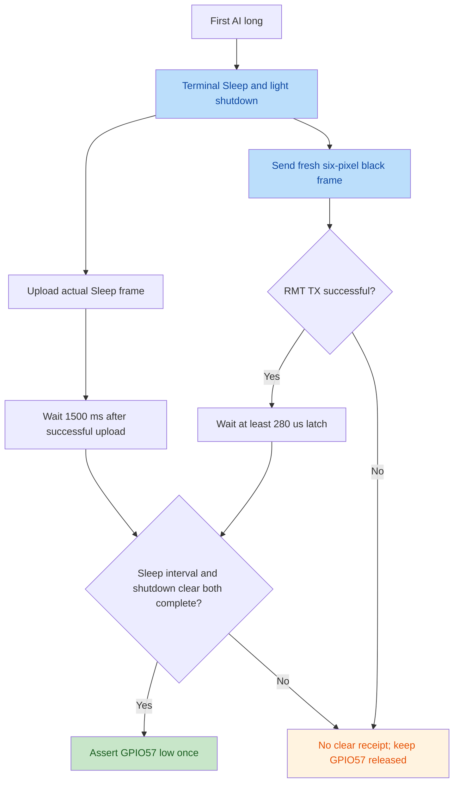

# N2 — onboard buttons and power-off

## Hardware ownership and source constraints

`tasks::buttons` owns AI GPIO7, BOOT GPIO61 and PWR_SW GPIO57. AI and BOOT
are low-active inputs with pull-ups, sampled independently of the sensor/I2C
startup at a nominal 5 ms period. GPIO57 is configured as an **open-drain**
output, initially high (released, high impedance), with pad hold released.
Power-off asserts low and leaves it asserted; it never drives push-pull high.

The ESP-Mosaico BSP `include/bsp/esp_mosaico.h` defines GPIO57 and assert/release
levels 0/1 at lines 126–128, and AI7/BOOT61/active level 0 at lines 131–133.
`onboard/esp_mosaico.c` initializes the switch as released open-drain and clears
pad hold (`bsp_power_init`, lines 166–174). `bsp_power_set_shutdown` (lines
277–285) asserts low or releases high impedance; it specifies no pulse duration
or timed handshake. BOOT's application events do not change its ROM boot-mode
behavior: holding BOOT during reset can select the bootloader.

## Gesture and UI behavior

The host-testable `buttons::Button` state machine uses:

| Rule | Value / outcome |
| --- | --- |
| Debounce | 20 ms stable level on both edges |
| Single click | Confirm only after 180 ms without the next press |
| Double click | Two clicks in the same window; no preceding single |
| Dense third and later clicks | Coalesce to one native Double after the window; Lua retains its existing multiple-click behavior |
| Long press | Once at 1500 ms after debounced down; clears pending clicks |
| Release after long | No single or double emitted |
| Held during startup | Ignore gesture timing until the first stable release; no invented initial down time |
| Hold released before long threshold | Normal click classification; no shutdown request |

AI emits `ButtonPower`, BOOT emits `ButtonBoot`, with `ButtonShort`,
`ButtonDouble` or `ButtonLong` into the existing bounded sensor-event channel.
Home routes them into the affect engine. The existing engine maps AI short to
Listening and AI double to StopActivity; BOOT remains debug-only. Off Home,
the existing paused-fox routing and Settings light/haptic switches are
preserved. AI long has one explicit global exception: terminal shutdown works
from every page, independent of those switches or Lua ownership.

## Lua button interface and compatibility

`button.new(7, active_level, long_ms, short_ms)` and `button.new(61, ...)` now
open the onboard buttons. The existing `on`, `off`, `get_key_level`, `dispatch`
and `close` interface and callback event names apply unchanged. Defaults remain
low-active, 1500 ms long, 180 ms click window; caller thresholds remain local to
Lua and do not change the system shutdown threshold. Before the onboard task
has initialized, opening returns `nil, "onboard buttons unavailable"`.

The firmware appends an independent `OnboardButtons` structure to the internal
Rust/C hardware snapshot: ready flag, two pressed levels, wrapping sequence,
and a 16-entry timestamped edge ring. Lua receives this as a separate domain,
with no interaction-slot generation. GPIO11/10 or GPIO13/12 keep their original
availability, generation, queue and detach errors. Detaching/reinserting the
interaction board therefore invalidates its old handles while AI/BOOT handles
continue working. Both domains retain explicit queue-overflow errors; this is
not an unbounded event store.

Callbacks still run only when the application calls `button.dispatch`; no Rust
or interrupt context invokes Lua. Opening while held has no known down time,
so the release does not invent a click or long press. Like other page exits,
shutdown leaving a Lua page stops its VM: an undispatched final AI long callback
can be canceled by system shutdown. Lua callbacks are not shutdown vetoes and
are not guaranteed finalizers. An application that needs an earlier AI long
observation may choose a Lua long threshold below 1500 ms and dispatch
frequently; it cannot delay or intercept system shutdown. BOOT has no system
shutdown action.

## Sleep-to-power sequence

1. The first confirmed AI long press latches `Shutdown::WaitingForSleep`.
   Releasing the button, repeat long events or further clicks cannot cancel or
   restart it. Detection does not depend on successfully enqueueing the emotion
   event when the bounded channel is full. The same branch latches terminal
   light shutdown, clears Lua/brain leases and rejects subsequent colour input.
2. The UI returns to Home, reconciles the fox widget and stops an active Lua
   page through the existing page lifecycle. `Runtime::begin_shutdown` is
   terminal: it publishes Sleep and a neutral pose, ignores later sensor/touch
   reactions, and returns no new runtime haptics. Queued navigation cannot
   replace the terminal Home page.
3. The normal fox entrance is allowed to finish. A plane job is tagged as
   shutdown Sleep only on a tick that actually rendered a new fox frame and
   after the entrance ended. Unrelated or old ready frames are not receipts.
4. The plane reports the job tag and the actual upload success into the pure
   shutdown state machine. Failed or untagged uploads cannot arm the timer.
   The first successful tagged upload begins a 1500 ms display interval;
   subsequent frames do not restart it.
5. Independently, the right-slot light task sends a fresh six-pixel black frame,
   even if discovery reports no board, lights are disabled or the cached frame
   was already black. Successful RMT completion followed by at least 280 µs
   of low latch time acknowledges that shutdown. A prior or in-flight startup
   clear cannot acknowledge the new shutdown request.
6. The button task asserts GPIO57 low **once** after both the Sleep interval and
   the shutdown light receipt, retaining low if external power prevents immediate
   loss of execution. Missing receipts keep GPIO57 released with a warning;
   neither display nor light failure has an unconditional cutoff fallback.



Startup also sends a black frame before allowing normal colour output. RMT
errors that return the channel retry after a task yield. A transfer that never
reports completion is bounded, drops the transaction and leaves light output
unavailable until reboot; it cannot publish a successful clear receipt.
Physical RESET/BOOT entry into ROM does not execute application cleanup.
The application therefore makes no promise to clear a powered strip in ROM.
GPIO60 supplies multiple peripherals and is not used as an isolated slot switch.

An upload receipt proves the panel driver accepted all chunks, not optical
visibility. Real panel behavior, supply cutoff and wake circuitry require
physical acceptance. Existing haptic bursts already in progress are finite;
this sequence does not introduce a new motor waveform or power pulse.

## Validation and physical acceptance

The implementation is host-testable without GPIO access. Targeted checks:

```sh
cargo test -p mosaico-s31 --lib --offline buttons -- --nocapture
cargo test -p mosaico-s31 --lib --offline behavior::runtime::tests -- --nocapture
cargo test -p mosaico-lua --lib --offline tests_hardware -- --nocapture
./scripts/test-drivers.sh
cargo fw --offline
cargo fmt --all -- --check
git diff --check
```

The first command covers native debounce/bounce, delayed single, double,
canceled hold, held-at-boot suppression, repeated long suppression, dense
clicks, failed/unrelated frame receipts, and one-shot cutoff timing. Runtime
checks cover terminal Sleep and haptic suppression. Real C/Lua bridge tests
cover onboard short/double/long callbacks, held-open behavior, and independent
onboard handles across slot detach/reinsert alongside original N1 contracts.
Firmware compilation validates actual pin configuration, task spawning and the
UI/plane wiring; no hardware operation is part of these checks.

Physical acceptance categories (current observations are recorded below):

- AI and BOOT short/double/long, bounce handling and boot-held release behavior;
  BOOT must not request power-off.
- GPIO7/61 Lua callbacks while both present and absent interaction boards;
  old slot handles must invalidate while onboard handles stay valid.
- AI short/double preserve Home emotion behavior; other pages and Settings
  preserve their prior light/haptic rules until terminal shutdown.
- AI long from Home, Settings and a Lua page: visible Sleep after any entrance,
  then one GPIO57 low assertion at least 1500 ms after the first Sleep upload.
- Confirm real supply current falls to the expected off-state, including USB
  and battery configurations; confirm the separate physical POWER button can
  power the device back on. AI GPIO7 is an application input, not the SAM8108
  power-latch button; see the [V1.2 hardware reference](lessons/esp-mosaico-v1.2-reference.md).
- If a failed display upload can be induced safely, verify power remains on
  and the missing-frame warning appears; no unconditional cutoff fallback.

No physical button, panel, power-current, GPIO waveform or reboot acceptance
is claimed by host tests or a successful firmware build.

## 2026-10-23 acceptance receipt

The independent full `scripts/check.sh` run passed 306 host tests: 207
`mosaico-s31`, 47 `mosaico-lua`, 10 `mosaico-fs`, and 42 pure driver tests.
Both previews, release firmware, and the 627-symbol ROM collision check passed.
Logs and saved images are under `target/n2-acceptance-20261023/`; no image was
flashed during this stage.

| Artifact | Size / SHA-256 |
| --- | --- |
| `n2-default.bin` | 2,636,560 bytes; `d47de8381d923550edaaad16baaf38f14e51f0904feee116f9dfb5ecf02b7477` |
| `n2-default.elf` | `c3c49418cedeb5540ba524bf36251c62465cc02715f7102b7161ddf293f768be` |
| Changed implementation source manifest | `53f36956fd76bcef355071531d6fa6b7da4aeb143d041ab5a97c4e29f4d99886` |

`receipt.json` records each implementation file hash and the base commit. The
source digest hashes sorted `path + NUL + file_sha256 + LF` entries; documentation
is excluded. Later integration builds require their own receipts.

## 正式默认镜像现场结果：2026-10-23

本节使用 `target/haptic-fixed-20261023/default.bin`，SHA-256
`92fbffad3f5c69d3cb62c581cd897cdef1246c907ae06746f1d11772fd8d0be9`，
源码提交 `1f97924`，CoreBoard V1.2，USB 连接、右槽交互板。当前结果不追写到早期
N2 冻结分支。证据目录 `target/n1-live-20261023-143145-nmf7roas/`，汇总为
`n2-left-results.json`。

- `48` 主页：AI 单击进入 Listening；BOOT 短按、一次双击、长按均被捕获，长按不关机。
  初轮 AI 双击未捕获，操作者在可见计数页确认此前间隔较长，认可现有 180ms 窗口。
- `49` Lua：GPIO7 有 34/34 down/up、8 single、11 double、4 完整 long；GPIO61
  有 26/26 down/up、7 single、7 double、2 完整 long。Lua AI long=800ms，系统
  仍为1500ms；四次 1170/1322/1391/1245ms 保持均未关机。BOOT 2551/2172ms
  长按亦未关机。实际回调计数不替代操作者精确动作次数，未计算零漏计率。
- `50`、`51`、`53`：分别从 Home、Settings、前台 Lua 长按 AI，均只出现一次
  shutdown latch，随后 Sleep 日志与 USB 断开；操作者确认关机，Settings/Lua
  还明确确认睡觉表情短暂停留，Lua 页面先退出。三次会话 exit2 是断电断开。
- `51`、`52`、`54`：独立 POWER 键均重新启动，默认脑与设备任务恢复。
- `50`、`55` 已分别删除板载键与关机临时 Lua 探针。

GPIO57 最终 assert 日志在这些断电窗口未送达，不能把断连推断成精确拉低时刻。
尚未测电源电流、GPIO57 波形或精确光学1500ms；Home AI 双击映射、同一 VM 的换板句柄存活与上传失败保持供电仍需各自证据。
`49` 的 CST9220 Header 警告和 ierr=1 单独保留，不与 `47` 稳定窗口的零增量混合。

随后按先关机取板的顺序完成空槽测试。`58` 主页 AI 表情响应正常、BOOT双击及长按
保持开机。`60` Lua 的 AI 有20/20 down/up、5 single、5 double、2完整long
（1354/1113ms）；BOOT有12/12 down/up、5 single、3 double、1完整long（1872ms）。
操作者确认正常。四个交互板 GPIO 均返回 unavailable，LED亦拒绝；`61`已删除探针。
`59`是一次主机采集器交接时串口争用的失败尝试，不作为设备缺陷或验收证据；旧采集器
结束后，`60`先abort未完成上传，再重新完整上传并取得END。后续恢复右槽在`63`确认。

**新缺陷：关机后灯带仍亮。** 操作者在右槽恢复后、进入触摸诊断下载模式前反馈
“灯带卡住了，我现在关机它依旧亮着，进入下载模式还是亮着”。此前三页面结果只证明
Sleep、屏幕熄灭与USB断开，没有覆盖灯带关机释放；N2不视为整体验收通过。
清灯修复首轮主机产物与源码收据位于
`target/lights-shutdown-20261023/receipt.json`。该归档未烧录，覆盖 9 项独立生命周期 /
按键测试与 257 项 S31 测试；后续组合镜像有独立收据。WS2812 保留颜色的可能性
不代替电气测量。

`1c793c5`、`cc949c9` 的组合诊断镜像（SHA `2d0895c9…`）完成三处回归：
`68` Lua 六灯交替红绿页、`69` Settings 预览、`70` Home。每次日志都按顺序出现一次
shutdown latch、Shutdown 黑帧 / 至少280µs latch 回执、Sleep 与 USB 断开；操作者
分别反馈“全部正常，关机以后表情显示，灯也熄灭了”、“ok是正常的”、“一切正常”。
该应用关机残灯用例已通过。RMT 回执和目视熄灭是两条证据；仍未测关机电流、GPIO57
波形或精确光学时间，不能保证物理 RESET 进入 ROM 时执行清理。完整记录见
`target/n1-live-20261023-143145-nmf7roas/lights-shutdown-results.json`。普通镜像恢复后，
`73` 已删除 `n2_lights_shutdown_probe`。
