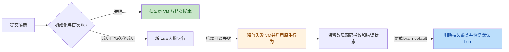

# N4 常驻 Lua 大脑现场记录

设备为 CoreBoard V1.2，交互板在右槽，仍使用旧分区布局。所有更新仅写
`main_app` 的 `0x210000` 起始区域；未执行 N6 迁移。

## 热加载、拒绝候选与持久化

第一轮运行普通镜像 `7b7b65b0c5575e6734b332f0804ba3065c602cecac8f349b97e7416535d20fe7`。
证据位于 `target/n4-live-20261024/`，根审查汇总为
`partial-acceptance-through-10.json`，原始采集、回执和操作者反馈分别保存。

| 用例 | 现场结果 |
| --- | --- |
| 默认基线 | Lua/default，29672 B，CRC `bc14ae2e`，error=0 |
| Happy 热加载 | commit 成功，Lua/custom，402 B，CRC `e36bbd88`，error=0；操作者确认持续开心 |
| 错误候选 | 97 B 缺少闭合 `}` 的脚本被 `brain-commit` 拒绝；原 Happy 指纹和状态保持，操作者确认开心及点按有效 |
| Happy 重启保留 | 一次软件重启，主机观察到 USB 消失和返回，启动日志为 CoreSw；存储挂载后加载相同 Happy，操作者确认稳定后的表情与点按 |
| 延迟运行时错误 | 新脚本先 commit 成功、custom/error=0；约 10 秒后为 native/custom/相同源码 CRC/error=1，绘制持续，Happy 转 Idle |
| 原生接管后的反应 | 后续日志有 Peering、Satisfied、Puzzled、Angry 和 Angry 震动请求；操作者反馈画面无异常。没有独立触感或精确触摸延迟结论 |
| 恢复默认 | `brain-default` 成功，随后精确 default/29672 B/`bc14ae2e`/error=0；皮肤仍 default，下载应用仍为原四个 |

延迟错误的严格用例 `08-delayed-error` 保留为 **failed**：状态回退及通信存活
通过，但原始设备日志没有错误原因，无法完成故障分类。主机真实 VM 测试支持夹具
预期，不能替代设备原因日志。未在该镜像继续测试循环或内存耗尽。

## 运行时故障原因日志修复

源码核查确认 `Controller::dispatch_inbox` 原来在失败时仅保存错误、释放活动 VM，
普通运行时回退没有打印原因。启动失败和命令拒绝已有日志，不能覆盖这一分支。

`02ce70d` 在唯一活动 VM → inactive 转移处增加一次
`brain: runtime fallback: ...` 警告。失败 VM 先释放；完整错误继续保存在 Controller，
日志复用 96 B 首行格式化，阻止脚本换行伪造协议回执。后续 inactive 调用不重复打印，
有效替换后的新故障可以再次报告。回调预算、候选事务和持久化规则保持原语义。

`target/n4-runtime-fallback-log-20261024/` 保存主机与构建证据：269 项库测试、
真实 VM 的普通错误／预算耗尽／内存不足分类、故障后 100 次调用不刷日志、重新加载
后再次报告、事件错误的换行截断、普通固件构建、严格镜像检查及 714 个 ROM 符号
检查通过。根代理独立核对了 586 个源码指纹和产物。该目录的 `6609b356…` 镜像未刷入；
实际刷入的是包含下一项清灯改进的组合镜像。

## RESET 后的早期清灯

`c86811b` 将原 RMT 灯光／振动初始化提前到 USB task 启动之后、LCD／触摸／UI／
模块初始化之前。启动最多让出等待 100 ms，确认六颗 WS2812 黑帧发送及至少
280 μs 锁存完成；无回执时记录警告并继续启动。原电源 GPIO57／GPIO60 配置未改变。
9 项灯光／按钮生命周期检查、普通构建、严格镜像和 ROM 符号检查通过。

此路径在应用开始运行后执行。按住 RESET 或停留 ROM 下载模式时应用不运行，
不能据此声称复位边沿熄灯、下载期间断电或全部外设断电。V1.2 的 GPIO60 控制
屏幕和外扩供电，板载外设还有其他电源域；资料及电气边界见
[V1.2 资料核对](lessons/esp-mosaico-v1.2-reference.md)。

组合镜像位于 `target/lights-early-reset-clear-usb-first-20261024/`：

- BIN：3,057,568 B；SHA256 `c8e4f00de7a31aec5936ffc3f54cedd0b0fc992a595beee07949365f54f9af42`。
- ELF：SHA256 `1032e91beaa194396a2ff4d17ee5f2abeb76a2b56251e9cc9409e2d56dd2aec7`。
- `target/usb-session-live-20261024/flash-06/`：完整应用读回一致、引导区与原备份
  逐字节一致、历史应用头一致；随后一次 watchdog-reset。
- `27-n4-early-lights-startup`：默认脑与皮肤查询正常，启动黑帧成功回执位于触摸
  初始化之前。该日志顺序不等于 RESET 边沿到物理熄灯的测量。

`target/reset-peripheral-review-20261024/03-physical-reset` 观察到 USB 消失和返回，
随后完成启动及默认脑、默认皮肤查询。黑帧完成位于日志第 19 行，LCD 清屏从第 20 行
开始；没有清灯超时警告。操作者反馈「主页恢复以后灯光熄灭，点击有效」。这确认了
重启后的残灯清除和触摸恢复，未确认物理熄灯早于主页或等于 RESET 边沿。
`04-cleanup` 收到临时测试页 `rmdata`、`rm` 成功回执，下载列表精确恢复原四个应用，
默认脑与默认皮肤保留。未将管理回执扩大为删除后 appdata 路径的直接检查。

## 组合镜像故障复测

组合镜像的新验收目录为 `target/n4-reset-live-20261024/`，通过 `image-preflight.json`
绑定实际 flash-06、启动、物理 RESET 与清理后的默认基线。`acceptance-through-10.json`
独立核对了前 10 阶段的原始文件指纹，旧目录的 `08-delayed-error` failed 保留不变。

| 新镜像用例 | 设备证据 |
| --- | --- |
| Happy 与语法拒绝复测 | 402 B／CRC `e36bbd88` 激活；错误候选拒绝后仍为同一 Happy，error=0 |
| 延迟普通错误 | 230 B／CRC `1b34eac5`，先 Lua/error=0，约 10 秒后记录 `N4 delayed ordinary error`，变为 native/error=1 |
| 延迟无限循环 | 213 B／CRC `30cf7e3d`，先 Lua/error=0，随后记录 `callback budget exhausted (wall; ...)`，变为 native/error=1 |
| 延迟内存耗尽 | 248 B／CRC `d80693d8`，先 Lua/error=0，随后记录 `not enough memory`，变为 native/error=1 |

三种故障的原因均在对应采集窗口内只出现一次，回退后 hello、精确状态查询和 plane
帧遥测继续。前两种故障后显式恢复默认，再安装 Happy 作为下一轮起点；没有自动
重复执行失败脚本。以上不替代每种故障后的物理关机或长期稳定性验收。

## 验收边界

N4 整体尚未通过。最终默认重启、
持久文件直接清理检查、前台 VM 并存、全部输入时间线、原生反射与设置优先级仍须
逐项取得设备证据。Happy 状态不证明后台回调持续调度；默认状态也不独立证明
`.incoming` 或 `.next.lua` 不存在。临时应用和脚本的清理结果按每轮实际回执记录。
