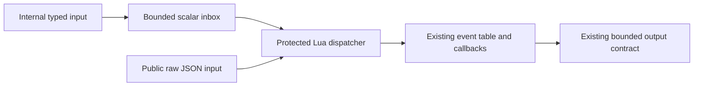

# N4 resident Lua brain

The resident brain owns behavior decisions; Rust retains sensor production,
rendering, physical effects, foreground application execution, and terminal
shutdown. The bundled brain is `crates/mosaico-s31/assets/brain/default.lua`.
It implements Affect and Personality in Lua, including thresholds, timelines,
hysteresis, sleep/wake, activity layers, magnetic/module sequences, touch
reactions, and the merge and haptic priority rules. No host callback computes
native Affect or Personality answers on its behalf.

## Ownership and fallback

`behavior::brain::BrainVm` is a distinct Lua state with its own host, heap,
callback accounting, and storage-root identity. It does not reuse the foreground
app VM. `Runtime` continues feeding every sensor, pointer, interaction, ignored
touch deadline, and timer to the native engines while Lua is active. The UI preserves its existing off-Home filter: only lasting sensor state is
delivered while foreground apps own interaction. Both engines receive identical
accepted inputs. Native Error/Panic remain authoritative over custom resident
expression, pose, LED and haptic outputs. Other native
outputs are suppressed while resident callbacks succeed. If an ordinary callback
fails, the resident state is discarded and the same runtime publishes its warm
native state immediately. The failing callback's staged effects are discarded.
There is no replay of a bounded or incomplete history and no repeated automatic
retry of bad source. A later explicit reload can recover even after bad persisted
source prevented initial startup.

Rust's FoxAnimator and RGB565 renderer keep running at their existing cadence.
Lua selects expression, animation and bounded visual parameters; it does not
supply raster frames. `fox.play` expires by millisecond deadline and returns to
the selected expression. The terminal shutdown path removes the resident state,
clears its output lease, selects Sleep, and retains the existing presented-frame
receipt before power-off. Reload is rejected once shutdown begins.

## Script contract

A source file returns a table with `on_event(event)` and `tick(now_ms)`, or a table
whose `create(start_ms)` returns that object. Functions are called with dot syntax.
`on_event` returns nil or boolean; false means a pointer input was intentionally
ignored. `tick` returns no application result. Initialization and the first tick
must both complete before a candidate becomes active.

Sensor input has this JSON-equivalent typed shape:

```lua
{ type='SensorEvent', at_ms=1234, source='Imu',
  kind={type='Accel', ax_mg=0, ay_mg=0, az_mg=1000} }
{ type='SensorEvent', at_ms=1234, source='Imu',
  kind={type='Gyro', gx_dps=0, gy_dps=0, gz_dps=320} }
{ type='SensorEvent', at_ms=1234, source='Light',
  kind={type='LightLevel',args={60}} }
{ type='SensorEvent', at_ms=1234, source='KeyLeft',kind='KeyDown' }
{ type='PointerSample',at_ms=1234,x=240,y=240,pressed=true }
{ type='Interaction',at_ms=1234 }
{ type='IgnoreTouch',at_ms=3000 }
```

Timestamps and durations are milliseconds. Accelerometer values are milli-g,
gyroscope values degrees/second, light is filtered relative 0–100 (not lux),
magnetic classifier confidence and battery charge are 0–100. Presence carries a
boolean. ModuleInserted/ModuleRemoved carry Interaction or Camera; Activity
carries an expression. The source enum is preserved, including separate left and
right keys/modules and power/boot buttons. The serialization is exhaustive for
payload-bearing EventKind variants, so field names preserve their units.

Since `8d49214`, internally generated inputs use a typed inbox instead of a JSON
string. The existing `host.next()` callback returns at most seven scalar values;
the resident Lua dispatcher constructs the same event tables inside protected
`lua_resume` execution. Table allocation therefore remains subject to the VM's
heap and instruction budgets. The public raw JSON `BrainVm::rpc` and
`Controller::dispatch` paths remain available. Numbers retain the previous
JSON decoder's floating-point mapping, including large timestamp rounding;
booleans, unit variants, structured variants and one-based `args` retain their
existing shapes. Output JSON and pointer nil/false semantics are unchanged.



Host differential tests cover the new input route, numeric boundaries, reset and
expiry behavior, errors, OOM and instruction exhaustion. The 4,161 frozen oracle
calls still exercise the raw route and are not counted as direct typed coverage.
Builds and independent artifact checks are recorded in
`target/brain-input-rpc-20261024/`; device timing after this change is not yet
measured. The latest ordinary device image before this optimization has touch
P95 51 ms against the unchanged 50 ms limit.

Available output functions:

| Function | Contract |
| --- | --- |
| `fox.set_expression(name)` | One of the 18 native Expression names |
| `fox.play(pose,duration_ms)` | One of the 20 FoxPose names; duration 1–60000 ms |
| `fox.visual(look_x,pulse,pet,lean_x)` | Finite numbers; ranges ±8, 0–1, 0–1, ±6 |
| `fox.command(name)` | Hub, StartListening or StopActivity |
| `haptic.play(name)` | One of the existing 13 named HapticPattern presets |
| `led_strip.set(index,r,g,b)` | Index 1–6; integral channels 0–255 |
| `led_strip.clear()` | Releases the resident frame |

Hub navigation is connected to the existing Launcher. StartListening and
StopActivity update the default brain's Activity behavior; they do not create a
voice service. Haptics pass through existing settings, page visibility and
hardware rate limiting. LED output uses a separate resident frame and a renewable
200 ms lease. It never acquires, clears or replaces the foreground Lua LED lease.
The owner order remains foreground app / Settings preview / dark page before
resident Home output. Key and module native reflex windows precede resident
frames, and disabling lights forces black after arbitration.

## Bounds and teardown

Source is limited to 64 KiB and each resident Lua heap to 512 KiB. Every init,
first tick, event and tick receives 2000 count hooks at an interval of 100 Lua
instructions, with at most 128 resume attempts. With the firmware monotonic
clock installed, hooks also enforce a 20 ms deadline. These are hook-observed
budgets, not an assertion that arbitrary C execution can be preempted at 20 ms.
The restricted environment removes pattern matching, formatting, repetition,
loading, binary dumping, IO, OS, package/require, debug, coroutine and explicit
GC APIs. The VM's original string table is reduced too, so string colon syntax
and the string metatable cannot recover the removed pattern APIs. The remaining
string operations traverse at most the bounded Lua heap. Native JSON bridge
allocations, source ownership, host output and the old/candidate overlap are
separate from the per-VM Lua allocation counter; 512 KiB is not a total process
memory claim.

Count-hook exhaustion takes an uncatchable escape from the C hook to a C
`setjmp` boundary around `lua_resume`. The Rust hook returns before the C escape;
it never jumps across a Rust hook frame. The aborted VM is never resumed.
Restricted VMs disable script `__gc` from the moment budgets are enabled,
including ordinary collection: Lua normally suppresses hooks while running GC
finalizers, and allocation in a Rust Call could otherwise execute an unbounded
script finalizer across a Rust frame. Restricted discard frees all Lua objects
and closes upvalues without invoking script `__gc` or `__close`. A Lua `__close`
executed during a normal callback remains subject to the callback hook guard.

The resident sandbox cannot obtain IO/native resource handles. Its hardware
functions only stage owned Rust values. Native exit cleanups are a fixed array of
C function pointers registered by trusted modules, independent of mutable Lua
package tables; no Lua exit callback is invoked during discard. Ordinary
foreground VMs keep their existing lua_close and finalizer behavior, including
per-VM roots during finalization. The restricted-finalizer changes to vendored
Lua are listed in `crates/mosaico-lua/vendor/NOTICE.md`.

## Transactional replacement

`Runtime::reload_brain_transaction` constructs a separate candidate, runs source
initialization and the first tick against a separate staged output, then invokes
the persistence commit callback. Only a successful commit swaps ownership.
Syntax errors, init/first-tick errors, loops, memory exhaustion and persistence
failure preserve the old VM, source and output. This is also the protocol's
completion boundary; enqueueing a reload is not success. See the brain commands
in `scripts/push-app.py --help` and the push protocol for transfer and status.
The persisted active source is `/data/brain/active.lua`; the firmware control
queue owns loading and committing it, while the UI owns both VM validation and
activation. No filesystem lock is held while executing Lua.

## USB delivery and persisted selection

The normal runtime USB console accepts these CLI operations:

```sh
python3 scripts/push-app.py brain-push examples/brains/happy.lua
python3 scripts/push-app.py brain-status
python3 scripts/push-app.py brain-reload
python3 scripts/push-app.py brain-default
```

`brain-push` accepts one nonempty UTF-8 file up to 65536 bytes. It transfers
`source.lua` with the existing byte count and CRC protocol into
`/data/brain/.incoming/resident/`, then sends `brain-commit`. The commit command
is deferred at its exact stream boundary: commands in the same USB packet wait
until the UI has returned the real result. Receiving the source file is not an
activation receipt. CRC failure, disconnect, wrong filename or oversized source
cannot overwrite `/data/brain/active.lua`.

After candidate validation, persistence writes and syncs `.next.lua`, closes the
file, and atomically renames it over `active.lua`. Only then does the candidate
replace the old VM. A partial `.next.lua` is ignored at boot. Syntax, callback or
storage failure leaves both the selected file and the last good VM in place.
`brain-reload` explicitly retries the persisted source. `brain-default` first
validates the bundled default, then removes the persisted override and activates
the default. Neither command automatically loops after a runtime failure.

`brain-status` reports `active=lua|native`, `source=default|custom`, the configured
source byte count and CRC, and an error flag. The source fingerprint remains the
last configured source after runtime failure; `active=native error=1` identifies
fallback. Detailed failure reasons appear in the console log. A missing data
mount or unreadable persisted file is an error, not a successful default
selection. A later valid push can recover without rebooting.

The device queue has one owner, and mutating requests are rejected during
shutdown. Protocol errors keep one bounded UTF-8 line, preventing a script error
from injecting a second protocol reply. `brain-default` is the normal recovery
command after manually trying a custom brain. The original behavior can also be
restored by pushing `crates/mosaico-s31/assets/brain/default.lua`.

## Evidence and limits

Host receipts are under `target/n4-acceptance-20261023/`. The frozen native oracle
is tracked at `crates/mosaico-s31/testdata/n4-native-oracle/native-contract.json`: 4161 calls, 89 engine
instances and 88 original native tests. The real production BrainVm dispatcher
runs each oracle call against the Lua implementations. Recursive comparison
checks every expected field and rejects unexpected non-null fields; absent Lua
nil and explicit JSON null are equivalent. Numeric tolerance is 1e-5 absolute or
relative for native f32 versus Lua double arithmetic. Discrete states, reasons,
commands, expressions, reaction identities, timestamps and booleans are checked
exactly. The oracle is not generated from or rewritten by the Lua implementation.

Additional real-VM tests cover init/firsttick loops, pcall-caught loops,
allocation growth, error followed by infinite finalizers, ordinary-GC infinite
finalizers, `__close` loops, removal of coroutine/string bypasses, failed and valid
transactional swaps, persistence failure, bad-boot recovery, warm fallback,
foreground/resident interleaving, and actual LVGL/Rust animation and shutdown.
Adversarial tests are also run under an external subprocess timeout so a broken
termination mechanism cannot indefinitely hang acceptance.

Physical USB reload, device display continuity, actual haptic/LED output and
hardware shutdown acceptance require an attended device session. Host tests and
a successful firmware build do not establish those physical receipts.

## Boot ordering

The bundled brain starts before the UI drains its first input. Storage mounts
later; after that mount attempt, persisted selection is resolved exactly once.
If no override exists, the active bundled VM is retained with its earlier module
edges, battery state and light input. A valid override replaces it; unreadable or
invalid persisted source selects warm native fallback. A Runtime regression
covers inputs before mount, missing selection state retention, bad selection and
subsequent valid recovery.

## 2026-10-23 independent acceptance receipt

The final source passed `./scripts/check.sh`: 239 s31 + 50 Lua + 10 filesystem +
42 pure driver tests = **341**. Both native previews, the release firmware and
629 C ROM-symbol checks passed. All **4161** frozen native calls matched. The
fixture is tracked with its original capture commit and 12 source hashes, so a
clean checkout does not require an ignored target directory.

The independent process runner exercised **12** rejected/hostile candidates,
including actual table allocation exhaustion, caught loops, string colon and
metatable paths, ordinary GC and scope-close paths. Each process confirmed
teardown completion, retained the old source/output on rejection and did not
reach the persistence callback. The harness has a 3-second external timeout;
this is host termination evidence, not device callback latency measurement.
The complete Python tool suite passed **21** tests. `git diff --check` passed.

Artifacts and logs: `target/n4-acceptance-20261023/`. The frozen implementation
manifest digest is `dab29c4e47825d403925bbfd13e7a57196ecf09df853831f7fa180f966e32aa5`.
The BIN is **2,770,528 bytes**, leaving **375,200 bytes** in a 3 MiB slot. It was
serialized with explicit ESP32-S31, 16 MiB, DIO/40 MHz metadata; esptool validated
its image checksum and embedded hash.

- BIN SHA256: `7af1b19df9f4838307dc8675daaf18e6a26398eedbcd3c43a8edf50ad1f07fb0`.
- ELF SHA256: `494e0f2d2e1e0dc4196780c349dda93eeaac656621bef45ec371405894d658fc`.
- Physical acceptance: **not-run**. This image has not been flashed.
