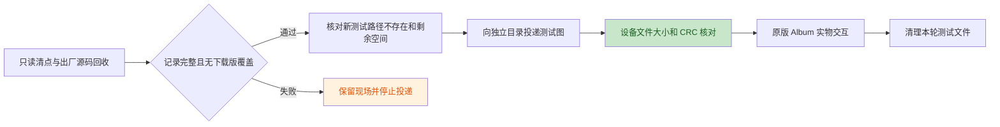

# N5 相册、图像与 worker 现场验收

日期：2026-10-24。设备为 ESP-Mosaico CoreBoard V1.2，USB 与右槽交互板连接，
旧分区布局。当前只完成原版程序核对、照片清点、空库显示及返回；有照片的相册
交互、独立图像与 worker 用例仍待验收。

## 镜像与基线

运行普通镜像来自 `0b1b211`，未开启诊断 feature。BIN 为 3,058,496 字节，SHA-256：

```text
dce2f5f0bfaeb56806d933b3266dc9a11df3ea3b1c309e43f05c0abe58d9ca56
```

`target/slot-recovery-live-20261024/flash-01/root-verified.json` 保存完整应用读回和
引导区不变的核对结果。本轮证据目录为 `target/n5-live-20261024/`，
`image-binding.json` 绑定镜像、刷写复核、N4 最终清理和 N5 初始查询。
没有分区迁移、otadata 写入或重新刷写。

初始设备为默认 Lua 大脑（29,672 字节，CRC `bc14ae2e`）、默认皮肤，以及原有
`hardware_probe`、`hello_push`、`n1_contract_probe`、`n1_lifecycle_probe` 四个
下载应用。`01-baseline` 记录 data 可用 463 / 512 个 4096 字节块。

## 文件清点与投递边界



`02-inventory` 安装唯一临时清点应用 `n5_inventory_20261024_d6a90e`。探针只读
出厂相册源码和相册文件树，对所有照片类型记录路径、元数据及内容 CRC；暂存树
只记录元数据。不存在必须有明确 `ENOENT`；其他 I/O 错误、预算耗尽或记录缺失
均判为清点不完整。路径以原始字节的十六进制表示，未经截断或替换。

固件日志每行正文最多 158 字节，包含 Lua 来源前缀。清点工具将逻辑记录拆成短帧，
核对来源、序号、分片数及分片／整条 CRC。主机 18 项测试通过；真实设备回收
3,743 帧、168 条逻辑记录，原始串口字节与文本日志一致，独立重组通过。
清点不是照片备份或原子文件系统快照；原生 `storage.listdir` 仍同步执行。

实际结果：

| 检查对象 | 设备结果 |
| --- | --- |
| `/data/apps/album_app` | `ENOENT`，无下载版覆盖出厂相册 |
| `/system/apps/album_app/launcher.json` | 158 字节，与冻结原版逐字节一致；SHA `7a7c2951ac92d9ee1c1d35a7533d5275c41099469a90979a26d8730c6eb43733` |
| `/system/apps/album_app/scripts/album_app.lua` | 16,643 字节，与冻结原版逐字节一致；SHA `9324845e21df28b01284e0b06c01790366fb4ef095572cf104b6dece5a74b7ac` |
| `/data/appdata/album_app/photos` 和 `.incoming` | 均为 `ENOENT`，本轮清点没有既有照片或暂存照片 |
| 测试目录 `photos/n5_guard_20261024_f4d82c` 及所有计划文件 | 均为 `ENOENT` |
| 安装清点探针后的可用空间 | 1,863,680 / 2,097,152 字节 |

探针正常结束，随后默认大脑、默认皮肤及原四应用加唯一探针的列表查询通过。
运行日志为 49,939 ms、5,331 slices、最长 slice 24,911 µs；该工具结果不用于
声明设备调度或触摸实时性通过。独立复核在 `02-root-verification.json`。

## 原版空库与返回

`03-empty-album` 从启动器运行出厂 `album_app`，日志确认 `found 0 image(s)`。
照片目录不存在的警告与清点结果一致。操作者确认 Album、空库显示正常，随后
明确确认已通过左边缘返回应用列表。

日志记录 `App(Lua(3)) -> Launcher` 及 `lua[album_app]: stopped`，运行
122,879 ms，早于原版 180,000 ms 自动结束期限。本项覆盖手势退出，不将其计为
自然到期退出。日志仍有既有触摸 Header 和 sensor drain 警告，未据主观正常
宣称这些问题消失。

`03-postflight` 再次确认默认大脑、默认皮肤、原四应用加清点探针，data 可用
453 / 512 块（1,855,488 字节）。`03-root-verification.json` 绑定两份采集收据
与操作者反馈。

## 当前清理与后续范围

目前没有上传测试照片，临时清点应用仍保留，原版 Album 已停止。后续只向已证实
不存在的独立测试目录投递，清理限定为本轮创建的应用和文件；不调用全相册
`rmdata album_app`。

待验收项包括有照片的缩略图、滚动、全屏、前后张、返回、删除取消／确认、
损坏图片与重复打开退出；同名替换、CRC 错包和中断恢复；独立 PNG、JPEG
编码保存及 worker 执行／停止／退出清理。原版相册只枚举 JPG / JPEG / BIN，
其结果不替代 PNG 或 worker 验收。完整清单见
[集中真机验收](N1_N7_DEVICE_ACCEPTANCE.md#n5-相册图像与-worker)。
