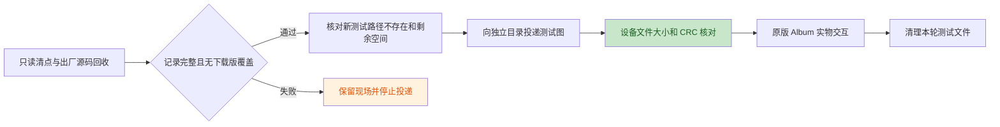

# N5 相册、图像与 worker 现场验收

日期：2026-10-24 至 2026-10-26。设备为 ESP-Mosaico CoreBoard V1.2，USB 与右槽交互板连接，
旧分区布局。已完成原版程序核对、照片清点、空库显示及返回，以及三张 JPEG 的
投递、文件校验、显示、前后切换、返回网格和删除取消。扩充到二十张后复现轻微
卡顿和单图切换全屏黑闪；后续切图输入、三列滚动和启动白屏已有对应修复与复测。
原版确认删除、损坏图片、照片事务、JPEG／BIN、独立图像与 worker 功能用例，
以及前台错误／AI 关机后的恢复已通过对应检查。整体性能、长期资源、整库清数据
及正式三列交付仍未完成，80 MHz 残影暂缓，详见各阶段记录。

## 镜像与基线

首次验收与修复前基线为 `0b1b211` 普通镜像，未开启诊断 feature。BIN 为 3,058,496 字节，SHA-256：

```text
dce2f5f0bfaeb56806d933b3266dc9a11df3ea3b1c309e43f05c0abe58d9ca56
```

`target/slot-recovery-live-20261024/flash-01/root-verified.json` 保存完整应用读回和
引导区不变的核对结果。本轮证据目录为 `target/n5-live-20261024/`，
`image-binding.json` 绑定镜像、刷写复核、N4 最终清理和 N5 初始查询。
没有分区迁移、otadata 写入或重新刷写。

初始设备为默认 Lua 大脑（29,672 字节，CRC `bc14ae2e`）、默认皮肤，以及原有
`hardware_probe`、`hello_push`、`n1_contract_probe`、`n1_lifecycle_probe` 四个
下载应用。`01-baseline` 记录 data 可用 463 / 512 个 4096 字节块。

## 文件清点与投递边界



`02-inventory` 安装唯一临时清点应用 `n5_inventory_20261024_d6a90e`。探针只读
出厂相册源码和相册文件树，对所有照片类型记录路径、元数据及内容 CRC；暂存树
只记录元数据。不存在必须有明确 `ENOENT`；其他 I/O 错误、预算耗尽或记录缺失
均判为清点不完整。路径以原始字节的十六进制表示，未经截断或替换。

固件日志每行正文最多 158 字节，包含 Lua 来源前缀。清点工具将逻辑记录拆成短帧，
核对来源、序号、分片数及分片／整条 CRC。主机 18 项测试通过；真实设备回收
3,743 帧、168 条逻辑记录，原始串口字节与文本日志一致，独立重组通过。
清点不是照片备份或原子文件系统快照；原生 `storage.listdir` 仍同步执行。

实际结果：

| 检查对象 | 设备结果 |
| --- | --- |
| `/data/apps/album_app` | `ENOENT`，无下载版覆盖出厂相册 |
| `/system/apps/album_app/launcher.json` | 158 字节，与冻结原版逐字节一致；SHA `7a7c2951ac92d9ee1c1d35a7533d5275c41099469a90979a26d8730c6eb43733` |
| `/system/apps/album_app/scripts/album_app.lua` | 16,643 字节，与冻结原版逐字节一致；SHA `9324845e21df28b01284e0b06c01790366fb4ef095572cf104b6dece5a74b7ac` |
| `/data/appdata/album_app/photos` 和 `.incoming` | 均为 `ENOENT`，本轮清点没有既有照片或暂存照片 |
| 测试目录 `photos/n5_guard_20261024_f4d82c` 及所有计划文件 | 均为 `ENOENT` |
| 安装清点探针后的可用空间 | 1,863,680 / 2,097,152 字节 |

探针正常结束，随后默认大脑、默认皮肤及原四应用加唯一探针的列表查询通过。
运行日志为 49,939 ms、5,331 slices、最长 slice 24,911 µs；该工具结果不用于
声明设备调度或触摸实时性通过。独立复核在 `02-root-verification.json`。

## 原版空库与返回

`03-empty-album` 从启动器运行出厂 `album_app`，日志确认 `found 0 image(s)`。
照片目录不存在的警告与清点结果一致。操作者确认 Album、空库显示正常，随后
明确确认已通过左边缘返回应用列表。

日志记录 `App(Lua(3)) -> Launcher` 及 `lua[album_app]: stopped`，运行
122,879 ms，早于原版 180,000 ms 自动结束期限。本项覆盖手势退出，不将其计为
自然到期退出。日志仍有既有触摸 Header 和 sensor drain 警告，未据主观正常
宣称这些问题消失。

`03-postflight` 再次确认默认大脑、默认皮肤、原四应用加清点探针，data 可用
453 / 512 块（1,855,488 字节）。`03-root-verification.json` 绑定两份采集收据
与操作者反馈。

## 三张 JPEG 与原版浏览

`04-first-three` 依次提交独立测试目录内的三个新 JPEG，每张均收到传输 CRC 与
提交回执。临时只读应用 `n5_photo_verify_20261024_3c71d8` 随后从设备读取文件，
完整清点照片树并再次核对出厂源码；没有额外照片路径，`.incoming` 明确不存在。

| 文件 | 字节数 | 设备读出内容 CRC32 |
| --- | --- | --- |
| `n5_f4d82c_01.jpg` | 3,190 | `ca26d943` |
| `n5_f4d82c_02.jpg` | 3,528 | `0e7f746f` |
| `n5_f4d82c_03.jpg` | 3,527 | `ce24035c` |

三图均为 160×96：左蓝右暗红、中央白色编号、顶部白色三角及不同颜色的角标。
`05-three-album` 运行原版并记录 `found 3 image(s)`。操作者确认颜色、方向、
网格到单图页、左右前后张、点图回网格以及 Delete 弹框 Cancel 均正常，取消后
仍有三张。没有 Album 加载错误或删除日志；下一轮投递前仍需再次读取文件核对
取消后的三张实际内容。

本轮有系统返回启动器及 VM `stopped` 日志，运行 127,838 ms，早于自然结束期限。
Lua 峰值 298,244 字节，8,171 slices 中最长 **323,903 µs**，且有 sensor drain
警告。主观操作正常不代表调度满足 20 ms；同步图像路径的耗时仍需定位，也未由
单次结束后的堆空闲变化建立长期资源稳定性结论。

`05-postflight` 已对两只用完的临时核验应用分别执行精确的 `rmdata` 与 `rm`，
均收到回执。列表恢复原四应用，默认大脑和皮肤通过，data 可用 454 / 512 块
（1,859,584 字节）；此处清理有命令回执和应用列表，未另行直接 stat 已删除目录。
三张测试照片仍保留供后续浏览验收。收据分别绑定在 `04-root-verification.json`
和 `05-root-verification.json`。

`05-natural-exit` 使用同三张图补验静置自然结束：日志按顺序出现 `found 3`、
`done images=3`、`finished` 和返回启动器，运行 180,580 ms，采集中没有触摸
按下或外部 stop 命令。峰值 193,820 字节，最长 slice 114,876 µs。
`05-natural-postflight` 确认原四应用、默认大脑／皮肤及可用 454 块；收据在
`05-natural-root-verification.json`。该轮没有重新请求目视图片确认，也没有
回读照片内容；后续投递前的文件核对仍保留。

## 二十张图片与已复现缺陷

`06-expand-grid` 安装独立只读核验应用，先重新读取三张图片与完整照片树。
实际三图与 `04` 的大小、CRC、路径完全一致，补齐 Delete Cancel 后保留文件的
客观证据；`.incoming` 不存在。随后只追加既定的 04–20 共十七张，每张收到 CRC
与提交回执；第二轮独立读取完整二十图，所有文件大小／CRC 均匹配，原三图不变，
没有额外路径或暂存残留。两次运行的日志各自解析，序号分别从零开始。

本轮出厂源码只核对设备当前大小和 CRC，SHA 参考来自 `02`／`04` 的完整源码
回收，未重新传输源码或在设备计算 SHA。追加与两轮读取共 164.195 秒，后续仅
需文件指纹的核验将改为每文件输出最终 CRC，并继续逐小块读取和让出执行。
`06-root-verification.json` 绑定完整证据。

`07-grid-album` 运行原版相册并识别二十张。操作者报告“无错位，但是略微卡顿，
而且进入单图以后，切换图会全屏幕黑一下再显示”。本项未通过。两次相册运行
最长 slice 分别为 325,160／324,542 µs，Lua 峰值为 262,478／293,433 字节；
没有 Album 加载错误或删除日志。期间返回启动器并打开其他核验应用的行为已确认
为操作者主动操作，不记为意外跳转。

源码存在中间帧提交路径：原版 `show_fullscreen` 先 `screen:clean()`，后续
逐条创建新页面；每条 native LVGL 请求返回后，UI task 都可执行刷新并提交
尚未重建完整的页面。图片 resize 也存在同步双线性运算；当前最长 slice 只计
`Vm::resume()`，不含等待 UI 回复的时间，具体图像调用耗时仍待分段验证。
修复保持出厂相册源码不变，调整 native UI 呈现边界和经核验的图像计算路径。

`07-postflight` 停止相册并删除已用完的 grid 核验应用及其数据，回执通过；
应用列表恢复原四项，默认大脑／皮肤通过，data 可用 435 / 512 块
（1,781,760 字节）。`07-root-verification.json` 保留缺陷和清理结果。

## 图像处理分段基线

`08-image-timing-before` 在同一普通镜像上读取既有 160×96 测试 JPEG，重复三轮。
`system.millis()` 记录各调用的经过时间，包含调度与中断开销，不等同于纯 CPU 时间。

| 调用 | 第 1 轮 | 第 2 轮 | 第 3 轮 |
| --- | ---: | ---: | ---: |
| `image.load_file` | 13 ms | 13 ms | 13 ms |
| 双线性处理，160×96 → 160×96 | 313 ms | 298 ms | 298 ms |
| 最近邻处理，160×96 → 160×96 | 23 ms | 17 ms | 17 ms |
| 双线性缩小，160×96 → 80×48 | 98 ms | 99 ms | 98 ms |

每轮均逐字节比较两种原尺寸处理的输出，三轮断言通过，脚本正常结束。
原尺寸双线性处理是已测慢路径；80×48 用于隔离缩小开销，不代表原版相册所有
缩略图的实际尺寸。原版相册按屏幕和网格尺寸计算目标大小。

采集驱动原收据为 `failed`：设备打印 `ms=13.0` 等整数值的小数表示，主机正则
仅接受整数字符串。原始串口、文本及事件记录完整一致；独立解析保留原失败收据，
重新验证十二条测量、完成标志及像素断言，结果在 `08-root-verification.json`。
`08-postflight` 已精确删除临时测量应用及其数据，查询恢复原四应用、默认大脑和
默认皮肤，data 仍可用 435 块。二十张照片保持供修复前后对照。

## 2026-10-25 修复候选与主机验收

基于 `1314197` 加工作区修复，普通候选镜像已封存在
`target/n5-render-fix-20261025/`。活动屏幕清理后保留上一完整画面，在事件批次
结束或脚本休眠前发布新页面；错误恢复、退出和反初始化会正确结束刷新门控。
输入计时器继续运行。原尺寸图像跳过插值，其他比例缓存有限横坐标，保留双线性
计算顺序。原版 Album 源码指纹不变。

413 项 Rust／驱动测试、46 项 Python 测试、四个 N5 探针、独立 Pillow 对照、
两个既有预览和普通固件构建通过；714 个 C 符号未发现 ROM 冲突。原版相册主机
探针覆盖 48 次切页、错误图片、删除和退出，十一幅截图已检查。独立编译的旧 C
公式对 176 组 RGB565／GRAY8 输出逐字节匹配，包括 81×48 缩略图和缓存边界。
先前 Lua 算术参考的差异来自主机 C 浮点乘加收缩，未放宽像素判定阈值。

构建前后 592 个文件指纹一致，独立审查记录为 `root-review.json`。候选产物：

| 产物 | 字节数 | SHA-256 |
| --- | ---: | --- |
| `default.bin` | 3,061,344 | `6143b13135303870ea541053c415885caf0755e8a0f8582ee3b9cca39eabc54b` |
| `default.elf` | 5,494,068 | `a85927b23251a5ce2ea3b1645e8471a4235c12cb9cab28cf305befe4d07ed4d5` |

严格镜像解析与 esptool 均确认 ESP32-S31、16 MiB／DIO／40 MHz、checksum、
embedded SHA 与 ELF 身份，3 MiB 槽剩 84,384 字节。刷写流程已准备在
`target/n5-render-live-20261025/`，仅写旧布局 `0x210000`，包含应用完整回读、
引导区前后核对和自动重启。`09-resume-baseline` 确认刷前原四应用、默认大脑／
皮肤和 435 块可用空间。

`flash-01/root-verified.json` 已确认候选完整回读一致，引导区刷前／刷后／原备份
逐字节一致。自动重启后的 `01-startup` 确认旧布局双挂载、默认大脑与皮肤、原四
应用以及右槽 `R=interact* derr=0`，data 可用空间仍为 435 块。启动时有一次
sensor drain 警告，既有 CST9220 Header 警告也仍存在。

`02-image-timing-after` 使用与修复前逐字节相同的脚本和同一张图，三轮结果如下：

| 调用 | 修复前范围 | 修复后三轮 |
| --- | ---: | --- |
| `image.load_file` | 13 ms | 12／12／13 ms |
| 双线性处理，160×96 → 160×96 | 298–313 ms | 21／13／13 ms |
| 最近邻处理，160×96 → 160×96 | 17–23 ms | 15／13／14 ms |
| 双线性缩小，160×96 → 80×48 | 98–99 ms | 66／65／65 ms |

原尺寸输出仍逐字节一致，正常结束后精确删除测量应用及其数据，默认基线查询
通过；独立证据在 `02-root-verification.json`。缩略图同步调用仍超过 20 ms 切片
目标，不据此判定整体调度通过。`03-album-regression` 运行原版并识别二十图，
操作者确认切图没有闪烁、操作比上一版顺畅，但帧率仍低，需要继续优化。
外部停止时统计为 129,658 ms、9,554 slices、最长 156,982 µs、Lua 峰值
310,642 字节。`03-postflight` 确认原四应用、默认大脑／皮肤与可用 435 块。
日志中的 FPS 字段在无新帧时保留上次值，不将空闲重复值解释为实时刷新率。

## 后续性能优化基线

`target/n5-render-live-20261025/04-perf-baseline` 在当前 `6143b131…` 镜像上
测量原版相册实际使用的 81×48 缩略图，并隔离原生界面命令的等待开销：

| 调用 | 第 1 轮 | 第 2 轮 | 第 3 轮 |
| --- | ---: | ---: | ---: |
| 双线性缩小，160×96 → 81×48 | 83 ms | 84 ms | 68 ms |
| 原尺寸处理，160×96 | 23 ms | 14 ms | 13 ms |
| 连续 20 次 `set_text` | 202 ms | 195 ms | 189 ms |
| 连续 20 次 `get_size` | 168 ms | 169 ms | 169 ms |

`get_size` 不修改画面，但每次请求仍平均等待约 8.4 ms。当前后续优化把普通
双线性计算改为保持旧舍入结果的整数计算，并使用原 UI 空闲窗口响应请求；
不延长窗口、不跨 UI 任务调用 LVGL，停止与释放仍由正常循环处理。

`05-resize-fingerprints-before` 读取既有 01、07、20 三张照片，分别生成
80×48、81×48、31×11、33×7、160×96 的 RGB565／GRAY8，共三十组长度与
CRC32。所有记录完整、脚本正常结束，作为后续同源设备对照；CRC 一致只证明
这些指纹匹配，不表述为完整输出逐字节回读。两只探针均已精确删除应用及数据，
原四应用、默认大脑和皮肤查询通过；不修改照片。

## 第二版性能修复与设备对照

`target/n5-perf-followup-20261025/` 封存整数双线性缩放和原 UI 空闲窗口内的
有界原生请求响应。非二进制权重的精确半数舍入回退旧 double 表达式，合法维度
范围不变。414 项 Rust／驱动、46 项工具测试通过；176 组真实模块旧 C 对照、
10,052 组独立反例搜索（每格式 48,881,924 像素）均逐字节一致。160 组实际
RV32 指令模拟通过，证明目标软件 double 路径的像素一致性，不代表设备性能。
11 幅原版相册主机截图与第一版逐字节相同。独立审核见 `root-review.json`。

普通镜像为 3,062,592 字节，SHA-256
`1cbd57c0912436f40724fa27a0b6ce4fab8c84ff672f615a834d37ae09842c6f`，
3 MiB 槽剩 83,136 字节。`target/n5-render-live-20261025/flash-02/` 保存旧布局
main_app 完整回读、引导区刷前／刷后／原备份一致和自动重启收据；`06-startup`
查询确认默认大脑／皮肤、原四应用、右槽 `R=interact* derr=0` 及 data 可用 435 块。

`07-perf-after` 与 `04` 使用逐字节相同脚本及照片，墙钟结果如下：

| 调用 | 第一版三轮 | 第二版三轮 |
| --- | --- | --- |
| 双线性 81×48 | 83／84／68 ms | 25／17／17 ms |
| 原尺寸处理 160×96 | 23／14／13 ms | 13／14／13 ms |
| 连续 20 次 `set_text` | 202／195／189 ms | 138／99／99 ms |
| 连续 20 次 `get_size` | 168／169／169 ms | 72／78／79 ms |

`08-resize-fingerprints-after` 同源重复三十组输出，长度与 CRC 全部等于 `05`
基线。两只临时应用及数据均已精确清理；默认基线查询通过。独立解析与输入指纹
见 `07-08-root-comparison.json`。一次缩略图仍需 25 ms，未宣布全部调用满足
20 ms；这些测量也不替代帧率或完整像素回读。

`09-album-perf-regression` 运行未修改的原版相册并识别二十图。操作者反馈额外
流畅度提升感知不明显，但无错位、无黑闪。日志记录 37,900 ms 后 `stopped`，
3,896 slices、最长 185,164 µs、峰值 331,103 字节。返回发生于原版三分钟期限前，
采集没有发出外部 stop；此处尚未取得明确的返回手势目视反馈。仍有既有传感器
drain／Header 警告，不把调用耗时下降扩大为整体调度通过。

## 原生显示分段诊断

第二版额外流畅度提升感知不明显，继续测量正常原生 Lua 页面中的 LVGL handler、
flush、shadow lease、提交／取帧、TE 等待、传输及释放。`native-ui-diagnostics`
默认关闭；本轮不改显示调度、刷新周期、缓冲区、TE 策略或原版 Album。

诊断镜像 `target/n5-native-profile-20261025/diagnostic.bin` 为 3,077,984 字节，
SHA-256 `16b03146d09fff23bf38bb0531c80b8b7b659e55d5aa1986bab584fa475cf425`。
419 项 Rust／驱动、46 项 Python、三只原生探针、两个预览及两套镜像校验通过；
主控核验 595 个源码指纹、92 个证据文件及十一幅原版相册截图。
`flash-03/root-verified.json` 保存旧布局 main_app 完整回读、引导区一致与自动
启动独立核验，`10-profile-startup` 默认脑／皮肤、原四应用、右槽及存储查询通过。

`11-native-grid-profile` 运行原版 Album、识别二十图。操作者同时进行了网格和单图
操作，第一次意外退出到 Home 后自行重新进入，因此整个会话不能视为纯滚动样本。
239 个报告窗口三行齐全，无解析缺行；第一次退出记录提交／完成 309 帧、取消 0，
保留末十二个慢帧，全部为 `[8,42,471,471]` 网格区域（199,520 像素、18 次 flush）。

| 末十二个网格慢帧的阶段 | 最小／中位／最大，ms |
| --- | --- |
| LVGL handler（含 flush） | 64.799／84.768／102.976 |
| 提交到取帧 | 0.067／0.073／0.078 |
| TE 等待 | 2.186／9.985／15.961 |
| 传输（含打包及 SPI 等待） | 22.325／23.736／25.382 |

flush 本身为 5.268–5.436 ms，已包含在 handler 内。这组证据支持先定位 handler
内部非 flush 开销，尚不能细分纯绘制、布局或其他处理。窗口的实际完成率包含静止
时间；末十二个慢帧是偏样本，不代表全部帧延迟分布。lease 与 CPU 工作重叠，不能
相加为独立 CPU 时间。独立复算见 `11-root-verification.json` 与诊断目录
`root-11-final-analysis.json`；计量定义见 `measurement-contract.md`。

### 单图箭头点击在重建期间返回网格

操作者在 `11` 反馈连续点 `< / >` 约三张后返回网格，`12-arrow-reproduction`
按慢点／快点要求复测后反馈后续一次也会返回。`12` 原版自然运行 180,795 ms 后
结束，无应用错误，二十图仍在；`12-postflight` 的默认脑／皮肤、原四应用及存储
查询通过。操作反馈未单独区分慢点与快点结果，不补推确切触发次数。

主机使用同一未修改 Album、二十张原 JPEG、真实 LVGL pointer 和逐 RPC 执行复现：
稳定右箭头范围为 `[404,208,467,271]`，中心与内缘各连续八次均正常；范围外点按
按原脚本返回网格。设备日志包含范围内外两类坐标，单靠按下日志不能逐次判定目标。

另在 `screen:clean` 后、画布及其点击回调已建好但新箭头尚未创建时，于旧箭头内部
`(418,251)` 注入一次实际 press／release。flush 计数保持 147，旧画面不变，但
最终返回网格。主控独立重复得到相同结果，说明保留旧画面时仍对半成品对象树执行
命中测试是可复现缺陷。该机制与现场现象相符，不声称现场所有返回均由它造成。
主机证据为 `root-rapid3-during-rebuild.log` 与 `root-parent-witness-absolute.log`。
后续输入修复在重建期间暂停同 display 的 pointer read timer，保留 enabled 位及
原来已暂停的状态；结束前先完成布局，再以 reset／wait_release 处理旧短按 latch
和跨提交按住。退出先恢复原生 screen、删除脚本对象，再恢复输入；原始触摸、
系统边缘手势和 AI 关机路径继续运行。输入设备删除回调防止地址复用后误恢复。

`target/n5-input-gate-20261025/` 默认／诊断两套构建及严格镜像、714 ROM 符号检查
通过，419 项 Rust／driver 与 46 项 Python 检查通过。实际原版二十 JPEG 的七组输入
用例、独立 pointer 边界及十一张像素截图通过，源文件 596 项、证据 118 项已独立
核验。两只关键原生 probe 已接入 `scripts/check.sh`。layout 耗时进入 `frame_end`
RPC，不能把后续 handler 下降单独解读为整体性能提升。

诊断候选 SHA-256 `939be8aea676fd2d35e9c83e7776634377fd408fb1dcbd30ce80f06e4324e534`，
3,078,944 B，3 MiB 槽余 66,784 B。`flash-04/root-verified.json` 确认旧布局 main_app
完整回读、引导区刷前／刷后／原备份一致及自动启动，`13-input-gate-startup` 默认
脑／皮肤、原四应用、右槽及可用 435 块通过。`14-input-gate-regression` 原版相册
达到三分钟时限后自然结束，该段没有 raw touch-down，不能作为连续点按的同步证据。
操作者随后反馈“我已经操作了一遍，确认修复”，连续切图意外返回网格按实物反馈
记为通过；未补推逐次点击计数，也未将一句反馈拆成黑闪、边缘返回的独立验收。
`15-input-gate-postflight` 五项查询通过，默认脑／皮肤、原四应用和 435 个可用块
保持；既有 Header、sensor drain 警告仍在。证据见 `operator.jsonl` 与
`15-root-verification.json`。

### 当前输入修复版的纯网格对照与内存预算

`16-grid24-baseline` 在同一 `939be8ae…` 镜像上只操作二十图网格，31 个完整窗口
无缺行，窗口合计提交／完成各 94 帧，包含缩略图初始化和静置，不作为持续滚动
FPS。原版运行 31,568 ms 后 `stopped`，最长 slice 164,592 µs；操作者确认正常
返回、无错位、无黑闪。末十二个保留慢帧均为 `[8,42,471,471]` 网格区域、18 次
flush，handler 最小／中位／最大为 72.478／95.661／111.801 ms，传输为
22.667／23.810／24.087 ms。退出的累计 250 帧是固件进程计数，不等于该段帧数。
解析和独立核验为 `16-grid24-analysis.json`、`16-root-verification.json`。

`19-post-album-heap-v2` 使用独立一次性 Lua 探针取得 INTERNAL 总量 262,135 B、
free 61,792 B、allocated 199,760 B；这是相册退出、短探针运行时的读数，不是
相册同时运行峰值或连续可分配容量。初版探针 `visible=false` 被 registry 跳过，
同一独占 ID 的可见 manifest 恢复执行后已精确 `rmdata`／`rm`，原四应用和 data
可用 435 块恢复。第二次原收据因错误要求 `free + allocated == total` 标为 failed；
TLSF 的 pool 跨度、占用块大小与空闲 payload 口径不同，不能施加该等式。
原始失败收据保留，三行设备读数及清理由 `19-root-verification.json` 独立核验。

48 行受控候选将内部 draw payload 从 23,040 B 增至 46,080 B。主机同二十 JPEG
在三个滚动位置输出逐字节一致，分块数由 18 降为 9；按上述 idle 样本仅作 payload
估算，余量为 38,752 B，不能保证运行峰值。诊断构建在 handler、work、RPC 计时
区间之外采集进入／期间／退出的 INTERNAL 样本，单列 `sample_us`；日志与采样
仍可能影响 loop／plane lease 墙钟时间，不作为精确历史 minimum。

候选目录 `target/n5-draw48-20261025/` 的 596 项源码前后相同、101 项证据已独立
核验，419 项 Rust／driver、46 项 Python、七组原版输入与像素对照通过。诊断
BIN 为 3,081,008 B，SHA-256
`8c9b37f458692767216d02c0409c74cf269cd997ba6cb4b5565db9ab50aa0b92`；
普通 BIN 为 3,063,568 B，SHA-256
`c5358c6d984d2b721227e16664dc2d4a156d4179c14d63a87698d8ba11ed2aac`。
两版严格镜像及 714 ROM 符号检查通过。`flash-05/root-verified.json` 已确认
48 行诊断候选仅更新旧布局 main_app、完整回读、引导区不变和自动启动；
`20-draw48-startup` 五项基线查询通过，实际缓冲为 48 行、46,080 B、128 B 对齐。
初始化完成时 INTERNAL 样本 free 12,664 B，仅为该时刻读数。

`21-grid48-comparison` 已关闭，包含首次未操作和随后手动重开的两次原版运行，
均由约 180 秒超时结束；第二次记录到七组触摸接触。这两次不能证明边缘返回成功。
360 个完整诊断窗口无缺行或解析异常。仅比较第二次运行末十二个保留网格慢帧，
相同 `[8,42,471,471]` 区域的 handler 最小／中位／最大为
61.682／67.705／78.559 ms，中位较 24 行基线降低约 29.2%；flush 从 18 次降为
9 次，屏幕传输中位仍为 24.090 ms。该集合是保留慢帧，不代表完整延迟分布或整体
FPS。第二次运行的 181 个 INTERNAL 样本最低 free 为 23,888 B，周期样本中位
24,000 B；采样本身中位约 8.497 ms，虽在 handler 之外，仍可能影响循环墙钟。

操作者反馈“差不多”，并建议降低单屏显示数量。因此不把测得的 handler 改善写成
体感验收通过，也不推断已到硬件渲染极限。独立对照为 `21-root-comparison.json`；
`22-draw48-postflight` 确认默认脑／皮肤、原四应用和 data 可用 435 块。
下一步在同一 48 行固件上用临时三列相册读取同一二十图目录，检验显示密度影响。
原版 Album 不改，临时应用禁止照片删除，不增加照片副本。

### 三列显示密度对照

`target/n5-density3-20261025/` 保存独立可见应用
`n5_album3_20261025_e4c812`（标题 `Album 3 cols`），运行窗口 900 秒。
其来源固定为 `/data/appdata/album_app/photos/n5_guard_20261024_f4d82c`；共享来源
的删除操作实际被阻止，确认框明确提示只读测试。主控复核 34 项证据指纹、三份
上传文件／CRC、二十份来源字节及真实 pointer 检查。原版脚本 SHA 仍为
`9324845e21df28b01284e0b06c01790366fb4ef095572cf104b6dece5a74b7ac`。

主机真实 LVGL 布局中，卡片从四列 110×85 变为三列 149×116；顶部／中部／底部
与 viewport 相交的卡片为 12／15／11 张，四列均为 20 张。两版实际 JPEG canvas
均为 81×48，缩略图上限仍为 4096 像素。顶部完整可见九张，卡片留白变多；滚动
范围从 27 px 增至 430 px。三列各位置绘制对象事件为 75／75／70，四列为
110／110／106；每帧仍为相同网格面积的九次 flush。全部二十个卡片和 canvas
仍存在，该试验减少同时绘制的对象，尚无常驻内存下降或 SPI 传输下降结论。

两版首次单图输出逐字节相同；真实 pointer 的右箭头和点图返回通过，三列实际
删除确认路径记录零存储写调用，最终二十张来源文件字节不变。主机耗时不能替代
设备滚动性能。`23-density3-install` 已收到三个文件及 commit 的精确回执；
`24-density3-grid` 在同一固件启动并识别二十图，但最初 900 秒窗口内仅有初始化
及静置，没有触摸滚动。随后发生手动重开，`26-density3-stop` 通过停止日志确认
运行的仍为该临时应用，并取回 session 5 的末十二个网格慢帧。其 handler
最小／中位／最大为 51.942／55.319／56.989 ms，较四列 48 行的保留慢帧中位
67.705 ms 降低约 18.3%；传输中位 24.389 ms、flush 九次，未体现传输下降。
中间的完整手势日志缺失，不能据此推导全量 FPS 或精确触摸计数。对应收据和
限制见 `26-density3-root-comparison.json`。

操作者确认三列“比较跟手”、没有错位、左边缘返回正常；另报告启动时白屏持续
几秒后恢复，作为下一版的首屏修复目标。初始脚本先 `screen:load()` 再 `show_grid()`，
空 screen 可能先呈现，随后在网格重建事务中保留。接续以同一三列布局准备调整
首屏顺序的 Lua 候选，并捕获真实 LVGL 启动帧验证。`27-density3-cleanup` 已精确
删除临时应用及其自有数据，恢复原四应用、默认脑／皮肤和 data 可用 435 块。

`target/n5-density3-startup-v2-20261025/` 在真实 LVGL 中安排首次 load 后的一次
定时器机会，复现旧顺序呈现默认近白首帧：230,400 个像素全部为 RGB565
`0xf7be`，并在网格构建期间保留。V2 仅交换首次 `show_grid()` 与
`screen:load()`，首个应用画面直接为深色网格和占位符。按 R≥28、G≥57、B≥28
定义的近白像素降至 103；日志里的 `white_pixels` 只统计精确 `0xffff`，不能把
其旧版读数零理解为没有近白画面。主机调度验证可能出现的顺序，不测量设备白屏
秒数。三个最终网格位置与单图结果均和 V1 逐字节一致，指针切图／返回及只读
删除检查通过。

主控独立复核 133 项证据、48 个启动帧的近白像素计数和唯一两行顺序差异。
V2 脚本 SHA-256 为 `60a9326a26fb9d540f70f94973b1b94be32ddf56143c95b6f3c9a5fe6905bd48`，
同 ID 的新包由 `28-density3-startup-install` 确认上传及 commit，未更换固件。
`29-density3-startup-manual` 捕获一次手动打开与停止，运行 33,619 ms、发现二十图，
33 个完整诊断窗口无缺行，未出现脚本或缩略图错误。操作者确认“没有白屏”，
启动和退出均正常，首屏修复通过本次目视复测。问题提示建议打开两次，但日志
只记录一次，故不声明两次启动覆盖。`29-density3-startup-root-verification.json`
绑定此次实物反馈与采集；`30-density3-startup-cleanup` 已精确删除 V2 应用及其
自有数据，默认脑／皮肤、原四应用和 data 可用 435 块恢复。

当前通过的是临时三列 Lua 版本。Factory Album 原始脚本与 `/system` 文件保持
不变；正式交付需维持 `album_app` 身份、数据位置及 System 来源语义，不能用
同 ID 的下载覆盖冒充出厂更新。其打包与部署范围独立于本轮 main_app 验收。
`target/n5-album-factory-draft-20261025/` 已保存正式应用源码候选及唯一文件覆盖
映射，主控核验见 `31-factory-draft-review.json`。候选相对冻结上游仅三列和
首次显示顺序两处差异，恢复原身份、标题、参数和正常删除逻辑；尚未生成或部署
system 镜像，临时只读试验不替代正常删除验收。

## 当前清理与后续范围

之前使用的临时核验应用和首版三列对照应用均已删除。
同 ID 的 V2 三列应用也已完成启动白屏复测并精确清理。
确认删除后的十九张正常测试照片仍位于
独立目录 `photos/n5_guard_20261024_f4d82c`，用于修复前后对照。
损坏图像验收投递的 13 B `n5_bad_20261025_7bd2.jpg` 已通过原版 Album 删除，
设备核验其为 `ENOENT`。下一项使用独占 `n5_big_20261025_9c31.jpg` 验证有效
JPEG 的像素超限拒绝；该文件也已删除并核验。当前设备保留十九张正常测试图，
相册内部竖线的新视觉缺陷正在排查。清理限定为
本轮创建的应用和文件；不调用全相册 `rmdata album_app`。

正常确认删除已完成，网格／切图修复和临时三列版本的通过范围见上文。
损坏 JPEG 的显示、导航与删除已通过；待验收项包括超限图像、重复打开退出的资源行为；同名替换、CRC 错包和中断恢复；独立 PNG、JPEG
编码保存及 worker 执行／停止／退出清理。原版相册只枚举 JPG / JPEG / BIN，
其结果不替代 PNG 或 worker 验收。完整清单见
[集中真机验收](N1_N7_DEVICE_ACCEPTANCE.md#n5-相册图像与-worker)。

## 原版照片确认删除

`target/n5-render-live-20261025/32-delete-baseline` 确认默认脑／皮肤、原四应用、
data 可用 435 块；`33-confirm-delete-album` 运行冻结原版 Album 并识别二十图。
操作者确认弹框文件名、删除后自动显示下一张、返回网格剩十九张且 01 消失、
左边缘返回均符合预期。设备日志只出现一次目标文件删除：
`photos/n5_guard_20261024_f4d82c/n5_f4d82c_01.jpg`。

`34-delete-bytecheck` 使用独立只读探针，每 256 B 读取后让出，逐文件输出最终
大小／CRC。设备明确返回 01 为 `ENOENT`，02–20 共十九张的大小与 CRC 均与
冻结 fixture 相同；出厂 manifest／源码的大小和 CRC 也匹配，未发现下载同 ID
覆盖、该 ID 上传暂存或照片 `.incoming`。原始串口与文本日志分别解析完整，
均匹配同一组路径；这不是完整目录清点，也不声明不存在其他未枚举路径。

核验应用 `n5_chk_251025_7bd2` 及其自有数据已精确清理，默认脑／皮肤与原四应用
恢复。结果绑定在 `34-delete-root-verification.json`。此项覆盖正常确认删除与
剩余文件保留，不替代断电持久性、资源泄漏或正式三列版本的全部删除验收。

## 损坏 JPEG 显示、导航与删除

`35-bad-path-guard` 先确认独占目标
`photos/n5_guard_20261024_f4d82c/n5_bad_20261025_7bd2.jpg` 为 `ENOENT`，
`36-corrupt-photo-upload` 随后只投递该文件，`photo-commit` 返回成功。
`37-corrupt-photo-bytecheck` 在设备上确认该文件为 13 B／CRC32 `da84387c`，
十九张正常图和出厂两文件的大小／CRC 仍匹配，01 与三个覆盖／暂存保护路径
仍不存在。只读核验应用及自身数据已删除，默认脑／皮肤和原四应用恢复。
收据与原始／文本日志的独立核验见 `37-corrupt-photo-root-verification.json`。

主机真实 LVGL 指针预检查覆盖坏缩略图、错误页、前后切换和点图返回；
系统左边缘手势不在该主机 harness 中。设备 `38-corrupt-photo-album` 已运行
未修改的出厂 Album，记录 `found 20 image(s)` 和预期的坏图缩略图及全图加载
失败日志。操作者确认错误提示、切换到正常 02／回坏图、点击回网格和左边缘
返回均正常，无卡死。长错误行被固件日志长度限制截断，本轮不从日志尾部推断
完整解码错误码；目标路径与此前完整文件 CRC 核验对应。

`39-corrupt-photo-delete` 重新运行原版，操作者确认只删除该坏图后自动显示 02、
网格剩十九张及返回正常。日志只记录一次该目标删除。
`40-big-path-guard` 同时完成坏图清理核对和下一项路径预检：坏图、01 和下一张
超限图目标均为 `ENOENT`，十九张正常图及出厂两文件的大小／CRC 保持，三个
覆盖／暂存保护路径仍不存在。临时核验应用及自身数据已删除，默认脑／皮肤和
原四应用恢复。实物反馈、文件核验和清理收据绑定在
`38-corrupt-photo-root-verification.json` 与 `40-corrupt-cleanup-root-verification.json`。
此项不替代有效超限图片、断电持久性、资源泄漏或重复稳定性验收。

## 有效 JPEG 超限测试准备

生产 `image.load_file` 的限制为源图像素面积不超过 `1920×1080`，并非每边各自
限为 1920／1080。下一张独占 fixture `n5_big_20261025_9c31.jpg` 为有效 baseline
JPEG，尺寸 `1920×1081`、33,269 B／CRC32 `53e92f43`。Pillow 和生产 TJpgDec 的
主机完整解码均通过；真实生产 VM 对其返回 `JPEG invalid or oversized (0)`，
同时接受只在主机使用的 `1920×1080` 边界正控。源码复核确认超限检查在头部
解析后、RGB 输出分配前执行；主机账本不作为设备堆余量证据。

主控核验 42 项离线证据、四份相关源码及原版 Album 的错误页／导航画面，记录为
`40-big-material-root-review.json`。新目标先由 `40-big-path-guard` 确认不存在，
`41-big-photo-upload` 完整投递后，`42-big-photo-bytecheck` 读取设备文件核对
33,269 B／`53e92f43`，十九张正常图与出厂两文件保持一致；01、此前坏图和三个
覆盖／暂存保护路径仍为 `ENOENT`。临时核验应用及其数据已清理。

`43-big-photo-album` 打开未修改的出厂相册，识别二十项并对该目标记录预期的
缩略图及全图加载失败日志。操作者反馈操作“看起来正常”，但指出相册内部有
常驻竖线，错误区域及对话框呈切割感，退出相册后恢复正常。因此本轮只记录
功能旅程观察，不将画面验收勾为通过；完整解码错误码的主机证据不冒充被截断
的设备日志。

43 日志只记录一次该超限目标删除。`44-big-postflight` 明确核验超限图、此前
坏图和 01 不存在，十九张正常图及出厂两文件的大小／CRC 不变，三个覆盖／暂存
保护路径不存在。临时核验应用及自身数据已清理，默认脑／皮肤和原四应用恢复。
证据绑定在 `44-big-root-verification.json`。竖线排查记录为项目根的
`debug-album-vertical-lines.md`，照片传输异常项目暂缓，以优先处理新报告的画面缺陷。

## 删除弹窗取消后的竖线：诊断候选

操作者进一步明确顺序：第一次删除弹窗正常，取消后旧弹窗左侧残留竖线；
切换图片并再次打开弹窗，残影显现在白色背景内。主机按连续顺序执行，中途
不强制刷新，四轮共三十帧未复现。取消时刷新范围覆盖旧弹窗左边缘；仅在
独立终末对照中强制全刷，变化为零像素。主控复核225份文件，绑定在
`45-lines-sequence-root-review.json`。软件模拟上传不覆盖实体 SPI／DMA／缓存／
面板行为，历史依赖构建等价也未证明，因此竖线仍为 OPEN。

`target/n5-popup-shadow-diag-20261025/build-v2/diagnostic.bin` 是仅增加观察的
候选：3,085,936 B，SHA256
`ddd0cfe65cab2fa3cb99be374c82126936913bd1354abb977a1dcea8add42b84`。
成功打开／关闭 msgbox 后，等待发布、后续 handler、450ms安静及 shadow 无租约／
待提交区域，再采全帧和480列的 RGB565 LE CRC。每次至多一帧，每次开机最多八帧，
退出取消，日志分批输出。完整样本需要 begin、120行列值和匹配的 end；缺行不能
解读为画面差异。固定列缓存约2KB，采样耗时明确记录，不声明零干扰。

项目424项测试与六项feature专项测试通过；独立zlib核对24帧／11,520列一致。
普通／诊断构建、镜像格式和ROM符号检查通过，普通版不含采样marker；主控
核对545个构建输入，增量仅四个既有诊断钩子文件和一个诊断模块。完整检查已
通过后，首个打包辅助程序因ELF名称写错退出；原失败回执保留，修正路径后
沿用同源成功检查并完成构建／封存，没有重跑已通过矩阵。

截至该准备记录，设备仍运行draw48旧诊断镜像；新候选尚未刷写。已准备
`flash_reviewed_v6.py` 与 `popup-shadow-prepared.json`，等待操作者进入下载模式。
范围仍仅旧布局main_app 0x210000，完整读回、boot区前后核对与自动重启；无N6迁移。
现有十九张正常照片保留，没有新增设备测试应用或图片。残影修复和设备验证均未完成。

诊断候选随后已完成刷写和启动核验：`flash-06/root-verified.json`确认完整应用
回读一致、boot区逐字节未变及旧应用头匹配draw48；自动重启后，46启动日志
包含新采样标记、右槽interact／derr=0、默认脑／皮肤及原四应用。47原版相册
采集识别十九张图片，等待操作者按02弹框→取消→03弹框的连续顺序复现。
尚未取得本轮完整画面指纹与实物结果，不能将竖线标为修复。

48分步采集已取得决定性的边界观察：操作者在02删除弹窗静置时明确看见竖线，
取消后仍在。q9打开和q11再次打开的全帧CRC0efb7df8，以及q10关闭后的全帧
CRCb4c8966d，均连同全部480列CRC匹配正确主机画面；三帧日志完整且无解析错误。
`48-popup-shadow-root-review.json`绑定对应实物反馈与原始日志。这将排查推进到
shadow之后的打包／传输／面板路径，不能当作面板像素读回或直接归因于时钟。
中途返回列表对应原版相册180753ms正常结束，随后重新启动。

官方CO5300 v2.2.0固定commit81b34365的QSPI宏默认40MHz，Mosaico BSP
a4bfb426使用该宏；该值是默认配置，未证明为硬件绝对上限。当前80MHz固件
保留作对照，仅将屏幕SPI_CLOCK_HZ改为40MHz并更正来源注释，32行分块、窗口、
打包、DMA及五份CRC诊断源码均不变。两版MCU构建、严格镜像检查、ROM符号与
同源核验通过；未变的主机测试矩阵沿用此前记录，未重复运行。候选位于
`target/n5-popup-transport-40mhz-20261025/build/diagnostic.bin`，3,085,744B，
SHA256 `c94c37b44c7801e21cba455836f3e3b050f00374233b8b7376a763c38805ae7f`。
已准备flash07完整回读／boot保留／自动重启流程，等待进入下载模式。40MHz实物
对照尚未运行；残影仍OPEN，后续还需检查降低屏幕时钟后的滚动与导航表现。

## 40 MHz 实物对照及恢复 80 MHz 的决定

flash07 已完成：3,085,744 B 应用完整回读、引导区逐字节不变，自动重启后启动
日志明确为 QSPI@40MHz。50 采集及 HTTP 转发均已结束，八组完整全帧／480列
CRC 无解析错误；前三组对应正确的 03 弹框／单图／弹框。操作者有快速连续操作，
不把其余样本当作严格分步 02 对照，shadow 指纹也不冒充面板读回。

操作者反馈首个弹窗竖线看起来消失，操作稍慢但可接受；获知全屏带宽代价后，
明确选择“恢复 80 MHz，暂缓残影排查，继续其他验收”。取消、切图后各状态未获得
逐项实物确认。残影保留为 **未修复、按操作者决定暂缓**，40 MHz 不作为正式方案。
480×480 RGB565 的四线纯像素传输理论耗时为 40 MHz 下 23.04 ms、80 MHz 下
11.52 ms，不含绘制／命令／等待；没有据此宣称实际达到 60 FPS。

普通 80 MHz 镜像恢复准备位于 `target/n5-restore80-20261025/`，原切图、输入和
48 行绘制缓冲优化保留，本轮额外 CRC 采样由普通构建的 feature 配置排除。
所有诊断证据保留，后续转回照片投递事务及其余 N5 验收。此记录写入时设备仍为
40 MHz 对照版；恢复须以新的完整回读和启动回执为准。当前状态见
`target/n5-render-live-20261025/resume-state.json`，对照封存见
`50-popup40-root-review.json`。

80 MHz 普通版随后已恢复：镜像 3,063,568 B，SHA256
`0551aa2264be2956b7854be4ea433d615aaf184b9fc237cd3c179c79c29b978c`。
`flash-08/root-verified.json` 确认完整回读一致、引导区前后不变、旧应用头匹配
40 MHz 对照版，自动重启成功。51 启动明确记录 QSPI@80MHz，默认脑／皮肤、
原四个下载应用及右槽 interact／derr=0 正常；额外 popup CRC 与 native heap
采样标记均不存在。恢复带宽已完成，残影仍按操作者决定暂缓，没有宣称已修复。

照片事务脚本已补齐离线验证并绑定该普通固件：七个完整协议序列、四种串口
不确定状态和五种核验记录损坏，共十六项通过。先前生产 Session/LittleFS
分块矩阵与七种真实 Lua VM 只读核验状态的证据保持，未重复运行。正式准备
收据为 `target/n5-photo-transaction-20261025/receipt.json`；最初的 paused-draft
收据及脚本另存，未把草稿状态冒充设备通过。

首项使用独占 `n5_ab_20261025_c8e4.jpg`。每个阶段只读核验原十九张照片、
出厂两文件、下载覆盖目录及暂存目录，先确认目标不存在，再测试完整暂存时
尚未发布，最后提交并核对 A 的实际大小／CRC。后续同名 B 替换、坏 CRC、
abort、半包及真实 USB 拔插分别验收；这些项目截至本条仍需对应设备回执。

52 首次投递 A 已取得设备证据：目标最初为 ENOENT；完整文件暂存在 `.incoming`
时，正式照片路径仍为 ENOENT；明确 `photo-commit` 后正式目标为 1,347 B／CRC32
`d5ac6245`，暂存文件及根目录均消失。三个阶段各核验原十九张照片和出厂两文件
不变，原坏图、超限图、01 及下载版 Album 覆盖路径均未出现。主控重新解析原始
串口流，与收据三种状态一致，证据为 `52-photo-root-verification.json`。

53 已打开原版 Album 供红底白色 A／短白标记的实物检查。当前保留只读核验应用
`n5_chk_251025_7bd2` 和这一张事务测试图，以继续同名替换及异常场景；不得把
尚未完成的 B、CRC 错误、abort 或 USB 拔插用例标记为通过。

53 红色 A 与 55 蓝色 B 的实物显示、标记、回网格数量 20 均获操作者“符合预期”
确认。54 同名替换在三个设备检查点分别为 A／无暂存、A／B 暂存、B／暂存清空，
正式 B 为 1,504 B／CRC32 `0c0d6cc5`；没有额外生成第二张照片。原十九张和
出厂两文件在各检查点保持，原始串口记录已重新解析核验。

56 错误 CRC 用例实际返回 `d5ac6245 != d5ac6244`，随后 commit 被拒绝；
旧 B 保留，abort 后暂存目录清空。57 完整上传 A 后取消，暂存 A 不覆盖 B，
取消后旧 commit 被拒绝。58 半包期间发送的 `@mosaico abort` 被作为图片正文
消费，没有提前得到命令回执；精确补足剩余字节后得到预期 CRC 错误，再发送
真正 abort，B 与原十九张照片保持、暂存清空。对应 `56`～`58` 的
`.root-verified.json` 核对了所有原始只读记录与绑定文件。

59 已发送另一份 A 的前半包，60 恢复程序等待真实串口消失／重现，最长十五分钟。
用户已被请求仅拔插 USB、保持右槽且不按 RESET；不会自动重启。此处只是半包
准备状态，不能算 USB 恢复通过。重连后须先检查 B 和暂存清理，再完整重传 A；
完成后还需目视及精确清理该事务图和核验应用。

60 已实际观察到 USB 设备节点消失后重现，未发送 RESET。重新连接后 hello、
默认脑／皮肤及应用列表正常，旧 photo-commit 返回 not staged；设备读取确认 B
保持、半包暂存清空。随后完整暂存 A 时 B 仍在，明确提交后才变成 A。原十九张
照片与出厂两文件在三个检查点均保持，60 独立回执重解析了完整原始记录。
操作者确认拔插后触摸正常。

61 原版相册重新识别二十张，操作者确认最终红色 A／短白标记正常，并只删除
`n5_ab_20261025_c8e4.jpg`，回网格十九张及返回正常；日志仅有这一目标的一次
删除。62 再次读取验证事务图、暂存目录及旧异常目标均不存在，十九张原图和
出厂两文件大小／CRC 不变。随后仅清理 `n5_chk_251025_7bd2` 自有数据与应用，
列表恢复原四应用，默认脑／皮肤和 hello 均正常。

这组照片事务验收和清理已完成，汇总为 `photo-transaction-summary.json`。
范围是协议直接投递与本轮实际 USB 拔插，不替代官方 `photo-push --run` CLI
路径、整个 Album 数据清除／断电、PNG、编码或 worker 用例。十九张原测试照片
继续为剩余 N5 验收保留；没有删除 Album 应用或其整个数据根。

## 独立 PNG／JPEG 设备验收

普通 80 MHz `0551aa22…` 上，`65-image-api-install-run-v2` 运行独立图像应用。
最初 63 的 manifest 缺少 schema_version，设备拒绝提交；64 明确 abort 并确认
原四应用。修正后的 V2 launcher 通过生产 manifest 解析器，图像及 Lua 载荷未变。
首次拒绝不计作图像运行，失败记录保留。

八份设备导出均具有完整 begin／offset／CRC／end，原始串口和文本解析一致，
且逐字节等于同源主机输出。PNG RGB888／RGB565 与 alpha 合成黑底使用独立
已知像素核对。彩色 96×64、灰度 32×24 JPEG 解码的平均通道误差相对 Pillow
分别为 1.9176、0.9271；编码结果相对 Pillow Q90/420 为 0.0321、0.5938，
均无像素超过各自严重误差阈值。设备编码字节、保存后回读一致，重新打开的
格式与尺寸正确。损坏／截断图、超限 resize、PNG 输出及 YUYV 转换被拒绝，
随后有效图仍可使用。这些小图覆盖正确性，不代表全尺寸性能或内存压力通过。

66 的四图颜色／方向、Alive 及左边缘返回预期获实物确认。该次采集没有同步的
应用停止事件，不据此推导手势时延。67 明确停止，并只删除
`n5_img_251025_f6a9` 及其数据，原四应用、默认脑／皮肤恢复。完整结果见
`target/n5-render-live-20261025/image-api-summary.json`、
`65-image-api-root-verification.json` 和 `66-image-api-visual-root.json`。

## 17 组独立 worker 设备验收

`target/n5-worker-device-v2-20261026/receipt.json` 绑定相同普通固件和生产 worker
源码。测试应用每次启动使用新 VM，自有 index 文件选择下一例。14 个兼容契约
载荷保持原样，另覆盖生命周期、阻塞父脚本停止及下一次 VM 启动。准备阶段的
CRLF 标记解析错误在连接设备前修正，20 个离线解析场景通过；V1 记录保留。

`68-worker-device` 的 17 组原始字节切片和完整标记重新独立核验通过：16 组正常
finished，1 组在持锁子任务仍运行、父脚本等待队列时收到 USB stop 并 stopped。
主机停止请求至收到结束／heap 日志为 0.175 秒；新 VM 不继承任务，能重新建立
同名锁与队列。父脚本休眠期间子任务继续执行，NUL 二进制消息、锁归属、能力
限制、禁止嵌套 worker、子任务 OOM、捕获无限循环及终结器停止均通过。
200 ms 子任务期限的锁等待实测 157 ms 后成功，历史任务上限为 32。

每例结束都有 hello 成功回执；最终只清理 `n5_wrk_251025_a42d` 及其数据，
恢复原四应用、默认脑／皮肤。证据汇总为
`target/n5-render-live-20261025/68-worker-root-verification.json` 和
`worker-summary.json`。本轮未重刷、重启或写入 Album／factory。

主机计数分配器在每个 VM 及 worker group 销毁后归零，属于主机证据。设备每例
退出后的全局 heap free 为 14,420,824–14,557,312 B，包含 UI／大脑并发分配，
不证明设备零泄漏或长期稳定。日志存在 18 条 sensor-drain 警告，最长 slice
约 35–82 ms；worker 功能通过不关闭实时性／帧率门槛，也不覆盖物理手势或 AI
关机恢复。正式 CLI 照片投递、整库清数据及剩余相册生命周期继续单独验收。

## 正式照片 CLI、相册关机与 POWER 恢复

`scripts/push-app.py` 的串口打开路径已改为低 DTR 打开、保留初始输入、打开后
置高 DTR。照片载荷完整续写；ready/file 回执丢失或错配时，不向未知的二进制
正文状态发送文本 abort。明确文件拒绝仍执行取消，照片入口在完成或失败后
关闭端口。51 项 Python 工具测试及真实 POSIX pyserial／PTY 初始字节保留检查
通过；固件无需改变。代码和本地证据绑定于
`target/n5-cli-device-20261026/local-checks.json`。

69 只读复核原十九张图和出厂两文件的大小／CRC，事务目标及暂存均为 ENOENT。
随后 70 以实际 Python 子进程运行正式 `photo-push … --run`，不是替代协议
驱动：独占事务路径收到 A 的提交成功输出，进程退出码 0，耗时 1.309 秒。
71 继续采集并记录原版 Album 自动识别二十张，hello 与默认脑查询正常。
CLI stdout 与后续串口原始记录分别保存，没有把 stdout 标为原始 USB 字节流。

事务 A 和只读核验应用 `n5_chk_251025_7bd2` 用于 POWER 开机后的文件复核，
复核后已精确清理。整库清数据、断电丢包和三列 factory 交付未纳入本次成功范围。

71 的 A 图、短白标记、触摸及相册 AI 关机顺序获实物确认。首次 CLI 自动启动的
原版相册在 180,766 ms 自然结束；其后重新打开的相册运行 9,226 ms，关机 latch
之后记录 stopped，随后 UI 转入 Sleep。固件记录睡觉画面满足 1,500 ms 条件且
灯已清除，再将 GPIO57 开漏拉低；约 48 ms 后采集出现设备移除错误，核对时
串口不存在。该错误是关机导致的采集终止，原始 failed 回执保持原样，设备验收
结论另存 `71-album-shutdown-root-verification.json`。上述时序为软件记录与
主机收到日志的顺序，不等同于独立光学计时或关机电流测量。

`72-power-startup` 在设备关机时开始等待 POWER 启动，实际连接后采集约
39.081 秒。只出现一次 ChipPowerOn，80 MHz 显示、两文件系统、默认脑／皮肤
及右槽 interact／derr=0 正常；三组触摸按下／松开完整，操作者报告无卡死。
该采集存在三条 sensor-drain 警告，IMU error 计数始终为 1、磁计 error 为 0，
不记作全部传感器零错误或长期稳定。`72-cli-after-boot` 随后独立读取确认 A
为 1,347 B／CRC32 `d5ac6245`，原十九图和出厂两文件不变，暂存与覆盖路径不存在。

73 的清理脚本只含固定事务路径，逐字节读取核对大小／CRC，并确认元数据未变，
才调用单文件 remove；删除后 stat 必须返回 ENOENT。真实主机 VM 的四种准备
用例中，仅正确 A 调用删除，大小改变、同长 CRC 改变和缺失均不删除。该主机
用例模拟 storage 回调；实际文件删除由设备回执和 74 的独立只读核验确认。
两个临时应用 `n5_cln_261026_63d0`、`n5_chk_251025_7bd2` 及其自有数据均已移除。
74 确认目标不存在、原十九图和出厂文件保持，原四应用及默认脑／皮肤恢复。
整组结果为 `cli-photo-summary.json`；本轮未调用整库清除或写入固件。

## 十轮原版相册停止与重新打开

75 在相同普通固件上运行十轮原版 Album，交替在 started 后约 200 ms、以及
列出十九张图后继续五秒发送 USB stop。五个早停样本尚未到照片枚举，五个显示
窗口样本都已列出十九图。每轮只有一次 started／stopped，结束和 hello 回执
完整；停止请求到收到结束日志为 159–220 ms。没有传入触摸或删除操作，因此
此项覆盖外部停止／重开，不替代快速导航、异常退出或 AI 关机。

使用此前设备核验过的相同短探针，采集基线及每轮退出后的 INTERNAL／SPIRAM／
DEFAULT 三组统计。内部空闲内存从基线 53,832 B 到首轮后 33,328 B，此后范围
30,296–34,016 B。十轮未呈逐轮减少，但首用保留的 20,504 B 不能由这些全局
快照确定原因，资源门槛继续保留。采样包含探针、UI 和大脑分配，不代表相册
运行峰值、最大连续块或长期零泄漏。

原始记录保留 15 条 sensor-drain 和三条 CST9220 Header 警告。所有应用功能
断言及清理通过，不把结果扩展为全部传感器和输入零错误。采样应用及数据已
删除，列表恢复原四应用、默认脑和皮肤。完整字节切片、十一组统计和限制见
`75-album-cycles-root-verification.json`。

## JPEG／BIN 枚举、显示与精确清理

76 在两个目标路径均为 ENOENT 后，提交 `01-color.JPEG` 和 `02-color.bin`。
它们位于独立的 `photos/n5_formats_20261026_c63a/`，大小／CRC 分别为
1,357 B／`bba7b711`、12,300 B／`0516f36b`。设备只读核验同时确认原十九张图、
出厂 manifest／脚本不变，无下载同 ID 覆盖或暂存目录。原版 Album 枚举到 21 图。

两图均为 96×64。BIN 的 LVGL9 头与全部 RGB565 LE 像素经独立 PNG 对照验证；
该主机校验与实屏显示分别记录。77 的实物反馈确认两图颜色／方向、前后切换、
回网格及左边缘返回正常。日志记录初次运行在 181,061 ms 自然结束，随后再次
运行 21,976 ms 并 stopped；没有照片加载错误。采集中有 21 条 CST9220 Header
及三条 sensor-drain 警告，格式显示通过不关闭输入和调度门槛。

78 的清理脚本先完整读取并验证两图大小／CRC，再检查元数据，最后只删除两个
固定路径。五个真实主机 Lua VM 用例中，正确文件删除两次；第二图大小变化、
同长 CRC 变化、缺失或元数据变化均未删除任一文件。主机 storage 回调为模拟，
实际删除由设备回执和独立只读脚本确认。两张格式图明确 ENOENT，原十九图与
出厂两文件保持，两个临时应用及其数据移除，原四应用、默认脑／皮肤恢复。

证据汇总为 `target/n5-render-live-20261025/formats-summary.json`。此项使用普通
80 MHz 镜像 `0551aa22…`，没有替换出厂相册或写入固件；检查范围为固定路径，
不代表完整文件系统清点。

## 前台错误、重建中断与系统触摸恢复

`target/n5-foreground-error-device-20261026/` 从冻结的原版相册生成两份独立测试
副本，各自只使用私有数据根的一张图。grid 用例在缩略图完成五秒后抛出指定
错误，保留原版 xpcall／cleanup；rebuild 用例先清空页面并创建部分新对象，
在提交前抛出指定错误，跳过显式 deinit，以覆盖固件的运行时释放路径。
原版 vendor／设备 system 相册均未修改。

真实主机 Lua／LVGL 用例确认 JPEG canvas 已分配。grid 的显式清理结束后
服务无活动对象；rebuild 错误发生时输入与刷新 timer 均暂停，VM 销毁及服务
release 后对象／像素归零，原生 screen、输入和刷新 timer 恢复。主机依赖
单独绑定指纹，不将该结果当作设备面板或固件字节等价证据。

79 的 grid 用例记录完整预定错误、VM 结束及返回 Launcher，随后原版 Album
识别十九图。该次外部 stop 恰好中断一项缩略图操作，产生 `lvgl:8: stopped`。
UI 在 VM 结束前先返回列表，采集器误用了自然错误退出的相反顺序并超时；
79 的 failed 收据保留。实际字节和命令顺序另作核验，未计为解码失败。

80 接续尚未执行的 rebuild 用例，未重装或重复运行 grid。指定错误、结束日志、
返回列表以及 USB／默认脑查询通过；随后原版 Album 枚举十九图，保持五秒后
正常停止，没有图片加载错误。只读后检确认十九张图与出厂两文件的大小／CRC
保持，格式图、事务图和暂存不存在。两个故障副本、只读探针及各自数据精确
清理，列表恢复原四应用，默认脑／皮肤保持。

81 的实物反馈确认设置页打开、滑动、返回，以及主页动画和点按正常，没有
相册残留或卡住。日志包含两次 Settings 往返、Launcher→Home 及四次主页
触摸按下；第一条主页 release 属于返回手势，不将其误配为额外点按。
汇总见 `target/n5-render-live-20261025/foreground-errors-summary.json`。
受控副本覆盖错误恢复路径，不代表原版相册自发异常；79／80 合计 26 条
sensor-drain 和三条 CST9220 Header 警告保留，资源趋势另作采样。

## 不打开相册的内存对照与三轮追加打开

82 使用与 75 完全相同的短采样脚本，先连续采五次、不打开相册；再执行三轮
原版相册枚举十九图、保持五秒、USB stop 和采样；最后静置十秒，再连续采三次。
临时应用数量保持一致，各次测量均为运行中探针读取的全局 heap。

首次采样从 Home 进入，内部空闲为 99,320 B；随后四次从 Launcher 进入，分别为
27,536、32,440、33,632、36,016 B。在尚未打开相册时已出现较大的首样本差额，
且首样本经历不同页面转换；现有全局统计无法隔离相册分配，不能直接归因相册泄漏。
该对照不确定 75 中 20,504 B 差额的具体分配来源。

三轮相册后的内部空闲为 33,600、36,080、33,624 B；静置后的控制样本为
33,704、34,848、33,576 B，与从 Launcher 开始的控制范围重叠。本轮没有持续
随相册轮次下降的趋势。原版三轮均正常启动／停止，没有应用或图片加载错误，
也没有触摸输入或删除照片记录。十一份原始字节切片和三轮状态已重新核验，
采样应用及自有数据移除，原四应用与默认脑／皮肤恢复。

证据为 `target/n5-render-live-20261025/82-heap-controls-root-verification.json`。
本轮仍有十一条 sensor-drain 和一条 CST9220 Header 警告。该结果覆盖同次开机的
短时重复操作，未测冷启动首用、运行峰值、最大连续块或长期零泄漏，资源门槛保留。

## 三列维护版与相册图标正式交付（2026-10-26）

正式维护源为 `apps/album_app`，冻结的 vendor 副本保留原字节。Lua 只有两处差异：
网格固定三列；首次 `show_grid()` 在 `screen:load()` 前完成。manifest 保留标识、
名称、参数、排序和可见性，新增 `assets/icon.jpg`。图标以 SVG 保存原稿，导出
96×96 非渐进 RGB JPEG，采用蓝色底、叠放照片、山景和太阳。

| 文件 | 字节 | SHA-256 |
| --- | ---: | --- |
| `scripts/album_app.lua` | 16,591 | `a60d3c8535547624224b1a3061c2658a8f6f0023b0a0432b26b5f3783c5d2437` |
| `launcher.json` | 187 | `64ca3e0e48ed848bf5374e260c2798ed9784f0825751a7442d1ce4cab7189e2c` |
| `assets/icon.jpg` | 6,356 | `be696746ace19deab8a3f10a40b4d1f5511b5499cb785a5df748aa3a0f8383ef` |

`album_system_image` 在现有 LittleFS 镜像的 RAM 副本中覆盖上述三文件，新增
assets 目录。候选经只读重挂载、完整文件树比较和真实启动器 Registry 扫描，
确认 `Origin::System`、可运行和 96×96 图标。官方 0.5／0.6 镜像离线检查通过；
修改过的输入相册、异常包、坏 JPEG、不完整扇区和无法挂载的输入会被拒绝。
维护版真实 LVGL 的 11 个场景及 48 次网格／单图往返通过，截图已检查；设备
更新工具的 15 项保护检查与只读文件核验脚本的主机运行通过。

设备为 V1.2，MAC `1c:29:04:d0:a7:4a`，右槽交互板。更新前在
`/Users/ikaros/mosaico-backups/20261026-factory-album-01/` 保存完整 16 MiB
Flash 和独立引导区读数，再从该备份提取实际 system 分区生成候选。
只写 `0xD00000 + 0x2EE000`。候选 system SHA-256 为
`d7cda068bbe66c6216762b3118642991336e089f3b26a8a075ae3407a69d896c`。
另 234 个文件／目录保持不变。完整 Flash 回读确认候选逐字节一致，system 之外
所有字节与备份一致，包括引导、分区表、otadata、main_app、vibe_mode、ui_apps
及旧 data。主程序仍为 `0551aa22…` 的普通 80 MHz 镜像。

一次自动 watchdog 复位后，system／data 挂载、右槽 interact、默认脑／皮肤与
USB 查询通过。只读核验确认三个正式文件和原十九张照片的大小／CRC；不存在
下载版相册覆盖或相册暂存包。核验应用 `n5_fac_261026` 及其数据已精确移除，
下载应用列表恢复原四项。

操作者确认新图标、三列十九图、无启动白屏、网格滚动、连续箭头切图、返回网格／
启动器，以及长按后的出厂清数据文案和取消均正常。实物采集记录一次相册启动、
枚举十九图和 6,772 ms 后停止；无应用错误或删除日志。这次短操作不扩展为整体
帧率、长期内存或整库清理结论。采集中的一条 CST9220 Header 与一条 sensor-drain
警告保留。80 MHz 弹窗残影仍为暂缓排查状态；N6 迁移排期 2026-10-27。

证据位于 `target/n5-factory-album-20261026/`：`current-candidate-verification.json`、
`flash-root-verification.json`、`flash-01/startup.receipt.json`、
`runtime-files.receipt.json`、`physical.receipt.json` 和 `delivery-summary.json`。
