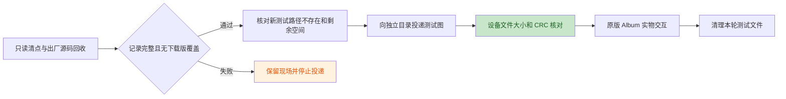

# N5 相册、图像与 worker 现场验收

日期：2026-10-24。设备为 ESP-Mosaico CoreBoard V1.2，USB 与右槽交互板连接，
旧分区布局。已完成原版程序核对、照片清点、空库显示及返回，以及三张 JPEG 的
投递、文件校验、显示、前后切换、返回网格和删除取消。扩充到二十张后复现轻微
卡顿和单图切换全屏黑闪，当前优先修复；确认删除、独立图像与 worker 用例仍待验收。

## 镜像与基线

运行普通镜像来自 `0b1b211`，未开启诊断 feature。BIN 为 3,058,496 字节，SHA-256：

```text
dce2f5f0bfaeb56806d933b3266dc9a11df3ea3b1c309e43f05c0abe58d9ca56
```

`target/slot-recovery-live-20261024/flash-01/root-verified.json` 保存完整应用读回和
引导区不变的核对结果。本轮证据目录为 `target/n5-live-20261024/`，
`image-binding.json` 绑定镜像、刷写复核、N4 最终清理和 N5 初始查询。
没有分区迁移、otadata 写入或重新刷写。

初始设备为默认 Lua 大脑（29,672 字节，CRC `bc14ae2e`）、默认皮肤，以及原有
`hardware_probe`、`hello_push`、`n1_contract_probe`、`n1_lifecycle_probe` 四个
下载应用。`01-baseline` 记录 data 可用 463 / 512 个 4096 字节块。

## 文件清点与投递边界



`02-inventory` 安装唯一临时清点应用 `n5_inventory_20261024_d6a90e`。探针只读
出厂相册源码和相册文件树，对所有照片类型记录路径、元数据及内容 CRC；暂存树
只记录元数据。不存在必须有明确 `ENOENT`；其他 I/O 错误、预算耗尽或记录缺失
均判为清点不完整。路径以原始字节的十六进制表示，未经截断或替换。

固件日志每行正文最多 158 字节，包含 Lua 来源前缀。清点工具将逻辑记录拆成短帧，
核对来源、序号、分片数及分片／整条 CRC。主机 18 项测试通过；真实设备回收
3,743 帧、168 条逻辑记录，原始串口字节与文本日志一致，独立重组通过。
清点不是照片备份或原子文件系统快照；原生 `storage.listdir` 仍同步执行。

实际结果：

| 检查对象 | 设备结果 |
| --- | --- |
| `/data/apps/album_app` | `ENOENT`，无下载版覆盖出厂相册 |
| `/system/apps/album_app/launcher.json` | 158 字节，与冻结原版逐字节一致；SHA `7a7c2951ac92d9ee1c1d35a7533d5275c41099469a90979a26d8730c6eb43733` |
| `/system/apps/album_app/scripts/album_app.lua` | 16,643 字节，与冻结原版逐字节一致；SHA `9324845e21df28b01284e0b06c01790366fb4ef095572cf104b6dece5a74b7ac` |
| `/data/appdata/album_app/photos` 和 `.incoming` | 均为 `ENOENT`，本轮清点没有既有照片或暂存照片 |
| 测试目录 `photos/n5_guard_20261024_f4d82c` 及所有计划文件 | 均为 `ENOENT` |
| 安装清点探针后的可用空间 | 1,863,680 / 2,097,152 字节 |

探针正常结束，随后默认大脑、默认皮肤及原四应用加唯一探针的列表查询通过。
运行日志为 49,939 ms、5,331 slices、最长 slice 24,911 µs；该工具结果不用于
声明设备调度或触摸实时性通过。独立复核在 `02-root-verification.json`。

## 原版空库与返回

`03-empty-album` 从启动器运行出厂 `album_app`，日志确认 `found 0 image(s)`。
照片目录不存在的警告与清点结果一致。操作者确认 Album、空库显示正常，随后
明确确认已通过左边缘返回应用列表。

日志记录 `App(Lua(3)) -> Launcher` 及 `lua[album_app]: stopped`，运行
122,879 ms，早于原版 180,000 ms 自动结束期限。本项覆盖手势退出，不将其计为
自然到期退出。日志仍有既有触摸 Header 和 sensor drain 警告，未据主观正常
宣称这些问题消失。

`03-postflight` 再次确认默认大脑、默认皮肤、原四应用加清点探针，data 可用
453 / 512 块（1,855,488 字节）。`03-root-verification.json` 绑定两份采集收据
与操作者反馈。

## 三张 JPEG 与原版浏览

`04-first-three` 依次提交独立测试目录内的三个新 JPEG，每张均收到传输 CRC 与
提交回执。临时只读应用 `n5_photo_verify_20261024_3c71d8` 随后从设备读取文件，
完整清点照片树并再次核对出厂源码；没有额外照片路径，`.incoming` 明确不存在。

| 文件 | 字节数 | 设备读出内容 CRC32 |
| --- | --- | --- |
| `n5_f4d82c_01.jpg` | 3,190 | `ca26d943` |
| `n5_f4d82c_02.jpg` | 3,528 | `0e7f746f` |
| `n5_f4d82c_03.jpg` | 3,527 | `ce24035c` |

三图均为 160×96：左蓝右暗红、中央白色编号、顶部白色三角及不同颜色的角标。
`05-three-album` 运行原版并记录 `found 3 image(s)`。操作者确认颜色、方向、
网格到单图页、左右前后张、点图回网格以及 Delete 弹框 Cancel 均正常，取消后
仍有三张。没有 Album 加载错误或删除日志；下一轮投递前仍需再次读取文件核对
取消后的三张实际内容。

本轮有系统返回启动器及 VM `stopped` 日志，运行 127,838 ms，早于自然结束期限。
Lua 峰值 298,244 字节，8,171 slices 中最长 **323,903 µs**，且有 sensor drain
警告。主观操作正常不代表调度满足 20 ms；同步图像路径的耗时仍需定位，也未由
单次结束后的堆空闲变化建立长期资源稳定性结论。

`05-postflight` 已对两只用完的临时核验应用分别执行精确的 `rmdata` 与 `rm`，
均收到回执。列表恢复原四应用，默认大脑和皮肤通过，data 可用 454 / 512 块
（1,859,584 字节）；此处清理有命令回执和应用列表，未另行直接 stat 已删除目录。
三张测试照片仍保留供后续浏览验收。收据分别绑定在 `04-root-verification.json`
和 `05-root-verification.json`。

`05-natural-exit` 使用同三张图补验静置自然结束：日志按顺序出现 `found 3`、
`done images=3`、`finished` 和返回启动器，运行 180,580 ms，采集中没有触摸
按下或外部 stop 命令。峰值 193,820 字节，最长 slice 114,876 µs。
`05-natural-postflight` 确认原四应用、默认大脑／皮肤及可用 454 块；收据在
`05-natural-root-verification.json`。该轮没有重新请求目视图片确认，也没有
回读照片内容；后续投递前的文件核对仍保留。

## 二十张图片与已复现缺陷

`06-expand-grid` 安装独立只读核验应用，先重新读取三张图片与完整照片树。
实际三图与 `04` 的大小、CRC、路径完全一致，补齐 Delete Cancel 后保留文件的
客观证据；`.incoming` 不存在。随后只追加既定的 04–20 共十七张，每张收到 CRC
与提交回执；第二轮独立读取完整二十图，所有文件大小／CRC 均匹配，原三图不变，
没有额外路径或暂存残留。两次运行的日志各自解析，序号分别从零开始。

本轮出厂源码只核对设备当前大小和 CRC，SHA 参考来自 `02`／`04` 的完整源码
回收，未重新传输源码或在设备计算 SHA。追加与两轮读取共 164.195 秒，后续仅
需文件指纹的核验将改为每文件输出最终 CRC，并继续逐小块读取和让出执行。
`06-root-verification.json` 绑定完整证据。

`07-grid-album` 运行原版相册并识别二十张。操作者报告“无错位，但是略微卡顿，
而且进入单图以后，切换图会全屏幕黑一下再显示”。本项未通过。两次相册运行
最长 slice 分别为 325,160／324,542 µs，Lua 峰值为 262,478／293,433 字节；
没有 Album 加载错误或删除日志。期间返回启动器并打开其他核验应用的行为已确认
为操作者主动操作，不记为意外跳转。

源码存在中间帧提交路径：原版 `show_fullscreen` 先 `screen:clean()`，后续
逐条创建新页面；每条 native LVGL 请求返回后，UI task 都可执行刷新并提交
尚未重建完整的页面。图片 resize 也存在同步双线性运算；当前最长 slice 只计
`Vm::resume()`，不含等待 UI 回复的时间，具体图像调用耗时仍待分段验证。
修复保持出厂相册源码不变，调整 native UI 呈现边界和经核验的图像计算路径。

`07-postflight` 停止相册并删除已用完的 grid 核验应用及其数据，回执通过；
应用列表恢复原四项，默认大脑／皮肤通过，data 可用 435 / 512 块
（1,781,760 字节）。`07-root-verification.json` 保留缺陷和清理结果。

## 当前清理与后续范围

原版 Album 已停止，三只已使用的临时核验应用均已删除。二十张测试照片仍位于
独立目录 `photos/n5_guard_20261024_f4d82c`，用于修复前后对照。清理限定为
本轮创建的应用和文件；不调用全相册 `rmdata album_app`。

待验收项包括更多照片的缩略图、滚动、快速切页、删除确认、损坏图片与重复
打开退出；同名替换、CRC 错包和中断恢复；独立 PNG、JPEG
编码保存及 worker 执行／停止／退出清理。原版相册只枚举 JPG / JPEG / BIN，
其结果不替代 PNG 或 worker 验收。完整清单见
[集中真机验收](N1_N7_DEVICE_ACCEPTANCE.md#n5-相册图像与-worker)。
