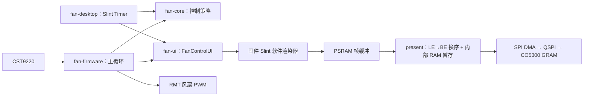

# Crate 与源码结构

桌面和固件共享控制计算与 Slint 组件；各自的入口负责组装运行环境。固件显示驱动负责 PSRAM 帧渲染与 QSPI GRAM 整帧刷新，UI 层只写渲染缓冲。

## 运行路径



桌面窗口由 Slint 桌面后端显示。图中的 PSRAM、DMA 和面板路径只存在于固件。

## 目录

```text
.
├── Cargo.toml / Cargo.lock       统一依赖和发布优化
├── .cargo/config.toml           命令别名及 MCU 链接配置
├── rust-toolchain.toml          Rust 工具链与交叉编译目标
├── crates/
│   ├── fan-core/
│   │   ├── src/{lib,fan}.rs     无平台依赖的控制计算
│   │   └── tests/fan_policy.rs  温度曲线与功率契约测试
│   ├── fan-ui/
│   │   ├── build.rs             编译 Slint 布局
│   │   ├── src/{lib,boot}.rs    组件、尺寸及共享启动动画时序
│   │   ├── ui/                  方屏布局及启动页
│   │   └── assets/fonts/        两种字重的字体子集
│   ├── fan-desktop/
│   │   └── src/
│   │       ├── main.rs          桌面入口
│   │       ├── app.rs           UI 回调和 Timer
│   │       └── simulation/      模拟设备与应用状态
│   └── fan-firmware/
│       ├── src/
│       │   ├── main.rs          no_std 入口、应用元数据、panic 复位
│       │   ├── app.rs           硬件版本自检、外设初始化
│       │   ├── board.rs         Mosaico v1.2 引脚、扩展槽与 eFuse 版本检测
│       │   ├── platform.rs      Slint 平台、触摸事件、渲染和主循环
│       │   └── drivers/         display.rs(CO5300) / touch.rs(CST9220) / fan.rs
│       └── assets/boot/         已验证的 bootloader 和分区表
├── scripts/                     检查与打包
├── releases/                    本地生成的交付包（Git 忽略）
└── docs/                        架构、开发、发布说明及历史参考
```

## 边界与状态

| 边界 | 传递的数据 | 规则 |
| --- | --- | --- |
| 控制计算 | 摄氏温度、占空比 | `fan-core` 不引用 Slint、HAL 或时钟；自动曲线保留现有取整行为 |
| UI 绑定 | 属性和档位回调 | `fan-ui` 不依赖具体设备；桌面 UI 访问位于事件循环线程 |
| 帧刷新 | PSRAM 帧缓冲字节 | `present()` 换序进内部 RAM 暂存后 DMA 整帧写 GRAM；刷新期间主循环阻塞 |
| 触摸输入 | TouchState 下/抬 | I2C 错误与坏报文不产生抬手事件，由心跳汇总 |

固件启动即读取 eFuse 硬件版本（v1.1/v1.2 才放行），随后按官方 BSP 时序开 VCC_PW 轨、初始化 CO5300 与 CST9220。GRAM 面板自扫描，无需帧界同步；`present()` 期间触摸不轮询。

状态保存在内存中；当前应用没有保存档位、温度历史或界面设置到 Flash 的流程。触摸控制器未检出时，启动日志记录状态，显示和主循环继续运行。

QSPI 线序、厂商初始化序列和 GRAM 刷新路径集中在 `drivers/display.rs`；扩展槽引脚与模块生态定义集中在 `board.rs` 的 `subboard` 模块。共享 UI 或控制策略不处理这些细节。硬件真相来源见 [Mosaico v1.2 硬件文档](MOSAICO_V12_HARDWARE.md)，运行日志判读见 [固件说明](../crates/fan-firmware/README.md)。
