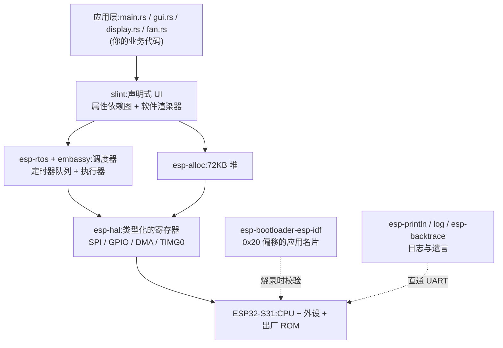

# 依赖实现原理:每个 crate 在脚下垫了什么(JS/TS 开发者向)

> 与 `tutorial.md` 的关系:tutorial 讲「代码怎么写、为什么这么写」;本文讲 **`Cargo.toml` 里这些依赖自己是怎么造出来的**。
> 读完本文,你应当能回答:浏览器里这些事是谁免费做的、这座岛上是谁在收费实现,以及每一层的边界和代价在哪。
> 阅读顺序:建议先读完 tutorial.md 第 1~4 章;本文自底向上,每章一个依赖,最后串起来。
> 本文所有实现细节都对照了本机 cargo registry 里锁定的真实源码(esp-hal 1.2.0-rc.0、esp-rtos 0.4.0、embassy-executor 0.10.0、embassy-time 0.5.1、esp-alloc 0.11.0、esp-println 0.18.0、esp-backtrace 0.20.0、esp-bootloader-esp-idf 0.6.0、slint 1.17.1),不是凭印象写的。

---

## 0. 总览:浏览器的「免费服务清单」,岛上谁接单

你在浏览器里写一行 `slider.onchange = ...`,脚下至少有七项服务在免费运转。这张表是全文的地图:

| 浏览器里免费给你的             | 岛上谁提供                        | 实现原理一句话                                 |
| ------------------------------ | --------------------------------- | ---------------------------------------------- |
| `performance.now()` + 定时器   | embassy-time + TIMG0(经 esp-rtos)| 最多 64 项的静态定时器队列,硬件闹钟中断驱动   |
| 事件循环                       | embassy-executor(包在 esp-rtos) | 无锁就绪队列 + Waker,任务睡在静态内存里       |
| V8 的堆 + GC                   | esp-alloc                         | 72KB 静态数组 + 链表分配器,GC 由编译器顶替    |
| `console.log`                  | esp-println + log                 | 临界区锁内调用芯片 ROM 里的出厂 UART 函数      |
| 未捕获异常页                   | esp-backtrace                     | panic_handler 沿帧指针链打印调用栈地址         |
| DOM + 渲染引擎 + rAF           | slint + slint-build               | 编译期属性依赖图 + CPU 软件光栅化              |
| `navigator.*` 硬件 API         | esp-hal                           | SVD 生成的寄存器地址,包成零大小单例类型       |
| 部署流水线的元数据校验         | esp-bootloader-esp-idf            | 在镜像偏移 0x20 埋一个 magic 结构体            |

分层视角:



组织原则:**自底向上**。每章三段式——它替你解决什么 → 它内部怎么实现(源码为证) → 边界与代价。

---

## 1. esp-hal——把寄存器地址翻译成 Rust 类型

### 1.1 最底层:内存映射的寄存器(MMIO)

芯片上每个外设(SPI、GPIO、定时器)都是一块独立电路,它们不「调用」,只「暴露寄存器」:在固定的内存地址放一排 32 位格子,往某格写一个数,硬件立刻按位含义改变行为;读某格,硬件告诉你它的状态。

esp-hal 脚下有一层 **PAC**(Peripheral Access Crate,外设访问 crate),由芯片厂商的 SVD 描述文件自动生成——SVD 就是一张「地址 ↔ 格子含义」的清单。PAC 的核心不过几行:

```rust
// SVD 生成代码的骨架:volatile 指针包住裸地址
pub struct Reg<REG> { register: VolatileCell<REG::Ux> }
impl Reg { pub fn write(&self) { /* 往固定地址写 */ } }
```

JS 对照:这就像「对象永远住在同一个内存地址,getter/setter 直接捅内存」,只不过这个地址另一头连着真实电路。**写寄存器 = 拧硬件的旋钮。**

### 1.2 引脚是零大小的「地契类型」

esp-hal 1.2.0-rc.0 的做法:每个引脚、每个外设都被宏生成一个**零大小单例类型**(`GPIO46<'static>`、`SPI2<'static>`),再配上密封 trait(sealed trait)做门禁——`OutputPin`、`InputPin` 这类能力 trait 外部无法实现,只有 esp-hal 能发「驾照」。

真正编码状态的是**消费式包装类型**:

```rust
pub struct Output<'d> { pin: Flex<'d> }   // 按值持有引脚地契
impl Output<'_> {
    pub fn new(pin: impl OutputPin, ...) -> Self  // 吃掉地契
    pub fn set_high(&mut self) { ... }
}
```

`Output::new(peripherals.GPIO48, ...)` 把地契**按值吃进去**。地契在 `Output` 的肚子里,编译器就不会允许任何第二处代码再拿到它——「46 号脚已被占用」从此不是运行时撞车,而是编译错误。这正是 tutorial 3.2 讲的 `with_sck()` 套路,底层机制相同。

`set_high()` 最终写的是 GPIO 的 `out_w1ts` 寄存器(**write-1-to-set**,写 1 置位)。这个寄存器的设计很聪明:普通做法得「读出 32 位 → 改一位 → 写回」,两步之间若被中断插入就会丢更新;w1ts 让「置位」成为一次原子写,硬件替你避开了竞态。配套还有 w1tc(write-1-to-clear)。

### 1.3 `Peripherals` 全局单例

`esp_hal::init()` 内部调用 `Peripherals::take()`:一个 `static mut bool` 加锁,第一次调用返回地契全集,第二次直接 panic「init called more than once!」。逃逸口只有 `unsafe { Peripherals::steal() }`。

注意每个字段是**令牌不是数据**:`GPIO46` 类型大小为零,编译后不占一个字节,只在编译期参与检查。运行时真正干活的,仍然是 1.1 那些寄存器地址。

### 1.4 SPI + DMA:描述符链搬运协议

DMA 引擎不认识 Rust 切片,只认识**描述符链**——一串 `{ flags, buffer 指针, next 指针 }` 结构体:`flags` 里记这一块的字节数和归属(owner 位标记这块内存现在归 CPU 还是 DMA),`next` 指向下一块,串成链表。

esp-hal 的 `SpiDma::write(bytes)` 帮你做了三件事(src/spi/master/dma.rs):

1. 在栈上现搭一条描述符链(每块上限 32736 字节,即 4092×8);
2. 把你的切片按块切好——本项目 150KB 帧缓冲会被切成 **5 块**;
3. 启动传输,然后**忙等轮询状态位**(`while !is_done() {}`)直到 DMA 报完成。

「Blocking 模式」的真相:CPU 不搬字节,但要原地等到搬完。对照:DMA 之于 CPU 如 `fetch` 之于主线程,只是 `await fetch()` 会释放事件循环,`blocking write()` 不会——这 30.7ms 里渲染车道就是停着的(这也是未来升级 `write_dma` 异步版的动机)。

### 1.5 链接脚本:没有加载器,所以每个段都要有住址

esp-hal 的 build.rs 把一套链接脚本(`memory.x` 内存区域布局、各段的归宿、ROM 函数符号表)生成到 `OUT_DIR`,再由 `.cargo/config.toml` 里 `-Tlinkall.x` 交给链接器。

为什么必须:桌面 ELF 由操作系统加载器在运行时映射内存;裸机的 ELF 没人加载,bootloader 只会按链接时写死的物理地址原样摆放。**代码放 flash 哪里、静态变量放 RAM 哪里、FRAME_BUFFER 那 150KB 落在哪个段,全在链接脚本里定。**

### 1.6 `Delay` 是忙等;`unstable` 是门禁

`Delay::delay_millis` 的实现就是 `while start.elapsed() < d {}`——不是空转 nop,而是反复读硬件定时器,精确但烧 CPU。所以 display.rs 初始化屏幕那约 0.5 秒(150+120+10+10+100ms 的等待),CPU 是满转的。忙等不是偷懒,是「此刻反正没别的事可做」的最简解。

`unstable` feature 则是 API 门禁:内部用 `#[instability::unstable]` 属性标注的模块,不开 feature 时降级为 `pub(crate)`,你根本 import 不进来。含义是「能用,但签名还可能变,后果自负」——我们用的 `timg::TimerGroup`、`DMA_AXI_CH0` 都在门禁后面。

---

## 2. esp-rtos + embassy——事件循环的工业化实现

### 2.1 先补课:Future 与 Waker(后面一切的语法基础)

JS 的 `Promise` 是「一个值 + resolve 函数」;Rust 的 `Future` 是「一个状态机 + `poll()` 方法」:

| JS 世界                    | Rust 异步世界                        | 说明                                   |
| -------------------------- | ------------------------------------ | -------------------------------------- |
| `Promise`                  | `Future`                             | 都代表「现在还没有、将来会有」         |
| `resolve()`                | `Waker::wake()`                      | 完成时叫醒等待者                       |
| `await`(事件循环免费调度) | `.await`(需要有人反复调 poll)      | 挂起等待                               |
| 事件循环                   | 执行器(executor)                   | 决定现在 poll 谁                      |

关键差异:JS 的 Promise 由 V8 的事件循环自动驱动;Rust 的 Future 是**惰性**的——没人 poll 它,它一步都不走。谁来 poll、什么时候 poll,就是执行器的全部工作。

还有一条对嵌入式至关重要的性质:编译器把 `async fn` 编译成一个**状态机结构体**,`.await` 点是状态机的档位。它不需要堆,可以放在静态内存里——这是 embassy 不用堆分配的根基。

### 2.2 esp-rtos 不只是「embassy 封装」,底下是真 RTOS

源码自称「An RTOS implementation for esp-hal」:它有真内核——线程、**33 级优先级位图调度、时间片轮转**、idle 任务(全系统没事时执行 `wait_for_interrupt()`,即 RISC-V 的 wfi 指令,CPU 进入低功耗等中断)。esp-radio 等大件就跑在它上面。

本项目只用它开了**一条执行器线程**,所以 tutorial 4.3 说的「单车道协作式」是这个项目的形态,不是 esp-rtos 的全部实力(Slint 的 `unsafe-single-threaded` 特性也要求所有 Slint 调用在同一线程)。

`esp_rtos::start(timg0.timer0, peripherals.FROM_CPU_INTR0)` 干了三件事(lib.rs):

1. 把 TIMG0 定时器注册为系统滴答源(挂上 tick 中断处理函数);
2. 把当前执行流登记为「主任务」;
3. 把 FROM_CPU_INTR0(一根 CPU 可以自己拉响的软件中断线)注册为**上下文切换中断**——到点「存现场 → 跑调度器 → 换线程指针 → 恢复现场」。

### 2.3 `#[esp_rtos::main]` 展开成什么

宏展开(来自 esp-hal-procmacros)大致是:

```rust
// 你的 async fn main(spawner) 变成一个 embassy 任务:
#[embassy_executor::task]
async fn __embassy_main(spawner: Spawner) { /* 你的代码原样搬入 */ }

// 真正的、no_main 世界的入口:
fn main() -> ! {
    let mut executor = esp_rtos::embassy::Executor::new();
    let executor = unsafe { __make_static(&mut executor) };  // 提升为静态
    executor.run(|spawner| spawner.spawn(__embassy_main(spawner).unwrap()))
}
```

也就是说:你的 `main` 是执行器上的**第一个任务**,执行器本体在 `main` 背后转。

### 2.4 执行器核心:就绪队列 + Waker

embassy-executor 0.10 的实现要点(都有源码出处):

- **任务不占堆**:`#[embassy_executor::task]` 宏为每个任务生成一个 `static TaskPool`(默认容量 1)。`fan_control_task()` 返回 `Result<SpawnToken, SpawnError>` 的原因就在这:spawn 是用 CAS(原子比较交换)去任务池里**抢槽位**,池满(默认 1 个实例在跑,再 spawn 同名任务)就返回 `Err(Busy)`。
- **就绪队列(run queue)是一个无锁侵入式 Treiber 栈**:入队 = CAS 换栈顶;执行器 `poll()` = 一次性取走整批,逐个调 `poll_fn`。无锁、无分配、无锁开销。
- **Waker 是一张静态 vtable + TaskHeader 指针**:任务被 poll 时把 Waker 交给它 await 的东西(比如定时器队列);将来 `wake()` 被调用 → 该任务 CAS 入就绪队列(CAS 保证重复 wake 也只入队一次)→ **如果队列刚从空变非空,才拉响 pender**(置 ThreadFlag 唤醒执行器线程)。已经 Ready 的任务原地 drop 自己的 future、归还任务池。

JS 翻译:run queue ≈ 宏任务队列,wake ≈ resolve,pender ≈ 「队列从空到非空才需要拍一下事件循环」。

### 2.5 embassy-time:一口钟,一张预约表

- `Instant` 就是开机以来的微秒数(esp-rtos 配的是 1MHz 滴答,1 tick = 1µs),来源是 TIMG0 的硬件计数器。
- `Timer::after(100ms)` 只是记下截止时刻;它作为 Future,第一次被 poll 时把自己的 Waker 登记进**定时器队列**并返回 Pending;之后的 poll 里时间到了才返回 Ready。
- 定时器队列不是什么高级数据结构,就是一个**最多 64 项的静态数组**(`heapless::Vec<Timer, 64>`),按到期时间插入。满了的策略朴素而正确:弹出一个立刻唤醒——宁可早醒再睡,绝不丢预约。
- 硬件侧:队列把**最近的到期时刻**编入 TIMG0 的闹钟;闹钟中断 → tick 处理函数 → 逐个 `waker.wake()` 到期任务 → 任务进 run queue → pender 置 ThreadFlag → 执行器线程被 RTOS 唤醒 → `poll()` → 你的 `Timer::after` 终于 Ready。

fan.rs 那 `Timer::after_millis(100).await` 睡着的 100ms 里,它不占任何 CPU,也不在 run queue 里——它在定时器队列里躺着,等闹钟叫。

### 2.6 一个隐藏规则:`start` 必须在第一个 `await` 之前

回看 main.rs:8 个步骤全部是同步代码,直到第 8 步 `run_ui` 循环里才出现第一个真正的 `await`。而 `esp_rtos::start`(第 3 步)在它之前。这不是巧合:

**start 之前,系统没有滴答中断、没有唤醒机制。** 如果在它之前就 `await`,执行器会把当前任务挂起、自己 `flags.wait()` 睡去——而没有任何东西能叫醒它们。睡下去,就是永远。

对照 JS:你不可能在事件循环还没建起来时就 `setTimeout`。

---

## 3. esp-alloc——亲手划一块地当堆

### 3.1 `#[global_allocator]`:语言预留的插座

Rust 规定:凡是 `extern crate alloc` 之后的堆类型(`Box`/`Rc`/`Vec`),每一次分配最终都路由到一个全局分配器——语言给你留了插座 `#[global_allocator]`,但没有默认插头(裸机上更没有)。谁声明它,谁的代码就接管全系统的 `malloc`。

esp-alloc 的做法:crate 自己声明 `#[global_allocator] pub static HEAP: EspHeap`(开箱即用,你一行都不用写),你只需在 main 第一句把「地」给它。

### 3.2 `heap_allocator!` 展开成什么

```rust
// esp_alloc::heap_allocator!(size: 72 * 1024) 展开为(骨架):
static mut HEAP: MaybeUninit<[u8; 73728]> = ...;   // 静态区划一块 72KB
unsafe { HEAP.add_region(HeapRegion::new(ptr, 73728, MemoryCapability::Internal)) }
```

一块未初始化的字节数组,登记为一个「内存区域」。内部最多可挂 3 个区域(为将来 PSRAM 留了位:`psram_allocator!` 宏已备好,16MB 外部内存,放未来 RGB 大屏帧缓冲正合适)。

### 3.3 分配算法:链表首次适应(默认)

esp-alloc 0.11 默认用 `linked_list_allocator` 的**首次适应**(first-fit)算法,编译期可切 TLSF。首次适应的原理,30 行讲完:

- 空闲内存组织成链表,每个节点 = {这块多大,下一块在哪};
- `alloc(n)`:沿链表找**第一个** ≥ n 的洞,从头上切 n 字节返回指针,剩下的留在链表里;
- `free(p)`:把这块插回链表,并与物理相邻的空闲块**合并**(防止越切越碎)。

这就是一个最小可用的「迷你 V8 堆」——只是没有 GC。

### 3.4 为什么没有 GC 也不泄漏

因为 Rust 的所有权在**编译期**就确定了每个值的死亡位置:`drop` 的调用点是编译器静态插进去的,`drop` → `dealloc` → 归还链表。GC 做的事(找出谁还在用),borrow checker 在你按下编译键的那一刻就做完了。

代价换了形式:**碎片**没法回收重排(没有 GC 就没有搬移式整理),72KB 里长袖子舞跳多了会碎;所以嵌入式习惯是「启动时分配,长期持有」,避免高频小分配——这正是 Slint 组件树「创建一次、反复重绘」的风格。

---

## 4. esp-println + log——走一根真实的线的 console.log

### 4.1 出厂 ROM:芯片里自带的函数库

一个反直觉的事实:esp-println 打日志,多数芯片上**不是自己直捅 UART 寄存器**,而是调用**出厂固化在芯片 ROM 里的现成函数** `uart_tx_one_char`——它躺在固定的 ROM 地址上(和 bootloader 同一片只读存储器),接收一个字节、等硬件 FIFO 有空位、塞进去。esp-println 按地址直接调用它。

JS 对照:这像调用浏览器内置原生 API——厂商已经用汇编写好了,你只管喊。

### 4.2 临界区:一行日志的原子性

两个任务同时打日志,字节会交叉成乱码。esp-println 用一把静态锁(临界区)把「格式化 + 逐字节输出」整段锁住,一行日志要么完整出去,要么别出去。代价:打日志期间,另一条车道是被锁在门外的。

### 4.3 `log` crate:接口与实现分离(facade 模式)

`info!(...)` 本身不知道输出去哪——`log` 只定义 `Log` trait(接口),谁 `init` 谁接单。esp-println 的 logger 实现了它,输出到 UART。这就是 pino/winston 适配器模式的嵌入式版:业务代码依赖接口,部署时换后端。

`init_logger_from_env()` 的「env」是个容易误解的名字:设备上没有环境变量。ESP_LOG 是**编译期**由 build.rs 读取、生成静态过滤代码烙进固件的(`.cargo/config.toml` 里 `[env] ESP_LOG = "info"` 就是给编译过程看的)。

### 4.4 算账:日志论字节收费

UART 默认 115200 波特 ≈ 每毫秒 11.5 字节。一行 60 字节的 `info!` ≈ **5ms 独占车道**。在 16ms 一轮的渲染循环里打三行,渲染预算就没了。这就是为什么 fan.rs 只在档位变化时打日志。你的 `console.log` 也慢,但没这么贵——这根线,论字节收费。

---

## 5. esp-backtrace——整个系统最后的声音

### 5.1 `panic_handler`:no_std 世界的法定必需品

编译器规定:任何 Rust 程序必须**恰好有一个** panic 处理函数;std 世界它由标准库提供,裸机上没人管,你不写就编译不过。esp-backtrace 就是来写它的:

```
===== PANIC =====
消息与位置(来自编译器给的 PanicInfo)
0x42001234        ← 调用栈,一帧一个地址
0x42000abc
...
(然后永久停机:默认关中断 + 死循环)
```

注意:**没有重启选项,默认是停机**。嵌入式哲学:程序已经疯了,让它继续跑不如让它死得明白——你从串口看到这几行,就是整个系统最后的声音。

### 5.2 帧指针回溯:栈上其实藏着一条链

RISC-V 上回溯调用栈的办法:编译器若保留帧指针(寄存器 x8),那么每个函数的栈帧里都存着「返回地址」和「上一帧的帧指针」——`RA = *(fp-4字节)`、`next_fp = *(fp-8字节)`,一路读上去就是调用链。esp-backtrace 逐帧校验地址合法(防读野指针跑飞),打印**原始地址**——不做符号化。

地址怎么变成函数名?离线工具 `addr2line` 拿着 ELF 和地址反查。对照:打包后未 source-map 的栈帧——机器认得,人不认得。

> **踩坑预警**:完整回溯需要编译参数保留帧指针(`-C force-frame-pointers`,esp-backtrace 文档明说)。本仓库 `.cargo/config.toml` 的 rustflags 目前没配这条——真 panic 时栈可能只有零星几帧。加一行 `"-C", "force-frame-pointers"` 即可补上。

(硬件异常,如非法内存访问的处理在 esp-hal 侧,不在 esp-backtrace;panic 是软件层的「不可能之事」,别揉成一团。)

---

## 6. slint + slint-build——没有浏览器的 React

### 6.1 编译期:`.slint` → Rust 代码,资源住进 ELF

build.rs 调 `slint_build::compile`,把 `ui/appwindow.slint` 编译成 `OUT_DIR/xxx.rs`,再由 `slint::include_modules!()`(本质是 `include!(env!("SLINT_INCLUDE_GENERATED"))`)引进你的 crate。生成的代码:每个导出组件一个 struct,字段是 `Property<T>` 和 `Callback`,外加强类型的 `get_fan_speed/set_fan_speed/on_fan_speed_changed` 访问器。

对照 Babel:JSX 编译成函数调用,`.slint` 编译成 Rust 类型——**UI 声明在编译期就变成了强类型代码**,拼错的属性名活不过编译,不是运行时的紫红屏。

资源内嵌是同一哲学的延伸:`EmbedForSoftwareRenderer` 让字体在**编译期**被栅格化成位图字体常量、图片被解码成原始像素常量,以 `static` 变量住进 ELF。设备上没有文件系统,也没有字体渲染引擎——资源在出厂前就「烤」好了。

### 6.2 属性系统:精确依赖图 + 脏标记,没有树也没有 diff

这是 Slint 与 React 最有意思的对照。React 的模型:状态变了 → 重建组件树 → 虚拟 DOM diff → 打补丁。Slint 的模型:**组件树在编译期就建好了,永远不重建**;每个属性背后是:

- 一张**依赖图**:绑定表达式 `text: fan-speed + "%"` 求值时,系统记录「text 依赖 fan-speed」(运行时求值一次、登记依赖,类似 Vue 的依赖收集);
- 一个**脏标记**:某属性被 set 且值真的变了 → 沿依赖图把所有下游标脏(**只标,不算**);
- **惰性求值**:直到下一帧渲染需要读这个属性,才真正重算绑定。

所以「拖滑块 → 大字 % 变化」的传播成本 = 依赖图上两三个节点的标脏与重算,与界面复杂度无关。没有 diff,没有 reconcile。动画的原理尤其优雅:一个特殊的「当前时间」属性被 `update_timers_and_animations()` 推进,所有依赖时间的动画绑定便自动标脏。

### 6.3 软件渲染器:CPU 逐项画,图元少到数得过来

`renderer.render(frame_buffer, 240)` 内部两步:先把组件树里可见的 item 编译成一串**场景命令**——图元只有四类:纯色矩形、纹理、圆角矩形、渐变;然后逐命令画进帧缓冲。

对 RGB565 目标,所有运算走整数:`from_rgb` 是位打包(`(r&0xF8)<<8 | (g&0xFC)<<3 | b>>3`),alpha 混合是预乘整数的移位乘法,**全程无浮点**——这在没有 FPU 的芯片上也能跑(S31 有 FPU,但整数路径更小更快)。

`RepaintBufferType` 是你向渲染器交底的「缓冲策略」,三档:

| 变体             | 语义                         | 渲染器据此做什么                   |
| ---------------- | ---------------------------- | ---------------------------------- |
| `NewBuffer`      | 每次一块新内存,内容不可信   | 每帧全屏重画,不做脏区追踪         |
| `ReusedBuffer`   | 同一块内存,上帧内容还在     | 只重画自上次变化的部分             |
| `SwappedBuffers` | 双缓冲交替                   | 重画「最近两帧脏区的并集」         |

本项目用单缓冲却选了 `SwappedBuffers`:按双缓冲假设多画一点(两帧脏区并集),而单缓冲其实保留着全部旧内容——**多画不吃错,少画才吃错**,这是保守正确的选择。(渲染器还有逐行绘制模式 `render_by_line`,为「SRAM 放不下整帧、只有一行缓冲」的小芯片设计——我们 150KB 全帧放得下,用不上。)

### 6.4 `Platform` trait:Slint 向宿主要求的契约

Slint 不假定有窗口系统。`Platform` trait 只有 `create_window_adapter` 一个必须实现;其余都有默认值——但 `duration_since_start` 在 no_std 下的默认实现是 `unimplemented!()`:**嵌入式必须自己报时**,动画、定时器全靠它。

gui.rs 的 `EspPlatform` 就是来履约的:窗口 → `MinimalSoftwareWindow`(一个只带「需要重绘」标志位的软件窗口:`request_redraw()` 置位,`draw_if_needed()` 消费这个一次性标志);时钟 → embassy-time 的 `Instant`。你在给 UI 框架手写浏览器免费提供的那两个函数。

### 6.5 两个 feature 开关省了什么

- `unsafe-single-threaded`:把 `thread_local!` 替换成基于静态变量的假实现,省掉线程本地存储和全部内部锁——**代价是承诺单线程访问**,这正是本项目单车道执设计的根源之一;
- `libm`:让所有浮点数学(sin/cos,动画曲线用)走纯 Rust 的软实现,不依赖任何目标机数学库——裸机上本来也没有。

---

## 7. esp-bootloader-esp-idf——0x20 偏移上的名片

`esp_app_desc!()` 宏生成一个 `static`,钉在 `.flash.appdesc` 段,内容是一个 `#[repr(C)]` 结构体:魔数 **0xABCD5432**、项目名、版本、编译时间/日期、ELF 的 SHA256、MMU 页大小……链接脚本保证它落在应用镜像**偏移 0x20** 处。

为什么:espflash 4.x 烧录、以及芯片的启动链路,都会在应用镜像的这个固定偏移读这个结构、验魔数,确认「这是一份合法的 ESP-IDF 格式应用」并取用版本信息。没有它,你的 ELF 再正确,烧录器也不认——**它不是代码,是名片,但门口只认名片**。

对照:package.json 的元数据被刻进二进制的固定偏移,供流水线校验。

---

## 8. 串起来——每一层各就各位的系统

### 8.1 通电到 `main` 之前

1. 芯片出厂的 ROM bootloader 先醒(它焊死在硅片里,永远第一个);
2. ROM 校验 flash 里的镜像——**第 7 章的名片在这里被查验**(偏移 0x20 的 0xABCD5432);
3. 跳到镜像入口:那是 `#[esp_rtos::main]` 生成的真 `main`,它创建执行器、把你写的 async main spawn 为第一个任务,开始 poll。

### 8.2 main 的 8 步 = 8 次依赖交接

| 步 | 代码                          | 动的是谁的机制                                        |
| -- | ----------------------------- | ----------------------------------------------------- |
| 1  | `heap_allocator!(72KB)`       | esp-alloc:静态区划地,接上 `#[global_allocator]` 插座 |
| 2  | `init(config)` 拿外设         | esp-hal:`Peripherals::take()` 发放全部地契            |
| 3  | `info!("启动")`               | esp-println:临界区 + ROM 的 `uart_tx_one_char`        |
| 4  | `esp_rtos::start(TIMG0, …)`   | esp-rtos:装系统滴答 + 上下文切换中断(必须在首个 await 前) |
| 5  | `Spi::new(...).with_dma(...)` | esp-hal:SPI 寄存器配置 + DMA 描述符链就绪             |
| 6  | `display::init` 一串命令      | esp-hal GPIO(out_w1ts)+ Delay 忙等(等物理毫秒)     |
| 7  | `init_platform()`             | slint:Platform 履约,时钟接 embassy-time             |
| 8  | spawn + `run_ui().await`      | embassy-executor:第二条车道上桌,第一个 await 让出    |

顺序即依赖:堆先于任何 `Box`,地契先于外设配置,钟先于 `await`,屏幕先于 UI。**每一步都要求脚下那一层已经就位——这就是「渐进」在工程上的含义。**

### 8.3 一次 16ms 渲染循环的全栈剖面

```text
run_ui 循环体一次(标注每层属于谁):
├─ slint::update_timers_and_animations()      [slint] 推进「当前时间」属性→动画标脏;触发到期定时器
├─ window.draw_if_needed(...)                 [slint] 消费「需要重绘」标志;不脏则整段跳过
│   ├─ renderer.render(FRAME_BUFFER, 240)     [slint] 场景命令→整数 RGB565 混合,画进帧缓冲
│   └─ display::flush()                       [本项目] swap_bytes ×2;设窗口
│       └─ SpiDma::write(150KB)               [esp-hal] 切 5 块,搭描述符链,DMA 启动,CPU 忙等
│           └─ DMA 引擎按 40MHz 节拍搬运       [硬件] 30.7ms 后整帧落在 ST7789 的显存里
└─ Timer::after(16ms).await                   [embassy-time] 登记预约,返回 Pending,让出车道

同一时刻,另一条车道:
fan 任务睡在定时器队列里(100ms 预约)
→ TIMG0 闹钟中断 → tick 处理函数 wake 它 → 进就绪队列
→ pender 置 ThreadFlag → 执行器线程醒 → poll → 读 AtomicU8 → 变了才打日志
→ 全系统无事 → idle 任务 wfi,CPU 睡到下一个中断
```

### 8.4 三个心跳,一口钟

16ms 的 UI 节拍、100ms 的风扇轮询、1µs 的滴答刻度——**全部来自同一口钟(TIMG0)**,由 embassy-time 的预约表统一编排。这就是「时间」在岛上的中央集权:一处配置,处处受益;也解释了为什么 `esp_rtos::start` 只需要传一个定时器。

### 8.5 思想实验:抽掉一层会怎样(检验你的理解)

- **抽掉 esp-alloc**:所有 `Box`/`Rc` 无处路由——编译/链接期就翻脸(语言不允许有分配却没有分配器)。第 1 步必须最先,原因在此。
- **抽掉 esp-rtos(不调 start)**:`await` 一次睡死——没有钟、没有闹钟、没有唤醒。系统退化成一根同步直线,`run_ui` 的 `Timer::after` 永不 Ready。
- **抽掉 esp-hal**:只剩 PAC 裸寄存器,display.rs 的每一行 `cmd()` 都要手写 volatile 指针和位运算,GPIO46 也没有地契——两个模块抢同一根线,运行时才会发现。
- **抽掉 slint**:你要亲手实现属性通知、脏区追踪、光栅化、位图字体、动画插值——你就变成了框架作者。浏览器免费给你的,正是这一整层。

---

## 9. 自测(答案在末尾)

1. `esp_rtos::start` 之前就 `await`,会发生什么?start 之前系统缺了什么?
2. embassy 的任务为什么不需要堆?任务本体存在哪里?`fan_control_task()` 为什么返回 `Result`?
3. 对一个已在就绪队列里的任务再 `wake()` 一次,会发生什么?什么机制保证的?
4. esp-alloc 的 72KB 在哪个内存、哪个阶段划走?为什么它必须是 main 的第一步?
5. `set_high()` 底层写的是什么寄存器?它比「读-改-写」聪明在哪?
6. 本项目单缓冲却用 `SwappedBuffers`,为什么不算错?换成 `ReusedBuffer` 会更省还是更险?
7. 一行 60 字节的 `info!` 在 115200 波特下独占车道多久?为什么 fan.rs 只在变化时打日志?
8. esp_app_desc 落在镜像什么偏移、魔数是什么、谁在读它?
9. 抽掉哪一层,系统连「现在几点」都答不上来?

---

## 10. 自测答案

1. **睡死。** start 之前没有滴答中断、没有唤醒链(定时器队列无人驱动、pender 没接中断线),任务 Pending 后执行器也随之等待,无人能叫醒。所以 main.rs 把 start 放在第 3 步、首个真正 await(第 8 步 run_ui)之前。
2. **任务在静态内存。** `#[task]` 宏生成 `static TaskPool`(默认容量 1),任务本体是编译器生成的状态机,放池子里。返回 `Result` 因为 spawn 是 CAS 抢池中槽位,同名任务没跑完再 spawn 就 `Err(Busy)`。
3. **无事发生(幂等)。** 入队用 CAS 保证「最多入队一次」;已就绪的任务不会被重复排队。
4. **内部 SRAM、编译期划地运行期登记。** 静态 `MaybeUninit<[u8;73728]>` 占住静态区,main 第一句把它登记为堆区域;后续每一步(Slint 的 `Box`/`Rc`)都要分配,插座没电第一个分配就 panic。
5. **`out_w1ts`(write-1-to-set)。** 「置位」是一次原子写,不经过读-改-写,两步间被中断插入也不会丢更新;硬件层面消灭了一类竞态。
6. **不算错。** SwappedBuffers 假设双缓冲交替,重画「最近两帧脏区并集」;单缓冲旧内容其实都在,多画的区域只是重复劳动,不会漏画。换 `ReusedBuffer` 更省(只画变化),但一旦缓冲被别处改写就会漏画——省与险的取舍。
7. **约 5ms**(60 字节 ÷ 11.5 字节/ms),且持锁期间别的任务不能打日志。渲染循环 16ms 一轮,几行日志就能吃掉预算,所以 fan 任务用「与上次比较」做变化检测,只在变更时输出。
8. **偏移 0x20,魔数 0xABCD5432,espflash 4.x 与启动校验链读它**,确认这是合法 ESP-IDF 格式应用。
9. **embassy-time / esp-rtos 那一层(具体是 TIMG0 这口钟)。** 抽掉它,`Instant`/`Timer::after`/动画时间戳全部失源——而浏览器里 `performance.now()` 和 `setTimeout` 从来是免费白送的。
