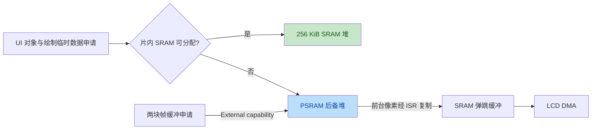
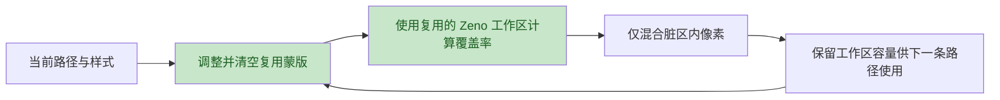

# v22：UI 内存分配与路径工作区复用

适用硬件：ESP32-S31-Korvo-1 + SUB3 800×480 RGB LCD、GT1151 触摸。

v21 真机稳态记录显示：渲染平均约 334.5 ms，窗口最大触摸轮询间隔约
348.1 ms。每帧约 90,633 个脏像素，启动结束后 `full=0`。29 段曲线的路径
处理约 129.2 ms，其中蒙版生成约 58.5 ms；I²C 读取约 1.5–2 ms。
渲染过程同步占用主循环，是触摸轮询长间隔的直接来源。

v22 的全局堆首先注册 256 KiB 片内 SRAM，UI 对象、属性和绘制临时数据优先
使用该区域，空间不足时回退到 PSRAM。显示驱动通过 `External` capability
单独分配两块各 768,000 字节、128 字节对齐的 PSRAM 帧缓冲。SRAM 弹跳缓冲
继续承接 LCD DMA 输出。

软件渲染器复用蒙版和 Zeno 路径工作区，减少逐路径临时分配和工作区初始化。
每次绘制仍重新计算当前几何与覆盖率，并清空当前蒙版范围。工作区复用不改变
路径坐标、抗锯齿或脏区混合规则。

主机完整遥测回放中，每帧平均分配次数从 1,658 降到 1,629，平均脏像素数
保持 91,639。主机时序不能换算为 MCU 时序；SRAM 分配的真机收益需要 v22
串口记录验证。

应用镜像烧录地址为 **`0x10000`**。启动标识为 `v22`，配置行包含
`heap=SRAM-first(256KiB)+PSRAM framebuffers=PSRAM`。

验收顺序：

1. 启动后静置至少 40 秒，使历史达到 30 点。
2. 记录连续五组心跳与 `[perf]`，再依次点击 25、100、AUTO 并记录五组。
3. 对比 `渲染avg`、`touch_us`、`phase_us` 和 `path_us`；确认 `full=0`，
   EOF 失步、欠载、DMA 错误和发布放弃没有增长。

`[perf]` 延续 v21 的统计口径，新增 `heap_i=已用/空闲` 和
`heap_e=已用/空闲`，单位为字节，分别表示片内堆和 PSRAM 堆的当前用量。
这是心跳时的快照，不是瞬时峰值；PSRAM 用量包含两块帧缓冲。
`paths` 是窗口总调用数，其他绘制耗时和像素数按帧平均。文字、路径和矩形
时间包含在场景时间内，蒙版包含在路径时间内；ISR 搬运时间也已包含在渲染
时间内。触摸延迟比较使用每窗口重置的 `touch_us`，避免启动期累计最大值干扰。

本版本保留测量插桩。主机检查覆盖原版与复用工作区的蒙版逐像素一致性、
双缓冲局部与全量渲染一致性、触摸协议和固件构建。真机响应速度与静态文字
红边仍需硬件验收。
