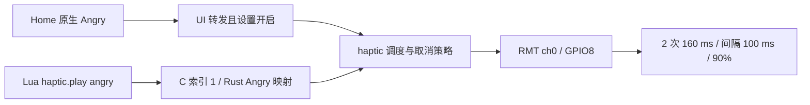

# N1–N7 测试前复盘核对

日期：2026-10-23。审查基线为 `codex/n1-n7-integration` 的 `f279361`，包含 N6 完成
提交 `586cfc9`。取消修复提交为 `50ed8c7`。本轮只做源码、主机检查和离线构建，没有打开串口、复位或烧录设备。
七个阶段分支继续保留原快照；修复只进入集成分支，提交见 [执行台账](../N1_N7_EXECUTION.md)。

## 复盘中的保护是否保留

逐项核对 [电容触摸键](touch-keys.md) 与 [L2 存储和启动](l2-storage-boot.md)，结果如下。
本表是源码与主机证据；新集成固件的设备启动、输入和输出仍待现场验收。

| 复盘问题 | 当前实现与结论 | 后续设备观察 |
| --- | --- | --- |
| 电容读数溢出、基线追着手指走、只判单方向变化 | `touch_sens.rs` 保留 charge times 200、硬件阈值 `u16::MAX`；`touch_key.rs` 使用双向绝对偏差、10% 按下 / 5% 松开、按住冻结基线、释放时 1/32 追踪；4 个安静样本释放、500 样本卡死恢复、异常读数回 GPIO 均保留 | 左右键真实 down/up、双击、长按；不要先降低防噪参数 |
| 触摸引脚覆盖其他输出 | 右槽键 GPIO11/10 对应 touch ch5/4，左槽 GPIO13/12 对应 ch7/6；马达 GPIO8 对应 ch2，不在键的扫描掩码中。马达 RMT ch0、灯带 ch1 / GPIO38 | 无静态引脚冲突证据；如马达对照不一致，再检查诊断寄存器和实际波形 |
| TJpgDec 与 ROM 同名符号冲突 | `mosaico-lua/build.rs` 仍把 `jd_prepare` / `jd_decomp` 改成 `mosaico_jd_prepare` / `mosaico_jd_decomp`；当前构建检查 713 个 C 符号无冲突 | 不能以编译通过替代相册解码和设备启动 |
| S31 RDID 返回容量 0 | `storage.rs` 仍经 `esp_storage::ll` 访问，包含 0x2000 的镜像头查找；底层调用使用临界区，调用方保留越界与对齐检查 | 启动确认 16 MiB、两个文件系统和旧数据 |
| Flash 操作时访问 PSRAM | VFS / OTA 共用 FlashGuard；ROM I/O 经静态内部 RAM 的对齐 `[u32;128]` 缓冲 | 实际 Flash / OTA 中断和数据保留仍在 N6 验收 |
| USB 枚举前 panic 无日志 | RTC 崩溃记录、100 字符分段、USB 先于普通挂载 / 扫描、失败阶段跳过仍保留 | 新 N6 有 USB 之前的早期 Flash / 表 / RTC 检查；main 前与 HAL 内部失败仍有记录边界 |
| 地址还原与日志错配 | 默认和诊断 BIN 分别保存对应 ELF；采集工具一个连接完成上传和日志，使用唯一文件名与有限超时 | 记录烧入镜像 SHA、日志起止、实际复位原因；零字节日志不证明无错误 |

触摸相关的 `touch_sens.rs`、`subboard/touch_key.rs`、`subboard/interaction.rs` 从
`80e362e` 到 N6 阶段没有变更。双击缺失的调查重点是现有过滤与新手势窗口的组合，
不能推断历史驱动保护丢失。

旧复盘有两项只代表当时状态。N6 当前要求明确的容量和合法布局，已经不再根据分区
末端猜容量；本轮修正了 `storage.rs` 遗留的旧注释，没有恢复该猜测。历史上出现过
出厂 `vibe_mode` 画面，也不足以证明新 A/B 配置支持 bootloader 自动回滚或冷断电恢复。

## 马达证据与同预设对照

证据需要同时保留三项：

- 既有 N1 运行中，五次 Lua Error 请求进入任务，记录 `3 × 60 ms, 100%`，操作者手持
  无触感。这项实物结果仍未通过。
- 四次 Lua Angry 曾记录 `2 × 160 ms, 90%` 并正常结束，但当时没有取得触感反馈。
- 操作者补充原生 Rust 小团子生气会震动。这是原生 Angry 正例；尚未与本轮日志和固件
  指纹绑定，不能直接与不同镜像或不同预设作结论性比较。

两条 Angry 调用路径在源码中汇合：

桥接没有把 Angry 映射成另一个预设。任务日志在 PWM start 之前，证明请求被选中，
不能证明实际输出。当前也没有证据把问题归因于 Error 的占空比或触摸复用。

现场先保持当前运行镜像，手持做 **原生 Angry → Lua Angry 四次 → 原生 Angry**，三段
使用相同设置、供电和冷却条件。保留每次请求、任务日志和触感；如果仍有差异，再用
当前集成诊断版重做三段，不能将旧默认版的原生观察与新诊断版的 Lua 观察拼成对照。
四次探针间隔 3 秒，不验证 150 ms 物理限速。完整命令见 [N1 清单](../N1_TEST_CHECKLIST.md)。

## 独立修复：关闭震动应取消既有请求

审查确认旧的 `set_enabled(false)` 只设置标志；`play`、待播放槽和执行中的 pattern
没有统一取消。部分 UI 请求还能绕过调用方的开关判断，N6 OTA 静默步骤也不能保证
已经停止。这会造成关闭之后仍输出，**不是先前 Lua Error 无触感的已证实根因**。

修复使用单个临界区策略管理开关、请求和取消代次。关闭会拒绝新请求并清掉 pending；
已经取出的请求在 burst、gap 或限速等待中检查代次，快速 off/on 也不能复活旧请求。
开始 PWM 的最后一次有效性检查与 start 操作在同一临界区内，防止检查后被关闭仍启动。

调度任务停止 RMT transaction 并结束选中请求后，才允许返回静默回执。OTA begin 等待
该回执，5 秒等待超时则报错并通过既有 abort 路径恢复原来的震动设置；不会继续接收
写入分块。UI 重新开启时先更新开关，再发送 Satisfied 提示。预设、波形和 150 ms
启动间隔没有改变。

RMT start / stop 报错会将输出标为故障，清除 READY、拒绝新请求与静默回执，直到重启。
这是有意的行为变化：外设状态不确定时不再继续排队，也不把错误当成已静音；恢复用户
开关偏好不会清除此故障。5 秒超时依赖执行器继续调度，不是外设卡死的硬件 watchdog。

四项纯策略测试覆盖关闭清队列与拒绝请求、off/on 代次失效且保留新的 pending、停止
回执 / 故障状态和原有优先级替换，已加入 `scripts/check.sh` 使用的驱动检查入口。
它们没有模拟真实 executor / RMT，**不构成 burst / gap / 限速等待的实测取消时序**。

## 双击的采样约束

交互板约 25 Hz 采样。TouchKey 要 4 个连续安静样本才报告释放，后级 Debounce 要 3 个
同状态样本；第四个安静样本已经是第一个 debounce false，因此理想轨迹需 6 个安静样本，
从实际松手到确认释放约 200–240 ms，调度和读数稳定时间还可能拉长。

Lua 默认 180 ms 双击窗口从确认释放后起计，长按门槛 1500 ms。快速二次按下可能早于
第一次释放确认，导致合并为一个长按段。现场先验证 down/up，再调整松手间隔看双击；
目前这是静态可解释的时序因素，尚未证实为此前左键缺失双击的原因。

## 本轮构建与验证

本轮产物与日志独立保存在 `target/haptic-followup-20261023/`，历史
`target/n6-acceptance-20261023/receipt.json` 保持原样。默认 / 诊断版均用于后续有人在场
时的测试，当前尚未烧录。完整收据为同目录 `receipt.json`；361 个实现 / 测试 / 构建输入
文件沿用 N6 清单范围并加入新 policy，清单 SHA-256 为
`44b17669d92257398983ecd6393811ff2fc5281fc471c71fbdc55412932ca214`。

| 归档文件 | 字节 | SHA-256 |
| --- | ---: | --- |
| `haptic-default.bin` | 3,047,648 | `acc4e04847fb2f3e1d9ce1b5ee9869291b4504c0b4c4f4adc3969cbb35ef119a` |
| `haptic-default.elf` | 5,471,020 | `3ba871c767806ffd16a0995c66ee2e1f91c60d201c8b0a2934538ca8ea89e7f8` |
| `haptic-diagnostics.bin` | 3,048,816 | `c18da714a4f3bff78c6c984c3a456f69121b446d7618f40d2e0d3581f2363d6d` |
| `haptic-diagnostics.elf` | 5,476,020 | `ff59652f50c38214b8049b414b3afc8084401a8e2b416ce3b9a18e208d053793` |

默认 / 诊断 BIN 在 3 MiB 槽内分别剩 98,080 / 96,912 字节，均通过仓库镜像校验器及
esptool 校验：ESP32-S31、16 MiB、DIO、40 MHz、A/B 标记、校验哈希和对应 ELF 一致。
常规 Cargo target ELF 已恢复为上表默认版；历史 N6 的两对 ELF / BIN 哈希保持不变。

`scripts/check.sh` 通过 364 项 Rust 测试（255 S31、53 Lua、10 FS、42 纯驱动、4 取消
策略），两个预览与 release 构建通过。停止失败后再结束请求的策略测试细化后，46 项
纯驱动 / 策略测试再次通过，两种固件均从最终源码重新构建。46 项 Python 测试、两种
构建的 713 个 C 符号检查、本次修改文件的 rustfmt 和 `git diff --check` 均通过。

全仓 `cargo fmt --all -- --check` 未通过，差异来自四个未改动的既有文件：
`mosaico-lua/src/lib.rs` 与 S31 的 `n5_album_preview.rs`、`n5_image_probe.rs`、
`n5_worker_probe.rs`。它们与审查基线逐字节一致；本轮保留这些旧格式差异，日志为
`fmt-check.log`，没有将全仓格式检查记为通过。

设备待测项目包括原生 / Lua Angry 对照、震动关闭及重新开启、异常 / 外部停止退灯、
双键完整手势、屏幕触摸与传感器稳定性。之后依次按 [集中清单](../N1_N7_DEVICE_ACCEPTANCE.md)
测试 N2、N3、N7、N4、N5，最后备份后单独验收 N6。当前主机结果不能将任何未运行的
设备项目改成通过。
