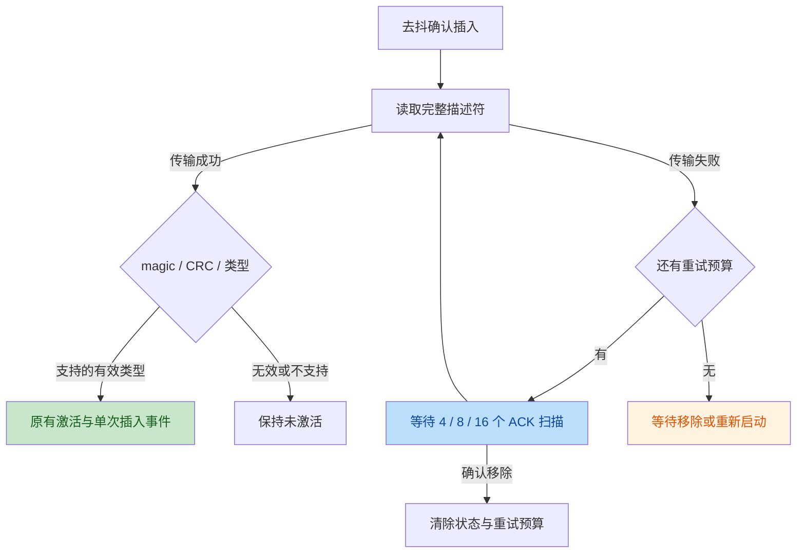

# POWER 开机后灯带不亮：描述符读取失败后的恢复

2026-10-24，ESP-Mosaico CoreBoard V1.2，右槽交互板，旧布局 main_app。

## 现场现象与证据

AI 关机能熄灭灯带；POWER 开机后 Happy 和周期震动恢复，灯带保持熄灭。
当时持久保存的是 N4 effects 测试脑，所以 Happy 和周期震动符合脚本。
`target/n4-reset-live-20261024/32-unattended-power-led-state.log` 记录：

- Startup 黑帧发送和锁存完成。
- I2C1 地址 `0x51` 应答成功。
- 首次完整 EEPROM 读取失败，后续一直为 `slots=[L=- R=bad derr=1]`。
- 没有 `Interaction board inserted, inputs active`。

失败镜像 SHA-256 为
`c8e4f00de7a31aec5936ffc3f54cedd0b0fc992a595beee07949365f54f9af42`。
`33-led-bug-restore-default` 已恢复默认脑、删除临时蓝灯页及其数据，列表恢复原四个
下载应用。完整记录见 [N4 现场记录](../N4_BRAIN_LIVE_20261024.md)。

## 状态机缺口与修复

旧 `Subboard::scan` 仅在连续三次探测确认插入时读取完整描述符。读取失败后保存
`Unreadable`；后续地址探测继续成功，没有新的插入边沿，因此不会再次读取。
灯带的可用性又依赖活动右槽，未识别时正常颜色请求不会输出。

`0b1b211` 将传输失败标为 `ReadFailed`，与成功读取后的无效 magic／CRC 分开。
当前探测成功、模块尚在位时，以 4／8／16 个成功探测周期等待后重试，最多额外三次。
扫描名义周期为 250 ms；这些是扫描计数，不是精确墙钟期限。失败探测不会推进倒计时，
扫描延迟也不会补发多次传输。移除重置预算；重试耗尽后等待重新插入或下次启动。

恢复后仍须通过原有完整描述符解析，再调用原有插入、激活和事件路径。无效描述符
不进入重试；未知类型不启用交互板 GPIO。活动槽选择、移除接管及 GPIO57／60 电源
行为未改动。首次完整传输失败的原因尚未确定，本次日志不能证明灯带或供电损坏。

## 验证边界

`target/slot-descriptor-retry-20261024/` 保存普通 BIN／ELF、源码清单、构建与测试日志。
74 项驱动测试通过，其中 5 项测试生产重试策略的退避、次数、ACK 条件、成功停止和
移除后预算重置。普通构建、严格镜像校验、714 个 ROM C 符号检查通过。
主审核对产物及源码，构建后的变化仅为四份现场文档。

候选普通 BIN 为 3,058,496 字节，SHA-256：
`dce2f5f0bfaeb56806d933b3266dc9a11df3ea3b1c309e43f05c0abe58d9ca56`。
新现场目录为 `target/slot-recovery-live-20261024/`。`flash-01` 已仅写 main_app
`0x210000`，完整应用回读一致，引导区与刷前及原备份逐字节相同，自动重启成功。
`01-startup` 确认默认脑、默认皮肤、原四个下载应用，以及 `R=interact* derr=0`。
本次首次识别成功。`02-settings-shutdown` 取得 AI Long、两处关机 latch、本次
Shutdown 黑帧及锁存、Sleep 遥测和实际 USB 消失；操作者确认双键、灯光预览与
关机表现正常。`03-power-boot` 捕获 USB 从无到有、活动右槽、灯带启用、两键校准
及分别按下／松开，默认脑、皮肤、原四应用和空闲存储均符合基线。操作者确认
独立 POWER 开机后的灯光、按键和设置预览正常。

随后 `06`／`07` 在原 effects 自定义脑与前台蓝灯页并存时完成另一轮 AI 关机／
POWER 开机：前台停止、Sleep、黑帧与端口消失均有记录，开机后 Happy、红灯和
周期震动恢复获操作者确认。`08` 已恢复默认并删除测试内容。

这共计两轮实际 AI 关机／POWER 开机回归，加上刷写后的自动启动，三次描述符均
首读成功，未触发重试。不能将正常功能恢复扩大为真实读失败分支通过或长期故障率结论。

新镜像不沿用旧镜像的通过记录。正常启动识别成功不能证明失败恢复分支；该分支必须观察到
完整读取失败、重试日志、有效识别，以及灯带和按键恢复。真实 EEPROM 时序和长期
故障率不由纯策略测试覆盖。
