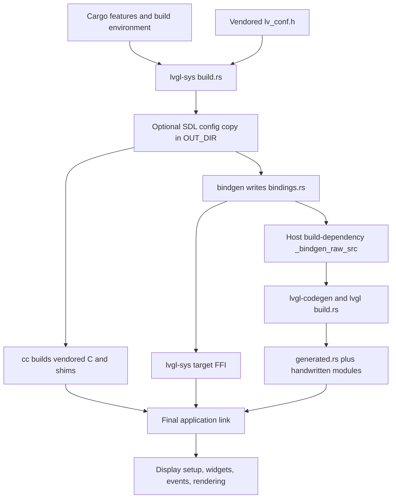
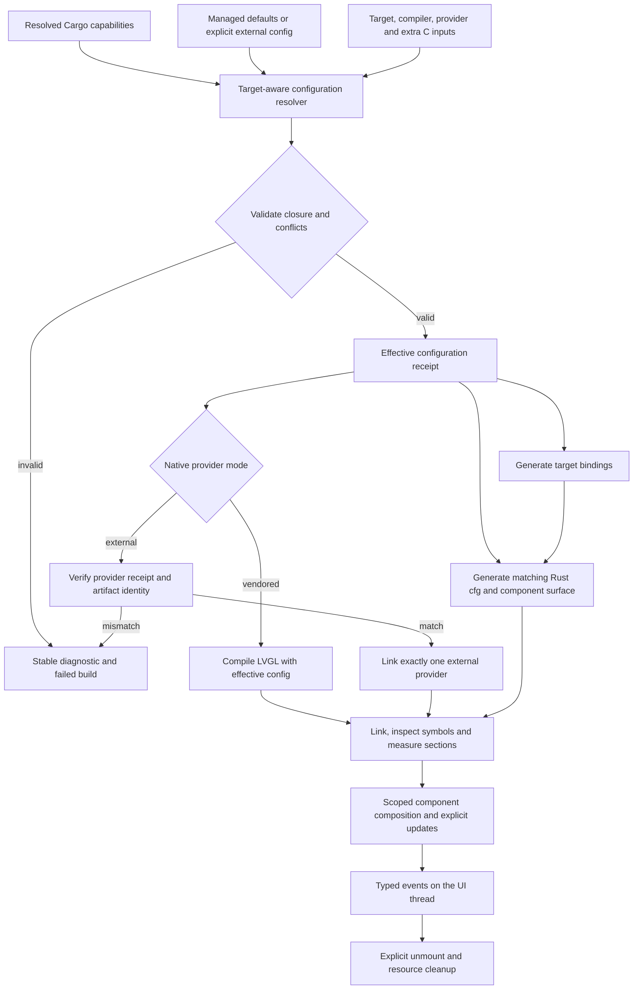

# RFC 0001: Configurable Rust Component Library — Development Plan (Not Implemented)

> Status: **Draft implementation plan; no implementation work package is complete.**
> Plan ID: `lvgl-component-library-v1`; revision: `1`.
> Baseline date: `2026-10-02` UTC (`2026-10-03` in Asia/Shanghai).
> Baseline revision: `5e3b9efab4d32ff514d2820354dcdef4bff857e2`.
> Classification: `CONFIRMED` current capabilities and gaps; `UNVERIFIED_RISK` for unproven failure paths. No defect severity is assigned by this RFC.
> Plan: `docs/plans/component-library-development-plan.md`.
> Execution ledger: [component-library-execution-ledger.md](component-library-execution-ledger.md).
> Accepted upstream project ADR/spec: `N/A` — none exists in the inspected checkout. Existing public contracts are in the manifests, API safety documentation, tests, and source references below.
> Implementation authorization: **not granted by authoring this RFC**. Acceptance and implementation scope must be recorded before W0 execution.

Navigation: [Roadmap](#1-product-direction-and-four-stage-roadmap) · [Architecture decisions](#4-proposed-architecture-decisions) · [Contracts](#5-target-contracts) · [Wave sequence](#10-wave-dependencies-and-execution-state-machine) · [Recovery](#14-execution-ledger-fingerprints-and-recovery)

## 1. Product direction and four-stage roadmap

The project develops an independently maintained Rust component library on the LVGL C engine. Rust API design, release decisions, and documentation are maintained in this repository; LVGL C remains an upstream dependency with recorded version and licensing provenance. No claim about the maintenance status of another Rust repository is required for this direction.

The component experience combines explicit capability selection with familiar composition: text, buttons, sliders, rows, columns, typed properties, typed events, design tokens, and variants. Familiarity with frontend or Flutter concepts does not imply Dart compatibility, Flutter layout equivalence, or a virtual widget runtime.

| Product stage | Execution wave | Deliverable | Observable milestone |
| --- | --- | --- | --- |
| 1. One build configuration | W1 | Resolve configuration once for native compilation, bindings, and Rust API generation | A changed external configuration or custom font is reflected consistently, including incremental rebuilds |
| 2. Component-level selection | W2 | Feature-gated Label, Button, Slider/Bar, layout and font capabilities; auditable dependency closure | The same Label + Button application works with a narrow configuration; Slider automatically brings Bar |
| 3. Build modes and reproducibility | W3 | Distinct vendored/external-provider paths; feature, packaging, and size CI | A matching external provider links once; incompatible providers fail; unpacked packages build without checkout-only inputs |
| 4. Familiar component experience | W4 | Optional composition/builders, Row/Column, typed events, tokens, variants, SDL gallery | A small settings screen is built without raw pointers and survives repeated mount, interaction, and unmount |

W0 establishes contracts and baseline evidence. W5 performs integrated acceptance and documents the supported matrix. These are guardrails around the four product stages, not additional product directions.

The first vertical slice is **Label + Button, then Slider with Bar**, on one frozen build target and profile. It demonstrates feature exclusion, linked-symbol exclusion, equivalent UI behavior, and measured size. No percentage reduction, timing improvement, or hardware compatibility is promised before measurement.

### Goals and non-goals

Goals map to C-01 through C-10 in section 5. The first implementation remains inside the existing three-crate workspace unless an approved contract amendment establishes a concrete need to split it.

Non-goals:

- Reimplementing the LVGL renderer, creating a permanent deep fork of the C engine, or copying Flutter's runtime.
- Import-driven feature discovery: writing `use Button` does not select a Cargo feature.
- React reconciliation, a virtual DOM, a signal scheduler, hot reload, JSX/Dart syntax, an editor, or a complete material-design library in the first release.
- A crate per widget, every possible LVGL widget, all feature combinations, or unqualified support for every target.
- Replacing the imperative API before the optional composition layer proves its resource contracts.
- Disabling safety checks, hiding raw-pointer requirements, changing display-handle destruction, or making LVGL globally thread-safe as an incidental convenience change.
- Silently changing the existing `0.7.0` compatibility contract. A breaking boundary and migration guide precede changes to defaults or feature-gated public APIs.
- Removing Montserrat 28 from the compatibility configuration; narrow configurations may omit it explicitly.
- Renaming crates, changing repository/fork relationships, bumping versions, publishing, committing, pushing, opening a PR, or messaging external systems under this plan's default authorization.
- Production changes during RFC authoring. Only this plan, its initial ledger, and the plan index are created.

## 2. Current checkout baseline

### 2.1 Checkout and investigation record

| Item | Observed baseline |
| --- | --- |
| Branch / revision | `master` / `5e3b9efab4d32ff514d2820354dcdef4bff857e2` |
| Dirty tracked / untracked before authoring | None / none, from `git status --short` and `git status --porcelain=v1 --untracked-files=all` |
| Submodules | `N/A`: `git submodule status` and tracked gitlink inspection returned none |
| Tracking branch | Local `origin/master` is `2245f623fa0aebba1313c68f2c31e0f1d3affc39`; checkout is one commit behind. Its observed diff only removes three README lines. No fetch, pull, reset, or merge was performed |
| Applicable local instructions | No `AGENTS.md` or `CLAUDE.md` found on the ancestor path or in the non-vendored project tree |
| Existing plans / ADR / architecture / spec | `N/A`: no project planning directory or accepted design record found before authoring |
| Contribution / build entrypoints | README, crate READMEs, examples README, Cargo manifests, `.cargo/config.toml`, and `.github/workflows/rust.yml`; no Makefile, Justfile, or contribution guide found |
| Changelog / historical migration | [CHANGELOG.md](../../../lv_binding_rust/CHANGELOG.md); historical claims are context, not fresh acceptance evidence |
| Issues / incidents | `N/A`: no issue export or incident record used; this baseline is the checkout, not live GitHub state |
| Workspace / version | `lvgl`, `lvgl-sys`, `lvgl-codegen`; each manifest is `0.7.0`; Cargo resolver `2` |
| Lockfile | Local `Cargo.lock` exists, format `4`, but is ignored and untracked. Future evidence must record its digest; package consumers resolve their own graph |
| Local tool inventory | `rustc 1.98.1`, `cargo 1.98.1`, Apple clang `21.0.0`, host `aarch64-apple-darwin`; `pkg-config` reports SDL2 `2.32.72` |
| Real dependencies | SDL2 discovery works. Compilation, libclang loading, native execution, packaging, cross-compilation, and physical hardware are **not run** during authoring |
| Cross targets | Rust target installation was observed, including RISC-V targets; a matching C compiler, sysroot, linker, and working board are `UNKNOWN` |
| Current test failures | `UNKNOWN`: no build/test suite was run during authoring. Prior conversation test counts are not imported as current evidence |
| Authoring overlap | Only new `docs/plans/` files. Any later overlapping tracked or untracked change must be attributed before editing |

Ignored `target/`, editor settings, and the local lockfile are not removed or normalized. An executor rechecks the entire worktree; this record does not authorize absorbing the tracking-branch change.

### 2.2 Source inventory and evidence classification

| ID / classification | Repository evidence | Current behavior / gap |
| --- | --- | --- |
| B-01 `CONFIRMED` | [sys build](../../../lv_binding_rust/lvgl-sys/build.rs), [native config](../../../lv_binding_rust/lvgl-sys/vendor/include-9.6/lv_conf.h) | LVGL `9.6.0` is vendored. The build selects a fixed configuration, recursively adds C files, and always calls `cfg.compile("lvgl")` |
| B-02 `CONFIRMED` | [sys manifest](../../../lv_binding_rust/lvgl-sys/Cargo.toml), sys build | `sdl` patches a configuration copy under `OUT_DIR`; demo sources are optional. `LVGL_CFLAGS` is comma-separated definitions; `LVGL_SYSROOT` adjusts bindgen includes. General external-config and provider-mode contracts are absent |
| B-03 `CONFIRMED` | [high-level build](../../../lv_binding_rust/lvgl/build.rs), [sys exports](../../../lv_binding_rust/lvgl-sys/src/lib.rs), [codegen](../../../lv_binding_rust/lvgl-codegen/src/lib.rs) | Widgets are discovered from `_bindgen_raw_src()` and their creation functions; this is reusable generation infrastructure |
| B-04 `CONFIRMED` | [high-level manifest](../../../lv_binding_rust/lvgl/Cargo.toml), [widget modules](../../../lv_binding_rust/lvgl/src/widgets/mod.rs) | `lvgl-sys` is both a normal dependency and a build dependency. Handwritten arc/bar/keyboard/label/slider/table modules and several exports are unconditional; proposed component features do not exist |
| B-05 `UNVERIFIED_RISK` | B-04 plus Cargo resolver-2 semantics | Host-side bindings may become an incorrect source for target-facing wrapper generation when feature sets or ABIs diverge. A controlled fixture must establish actual behavior; no existing cross-target bug is declared here |
| B-06 `CONFIRMED` | [Slider C](../../../lv_binding_rust/lvgl-sys/vendor/lvgl-9.6/src/widgets/slider/lv_slider.c), [Keyboard C](../../../lv_binding_rust/lvgl-sys/vendor/lvgl-9.6/src/widgets/keyboard/lv_keyboard.c) | Slider requires Bar; Keyboard requires Buttonmatrix and Textarea. C guards already provide native conditional compilation |
| B-07 `CONFIRMED` | Native config; [default theme](../../../lv_binding_rust/lvgl-sys/vendor/lvgl-9.6/src/themes/default/lv_theme_default.c); [font helpers](../../../lv_binding_rust/lvgl/src/font/builtin.rs) | The configuration enables many widgets, Flex/Grid, and Montserrat 12/14/16/28. Themes reference enabled widget classes. Some convenience font helpers are nightly-gated |
| B-08 `CONFIRMED` | [display](../../../lv_binding_rust/lvgl/src/display.rs), [support](../../../lv_binding_rust/lvgl/src/support.rs), [memory](../../../lv_binding_rust/lvgl/src/mem.rs), [initialization](../../../lv_binding_rust/lvgl/src/lib.rs), [timer](../../../lv_binding_rust/lvgl/src/timer.rs) | Existing contracts cover RGB888 safe buffers, explicit unsafe native teardown, callback cleanup, destructor execution, and timer re-registration; they must remain tested |
| B-09 `CONFIRMED` | [object/events](../../../lv_binding_rust/lvgl/src/lv_core/obj.rs), support | The imperative API registers callbacks and delete callbacks. An optional safe composition layer needs an explicit scope/handle/event contract; its soundness is not proved by the existing macros |
| B-10 `CONFIRMED` | [build-script tests](../../../lv_binding_rust/lvgl-sys/tests/build_script.rs), source-local tests, [CI](../../../lv_binding_rust/.github/workflows/rust.yml) | Existing tests include SDL patching, demo package-input listing, native smoke, codegen pointer safety, display/memory/timer regressions. CI currently uses Ubuntu build/test/example checks |
| B-11 `UNKNOWN` | No benchmark or contract/E2E fixture directory found | Final binary size, build-time benefit, runtime memory, full package reconstruction, external-provider ABI compatibility, and new UI behavior need dedicated evidence |
| B-12 `NON_BLOCKING` | README and [Cross config](../../../lv_binding_rust/Cross.toml) | Historical embedded guidance contains older configuration assumptions. Update touched guidance in W5; unrelated documentation cleanup is outside scope |

`lvgl/lv_conf.toml` exists but no inspected build path reads it. It is not treated as an active configuration contract. No database, application storage schema, remote API, or deployment system is part of this library's current build path.

## 3. Current and target end-to-end paths

### 3.1 Current flow



The graph is descriptive: host and target dependency instances can each run the sys build. Their output identity is not assumed equal. Without SDL, cc and bindgen use the vendored configuration directly.

### 3.2 Target flow



### 3.3 Boundary responsibilities

| Conversion / responsible module | Input -> output | Durable or derived effects | Failure behavior |
| --- | --- | --- | --- |
| Configuration resolver, initially within `lvgl-sys` build support | Features, selected header, target flags, custom C/font inputs -> validated capability closure and build mode | Source inputs are canonical; generated header/receipt are derived under `OUT_DIR` | Structured internal error plus stable nonzero build diagnostic; no partial successful configuration |
| Native build / external adapter | Validated receipt -> native artifact or accepted provider | Artifact identity binds source/config/toolchain/provider; never edits an input header | Missing compiler/config/provider, mismatch, or write failure stops the build |
| Bindgen | Same target receipt/header -> target FFI text | `bindings.rs` is replaceable generated output | Fails with stage-specific diagnostic; no stale binding fallback |
| `lvgl` build + `lvgl-codegen` | Target receipt and target binding text -> generated wrappers and cfg | Generated Rust is a projection of the accepted native/API capabilities | Reject missing receipt or inconsistent target, feature, or schema identity |
| Component builder and mount boundary, proposed inside `lvgl` | Typed properties and descriptions -> mounted LVGL object subtree | Runtime-only objects, styles, callback registrations; no application-data persistence | Invalid props/LVGL allocation failure returns a typed error; construction unwinds its own partial subtree |
| Event/update/unmount boundary | UI-thread events or explicit updates -> rendered changes or detached subtree | Event registrations/resources last no longer than their scope | Reentrant structural mutation is rejected or explicitly deferred under the frozen W4 contract; no callback into freed state |
| Verification / CI | Artifact and runtime behavior -> reports with input fingerprint | Evidence includes logs, symbol maps, section sizes, package hashes, and UI observations | Missing or stale evidence never advances a wave to `complete` |

## 4. Proposed architecture decisions

All names introduced in this section are **proposed**, not available APIs or environment variables in the baseline. W0 records acceptance, compatibility boundaries, and any amendments.

### 4.1 Two levels of code elimination

1. Explicit capabilities select native code, bindings, wrappers, fonts, themes, and assets before compilation.
2. Final-link dead-code elimination removes unreachable sections where supported by the selected target/linker.

Cargo features are additive and unify across normal dependency paths. `default-features = false` does not subtract features enabled elsewhere. No `minimal` feature overrides another dependency's selection. Presets only add capability sets. A third-party dependency that requests a full preset can enlarge the final closure and must be visible in the configuration report. See S-01.

Compiling every `.c` file is not evidence that every implementation survives into the linked application. Static-archive size is not a substitute for final executable/firmware section measurements. Linker behavior is target-specific; GNU flags are not copied unconditionally to Apple or embedded linkers. See S-03.

### 4.2 One effective configuration, target-correct projections

The proposed receipt records schema identity, exact LVGL source version, host and target identities, native capabilities, public Rust capabilities, default font, ABI-relevant configuration, selected mode, compiler/flags identity, and input hashes. Exact public field names and delivery syntax are frozen in W1.1 after the metadata fixture passes.

- Managed mode generates the effective header from the selected capabilities and supported scalar settings. Required font/core dependencies are explicit in the closure; `--no-default-features` is not promised to mean zero fonts or zero allocations.
- External-config mode uses the supplied header without silently rewriting it. Target preprocessing/probes determine native capabilities; requested Rust capabilities must be a supported subset. A contradictory feature request fails with its dependency chain.
- Font/default-font selection is a validated scalar configuration plus dependency closure, not mutually exclusive font features. The compatibility preset preserves the current 12/14/16/28 set; narrow applications may select only their required font closure.
- Definitions that conflict with resolver-managed feature/ABI settings are rejected. Legacy `LVGL_CFLAGS` behavior is characterized before migration; comma-separated defines must not be reinterpreted as arbitrary shell commands.
- Header dependencies, extra C sources, font sources, and selected environment inputs participate in rebuild tracking and identity. Paths with spaces and repeat builds are required cases.
- `lvgl` consumes the **target instance's** receipt and bindings, preferably through the existing `links = "lvgl"` immediate-dependency metadata path. W1 proves the mechanism. Do not use host `_bindgen_raw_src()` as an unverified substitute, scan random `target/` directories, or share a global mutable cache. See S-01 and S-02.
- Removing the high-level crate's sys build dependency is a proposed result of the target-metadata work, not an unconditional edit before the fixture proves it works.

External configuration is executable build input in the same trust category as C sources. The build does not download code or treat third-party headers as instructions to the agent.

### 4.3 Capability model and first vertical slice

| Proposed capability | Native / Rust consequence | Required closure |
| --- | --- | --- |
| `widget-label` | Label API and `LV_USE_LABEL` | Core and a valid default font |
| `widget-button` | Raw LVGL Button API and `LV_USE_BUTTON` | Core; a textual high-level Button also requests Label |
| `widget-bar` | Bar API and `LV_USE_BAR` | Core |
| `widget-slider` | Slider API and `LV_USE_SLIDER` | Bar |
| `layout-flex` | Row/Column layout support | LVGL Flex; no claim of Flutter's constraint algorithm |
| `font-montserrat-14` | Font 14 capability / helper when enabled | Consistent default-font validation |
| Compatibility preset, final name decided in W0 | Existing enabled widgets, layouts, fonts, and documented defaults | Full transitive native closure |

The rest of the current widget catalog remains available through the compatibility configuration until individually described and tested. The MVP does not need a separately public feature for every widget. Keyboard's Buttonmatrix/Textarea dependency is a negative/dependency-graph fixture; publishing a complete Keyboard component is deferred.

Disabled components disappear from the Rust public surface, including handwritten extensions and public type exports. Negative compile fixtures must prove that absence. Dependency closure and manifests must agree: a feature enabled only on a dependency cannot be assumed to set the same-named feature on its parent crate. Effective cfg must therefore reflect the accepted target receipt.

Avoid a runtime registry that references all widgets or fonts. Theme variants apply only to the selected component; broad default themes and demo presets are separate measurement inputs.

### 4.4 Provider modes

Use one explicit build-mode selector, provisionally `LVGL_BUILD_MODE=vendored|external`, rather than mutually exclusive additive Cargo features. This selector does not exist yet. The exact integration interface is frozen in W3.1.

- **Vendored:** compile the pinned C source and custom inputs using the accepted effective configuration.
- **External:** skip vendored native compilation; validate the actual provider artifact and its matching headers/build receipt; generate compatible bindings and link one provider.

The initial verified provider contract targets exactly the pinned LVGL version and a recorded configuration/ABI/toolchain combination. Matching a version string or comparing headers does not prove an arbitrary binary's layout. Provider evidence must originate from that native build and bind its artifact hash to configuration/layout probes. Missing evidence is a failed verified-provider integration, not an automatic fallback to vendored LVGL. A future unchecked raw-FFI escape hatch requires a separate explicit unsafe contract.

A Linux-built reference provider proves the external integration path, not ESP-IDF or another board's compatibility. A prebuilt provider cannot be made smaller by disabling Rust features. Dynamic-provider support and a public bindings-only product are deferred unless separately accepted.

### 4.5 Frontend / Flutter familiarity without hidden lifetime rules

The optional composition layer uses familiar names and typed composition while retaining LVGL's rendering and layout semantics. Text may wrap Label; Button, Slider, Row, Column, spacing/alignment, theme tokens, and variants are the initial vocabulary. Flutter's Row/Column conventions are a naming reference, not a compatibility promise. See S-04.

Illustrative syntax only; it is **not compilable against the current crate**:

```text
ui.mount(
    Column::new()
        .gap(12)
        .child(Text::new("Device settings"))
        .child(Button::new("Save").variant(Primary).on_click(save))
        .child(Slider::new().range(0..=100).value(50).on_change(change))
)?;
```

W4 first proves scoped handles, parent/child destruction, style/string retention, callback registration, and event reentrancy. Then it settles exact syntax and heterogeneous-child representation. No zero-allocation claim is made; no mandatory `std` dependency is added to the embedded-facing library. Allocation requirements are documented separately from `no_std`.

Mount and explicit updates run on one UI thread. Mount returns an error for invalid properties or LVGL allocation failure and cleans up its own partial construction. Rust allocator exhaustion follows the configured allocator/panic policy and is not falsely advertised as a recoverable `Result`. Strings cannot leave borrowed temporary bytes referenced by C. Event closures cannot outlive their registration/scope. Safe handles cannot be reused after unmount; compile-time lifetimes or checked handle identities must enforce the chosen design.

Repeated mounting requires an explicit unmount/replacement operation; it is not an implicit reconciliation algorithm. Structural mutation during callback dispatch must have one documented behavior, provisionally a typed busy/reentrancy rejection. Panics must not unwind through a C ABI callback. The selected panic strategy, callback replacement/unsubscription, and async display-flush teardown constraints are accepted before ergonomic wrappers are introduced.

### 4.6 Compatibility and independent maintenance

W0 freezes the first release boundary, supported Rust toolchain policy, and default preset. The recommendation is to preserve a compatibility preset and introduce the narrow configuration as an explicit opt-in during development; removing previously available APIs in `--no-default-features` remains a breaking change even if the normal default build still works. No version number is invented by this RFC.

A migration example maps today's imperative Label/Button/Bar usage to explicit capabilities, while the optional composition API remains additive. Independent maintenance retains upstream copyright/license notices and records LVGL updates. Repository renaming, release ownership, and registry publication are separate decisions and operations.

### 4.7 Open decisions and bounded discovery

| ID | State | Discovery / decision | Required before / stop condition |
| --- | --- | --- | --- |
| D-01 | `UNKNOWN` | Freeze compatibility preset, breaking-release boundary, MSRV/toolchain matrix, and minimal core/default-font closure | W0 exit; stop if an incompatible change is represented as `0.7.0` compatible |
| D-02 | `UNVERIFIED_RISK` | Prove target metadata delivery with host/target feature divergence and header/ABI probes; freeze receipt schema | W1 implementation beyond W1.1; stop on a host-derived fallback |
| D-03 | `UNKNOWN` | Choose a Linux ELF measurement fixture and exact linker/size/symbol commands from its working toolchain | W2 measurement package; no unverified size threshold or percentage |
| D-04 | `UNKNOWN` | Freeze external-provider interface, its receipt generator, archive identity and ABI probes | W3 external integration; stop if an arbitrary binary is accepted by version alone |
| D-05 | `UNVERIFIED_RISK` | Prove mount/handle/callback/style lifetime and reentrancy model, including panic behavior | W4 builder API; stop if convenience requires exposing dangling safe handles |
| D-06 | `UNKNOWN` | Register exact new fixture, negative-compile, unpacked-package, gallery, and recovery commands after their real test targets exist | Before their work package exits; missing commands remain `not_run`, never assumed executable |
| D-07 | `UNKNOWN` | Identify any real embedded target/toolchain/board separately from host builds | Conditional support claim only; do not claim board support from this RFC's required host matrix |

These unknowns are execution discovery work, not missing authoring sections or claims of existing defects.

## 5. Target contracts

Every contract uses independent expected results. Existing preservation contracts use characterization/differential oracles; they do not require inventing a regression in healthy code.

### C-01 — Independent Rust library, upstream C engine

- **Given:** the accepted RFC and recorded `9.6.0` C baseline.
- **When:** new component capabilities or public APIs are implemented.
- **Then:** Rust contracts and release policy are maintained here, with traceable C version/license provenance.
- **And not:** a renderer rewrite, mandatory Flutter runtime, unapproved crate split, rename, or publication.
- **Failure:** a required upstream API/license or scope change stops the affected package for an RFC amendment.
- **Evidence:** W0 decision record and W5 manifest, dependency, source-provenance, and scope diff review (G-BASE, G-DIFF, D-DOC).

### C-02 — One effective configuration

- **Given:** a target, accepted capability requests, configuration source, optional extra C/font files, and pinned source inputs.
- **When:** a clean build or an incremental rebuild runs after changing one input.
- **Then:** native compilation, bindings, and Rust API consume the same target receipt; an external font is linkable only when declared and compiled.
- **And not:** silent precedence conflicts, source-header mutation, host-binding substitution, or stale generated output.
- **Failure:** `ConfigConflict`, `MissingInput`, `TargetMismatch`, or `GenerationFailed` diagnostics stop the build; retry with corrected inputs regenerates derived artifacts.
- **Evidence:** W1 resolver/source fixtures, target metadata probe, input mutation/rebuild tests, custom-font round trip (G-SYS, G-CODEGEN, D-CONFIG).

### C-03 — Selectable components and dependency closure

- **Given:** a narrow Label + Button configuration, its font closure, and no other requester enabling a full preset.
- **When:** the application builds, then adds Slider.
- **Then:** unrelated Rust widget APIs are absent; Slider adds Bar and the native configuration matches; a second dependency's additive request is reported.
- **And not:** link errors as the normal dependency resolver, a subtractive `minimal` feature, or themes silently restoring disabled widgets.
- **Failure:** incompatible external config produces `MissingCapability` with the dependency chain before an inconsistent API is emitted.
- **Evidence:** W2 positive/negative compile cases, dependency-union fixtures, receipt assertions, and theme/font exclusions (G-SYS, G-CODEGEN, D-FEATURE).

### C-04 — Honest and repeatable size evidence

- **Given:** the same Label + Button application source, target, toolchain, optimization, backend, and asset/font inputs; only the capability configuration differs.
- **When:** full and narrow builds are linked, then the narrow application explicitly adds Slider.
- **Then:** reports contain final artifact hash, map/symbol proof, code/read-only data/static-RAM section sizes, and separately recorded build times. Unselected Slider/Bar symbols are absent before they are added.
- **And not:** `.a` size presented as firmware size, host process RSS presented as embedded RAM, or a guaranteed percentage reduction.
- **Failure:** incomparable inputs or missing map/symbol evidence invalidate the measurement. No measurable improvement is reported honestly and triggers design review before a reduction claim.
- **Evidence:** W2 measurement baseline and W3/W5 regression runs with preserved artifacts (D-SIZE).

### C-05 — Exactly one verified native provider

- **Given:** vendored mode or an external provider built from recorded compatible inputs and bound to its artifact hash.
- **When:** the application links; negative cases alter version, ABI-affecting config, capabilities, or provider evidence.
- **Then:** the positive path links exactly one provider; negative cases fail before an unsafe executable is accepted.
- **And not:** compiling a second vendored LVGL in external mode, accepting arbitrary binary compatibility, or claiming Rust-side trimming shrinks an external library.
- **Failure:** `ProviderMismatch`, `ProviderEvidenceMissing`, or `ProviderUnavailable` stops integration without fallback.
- **Evidence:** W3 actual external archive/link test, mismatch tests, link-command/map inspection (D-PROVIDER).

### C-06 — Familiar composition with explicit runtime semantics

- **Given:** the accepted component/lifetime contract, required capabilities, and a valid UI context.
- **When:** the settings screen mounts, a button is clicked, the slider changes, an explicit update applies, and the subtree unmounts.
- **Then:** typed props/events and Row/Column composition produce documented behavior; callback/resource counters return to baseline after teardown.
- **And not:** raw pointers in the gallery's application code, hidden reconciliation, callbacks after disposal, or claims of Flutter runtime/layout compatibility.
- **Failure:** invalid properties or LVGL allocation failure leave no partially mounted subtree; reentrant structural mutation and stale handles follow the selected typed rejection contract.
- **Evidence:** W4 library integration tests, negative lifetime cases, UI interaction record, repeated mount/unmount and failure injection (G-LVGL, D-LIFETIME, D-GALLERY).

### C-07 — Preserve the migrated safety and embedded-facing contracts

- **Given:** supported baseline feature combinations and the new component layer.
- **When:** codegen processes pointer arguments, displays flush, handles drop, callbacks clean up, and LVGL deinitializes/reinitializes.
- **Then:** current tested color/buffer boundaries, explicit unsafe teardown, destructor execution, timer re-registration, and `no_std` library compilation remain valid.
- **And not:** safe wrappers silently accepting new pointer/lifetime obligations, implicit display deletion on ordinary handle drop, mandatory desktop SDL or `std` on the core path, or a zero-heap claim.
- **Failure:** a changed safety contract blocks the affected package until its contract, callers, and tests are reviewed together.
- **Evidence:** existing safety regressions plus three consecutive lifecycle passes and new scope tests (G-TEST, G-CORE, G-NODEFAULT, G-ALLOC, G-CODEGEN, D-LIFETIME).

### C-08 — Reproducible matrix, packages, and real dependencies

- **Given:** the W0-frozen required matrix, actual dependency versions, and locally produced package archives.
- **When:** CI and isolated unpacked-package consumers build/run the applicable workflows.
- **Then:** default/narrow configurations, SDL, provider integration, and final artifacts are verified without undeclared checkout paths; logs identify exact inputs.
- **And not:** package listing alone counted as a package build, `cargo check` alone counted as native/UI execution, or mock/native-host success counted as hardware support.
- **Failure:** missing real dependencies or package inputs keep the gate `not_run`/failed and cap status below `complete`.
- **Evidence:** W3 matrix, actual archives and hashes, isolated consumer builds, W4 SDL interaction, W5 final evidence (G-BUILD, G-TEST, G-EXAMPLES, G-SDL, D-PACKAGE, D-GALLERY).

### C-09 — Explicit compatibility and migration boundary

- **Given:** the current `0.7.0` API/features and W0-approved changes.
- **When:** feature defaults or exposed APIs change.
- **Then:** compatibility examples preserve documented current behavior where promised, narrow examples declare requirements, and a migration guide identifies every intended breaking change.
- **And not:** silently removing font 28 from the compatibility preset, claiming source compatibility for a reduced no-default API, or adopting another project's pre-release breaking-change policy.
- **Failure:** an unclassified public change stops the package; amend the contract and callers before proceeding.
- **Evidence:** W0 decision record, W2 imperative examples, W5 public-surface/config diff and migration guide (G-EXAMPLES, D-FEATURE, D-DOC).

### C-10 — Plan-only authoring and resumable implementation

- **Given:** a draft RFC and an initially clean checkout.
- **When:** planning artifacts are authored, or a later separately authorized execution resumes.
- **Then:** authoring changes only planning files; implementation uses the ledger, fresh fingerprints, allowed paths, and serial gates.
- **And not:** production changes during authoring, copied unrelated project instructions, stale evidence counted as green, automatic Git/registry operations, or checklists marked complete without evidence.
- **Failure:** unknown overlap, missing authorization, or a stale/contradictory plan stops mutation until resolved.
- **Evidence:** authoring diff/link/structure checks; W0/W5 scope checks; ledger freshness and final report (G-BASE, G-DIFF, D-DOC).

The capitalized diagnostic names above define proposed error categories, not existing exported Rust enum variants. Internal build errors may be typed while Cargo observes a stable diagnostic code and nonzero exit. W1/W3/W4 specify their public or internal representation before implementation.

## 6. Requirement Coverage Matrix

Each requirement has exactly one primary contract. Secondary contracts identify shared constraints without replacing the primary mapping.

| Requirement | Primary / secondary contract | Current gap | Target behavior | Wave | Red test or preservation oracle | Final evidence |
| --- | --- | --- | --- | --- | --- | --- |
| R-01 Independent Rust-facing direction, retaining LVGL C | C-01 / C-09 | No accepted independent API/release policy | Recorded scope and upstream provenance | W0, W5 | Scope/dependency comparison; no fabricated defect red | Decision record and diff |
| R-02 Default/external config, custom fonts and C inputs | C-02 | Fixed header and no unified receipt | One target-specific configuration path | W1 | Mutated input is not reflected / conflicting config accepted | D-CONFIG plus build logs |
| R-03 Tree-shakable component selection | C-03 / C-02 | No component features; unconditional modules | Capability closure controls native and Rust surfaces | W2 | Disabled-widget compile-fail fixture unexpectedly compiles | D-FEATURE and receipt |
| R-04 Prove trimming rather than assume it | C-04 / C-03 | No final-artifact benchmark | Same-app comparable symbols/sections | W2, W3, W5 | Excluded symbols remain or report compares different inputs | D-SIZE report/artifacts |
| R-05 Vendored/external build separation | C-05 / C-02 | Unconditional native build | One verified native provider | W3 | External fixture sees unwanted native compilation / accepts a mismatch | D-PROVIDER logs/maps |
| R-06 Familiar frontend/Flutter component experience | C-06 / C-07 | Imperative API only | Optional composition, tokens, typed props/events, gallery | W4 | Availability oracle followed by actual lifetime/UI red tests | D-LIFETIME and D-GALLERY |
| R-07 Preserve safety, imperative access, no_std boundaries | C-07 / C-09 | New architecture not covered by old safety tests | Existing regressions plus new scope guarantees | W0, W1–W5 | Characterization fixtures; seeded negative cases for new scope | G-TEST / G-CORE / G-NODEFAULT / G-ALLOC |
| R-08 Feature/package/size CI and real SDL acceptance | C-08 / C-04 | Limited CI; no isolated package consumer | Bounded, repeatable supported matrix | W3–W5 | Missing package input and missing real-dependency fixture | D-PACKAGE / CI / D-GALLERY |
| R-09 Preserve font 28 in compatibility setup; classify breaking changes | C-09 / C-03 | No migration/default policy for new gating | Versioned decision and migration examples | W0, W2, W5 | Baseline public-surface/font expectations | D-FEATURE / D-DOC |
| R-10 Store a four-stage RFC using verifiable/resumable rules | C-10 / C-01 | No planning artifacts | Four product stages plus baseline/final gates and ledger | Authoring, W0, W5 | Scope/structure/ledger validation | Planning files and authoring checks |
| R-11 No implementation, push, PR, rename, or unrelated rules during planning | C-10 | Operational constraint | Documentation-only diff; separate future authorization | Authoring, all waves | Changed-path and operation audit | G-DIFF and ledger |

## 7. Impact boundary matrix

All proposed paths are allowed only in their listed wave after authorization. A path in this matrix is not permission to edit it during authoring.

| Module / boundary | Current responsibility | Allowed evolution | Must preserve | Contract / validation |
| --- | --- | --- | --- | --- |
| `lvgl-sys/build.rs`, build support, config | Native build and FFI generation | Resolver, source tracking, target receipt, provider adapter | Pinned C source semantics; correct target flags | C-02/C-05; G-SYS, D-CONFIG, D-PROVIDER |
| `lvgl-sys/Cargo.toml`, `lvgl/Cargo.toml` | Workspace API/feature declarations | Capability/preset edges and example requirements | Approved compatibility boundary; one `links = "lvgl"` provider | C-03/C-09; D-FEATURE |
| `lvgl/build.rs`, `lvgl-codegen/src/` | Bindings-to-wrapper projection | Target receipt consumer, cfg-aware codegen | Pointer arguments retain required unsafe boundaries | C-02/C-07; G-CODEGEN |
| `lvgl/src/widgets/`, fonts, public exports | Imperative widget and font API | Feature/capability-gated handwritten extensions | Matching native symbols; compatibility font set | C-03/C-09; D-FEATURE |
| `lvgl/src/lv_core/`, support, memory, display/timer | Handles, events, style and lifetime boundaries | Narrow changes required by scoped API with explicit tests | Existing buffer/deletion/callback/init contracts | C-06/C-07; G-TEST, D-LIFETIME |
| Proposed component/layout/theme modules inside `lvgl` | `N/A`: no composition layer | Typed props, builders, tokens, scoped mount/update/unmount | No mandatory std/SDL, no unproved safe aliasing | C-06/C-07; D-LIFETIME, D-GALLERY |
| `.github/workflows/rust.yml`, proposed test/measurement support | Build/test/example jobs | Feature/provider/package/size gates with evidence | Required tests cannot be ignored or weakened | C-08; matrix report |
| `examples/` and project documentation | Usage and simulations | Equivalent narrow/full fixture, gallery, migration guide | Existing imperative workflow where promised | C-04/C-06/C-09; D-SIZE, D-GALLERY |
| Durable store / cache / projection | No app store; `OUT_DIR` and `target/` are derived | Receipt identity and rebuild validation | Never reuse incompatible cached output; source inputs stay canonical | C-02/C-08; recovery tests |
| Permission / safety | Rust unsafe/FFI and local build inputs | Explicit diagnostics and capability checks | No new secret access, automatic downloads, unapproved external writes | C-07/C-10; diff and log review |
| Telemetry / audit | Cargo diagnostics; no telemetry service | Local build/acceptance receipts | No environment dumps, tokens, private header bodies or user data in reports | C-08/C-10; redaction review |
| Backup / restore / migration | Git source; no persistent application schema | Source/API migration guide; generated-cache rebuild | No destructive Git rollback or user-data deletion | C-09/C-10; migration and resume checks |
| Worker / remote service / database | `N/A`: no such boundary in inspected library | None | No unrelated infrastructure | C-01/C-10; scope review |

## 8. Global invariants, failure terminals, and support scope

- Canonical build facts are source/configuration inputs, requested capability graph, target/toolchain, and actual provider identity. Generated headers, receipts, bindings, wrappers, caches, and measurement summaries are derived facts. A receipt reports validation; it cannot prove an arbitrary external binary merely by asserting compatibility.
- Successful build means all projections match and the required final link succeeds. Partial generated output is not partial success. Failed, cancelled, timed-out, or crashed builds have no accepted new receipt; restart validates inputs and regenerates incomplete output before reuse.
- LVGL object state is runtime-only. There is no persistent UI tree, application DB, transactional user-data migration, or remote request protocol (`N/A` based on B-01–B-11). Process restart reconstructs UI from application inputs.
- Rebuilds are deterministic for fixed supported inputs. Generated outputs use per-build `OUT_DIR`; concurrent feature/target builds do not share mutable files outside Cargo's isolation. Retry never edits source configuration to “make it pass.” Bit-for-bit reproducible binaries are not promised unless the frozen toolchain demonstrates them.
- Mount is explicit; duplicate mount is a new operation, not deduplicated reconciliation. Unmount, callback removal, and delete notifications must not free resources twice. UI event delivery stays serialized; mount/unmount during active callbacks follows the W4-approved rule. These lifecycle paths require three consecutive passes.
- Native global initialization/deinitialization and LVGL tests remain serialized. No incidental `Send`/`Sync` or thread-safety guarantee is introduced.
- Application-level async cancellation is `N/A`: no async task runtime is proposed. Build-process interruption and synchronous mount failure are applicable; asynchronous display-flush completion remains part of the existing unsafe teardown obligation.
- API/config compatibility is frozen in W0. Receipt schema mismatches fail with a rebuild instruction; no dual-format migration layer is needed for discardable generated output. Source/API migration is required for intentional public changes. Database migration and destructive data rollback are `N/A`.
- Build reports may contain sanitized relative source paths, versions, hashes, known compiler flags, and diagnostic categories. Do not persist secrets, full environment variables, private font/config bodies, or raw external responses. No remote telemetry is added.
- Required initial real environments: Linux native/ELF build, provider/package/size validation on CI or an equivalent recorded runner; macOS native SDL interaction; target-vs-host feature isolation fixture. Network installation/bootstrap is distinct from deterministic tests and must record unavailable dependencies accurately.
- Board flashing, hardware rendering, and real ESP-IDF linkage are not required by this bounded milestone and remain explicitly unverified. They become required gates before any respective support claim. A Rust target being installed is insufficient.

## 9. Verification command registry

Commands run from the repository root unless a registered fixture explicitly defines a different working directory. Existing commands below are available from inspected entrypoints; **none of the build/test commands has been run for this RFC**.

| Gate | Exact command or bounded discovery | Provenance | Expected result / requirement |
| --- | --- | --- | --- |
| G-BASE | `git status --short`; `git rev-parse HEAD`; `git diff --binary HEAD`; `git diff --cached --binary` | Git checkout investigation | Fresh attributed baseline; required every wave/resume |
| G-BUILD | `cargo build --verbose` | Current CI | Default native build succeeds; required |
| G-TEST | `cargo test --verbose -- --test-threads 1` | Current CI | Current default unit/doctest suite passes serially; required |
| G-EXAMPLES | `cargo check -p lvgl --examples --features alloc` | Current CI and manifest examples | Declared examples typecheck; required |
| G-SDL | `cargo check -p lvgl --features sdl --examples` | Current CI | SDL feature/examples typecheck with actual SDL; required |
| G-SYS | `cargo test -p lvgl-sys --test build_script -- --test-threads=1` | Existing integration-test target | Existing and added build-contract cases pass; required |
| G-CODEGEN | `cargo test -p lvgl-codegen` | Manifest and source-local tests | Wrapper generation including unsafe boundary passes; required |
| G-LVGL | `cargo test -p lvgl -- --test-threads=1` | Manifest and source-local tests | High-level native behavior and regressions pass; required |
| G-CORE | `cargo check -p lvgl --no-default-features --lib` | Manifest and `#![cfg_attr(not(test), no_std)]`; added matrix requirement | Non-test library compiles with no defaults; no target-runtime claim; required |
| G-NODEFAULT | `cargo test -p lvgl --no-default-features -- --test-threads=1` | Existing manifest features and library tests; added matrix requirement | Approved no-default contract passes; characterize before changing it |
| G-ALLOC | `cargo test -p lvgl --no-default-features --features lvgl_alloc,rust_timer -- --test-threads=1` | Existing features and memory/timer tests; added matrix requirement | Custom allocator/timer path passes; required |
| G-FEATURES | `cargo test -p lvgl --features alloc,sdl,demo-widgets,rust_timer,custom_timer -- --test-threads=1` | Existing feature declarations; added matrix requirement | Composite supported path passes with SDL; required |
| G-SIM | `cargo run -p lvgl --example sdl_demo --features sdl` | README and declared example | Real window/event-loop smoke; not evidence for the not-yet-created gallery |
| G-PACKLIST | `cargo package -p lvgl-sys --list --allow-dirty --offline --locked` | Existing build-script integration test uses these package flags | Diagnostic package file list only; never counts as isolated package acceptance |
| G-DIFF | `git diff --check`; `git diff --name-only HEAD`; `git ls-files --others --exclude-standard` | Git checkout / doc quality | No whitespace or out-of-scope mutation; include untracked file content checks |
| D-CONFIG | W1.1 registers the exact fixture invocation for two configs, host/target split, custom font/C inputs, incremental mutation and interruption | Discovery; no current dedicated target | Required before W1 exit; actual production resolver must be called |
| D-FEATURE | W2.1 registers compile-pass/fail and dependency-union fixture commands after fixtures exist | Discovery; existing Cargo manifests supply entrypoints | Required before W2 exit; assert expected diagnostic/symbol absence, not just nonzero exit |
| D-SIZE | W2.1 records actual final-link, map, symbol and section tools/flags for the frozen Linux ELF fixture | Discovery from working target toolchain | Required W2–W5; no generic cross-platform guessed command |
| D-PROVIDER | W3.1 registers actual external archive creation, receipt/probe generation, consumer link and negative-case commands | Discovery from real provider fixture | Required before W3 exit; a mock provider is insufficient |
| D-PACKAGE | W3.1 registers package creation, unpack, isolated dependency wiring, and consumer build/run commands for all three crates | Discovery; package-list test is only preliminary evidence | Required; no repository path fallback, no registry publication |
| D-LIFETIME | W4.1 registers native failure injection, compile-fail lifetime checks and repeated teardown commands | Discovery after scoped API fixture exists | Required; lifecycle/reentrancy/callback cases pass three consecutive times |
| D-GALLERY | W4.1 reserves and then registers the real manifest example invocation and interaction scenario | Discovery; no gallery example exists yet | Required real SDL interaction, including rejected invalid state and teardown |
| D-STATIC | W0 inventories supported format/lint commands and legacy failures; registers exact touched-scope gate | No rustfmt/clippy gate currently defined by CI | Required static gate before implementation acceptance; no unrelated global reformat |
| D-DOC | W0 records the documentation link/fence/scope checker used for this plan and future migration docs | No project doc checker exists in baseline | Required doc/link/diff gate; record exact script/command and output |
| D-CROSS | Discover complete target/compiler/sysroot/linker and board workflow | Conditional, D-07 | Required only for a newly claimed real target; otherwise explicitly unverified |

Discovery entries are mandatory executable work, not commands that already exist. Before the associated implementation package advances, replace the entry's uncertainty in the ledger with an exact invocation, working directory, fixture inputs, diagnostic oracle, and expected artifacts. Missing commands cannot be waived by saying a similar unit test passed.

### Acceptance matrix and state ceilings

| Surface | Required proof | Gate family | Ceiling when not run |
| --- | --- | --- | --- |
| Formatting/lint/typechecking | Changed code meets frozen static policy; correct target cfg | D-STATIC, G-BUILD, G-EXAMPLES, G-SDL | `implemented_unverified` |
| Unit / native integration | Resolver, codegen, display/memory/timer and new lifecycle behavior | G-SYS, G-CODEGEN, G-LVGL, G-TEST | `implemented_unverified` |
| Public API / feature contract | Positive and negative compile cases; additive union behavior | D-CONFIG, D-FEATURE | `implemented_unverified` |
| Cache interruption / restart | Changed header/input regenerates; incomplete outputs not reused | D-CONFIG | `deterministic_green` |
| Compatibility / migration | Approved public diff, imperative example and config migration | D-FEATURE, D-DOC | `deterministic_green` |
| Final size / linkage | Final symbols and sections with matched inputs | D-SIZE, D-PROVIDER | `deterministic_green` |
| Packaging / real providers | Unpacked archives build independently; actual external library links | D-PACKAGE, D-PROVIDER | `deterministic_green` |
| Visible UI | Real SDL settings-screen interaction and cleanup | G-SIM, D-GALLERY, D-LIFETIME | `deterministic_green` |
| Full repository | Frozen default/no-default/allocator/SDL matrix | G-BUILD through G-FEATURES | `deterministic_green` |
| Documentation / scope | Links, fences, allowed changes, evidence/report consistency | D-DOC, G-DIFF | `deterministic_green` |
| Physical hardware | `N/A` for this milestone; required before advertising that board | D-CROSS if scope is amended | No hardware support claim |

## 10. Wave dependencies and execution state machine

```text
W0 contract_and_baseline
  -> W1 unified_configuration              [product stage 1]
  -> W2 component_selection_and_measurement [product stage 2]
  -> W3 provider_modes_and_reproducible_ci   [product stage 3]
  -> W4 scoped_component_experience         [product stage 4]
  -> W5 integrated_acceptance_and_docs
```

```text
not_started -> red_confirmed -> implemented_unverified
            -> deterministic_green -> complete

implementation or contract change -> implemented_unverified
failed gate / invalid red oracle   -> red_confirmed
```

Only a current, evidence-backed `complete` unlocks the next wave. Packages inside a wave execute in listed order; each package's targeted gates and required discovery must pass before the next package starts. A green local suite does not bypass required real dependency or UI acceptance.

For W0 and preservation-only checks, `red_confirmed` records a valid baseline/differential oracle with an explicit `N/A: no existing defect claimed` red-failure field. New behavior uses a meaningful failing oracle. A missing feature name, absent compiler, syntax error, or fixture crash does not prove component exclusion or provider validation.

`blocked` is an execution flag with an identified cause and release condition, not a replacement for wave state. Any affected code/config/toolchain/input change marks dependent evidence stale and resets its clean-acceptance counter. Lifecycle, interrupted rebuild, reentrancy, callback teardown, and concurrent-output-isolation cases require **three consecutive passes** without intervening changes. No sleep, timeout inflation, reduced assertion, or `ignored` conversion establishes green evidence.

## Wave 0: Contract acceptance and a reproducible baseline

### Goal and contracts

- Covered contracts: C-01, C-02, C-07, C-08, C-09, C-10.
- Observable result: An accepted scope, compatibility/default-font decision, attributed checkout, frozen required matrix, and independently specified baseline oracles.
- Explicitly excluded: Production feature implementation, new provider modes, UI syntax design, release operations, and automatic synchronization with origin/master.

### Entry gate

- [ ] Separate implementation authorization and RFC acceptance are recorded; Draft authoring alone is insufficient.
- [ ] Fresh status, revision, untracked files, relevant diffs, and ignored lockfile identity are recorded.
- [ ] Existing safety/API contracts and the required native/SDL verification environments are identified.

### Allowed files

- `docs/plans/component-library-development-plan.md`
- `docs/plans/component-library-execution-ledger.md`
- `docs/plans/README.md`
- `lvgl-sys/tests/build_script.rs; tests/fixtures/config-contract/** (characterization/probes only)`
- `lvgl-codegen/src/lib.rs; lvgl/src/display.rs; lvgl/src/timer.rs (test-only characterization changes)`

### Forbidden changes

No production code or feature/default changes. No rewrite of vendored sources, root instruction installation, README merge, crate rename, dependency upgrade, or Git/registry mutation.

### Red tests and baseline

| Test / oracle | Trigger | Expected old failure or preservation oracle | Wrong failure |
| --- | --- | --- | --- |
| Existing display/codegen/timer characterization | Run existing contract tests and inspect independent expected values | N/A: preservation oracle, not an asserted new defect | Importing old conversation results or using implementation-derived expected output |
| Scope and capability inventory | Compare current manifests/source with C-01–C-10 | Missing capability is recorded as a gap, not an invented P1 defect | Treating an unavailable compiler as proof of a product defect |
| Feature split investigation | Describe host-vs-target fixture inputs and observable outputs | Risk may be confirmed or disproved by W1; no predeclared outcome | Assuming resolver-2 always causes an ABI bug |

### Implementation work packages

| Package | Symbol / path | Contract | Work and failure behavior | Targeted validation |
| --- | --- | --- | --- | --- |
| W0.1 | Plan/ledger and Git checkout | C-01/C-09/C-10 | Record RFC acceptance, baseline drift decision, compatibility preset, release boundary and valid minimal font/core closure. Unknown overlap or unresolved breaking policy stops progression. | G-BASE, G-DIFF; D-01 closed |
| W0.2 | CI/manifests; local toolchain and source tests | C-07/C-08 | Inventory format/lint tools and baseline failures; freeze required host/native/SDL matrix and register D-STATIC/D-DOC. Missing required dependencies remain not_run. | G-BUILD, G-TEST, G-EXAMPLES, G-SDL, G-CORE, G-NODEFAULT, G-ALLOC, G-FEATURES |
| W0.3 | Characterization fixtures and ledger | C-02/C-07/C-10 | Record safety, configuration and public API expected outputs, plus bounded discovery for new fixture commands. Reject expected data merely copied from a changed implementation. | G-SYS, G-CODEGEN, G-LVGL; baseline artifact hashes |

### Validation commands

Gate IDs resolve to the exact commands in section 9 or their registered ledger expansion; discovery entries are not executable until registered.

| Command | Provenance | Expected result | Required / conditional |
| --- | --- | --- | --- |
| git status --short; git rev-parse HEAD | G-BASE / checkout | Fresh attributed baseline | required |
| cargo test --verbose -- --test-threads 1 | G-TEST / current CI | Baseline safety suite passes or a specific existing failure is recorded | required; unresolved required failure blocks exit |
| cargo check -p lvgl --examples --features alloc | G-EXAMPLES / current CI | Current imperative examples typecheck | required |
| G-BUILD, G-SDL, G-CORE, G-NODEFAULT, G-ALLOC, G-FEATURES | Exact commands in section 9 | Frozen baseline combinations pass | required |
| D-STATIC and D-DOC registration | Discovery W0.2 | Real command, scope and output recorded | required |

### Evidence

All fields start **not collected** and are filled with artifact paths and input fingerprints during execution.

- Behavior before: not collected.
- Red failure: not collected; preservation-only checks record the justified alternative oracle.
- Behavior after: not collected.
- Files changed: none by an implementation package.
- Commands passed: none recorded.
- Commands failed: none recorded; this does not imply they pass.
- Commands not run: every required command for this wave.
- API/storage/UI/restart evidence: not collected; application storage is N/A, generated-output restart applies where listed.
- External dependency evidence: not collected.
- Secret/redaction evidence: not collected; sanitize logs before attaching them.

### Exit gate

- [ ] D-01 is decided; the required matrix and compatibility obligations have no ambiguous defaults.
- [ ] Baseline tests and independent preservation oracles exist; pre-existing failures have attributable evidence and cannot be waived silently.
- [ ] Host/target metadata and new fixture discovery are bounded by D-02–D-06.
- [ ] No production implementation changes have occurred.
- [ ] Correct red/characterization and green evidence exists for each applicable contract; happy path and listed failure/cancel/restart surfaces are covered.
- [ ] All required commands passed without ignored required cases; actual changes match Allowed files.
- [ ] The ledger records fingerprints, stale evidence, counters, and one exact next action.

### Stop conditions

- A contract or forbidden boundary must change, or existing overlap cannot be attributed.
- A red oracle fails for the wrong reason or does not exercise the production path.
- A required gate fails without a diagnosed, in-scope recovery; any affected green evidence becomes stale.
- A public API/config change lacks its accepted contract, caller adjustment and compatibility classification.
- Progress requires unauthorized secrets, user data, destructive operations, remote publication, or replacing real acceptance with a mock.

### Handoff

Update the sidecar ledger before interruption. Next unlocked action after this wave is complete: **W1.1: implement the configuration/target-metadata contract fixture and register D-CONFIG before altering production resolution.**

## Wave 1: One target-aware effective configuration

### Goal and contracts

- Covered contracts: C-02, C-07, C-09, C-10.
- Observable result: Both clean and incremental builds use one validated configuration for native code, target bindings and Rust wrappers, with external configuration and custom C/font inputs.
- Explicitly excluded: Per-widget public feature rollout, external prebuilt linkage, final component syntax, and C renderer changes.

### Entry gate

- [ ] W0 is complete for the current fingerprint; all D-01 decisions are recorded.
- [ ] Dirty/untracked overlap is rechecked and build inputs/toolchain dependencies are available.
- [ ] Target-metadata fixture covers differing host/target capability sets and an explicit target invocation.

### Allowed files

- `lvgl-sys/build.rs; lvgl-sys/build_support/**; lvgl-sys/src/lib.rs`
- `lvgl-sys/tests/**; tests/fixtures/config-contract/**`
- `lvgl/build.rs; lvgl-codegen/src/**`
- `lvgl-sys/Cargo.toml; lvgl/Cargo.toml; lvgl-codegen/Cargo.toml (only required build plumbing)`
- `docs/plans/component-library-development-plan.md; docs/plans/component-library-execution-ledger.md`

### Forbidden changes

Do not change the pinned LVGL source, silently patch external headers, remove safety contracts, introduce network source fetching, or use host-generated bindings as an unverified target fallback. No widget-default rollout in this wave.

### Red tests and baseline

| Test / oracle | Trigger | Expected old failure or preservation oracle | Wrong failure |
| --- | --- | --- | --- |
| Alternate config/custom-font round trip | Build with a valid external header/font, then mutate its input | Actual native/API output remains on fixed defaults or does not rebuild | Malformed fixture/header, unrelated linker failure, or absent libclang |
| Conflict/dependency diagnostic | Supply contradictory managed settings or absent declared C input | Build accepts contradictory inputs or reports no stable source/conflict category | Only asserting any build error |
| Target projection identity | Build fixture separates host and target feature requests | Consumed receipt/bindings identify the wrong instance, if reproducible; otherwise retain as regression oracle | A synthetic manifest dump that never exercises lvgl/build.rs |
| Interrupted output recovery | Interrupt generation, then restart with changed input; use deterministic injection where necessary | Incomplete/stale projection is reused, if reproduced | Cargo dependency bootstrap/network timeout |

### Implementation work packages

| Package | Symbol / path | Contract | Work and failure behavior | Targeted validation |
| --- | --- | --- | --- | --- |
| W1.1 | sys tests / config-contract fixture; links metadata probe | C-02 | Register D-CONFIG, freeze receipt schema/transport, and obtain semantic red evidence for unsupported config behavior. Disprove or confirm B-05 without assuming a defect. | G-SYS, G-CODEGEN, D-CONFIG; D-02 closed |
| W1.2 | lvgl-sys build resolver and output writer | C-02/C-07 | Resolve managed/external input, validate conflicts and extra C/font declarations, emit per-target receipt/header with complete rerun tracking. Return stage-specific build diagnostics on failure. | G-SYS, D-CONFIG configuration/font cases |
| W1.3 | lvgl/build.rs; sys metadata; codegen projection | C-02/C-07 | Consume target receipt/bindings; remove redundant host-native dependency only if proven safe. Reject schema/target mismatch and missing receipt. | G-CODEGEN, D-CONFIG host/target cases, G-EXAMPLES |
| W1.4 | Incremental/recovery fixtures and baseline matrix | C-02/C-07/C-09 | Verify changed headers, C/font inputs, paths with spaces, interrupted writes and per-build isolation. Invalidate stale evidence rather than reusing output. | D-CONFIG recovery cases x3; G-TEST, G-CORE, G-NODEFAULT, G-ALLOC, G-SDL |

### Validation commands

Gate IDs resolve to the exact commands in section 9 or their registered ledger expansion; discovery entries are not executable until registered.

| Command | Provenance | Expected result | Required / conditional |
| --- | --- | --- | --- |
| cargo test -p lvgl-sys --test build_script -- --test-threads=1 | G-SYS / existing target | Production resolver contract fixtures pass | required |
| cargo test -p lvgl-codegen | G-CODEGEN / manifest | Codegen and unsafe-pointer behavior retained | required |
| D-CONFIG recorded exact fixture commands | W1.1 discovery | Matching target/native/API receipts and successful failure/rebuild cases | required; interruption/isolation x3 |
| G-TEST, G-CORE, G-NODEFAULT, G-ALLOC, G-EXAMPLES, G-SDL | Section 9 / baseline matrix | No baseline safety or integration regressions | required |

### Evidence

All fields start **not collected** and are filled with artifact paths and input fingerprints during execution.

- Behavior before: not collected.
- Red failure: not collected; preservation-only checks record the justified alternative oracle.
- Behavior after: not collected.
- Files changed: none by an implementation package.
- Commands passed: none recorded.
- Commands failed: none recorded; this does not imply they pass.
- Commands not run: every required command for this wave.
- API/storage/UI/restart evidence: not collected; application storage is N/A, generated-output restart applies where listed.
- External dependency evidence: not collected.
- Secret/redaction evidence: not collected; sanitize logs before attaching them.

### Exit gate

- [ ] A real custom font/C source is compiled, bound, and linked through the same configuration path.
- [ ] Managed/external precedence, diagnostic categories, receipt format and target transport are documented and tested.
- [ ] Host/target split fixture checks actual production generation, not an independent imitation.
- [ ] Interrupted/incremental/concurrent-output cases pass three consecutive times with source inputs unchanged.
- [ ] Correct red/characterization and green evidence exists for each applicable contract; happy path and listed failure/cancel/restart surfaces are covered.
- [ ] All required commands passed without ignored required cases; actual changes match Allowed files.
- [ ] The ledger records fingerprints, stale evidence, counters, and one exact next action.

### Stop conditions

- A contract or forbidden boundary must change, or existing overlap cannot be attributed.
- A red oracle fails for the wrong reason or does not exercise the production path.
- A required gate fails without a diagnosed, in-scope recovery; any affected green evidence becomes stale.
- A public API/config change lacks its accepted contract, caller adjustment and compatibility classification.
- Progress requires unauthorized secrets, user data, destructive operations, remote publication, or replacing real acceptance with a mock.

### Handoff

Update the sidecar ledger before interruption. Next unlocked action after this wave is complete: **W2.1: freeze the feature-selection and final-artifact fixture, including exact D-FEATURE and D-SIZE commands.**

## Wave 2: Selectable components with a measured vertical slice

### Goal and contracts

- Covered contracts: C-03, C-04, C-07, C-09.
- Observable result: Label + Button builds narrowly, Slider brings Bar, omitted APIs/symbols are absent, and comparable final-artifact evidence exists.
- Explicitly excluded: A feature for every LVGL widget, a crate per widget, external-provider support, complete theme catalogs, and a promised size percentage.

### Entry gate

- [ ] W1 is complete; receipt/cfg transport is stable at the current fingerprint.
- [ ] The W0-approved default/preset and breaking-API boundary are available.
- [ ] Equivalent application inputs and a real Linux ELF measurement environment are recorded; no unresolved overlap exists.

### Allowed files

- `lvgl/Cargo.toml; lvgl-sys/Cargo.toml; lvgl-codegen/Cargo.toml`
- `lvgl-sys/build.rs; lvgl-sys/build_support/**; lvgl-sys/tests/**`
- `lvgl/build.rs; lvgl-codegen/src/**; lvgl/src/widgets/**; lvgl/src/font/**; lvgl/src/lib.rs`
- `lvgl/src/display.rs; lvgl/src/timer.rs; lvgl/src/mem.rs (test cfg only; every preserved scenario must still run in an enabled fixture)`
- `tests/fixtures/component-features/**; tests/fixtures/size-baseline/**; tools/size/**`
- `examples/** (capability declarations and equivalent imperative fixtures only)`
- `docs/plans/component-library-development-plan.md; docs/plans/component-library-execution-ledger.md`

### Forbidden changes

No direct edits to the vendored LVGL implementation or the compatibility font-28 setting. Do not conflate feature presence in lvgl-sys with parent Cargo cfg, make minimal subtractive, globally reference every widget in a registry, or change display teardown.

### Red tests and baseline

| Test / oracle | Trigger | Expected old failure or preservation oracle | Wrong failure |
| --- | --- | --- | --- |
| Disabled API negative compile | On a narrow/no-default fixture, deliberately reference an omitted widget | Compilation unexpectedly succeeds in the broad baseline | Unknown feature name, broken dependency resolution, or fixture syntax error |
| Slider dependency closure / union | Select Slider, then add another dependency that requests an extra capability | Receipt lacks Bar or excludes a legitimately unified request | Asserting only that a C compiler emitted an error |
| Theme/font leakage and final symbols | Build equivalent full/narrow Label + Button binaries | Omitted widget symbols remain, or enabled scope is wider than recorded | Comparing archive sizes, changed app behavior/assets/profile, or no executable link |
| Compatibility preset | Build current imperative examples and inspect font-28 receipt/symbol availability | N/A: preservation oracle unless an actual regression is reproduced | Assuming narrow mode must preserve every full-preset symbol |

### Implementation work packages

| Package | Symbol / path | Contract | Work and failure behavior | Targeted validation |
| --- | --- | --- | --- | --- |
| W2.1 | component-features and size-baseline fixtures | C-03/C-04/C-09 | Register D-FEATURE and D-SIZE with final ELF artifact, independent compile-fail diagnostics, fixed target/profile/inputs and full baseline. Missing tools or wrong red failure blocks implementation. | G-SYS, G-CODEGEN, D-FEATURE baseline; D-03 closed |
| W2.2 | Capability manifest/closure and public Rust cfg | C-03/C-07 | Add Label/Button/Slider/Bar and their dependency edges; gate generated and handwritten modules/exports from the accepted receipt. Reject incompatible external headers early. | G-SYS, G-CODEGEN, D-FEATURE positive/negative/union cases |
| W2.3 | Font/layout/theme selection and existing callers | C-03/C-09 | Keep mandatory default-font closure explicit, preserve compatibility fonts, and prevent default theme/demo references from enabling excluded APIs. Update example feature requirements under approved compatibility policy. | G-EXAMPLES, G-NODEFAULT, G-ALLOC, D-FEATURE theme/font cases |
| W2.4 | Equivalent application binaries and measurement reports | C-04/C-07 | Compare full vs narrow before adding Slider, then verify Slider/Bar appearance. Report actual code/data/static RAM and build time separately; no claimed improvement without evidence. | D-SIZE; G-TEST, G-FEATURES; G-SIM |

### Validation commands

Gate IDs resolve to the exact commands in section 9 or their registered ledger expansion; discovery entries are not executable until registered.

| Command | Provenance | Expected result | Required / conditional |
| --- | --- | --- | --- |
| cargo test -p lvgl-codegen | G-CODEGEN / manifest | Conditional generated APIs keep required unsafe boundaries | required |
| cargo check -p lvgl --examples --features alloc | G-EXAMPLES / CI, with approved example requirements | Imperative compatibility path typechecks | required |
| D-FEATURE registered fixture commands | W2.1 discovery | Requested widgets compile; omitted APIs fail for the exact expected reason; union closure matches | required |
| D-SIZE registered link/symbol/section commands | W2.1 working toolchain | Comparable final binaries and maps archived | required |
| G-SYS, G-TEST, G-CORE, G-NODEFAULT, G-ALLOC, G-FEATURES, G-SIM | Section 9 | Safety/feature matrix and actual narrow-screen native behavior | required; G-SIM smoke alone does not replace fixture interaction |

### Evidence

All fields start **not collected** and are filled with artifact paths and input fingerprints during execution.

- Behavior before: not collected.
- Red failure: not collected; preservation-only checks record the justified alternative oracle.
- Behavior after: not collected.
- Files changed: none by an implementation package.
- Commands passed: none recorded.
- Commands failed: none recorded; this does not imply they pass.
- Commands not run: every required command for this wave.
- API/storage/UI/restart evidence: not collected; application storage is N/A, generated-output restart applies where listed.
- External dependency evidence: not collected.
- Secret/redaction evidence: not collected; sanitize logs before attaching them.

### Exit gate

- [ ] Label + Button is end-to-end usable; adding Slider automatically enables Bar.
- [ ] Omitted Rust APIs and final native symbols are proved absent; enabled-but-unreferenced code is distinguished from disabled code.
- [ ] Receipt explains additive union, theme/font scope and compatibility preset behavior.
- [ ] Full/narrow/add-Slider reports share comparable inputs, with observed results rather than a fabricated savings target.
- [ ] Correct red/characterization and green evidence exists for each applicable contract; happy path and listed failure/cancel/restart surfaces are covered.
- [ ] All required commands passed without ignored required cases; actual changes match Allowed files.
- [ ] The ledger records fingerprints, stale evidence, counters, and one exact next action.

### Stop conditions

- A contract or forbidden boundary must change, or existing overlap cannot be attributed.
- A red oracle fails for the wrong reason or does not exercise the production path.
- A required gate fails without a diagnosed, in-scope recovery; any affected green evidence becomes stale.
- A public API/config change lacks its accepted contract, caller adjustment and compatibility classification.
- Progress requires unauthorized secrets, user data, destructive operations, remote publication, or replacing real acceptance with a mock.

### Handoff

Update the sidecar ledger before interruption. Next unlocked action after this wave is complete: **W3.1: define the verified-provider and isolated-package fixtures and register D-PROVIDER/D-PACKAGE.**

## Wave 3: Verified provider modes and reproducible CI

### Goal and contracts

- Covered contracts: C-05, C-08, C-04, C-07.
- Observable result: Vendored and external paths have non-ambiguous selection and real link proof; CI exercises the bounded matrix and unpacked packages.
- Explicitly excluded: Unchecked arbitrary binary compatibility, automatic provider fallback, physical-board certification, dynamic providers and registry publication.

### Entry gate

- [ ] W2 is complete; capability and size fixtures are frozen.
- [ ] External fixture headers/source/toolchain and a real native build environment are available.
- [ ] Checkout overlap and required CI/isolated-package environments are recorded; no secret access or publish authorization is presumed.

### Allowed files

- `lvgl-sys/build.rs; lvgl-sys/build_support/**; lvgl-sys/tests/**`
- `lvgl-sys/Cargo.toml; lvgl/Cargo.toml; lvgl-codegen/Cargo.toml (packaging/integration only)`
- `tests/fixtures/external-provider/**; tests/fixtures/package-consumer/**`
- `tools/ci/**; tools/size/**; .github/workflows/rust.yml`
- `lvgl-sys/README.md; README.md (provider/build contract only)`
- `docs/plans/component-library-development-plan.md; docs/plans/component-library-execution-ledger.md`

### Forbidden changes

No package publication, workflow dispatch, remote push, duplicate native provider, unverified binary fallback, or compatibility claim for esp_lvgl_port. Do not modify the renderer to make a provider mismatch disappear.

### Red tests and baseline

| Test / oracle | Trigger | Expected old failure or preservation oracle | Wrong failure |
| --- | --- | --- | --- |
| Single provider link | Build external archive from controlled real native inputs and consume it | Vendored native compilation/linking still occurs or symbol provider is ambiguous | An unused archive, fake stub, or check-only build |
| Provider mismatch | Alter version/config/target/capability/receipt identity individually | Mismatched provider is accepted | Header parse failure used in place of ABI mismatch detection |
| Unpacked package isolation | Build fresh consumers of all three unpacked archives outside the checkout | A necessary generated/header/demo/config file is missing or a source path leaks | Package file listing alone or local checkout path patches |
| CI matrix fidelity | Run independent supported feature cases and explicit conflict cases | A documented required combination or size gate is absent | cargo --all-features presented as proof of every valid/invalid combination |

### Implementation work packages

| Package | Symbol / path | Contract | Work and failure behavior | Targeted validation |
| --- | --- | --- | --- | --- |
| W3.1 | external-provider/package-consumer fixtures | C-05/C-08 | Register real provider receipt/probe and package reconstruction commands. Provider identity must bind the actual archive, not only a copied header. | D-PROVIDER, D-PACKAGE baseline; D-04 closed |
| W3.2 | Native provider selector/validator | C-05/C-07 | Separate vendored and external execution; fail on absent/mismatched evidence before accepting link, with no implicit fallback. | G-SYS, D-PROVIDER positive/mismatch/duplicate-provider cases |
| W3.3 | Package inputs and isolated consumers | C-08 | Produce local archives for all crates; wire their exact contents in an isolated consumer; check default/narrow/SDL/custom-font paths and native link. Missing file/network bootstrap cannot be disguised as product success. | G-PACKLIST preliminary; D-PACKAGE actual build/run |
| W3.4 | CI workflow and retained measurements | C-04/C-08 | Run frozen valid/invalid feature cases, package/provider tests, host/target fixture and size reports; retain fingerprinted evidence with baseline-relative thresholds only after measurement. | G-BUILD through G-FEATURES; D-CONFIG, D-FEATURE, D-SIZE, D-PROVIDER, D-PACKAGE |

### Validation commands

Gate IDs resolve to the exact commands in section 9 or their registered ledger expansion; discovery entries are not executable until registered.

| Command | Provenance | Expected result | Required / conditional |
| --- | --- | --- | --- |
| cargo package -p lvgl-sys --list --allow-dirty --offline --locked | G-PACKLIST / existing test flags | Diagnostic inventory only | required preliminary; insufficient for exit |
| D-PROVIDER actual archive/probe/link commands | W3.1 discovery | One native provider; each mismatch rejected with its expected category | required real dependency |
| D-PACKAGE archive/unpack/isolated-consumer commands | W3.1 discovery | All three archived crates build/link without checkout-only paths | required real artifacts |
| G-BUILD, G-TEST, G-EXAMPLES, G-SDL, G-CORE, G-NODEFAULT, G-ALLOC, G-FEATURES | Section 9 / frozen matrix | All required supported combinations pass | required |
| D-CONFIG, D-FEATURE, D-SIZE | Earlier registered gates | No configuration/feature/measurement regression | required |

### Evidence

All fields start **not collected** and are filled with artifact paths and input fingerprints during execution.

- Behavior before: not collected.
- Red failure: not collected; preservation-only checks record the justified alternative oracle.
- Behavior after: not collected.
- Files changed: none by an implementation package.
- Commands passed: none recorded.
- Commands failed: none recorded; this does not imply they pass.
- Commands not run: every required command for this wave.
- API/storage/UI/restart evidence: not collected; application storage is N/A, generated-output restart applies where listed.
- External dependency evidence: not collected.
- Secret/redaction evidence: not collected; sanitize logs before attaching them.

### Exit gate

- [ ] External mode demonstrably does not compile/link a second vendored LVGL.
- [ ] Actual provider artifact/config/ABI evidence and mismatch failure paths are retained.
- [ ] Package acceptance includes real unpacked consumers, not only package listing.
- [ ] Required Linux/macOS host matrix has executable entries; hardware claims remain unverified unless separately accepted and tested.
- [ ] Correct red/characterization and green evidence exists for each applicable contract; happy path and listed failure/cancel/restart surfaces are covered.
- [ ] All required commands passed without ignored required cases; actual changes match Allowed files.
- [ ] The ledger records fingerprints, stale evidence, counters, and one exact next action.

### Stop conditions

- A contract or forbidden boundary must change, or existing overlap cannot be attributed.
- A red oracle fails for the wrong reason or does not exercise the production path.
- A required gate fails without a diagnosed, in-scope recovery; any affected green evidence becomes stale.
- A public API/config change lacks its accepted contract, caller adjustment and compatibility classification.
- Progress requires unauthorized secrets, user data, destructive operations, remote publication, or replacing real acceptance with a mock.

### Handoff

Update the sidecar ledger before interruption. Next unlocked action after this wave is complete: **W4.1: freeze the scoped component lifetime/event contract and register D-LIFETIME/D-GALLERY before implementing ergonomic builders.**

## Wave 4: Scoped, familiar component composition

### Goal and contracts

- Covered contracts: C-06, C-07, C-03, C-08, C-09.
- Observable result: An optional no_std-compatible composition layer exposes a settings-screen slice with typed events, explicit updates, tokens and real SDL interaction.
- Explicitly excluded: Virtual DOM/reconciliation, implicit reactive scheduling, complete Flutter equivalence, hot reload, exhaustive components and thread-safe global LVGL.

### Entry gate

- [ ] W3 is complete; selected component/native provider/configuration contracts are stable.
- [ ] W4 lifetime/reentrancy/panic choices are reviewed before syntax is frozen.
- [ ] Real SDL and native failure-injection environments are available; checkout overlap is recorded.

### Allowed files

- `lvgl/src/components/**; lvgl/src/layout/**; lvgl/src/theme/** (proposed modules)`
- `lvgl/src/lv_core/**; lvgl/src/support.rs; lvgl/src/mem.rs (only scoped-handle/event/style integration)`
- `lvgl/src/lib.rs; lvgl/src/widgets/**; lvgl/src/font/**`
- `lvgl/src/display.rs; lvgl/src/timer.rs (regression tests; production changes require an explicit safety-contract amendment)`
- `lvgl/Cargo.toml; lvgl-sys/Cargo.toml (necessary composition feature edges and gallery example)`
- `lvgl/tests/**; tests/fixtures/component-lifecycle/**; examples/**`
- `docs/plans/component-library-development-plan.md; docs/plans/component-library-execution-ledger.md`

### Forbidden changes

No implicit native display deletion on handle drop, hidden dangling references, callback unwind across C, mandatory std for the core path, all-widget/theme registry, unrelated allocator redesign, or unsound safe shortcut to fit the sketch.

### Red tests and baseline

| Test / oracle | Trigger | Expected old failure or preservation oracle | Wrong failure |
| --- | --- | --- | --- |
| Scoped lifetime and callback teardown | Mount a parent/child subtree, register/replace handlers, unmount and attempt reuse | For the new API: availability gap first; then actual stale-handle/counter/order violations from production-path tests | A missing method compile error presented as lifetime proof |
| Temporary strings/styles and partial construction | Mount temporary props, inject LVGL allocation failure at different child positions | Data becomes invalid or partial subtree/callback resources remain | Assuming Rust allocator abort can always be caught as a Result |
| Reentrant mutation / panic boundary | Handler requests structural mutation or selected panic behavior is exercised | Behavior violates the accepted rejection/deferral and no-C-unwind contract | Arbitrary sleeps or process crash without checking intended terminal |
| Settings-screen interaction | Mount, click Save, move Slider, update text/variant, unmount | Typed event/state/UI results differ from independent expectations | A screenshot without input handling or cleanup evidence |

### Implementation work packages

| Package | Symbol / path | Contract | Work and failure behavior | Targeted validation |
| --- | --- | --- | --- | --- |
| W4.1 | Scope/handle/events design and lifecycle fixture | C-06/C-07 | Close D-05, register D-LIFETIME/D-GALLERY, select callback lifetime/reentrancy/panic and heterogeneous-child representation. Stop if safe API proof requires changing the global unsafe teardown contract without review. | G-LVGL characterization; D-LIFETIME specified red cases |
| W4.2 | Scoped mount/update/unmount and events | C-06/C-07 | Implement validated props, handle invalidation, callback replacement/unsubscription, retained strings/styles and partial construction cleanup. Return typed invalid-prop/stale/busy/native-allocation errors as contracted. | D-LIFETIME targeted cases x3; G-TEST, G-NODEFAULT, G-ALLOC |
| W4.3 | Text/Button/Slider, Row/Column, tokens/variants | C-06/C-03/C-09 | Build typed composition over the proven lifecycle layer; explicit updates only; dependencies request exactly their native/font/layout requirements. | G-EXAMPLES, D-FEATURE, D-LIFETIME |
| W4.4 | SDL component gallery and usage examples | C-06/C-08 | Run the settings-screen scenario using application-level safe APIs; record event values, layout expectations and teardown counters over repeated cycles. No graphics-only mock substitutes for native SDL. | D-GALLERY real interaction; D-LIFETIME x3; D-SIZE regression |

### Validation commands

Gate IDs resolve to the exact commands in section 9 or their registered ledger expansion; discovery entries are not executable until registered.

| Command | Provenance | Expected result | Required / conditional |
| --- | --- | --- | --- |
| cargo test -p lvgl -- --test-threads=1 | G-LVGL / manifest | Native high-level and new scoped behavior passes | required |
| G-CORE, G-NODEFAULT, G-ALLOC, G-EXAMPLES, G-FEATURES | Section 9 / supported feature declarations | Library remains no_std-compatible with declared allocation requirements | required |
| D-LIFETIME exact native and compile-fail commands | W4.1 discovery | Lifetime, partial failure, callback replacement and teardown pass x3 | required |
| D-GALLERY real manifest invocation and interaction procedure | W4.1 registration, finalized when example exists | Observed layout, click/change/update/unmount meet C-06 | required actual SDL |
| D-FEATURE and D-SIZE | Earlier registered fixture commands | Composition does not silently re-enable unrelated capabilities | required |

### Evidence

All fields start **not collected** and are filled with artifact paths and input fingerprints during execution.

- Behavior before: not collected.
- Red failure: not collected; preservation-only checks record the justified alternative oracle.
- Behavior after: not collected.
- Files changed: none by an implementation package.
- Commands passed: none recorded.
- Commands failed: none recorded; this does not imply they pass.
- Commands not run: every required command for this wave.
- API/storage/UI/restart evidence: not collected; application storage is N/A, generated-output restart applies where listed.
- External dependency evidence: not collected.
- Secret/redaction evidence: not collected; sanitize logs before attaching them.

### Exit gate

- [ ] Resource/lifetime/error semantics are proved before builder syntax is presented as supported API.
- [ ] A real settings screen demonstrates Row/Column, typed props/events, tokens and variants with explicit updates.
- [ ] Mount/unmount, callback replacement, reentrancy and injected native allocation failure pass three consecutive runs.
- [ ] Application example uses no raw pointers; imperative access remains available under the approved capability contract.
- [ ] Correct red/characterization and green evidence exists for each applicable contract; happy path and listed failure/cancel/restart surfaces are covered.
- [ ] All required commands passed without ignored required cases; actual changes match Allowed files.
- [ ] The ledger records fingerprints, stale evidence, counters, and one exact next action.

### Stop conditions

- A contract or forbidden boundary must change, or existing overlap cannot be attributed.
- A red oracle fails for the wrong reason or does not exercise the production path.
- A required gate fails without a diagnosed, in-scope recovery; any affected green evidence becomes stale.
- A public API/config change lacks its accepted contract, caller adjustment and compatibility classification.
- Progress requires unauthorized secrets, user data, destructive operations, remote publication, or replacing real acceptance with a mock.

### Handoff

Update the sidecar ledger before interruption. Next unlocked action after this wave is complete: **W5.1: freeze final input fingerprints and run the complete integrated contract/matrix acceptance on the resulting checkout.**

## Wave 5: Integrated acceptance, migration and handoff

### Goal and contracts

- Covered contracts: C-01–C-10.
- Observable result: All required surfaces pass on one identified checkout, evidence is current, and documentation states measured results, limits and migration behavior.
- Explicitly excluded: New product capabilities, unreviewed fixes, registry release, Git publication, PR creation and hardware support claims without hardware evidence.

### Entry gate

- [ ] W4 and all preceding waves are complete at a compatible current fingerprint.
- [ ] All discovery gate commands have concrete invocations and artifact paths; no required field is merely a future name.
- [ ] No unattributed dirty/untracked overlap, failed gate or missing required external environment remains.

### Allowed files

- `README.md; lvgl-sys/README.md; lvgl-codegen/README.md; examples/README.md; CHANGELOG.md`
- `docs/plans/component-library-development-plan.md; docs/plans/component-library-execution-ledger.md; docs/plans/README.md`
- `docs/architecture/**; docs/migration/**; docs/verification/** (accepted final contracts/results only)`
- `tools/ci/**; .github/workflows/rust.yml (evidence/documentation wiring only)`

### Forbidden changes

Do not patch production behavior in the final gate wave. Reopen the responsible earlier package and invalidate dependent evidence. No deleting tests, changing expected values to match bugs, claiming unchecked platforms, or committing/pushing/publishing.

### Red tests and baseline

| Test / oracle | Trigger | Expected old failure or preservation oracle | Wrong failure |
| --- | --- | --- | --- |
| Evidence freshness | Modify or drift a relevant input and compare gate fingerprints | Old green evidence would otherwise be counted | Only comparing HEAD while ignoring dirty/untracked/config/toolchain inputs |
| Migration and documented capability claims | Run example consumers against approved full/narrow APIs and compare docs | A documented capability/default/compatibility assertion lacks matching proof | Documentation asserting a future API exists |
| Full integrated acceptance | Run all required registered gates on final inputs | Any genuine failed/not-run/stale gate prevents completion | One green feature/backend or mock replacing the matrix |

### Implementation work packages

| Package | Symbol / path | Contract | Work and failure behavior | Targeted validation |
| --- | --- | --- | --- | --- |
| W5.1 | Final checkout/receipts and complete gate registry | C-01–C-10 | Run full matrix including failure/recovery/provider/package/UI/size cases; bind each result to current inputs. Failed or stale evidence reopens its responsible wave. | All required G-* and registered D-* gates; lifecycle/recovery counts x3 |
| W5.2 | Architecture, migration, examples and changelog | C-01/C-06/C-08/C-09 | Document exact public names/config precedence, compatibility boundary, independent maintenance policy, supported matrix and measured values. Label all untested targets unknown. | D-DOC, G-DIFF, relevant consumer examples |
| W5.3 | Ledger/final handoff | C-10 | Reconcile every requirement, changed path, command, ignored test, real-dependency gap and artifact hash. Return COMPLETE only when section 13 holds; otherwise record the precise next action. | Final coverage audit, fingerprint freshness, G-BASE, G-DIFF |

### Validation commands

Gate IDs resolve to the exact commands in section 9 or their registered ledger expansion; discovery entries are not executable until registered.

| Command | Provenance | Expected result | Required / conditional |
| --- | --- | --- | --- |
| G-BUILD, G-TEST, G-SYS, G-CODEGEN, G-LVGL, G-EXAMPLES, G-SDL, G-CORE, G-NODEFAULT, G-ALLOC, G-FEATURES | Section 9 / final frozen matrix | All required supported native/static/regression surfaces pass | required |
| D-CONFIG, D-FEATURE, D-SIZE, D-PROVIDER, D-PACKAGE, D-LIFETIME, D-GALLERY | Commands registered by responsible prior packages | Current contract, artifacts, real dependencies and UI evidence | required; lifecycle/recovery x3 |
| D-STATIC, D-DOC; git diff --check | W0 discovery and G-DIFF | Static policy, links, fences, evidence and scope agree | required |
| D-CROSS | Only if separately accepted into required matrix | Actual claimed target/board passes its recorded workflow | conditional; no implied support otherwise |

### Evidence

All fields start **not collected** and are filled with artifact paths and input fingerprints during execution.

- Behavior before: not collected.
- Red failure: not collected; preservation-only checks record the justified alternative oracle.
- Behavior after: not collected.
- Files changed: none by an implementation package.
- Commands passed: none recorded.
- Commands failed: none recorded; this does not imply they pass.
- Commands not run: every required command for this wave.
- API/storage/UI/restart evidence: not collected; application storage is N/A, generated-output restart applies where listed.
- External dependency evidence: not collected.
- Secret/redaction evidence: not collected; sanitize logs before attaching them.

### Exit gate

- [ ] All C-01–C-10 map to current proof and no required gate is failed, stale, not_run or ignored.
- [ ] Final documentation separates supported facts, measured outcomes, and unverified targets; intended breaking changes have migration examples.
- [ ] All changes are attributed and within the approved wave scopes; no prohibited external operation occurred.
- [ ] Section 13 completion criteria hold and the ledger records a terminal handoff with no hidden required work.
- [ ] Correct red/characterization and green evidence exists for each applicable contract; happy path and listed failure/cancel/restart surfaces are covered.
- [ ] All required commands passed without ignored required cases; actual changes match Allowed files.
- [ ] The ledger records fingerprints, stale evidence, counters, and one exact next action.

### Stop conditions

- A contract or forbidden boundary must change, or existing overlap cannot be attributed.
- A red oracle fails for the wrong reason or does not exercise the production path.
- A required gate fails without a diagnosed, in-scope recovery; any affected green evidence becomes stale.
- A public API/config change lacks its accepted contract, caller adjustment and compatibility classification.
- Progress requires unauthorized secrets, user data, destructive operations, remote publication, or replacing real acceptance with a mock.

### Handoff

Update the sidecar ledger before interruption. Next unlocked action after this wave is complete: **No implementation work remains only after the final completion definition passes; Git/registry publication remains a separate authorization.**

## 11. Failure and recovery matrix

Names below are proposed diagnostic categories; the frozen implementation contract selects their exact representation. Persisted evidence contains sanitized input identities, never private source bodies.

| Fault / trigger | Typed state / terminal | Required durable facts | User-visible result | Recovery / proof |
| --- | --- | --- | --- | --- |
| Malformed config, unknown field or conflicting managed definition | `ConfigInvalid` / `ConfigConflict`; failed build | Input hash, diagnostic category, field/dependency path | Actionable build error; no accepted receipt | Correct input; regenerate; D-CONFIG negative case |
| Legacy env/config semantics differ | `UnsupportedConfig` until migration is explicit | Original interface classification, accepted compatibility decision | Documented migration requirement; no silent fallback | Approved source/config migration example, C-09 |
| Missing requested widget/font dependency in external header | `MissingCapability` | Requested closure and observed native capability identities | Error names dependency chain | Supply compatible config or remove request; do not patch external header |
| Invalid provider version/ABI/target/hash or absent evidence | `ProviderMismatch` / `ProviderEvidenceMissing` | Provider artifact hash and provenance/probe identities | External integration rejected before acceptance | Rebuild provider with matching evidence; D-PROVIDER |
| Missing compiler, libclang, SDL, provider or registry cache | `DependencyUnavailable`; required gate not_run/failed | Tool/version probe and failed command, sanitized diagnostics | Setup requirement; no product-success claim | Install/restore with authorization; rerun real gate |
| Network bootstrap timeout/rate limit/partial download | `BootstrapUnavailable`; no accepted build | URL identity without credentials, exit status, cached artifact hash if any | Dependency setup failed | Retry bootstrap separately; no blind success or partial archive reuse. Library runtime remote requests are N/A |
| Output permission denied, disk full, interrupted write | `OutputWriteFailed`; failed build | Stage and input fingerprint; incomplete output remains untrusted | Explicit build failure | Restore writable space; regenerate isolated outputs; never reuse half a receipt |
| Cancel before C compilation / during generation or C build | Cancelled process; no accepted artifact | Stage reached, termination status, input identities | Build incomplete | Restart deterministically; D-CONFIG interruption cases x3 |
| Concurrent builds with different feature/target sets | Independent build instances; no shared success terminal | Each `OUT_DIR`/target/config identity | Each build gets its own projections | Concurrent-output fixture x3; prohibit external mutable cache |
| Header/extra-C input changes after a previous green build | Previous evidence `stale`; rebuild required | Old/new content hashes and dependent gate list | Incremental build observes changed input | Rerun affected gates; reset acceptance counters |
| Process crash and restart | No durable UI state to recover; generated output untrusted until validated | Build fingerprint or runtime scenario ID | Application reconstructs UI normally | Rebuild incomplete artifacts; repeat init/interaction/deinit scenario |
| Invalid text/range/props at mount/update | `InvalidProps`; rejected operation | Test input description only; no user content capture | Typed error; existing valid UI remains | Correct props; ensure no partial subtree/handler installation |
| LVGL native allocation failure mid-mount | `NativeAllocationFailed`; mount rolled back | Injection position and before/after resource counters | Typed error with no leaked partial subtree | Retry after capacity recovery; every partial construction position tested |
| Rust allocator exhaustion | Allocator/panic/abort policy, not a guaranteed recoverable result | Selected policy and subprocess result if tested | Process termination or configured handler | Explicitly documented; do not claim transactional recovery from global OOM |
| Callback replacement, double unmount, stale handle | `StaleHandle` or safe no-op only where explicitly contracted | Registration/drop counts, handle identity, event order | No callback into freed state and no double free | D-LIFETIME x3, including parent cascade and duplicate teardown |
| Structural update during event dispatch | Accepted `Busy`/reentrancy rule; no implicit concurrent mutation | Event order and rejected/deferred operation result | Predictable typed outcome | Execute later through the documented API; x3, no arbitrary sleep |
| Callback panic or async display teardown overlap | Selected panic terminal; unsafe teardown preconditions remain explicit | Panic strategy / flush completion evidence as applicable | No unwind across C and no false safe-destruction guarantee | D-LIFETIME subprocess/instrumented cases; caller meets raw teardown contract |
| Unpacked archive lacks config/header/font/demo input | `PackageIncomplete` / build failure | Archive digests, isolated cwd and missing relative input | Consumer build fails; package gate red | Fix package inclusion under W3 scope, rebuild archives and consumers |
| Stale plan, new revision, unknown dirty overlap | Execution flag `blocked` or evidence `stale`; wave state retained/reset by cause | Fresh status/diff/untracked fingerprint, conflicting paths | Explicit reason and release condition | Reconcile plan/changes without overwrite; reopen first affected wave |
| Secret, absolute private path, config body in logs | Evidence rejected for disclosure risk | Redaction decision and sanitized replacement identity | No unsanitized report attached | Whitelist diagnostic metadata and rerun/capture safely |
| Database transaction, persistent-schema migration, backup restore | `N/A` | Repository contains no application DB/persistent UI schema | No database/data operation introduced | Generated-cache rebuild and source/API migration remain applicable |

## 12. Global stop conditions and prohibited shortcuts

Stop mutation when an accepted contract conflicts with implementation needs; unknown overlapping changes exist; a public interface change lacks current specification/caller classification; or a required gate fails without an in-scope diagnosis. Record the exact blocker, failed command, impact, and condition that would allow continuation.

No independent authorization is inferred for real user-data changes, secrets, package publication, external messages, destructive operations, commits, push, PRs, or a repository rename. A missing physical environment cannot be replaced by a mock while retaining the same support claim.

Prohibited shortcuts include deleting tests, weakening assertions, reducing the accepted matrix after a failure, marking required cases ignored, treating a generic compiler error as a semantic red test, changing a timeout/sleep to hide a race, treating `.a` size as final firmware size, deriving expected results from the implementation being tested, and reusing green evidence after a relevant change.

A real blocker is recorded with its observed trigger and release condition. Unproven risks remain `UNVERIFIED_RISK`, and speculative optimizations remain non-blocking. The scoped plan can advance through its prescribed discovery; it does not require pretending all open technical details are already settled.

## 13. Final implementation completion definition

Implementation is complete only when all items below are independently evidenced on the accepted checkout:

- [ ] R-01–R-11 each have exactly one primary contract, with no unmapped behavior or prohibition.
- [ ] W0–W5 are `complete`; every work package has current red/characterization and green proof.
- [ ] Every required gate has an exact recorded invocation and no failed, stale, not_run, or ignored required case.
- [ ] Native build, target bindings, Rust API, component dependencies, theme/font selection and provider identity agree.
- [ ] Happy paths, invalid inputs, partial construction, interruption/restart, concurrency isolation and lifecycle/reentrancy cases pass; applicable recurring cases have three consecutive clean passes.
- [ ] Real external-provider linking, isolated package consumers, final-artifact measurements and native SDL settings-screen interaction pass.
- [ ] Existing display/color/buffer/unsafe-pointer/destructor/timer safety contracts and approved no_std/allocator paths remain verified.
- [ ] Public API/default/config changes match the accepted release boundary and migration guide; compatibility configuration preserves font 28.
- [ ] Runtime storage, telemetry, source/API migration and real-device applicability are explicitly classified; no untested platform is advertised as verified.
- [ ] Final report lists changed files, exact commands, failures and resolved causes, not-run/ignored items, provider/package/artifact hashes, toolchain and lockfile identities, measured values, and support limits.
- [ ] Source/license provenance is retained, scope/links/fences/whitespace checks pass, and no unauthorized external operation occurred.
- [ ] Ledger, evidence fingerprints, dependent-wave invalidation and final completion status agree.

A partial implementation is reported with its actual wave state (`implemented_unverified` or `deterministic_green`) and execution terminal (`BLOCKED` or `HANDOFF_REQUIRED`). It is not described as “mostly complete.” Draft-plan completion satisfies only C-10's authoring boundary and does not check off any implementation item.

## 14. Execution ledger, fingerprints, and recovery

The [sidecar ledger](component-library-execution-ledger.md) is the durable execution handoff. Its initial state is Draft / not_started. Authoring validation is recorded separately from implementation evidence.

### Ledger schema

| Field | Required meaning |
| --- | --- |
| `schema_version`, `plan_id`, `plan_revision` | Ledger schema `1`, stable ID `lvgl-component-library-v1`, accepted plan revision |
| `updated_at`, `plan_status` | ISO-8601 update time and draft/accepted/executing/complete lifecycle; not an evidence substitute |
| `checkout.revision` | Full Git revision |
| `checkout.status_sha256` | Canonical porcelain status digest excluding only the exact ledger path |
| `checkout.relevant_diff_sha256` | Digest of working-tree-vs-HEAD and staged diffs, excluding only the exact ledger path |
| `checkout.relevant_untracked_sha256` | Digest of sorted untracked relative paths and content hashes, excluding only this ledger; `none` if empty |
| `checkout.lockfile_sha256`, `checkout.fingerprint` | Actual local ignored Cargo.lock digest (or `absent`) and combined checkout fingerprint |
| `current_wave`, `current_work_package`, `wave_state` | First incomplete wave/package and its state |
| `wave_states`, `package_states` | Explicit state of every wave/package; all start not_started |
| `clean_acceptance_count` | Consecutive count for applicable current-input recovery/lifecycle gates; starts `0` |
| `last_completed_action`, `next_action` | Last evidence-backed action and one exact next executable step; initial last action is null |
| `required_gates` | Command, cwd, oracle, status, start/end timestamps, exit code, checkout/build-input fingerprints, artifact paths/hashes and count; unregistered discovery is not_run |
| `changed_files`, `failed_commands`, `not_run_commands`, `blockers` | Attributed implementation diff, exact failure records, incomplete gate list, blockers with release conditions |
| `evidence`, `stale_evidence` | Evidence ID, associated contracts/packages and reason for any invalidation |
| `authoring_validation` | Plan-only checks, paths and results; explicitly excluded from implementation gate progress |

### Checkout fingerprint algorithm

1. Use `git status --porcelain=v1 -z --untracked-files=all`. Decode records, including both paths of renames/copies; retain their status and sorted relative paths. Exclude **only** `docs/plans/component-library-execution-ledger.md`, including its rename source/destination when applicable. Hash canonical UTF-8 JSON (`ensure_ascii=false`, sorted keys, compact separators).
2. Run `git diff --binary HEAD -- . ':(exclude)docs/plans/component-library-execution-ledger.md'` and `git diff --cached --binary -- . ':(exclude)docs/plans/component-library-execution-ledger.md'`. Hash the first byte stream, a NUL separator, and the second byte stream together.
3. Enumerate `git ls-files --others --exclude-standard -z`, except the exact ledger path. For each file, record sorted relative path and SHA-256 of bytes; for a symlink record its link text/type without following it. Hash canonical JSON. Use the literal `none` only when the list is empty.
4. Hash actual local `Cargo.lock` bytes if present, including while ignored. A gate also records resolved dependency/toolchain/config/provider identities; source fingerprints alone do not prove build-environment equality.
5. Hash canonical JSON containing `revision`, `status_sha256`, `relevant_diff_sha256`, `relevant_untracked_sha256`, and `lockfile_sha256`. Store the result as `checkout.fingerprint`.

The plan and index are **not** excluded. Ledger updates alone do not invalidate themselves; source/config/plan changes require impact classification and stale-evidence updates. Never exclude all `docs/`, all tests, or new source files to keep a previous fingerprint green. Generated ignored output is bound through gate artifact hashes rather than silently treated as source.

### Recovery sequence

1. Read applicable local instructions, this plan, its accepted contracts, and the ledger; do not reconstruct state from chat summaries.
2. Run `git status --short` and `git rev-parse HEAD`, then recompute the full fingerprint and relevant build-input identities.
3. On drift, attribute changes and mark affected evidence stale. Reopen dependent packages/waves; reset applicable consecutive counters. Unknown overlapping work stops mutation.
4. Locate the first non-complete wave and its first incomplete package. Check predecessor completion and required discovery/authorization gates.
5. Resume exactly the ledger's `next_action`; advance one package at a time in the listed order.
6. After each change run the targeted gate, then applicable contract/real-environment gates. Record evidence before unlocking another package or wave.

An execution turn ends only as `COMPLETE` (section 13 holds), `BLOCKED` (a real blocker cannot be resolved within authorization/environment), or `HANDOFF_REQUIRED` (a hard execution/context/tool limit with a durable next step). Available safe, in-scope work is not abandoned merely to produce a summary.

The execution report ends with these fields; values come from the ledger, never placeholders:

```text
EXECUTION_STATUS:
PLAN_ID:
CHECKOUT_FINGERPRINT:
CURRENT_WAVE:
CURRENT_WORK_PACKAGE:
WAVE_STATE:
CONTRACTS_PROVEN:
EVIDENCE_ADDED:
FAILED_GATES:
NOT_RUN_GATES:
BLOCKERS:
NEXT_EXACT_ACTION:
LEDGER_PATH:
```

## 15. Authoring validation and source references

Authoring validation checks planning artifacts only. It must not change production code, tests, dependencies, product checklists or external state. The implementation checkboxes above remain unchecked.

### Documentation-only checker

The following standard-library checker is part of the plan, not an installed project tool. It verifies local Markdown destinations, code fences, whitespace, authoring placeholders outside code samples, primary requirement coverage, and required wave fields. A later execution can register it as D-DOC without assuming an unavailable lint package.

<!-- documentation-checker:start -->
```python
from pathlib import Path
import re

root = Path.cwd()
plan = root / "docs/plans/component-library-development-plan.md"
files = [plan, plan.with_name("component-library-execution-ledger.md"),
         plan.with_name("README.md")]
errors = []
for path in files:
    text = path.read_text()
    fence = False
    prose = []
    for number, line in enumerate(text.splitlines(), 1):
        if line.rstrip() != line:
            errors.append(f"{path.name}:{number}: trailing whitespace")
        if line.startswith("```"):
            fence = not fence
        elif not fence:
            prose.append(line)
    if fence:
        errors.append(f"{path.name}: unbalanced code fence")
    if not text.endswith("\n"):
        errors.append(f"{path.name}: missing final newline")
    body = "\n".join(prose)
    if re.search(r"\b(?:TODO|TBD|FIXME)\b|<task-slug>|<full-revision>", body):
        errors.append(f"{path.name}: unresolved prose placeholder")
    if re.search(r"\[[xX]\]", body):
        errors.append(f"{path.name}: implementation checkbox marked complete")
    for dest in re.findall(r"\[[^\]]*\]\(([^)]+)\)", body):
        if re.match(r"[a-zA-Z]+://", dest) or dest.startswith("#"):
            continue
        target = dest.split("#", 1)[0]
        if not (path.parent / target).resolve().exists():
            errors.append(f"{path.name}: missing local link {dest}")
text = plan.read_text()
contracts = re.findall(r"^### (C-\d+) —", text, re.M)
if contracts != [f"C-{n:02}" for n in range(1, 11)]:
    errors.append("contract IDs are missing, duplicated, or out of order")
rows = re.findall(r"^\| (R-\d+) [^|]*\| (C-\d+)(?: / [^|]+)? \|", text, re.M)
if [row[0] for row in rows] != [f"R-{n:02}" for n in range(1, 12)]:
    errors.append("requirements lack exactly one primary contract each")
for requirement, contract in rows:
    if contract not in contracts:
        errors.append(f"{requirement}: unknown primary contract {contract}")
required = ["Goal and contracts", "Entry gate", "Allowed files", "Forbidden changes",
            "Red tests and baseline", "Implementation work packages", "Validation commands",
            "Evidence", "Exit gate", "Stop conditions", "Handoff"]
for n in range(6):
    match = re.search(rf"^## Wave {n}:.*?(?=^## |\Z)", text, re.M | re.S)
    if not match:
        errors.append(f"W{n}: missing wave")
        continue
    for field in required:
        if f"### {field}\n" not in match.group():
            errors.append(f"W{n}: missing {field}")
    if not re.search(rf"\| W{n}\.1 \|", match.group()):
        errors.append(f"W{n}: first package is missing")
if errors:
    raise SystemExit("\n".join(errors))
print("PASS: 3 planning files, 10 contracts, 11 mapped requirements, 6 complete wave templates; links/fences/whitespace/placeholders checked.")
```
<!-- documentation-checker:end -->

Exact invocation from the repository root:

```sh
python3 - <<'PY'
from pathlib import Path
lines = Path("docs/plans/component-library-development-plan.md").read_text().splitlines()
start = lines.index("<!-- documentation-checker:start -->")
end = lines.index("<!-- documentation-checker:end -->")
code = "\n".join(lines[start + 2:end - 1])
exec(compile(code, "rfc-documentation-checker", "exec"))
PY
git diff --check
git status --short
```

The embedded checker is read before executing it; it is a local planning-artifact validator. It does not validate generated code, real UI, provider ABI, package builds, remote links, or the implementation's safety. Its success belongs only in `authoring_validation` until adopted as one part of an execution documentation gate.

### Planning-rule applicability

The generic contract, baseline, wave, evidence, ledger and recovery structure is adopted. Project Xuanling-specific module names, source-porting restrictions, internal plan links, protocol requirements, execution queues and pre-release compatibility policy do not apply to this repository. No root `AGENTS.md` is installed by this RFC. Any future repository-wide instruction change requires a separate scoped decision.

### Primary technical references

Repository evidence is pinned by the baseline revision above; current documentation references support design constraints, not a claim that the proposed implementation exists.

- S-01: [Cargo features and resolver version 2](https://doc.rust-lang.org/cargo/reference/features.html) — additive selection, dependency feature isolation, and compatibility implications.
- S-02: [Cargo build scripts and the links key](https://doc.rust-lang.org/cargo/reference/build-scripts.html) — dependency metadata, build output, rebuild tracking and native linkage.
- S-03: [GNU ld options](https://sourceware.org/binutils/docs/ld/Options.html) — section garbage collection and retained roots for supported GNU-linker targets; other linkers require their own verified settings.
- S-04: [Flutter layout](https://docs.flutter.dev/ui/layout) — vocabulary reference for composition and Row/Column, not a target runtime specification.
- S-05: Vendored [Slider implementation](../../../lv_binding_rust/lvgl-sys/vendor/lvgl-9.6/src/widgets/slider/lv_slider.c), [Keyboard implementation](../../../lv_binding_rust/lvgl-sys/vendor/lvgl-9.6/src/widgets/keyboard/lv_keyboard.c), and [default theme](../../../lv_binding_rust/lvgl-sys/vendor/lvgl-9.6/src/themes/default/lv_theme_default.c) — dependency and reachability evidence at the actual checkout.

## 16. First-execution and continuation instructions

### First execution

```text
Read applicable repository instructions, RFC 0001 at
 docs/plans/component-library-development-plan.md,
its listed source contracts, and
 docs/plans/component-library-execution-ledger.md.
Confirm separate implementation authorization and record RFC acceptance. If the
ledger is absent, initialize it from section 14 with every implementation state
not_started. Record fresh revision, dirty/untracked files, checkout fingerprint,
lockfile and actual build inputs. Do not pull, reset or absorb unrelated changes.

Start at W0.1. Complete packages in their listed order, and do not unlock a new
wave until its predecessor is complete. Before changing production behavior,
obtain a red test that fails for the specified semantic reason; use documented
characterization oracles for preservation-only requirements. Register discovery
commands from actual targets/tools before claiming their gates passed.

After implementation, run targeted gates and the applicable API/native/provider,
package, size, UI, failure/restart and safety acceptance. Update the ledger with
exact commands, fingerprints and evidence. Continue while a safe in-scope action
exists. On a hard execution limit, persist a single next action and return
HANDOFF_REQUIRED with all section-14 report fields. Return COMPLETE only when
section 13 holds. No commit, push, PR, publication or unrelated rule installation
is authorized by the execution plan alone.
```

### Interrupted continuation

```text
Do not rely on previous chat summaries. Read applicable repository instructions,
RFC 0001 and its execution ledger. Run git status --short and git rev-parse HEAD;
recompute the section-14 checkout fingerprint and build-input identities. On
drift, attribute changes, mark affected evidence stale and reset the relevant
acceptance counters. Stop on unowned overlap or a required contract change.

Locate the first wave not complete and its first incomplete package. Resume the
ledger's next_action, one package at a time: valid red/characterization evidence,
implementation, targeted verification, required contract/real-environment gates,
then ledger update. Do not skip to a later product stage because its API looks
simpler. End only with COMPLETE, BLOCKED or HANDOFF_REQUIRED and every section-14
report field. Record missing environments and exact release conditions; never
replace real acceptance with a mock or silently shrink the frozen matrix.
```
