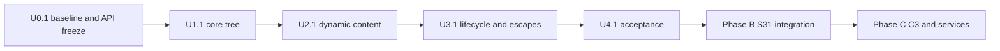

# RFC 0002 execution ledger

> Implementation status: **RFC 0002 host and target gates are green, including a
> bounded gallery smoke run; the interactive gallery was launched successfully
> but no human interaction session was recorded. Phase B hardware acceptance is
> still separate.**
>
> Plan: [Mosaico UI Layer](mosaico-ui-layer-plan.md).
> Execution date: 2026-10-19.
> Authorization: the user requested execution of the plan in this repository on
> 2026-10-19.

## Current handoff

- `EXECUTION_STATUS`: `HANDOFF_REQUIRED`.
- Plan: `docs/plans/mosaico-ui-layer-plan.md`.
- Ledger: `docs/plans/mosaico-ui-layer-execution-ledger.md`.
- Checkout revision: `5e3b9efab4d32ff514d2820354dcdef4bff857e2`.
- Worktree: tracked `Cargo.toml`, `README.md` and `CHANGELOG.md` modified; untracked
  `AGENTS.md`, `docs/`, and the new `lvgl-ui/` crate. No unrelated tracked files
  were changed.
- Current wave/package: **U4.1**, state `complete`.
- Host test suite passed three consecutive times on the final inputs:
  - `cargo test -p lvgl-ui -- --test-threads=1` → exit 0
    (2 unit + 1 lifecycle + 37 reconcile + 1 snapshot = 41 tests).
  - `cargo test -p lvgl-ui --doc` → 1 passed (the `Ui: !Send` compile-fail
    check), 1 ignored example.
- RISC-V target build passes with the host's `riscv64-unknown-elf-gcc` 16.1.0
  (its `rv32imafc/ilp32f` multilib), selected through
  `CC_riscv32imafc_unknown_none_elf` and `AR_riscv32imafc_unknown_none_elf`.
  `LVGL_SYSROOT` points at the toolchain sysroot so bindgen can find newlib
  headers.
- **ABI defect found and fixed while validating the target build.** `cc-rs`
  hardcodes `-mabi=ilp32` for non-Linux RV32 targets, so a plain target build
  produced 484 soft-float C objects while Rust's `riscv32imafc` uses `ilp32f`.
  `lvgl-sys/build.rs` now derives the ISA/ABI from the Rust triple
  (`riscv_target_config`) and passes `-march`/`-mabi` to both the C compiler and
  bindgen. A clean rebuild yields 484 objects with `RVC, single-float ABI`, and
  a real link test produced an ELF32 RISC-V executable with `lv_init` resolved.
- Gallery: the embedded-graphics simulator path is unusable on this host because
  Homebrew's `sdl2` is `sdl2-compat` (SDL3) and leaks SDL3 event codes the Rust
  `sdl2` bindings cannot decode. The gallery now uses LVGL's native SDL2 backend
  (C event handling) with `GALLERY_FRAMES` for bounded smoke runs.
  `GALLERY_FRAMES=300` exits 0 with 30 mounted nodes; a longer run also exited
  cleanly. Human click/drag interaction was not performed.
- Remaining gap: Phase B hardware touch-to-photon/frame-time measurements stay
  outside RFC 0002.

## Machine-readable state

```json
{
  "schema_version": 1,
  "plan_id": "lvgl-mosaico-ui-v1",
  "plan_revision": 1,
  "updated_at": "2026-10-19",
  "plan_status": "implemented_and_gates_green",
  "implementation_authorized": true,
  "authorization": "User requested execution of docs/plans/mosaico-ui-layer-plan.md on 2026-10-19.",
  "checkout": {
    "revision": "5e3b9efab4d32ff514d2820354dcdef4bff857e2",
    "tracked_status": "modified Cargo.toml, README.md, CHANGELOG.md",
    "untracked": ["AGENTS.md", "docs/", "lvgl-ui/"]
  },
  "current_wave": "U4",
  "current_work_package": "U4.1",
  "wave_state": "complete",
  "wave_states": {
    "U0": "complete",
    "U1": "complete",
    "U2": "complete",
    "U3": "complete",
    "U4": "complete"
  },
  "package_states": {
    "U0.1": "complete",
    "U1.1": "complete",
    "U2.1": "complete",
    "U3.1": "complete",
    "U4.1": "complete"
  },
  "clean_acceptance_count": 3,
  "last_completed_action": "Closed the compatibility gaps for grid, native tabview, safe RGB565 images, part styles and animation duration; added 39-test coverage and updated the widgets demo.",
  "next_action": "Human-interactive gallery session and Phase B hardware measurements are separate follow-ups.",
  "blockers": []
}
```

## Gate state

| Gate | Invocation | State | Notes |
| --- | --- | --- | --- |
| G-UI-BASE | `git status --short --untracked-files=all`; `git rev-parse HEAD` | `pass` | Baseline revision `5e3b9ef`; only the expected tracked edits and new `lvgl-ui/` plus pre-existing untracked `AGENTS.md`/`docs/`. |
| G-UI-FMT | `cargo fmt --all -- --check` | `partial` | Fails on pre-existing unformatted files in `lvgl/src/support.rs`, `lvgl/src/widgets/arc.rs` and `lvgl/src/widgets/bar.rs`, which this task did not modify. `cargo fmt -p lvgl-ui -- --check` passes. |
| G-UI-CLIPPY | `cargo clippy -p lvgl-ui --all-targets --no-deps -- -D warnings` | `pass` | Also passes with `--features simulator`. The exact `cargo clippy -p lvgl-ui --all-targets -- -D warnings` fails on pre-existing `lvgl-sys` warnings (deprecated `core::usize`, generated unsafe docs, unnecessary transmute) and is recorded as `partial` for the workspace, not as a `lvgl-ui` failure. |
| G-UI-TEST | `cargo test -p lvgl-ui -- --test-threads=1` | `pass` | Three consecutive runs exit 0 on unchanged inputs. 41 tests, including checkbox/textarea/dropdown/arc/scale/chart/tabview, grid, image, keyboard/focus, part-style and style-state regressions. |
| G-UI-GALLERY | `GALLERY_FRAMES=300 cargo run -p lvgl-ui --example gallery --features simulator` | `pass (bounded)` | Exit 0; SDL window created, 30 nodes mounted, clean `deinit`. Interactive mouse session not recorded. |
| G-UI-TARGET | `cargo build -p lvgl-ui --target riscv32imafc-unknown-none-elf --no-default-features --features alloc,no-autoinit` | `pass` | Exit 0 with `CC_...=riscv64-unknown-elf-gcc`, `AR_...=riscv64-unknown-elf-ar` and `LVGL_SYSROOT=<toolchain sysroot>`. `liblvgl.a` is ELF32 RISC-V with 484 `RVC, single-float ABI` objects. A real link test produced an ELF32 RISC-V executable. |
| G-UI-TREE | `cargo tree -p lvgl-ui --target riscv32imafc-unknown-none-elf --no-default-features -e normal --features alloc,no-autoinit` | `pass` | Only `lvgl`, `lvgl-sys`, `cstr_core`, `cty`, `bitflags`, `memchr` and proc-macros; no `std`, `sdl`, `embedded-graphics`, `esp-hal` or `esp-rtos`. |
| G-UI-SNAPSHOT | `cargo test -p lvgl-ui --test snapshot -- --test-threads=1` | `pass` | Recorded FNV-1a hash `0x6fa96bde8d31e465`; region pixels checked at four coordinates; re-render hash is stable. |
| G-UI-LIFECYCLE | `cargo test -p lvgl-ui --test lifecycle -- --test-threads=1` | `pass` | 1,000 mount/update/unmount cycles; screen child count returns to 0; `created_nodes == deleted_nodes == 11_000`. |
| G-UI-LIST | `cargo test -p lvgl-ui --test reconcile keyed_list -- --test-threads=1` | `pass` | 100-item value update creates nothing; the two-ended reorder creates/deletes nothing and records exactly 2 moves; append/remove touch one node; mixed `Auto`/keyed siblings reconcile in place. |
| G-UI-QUEUE | `cargo test -p lvgl-ui --test reconcile queue_overflow -- --test-threads=1` | `pass` | Capacity 2, five posts, three drops, drain cap 1 then remainder; counters match. |
| G-UI-DOC | Local link/fence scan over the new plan, ledger, crate README and root docs | `pass` | 0 missing relative links, 0 unbalanced code fences. |

## Widgets-demo compatibility exercise

A behavioral replica of LVGL's official `widgets` demo lives at
`lvgl-ui/examples/widgets_demo.rs`. Profile, Analytics and Shop use typed
layout, grid, tabview, label, button, slider, switch, checkbox, textarea,
dropdown, arc, scale and chart nodes; only the calendar uses `Node::raw`. The detailed mapping and remaining gaps
are in [mosaico-ui-widget-compatibility.md](mosaico-ui-widget-compatibility.md).

- `cargo build -p lvgl-ui --example widgets_demo --features simulator` → exit 0.
- `DEMO_FRAMES=240 cargo run -p lvgl-ui --example widgets_demo --features simulator`
  → exit 0; 57 nodes, clean teardown.
- `DEMO_TAB=analytics` → exit 0; 142 nodes (all tab pages); typed charts, arcs,
  scale and checkboxes.
- `DEMO_TAB=shop` → exit 0; 142 nodes; typed notification checkboxes, charts and
  RGB565 product images.
- `DEMO_SCROLL_Y=600` plus `DEMO_SCREENSHOT=<path>` → exit 0; the page scrolls
  and the PPM snapshot was inspected.
- The exercise found no use-after-free or reconcile error. It also exposed a
  suppression bug: a non-value event during a programmatic textarea write could
  consume the flag meant for the value event; only value-changed events now
  consume suppression.

## Widget gap closure

- Typed `Checkbox`, `Textarea`, `Dropdown`, `Arc`, `Scale`, `Chart`, `Grid`,
  `Tabview` and `Keyboard` were added with creation, in-place property updates,
  validation and value/text/focus events.
- `ImageSource::rgb565` builds and owns a safe static image descriptor.
- `keyboard_id`/`keyboard` binding runs after each render, so textarea and
  keyboard creation order does not matter.
- `Node::part_style` and `Style::anim_duration` cover part selectors and style
  transitions.
- `Style` gained per-side padding, text alignment, min/max width/height,
  `hidden`/`disabled` states and arc indicator color/width.
- The widgets demo now uses a native typed `Tabview`, a typed `Grid` form, typed
  charts/gauges/inputs/checkboxes/RGB565 images and part-styled sliders; only the
  calendar remains raw.
- Regression coverage: `checkbox_state_and_value_events`,
  `textarea_text_events_and_programmatic_suppression`,
  `dropdown_selection_events_and_programmatic_updates`,
  `arc_value_events_and_part_style`, `scale_properties_update_in_place`,
  `chart_type_values_and_series_update_in_place`,
  `grid_tracks_and_cells_place_children_and_update_in_place`,
  `grid_content_row_sizes_to_children`,
  `grid_with_column_children_content_height`,
  `grid_with_input_children_content_height`,
  `tabview_switches_pages_updates_titles_and_rebuilds_on_tab_count_change`,
  `tabview_value_event_updates_app_state`,
  `keyboard_binds_to_keyboard_id_targets`,
  `rgb565_image_source_builds_descriptor_and_updates_in_place`,
  `part_styles_override_and_restore_the_target_part`,
  `animation_duration_style_applies`,
  `style_sides_alignment_bounds_and_states`,
  `invalid_new_widget_properties_are_rejected`.
- Remaining compatibility gaps: the official image asset/decoder pipeline and
  animation object wrappers (style durations are typed). Keyboard/focus is now
  typed.

## Additional evidence

| Command | Result |
| --- | --- |
| `cargo build --workspace` | exit 0 |
| `cargo test --workspace --lib --tests -- --test-threads 1` | All pass: lvgl 19, lvgl-codegen 10, lvgl-sys unit 2, lvgl-sys build-script 10, lvgl-ui unit 2, lifecycle 1, reconcile 37, snapshot 1. |
| `cargo check -p lvgl-ui --no-default-features --features alloc` | exit 0; validates the `no_std` library configuration on the host. |
| `cargo check -p lvgl-ui --no-default-features --features alloc,no-autoinit` | exit 0; validates the intended bare-metal feature set on the host. |
| `cargo check -p lvgl-ui --target riscv32imafc-unknown-none-elf --no-default-features --features alloc,no-autoinit` | exit 0 with the RISC-V toolchain environment above. |
| `cargo build -p lvgl-ui --target riscv32imafc-unknown-none-elf --no-default-features --features alloc,no-autoinit` | exit 0; native `liblvgl.a` inspected as ELF32 RISC-V. |
| `cargo tree -p lvgl-ui --target riscv32imafc-unknown-none-elf --no-default-features -e normal --features alloc,no-autoinit` | exit 0; no `std`, `sdl`, `esp-hal`, `esp-rtos` or `embedded-graphics`. |
| `cargo test -p lvgl-ui --no-default-features --features alloc -- --test-threads=1` | All pass; the test suite does not depend on `simulator`. |
| `cargo fmt -p lvgl-ui -p lvgl-sys -- --check` | exit 0. |
| Gallery ABI/link note | The gallery no longer uses Rust `sdl2` bindings; LVGL's C SDL backend handles events, avoiding the SDL2-compat/SDL3 event-code mismatch on this host. The crate has no `sdl2` or `embedded-graphics` dependency. |
| `cargo test -p lvgl-ui --doc` | 1 pass (the `Ui: !Send` compile-fail check), 1 ignored example. |
| `cargo doc -p lvgl-ui --no-deps` | exit 0; no `lvgl-ui` documentation warnings. |
| `cargo check -p lvgl-ui --all-targets` | exit 0 (settings example; gallery skipped unless `simulator` is enabled). |
| `cargo build -p lvgl-ui --example gallery --features simulator` | exit 0 (LVGL native SDL2 backend). |
| `GALLERY_FRAMES=300 target/debug/examples/gallery` | exit 0; "SDL window created: 480x320"; "gallery stopped: 30 nodes, 0 messages". |
| `cargo run -p lvgl --example sdl_demo --features sdl` | exit 0; 400 frames pumped; snapshot bottom-right pixel matched the background. |
| Real RISC-V link test (`no_std` binary + `lvgl-ui` + `lvgl-sys`) | exit 0; ELF32 RISC-V executable, `_start` and `lv_init` resolved. |
| `cargo test -p lvgl-sys --test build_script -- --test-threads=1` | 10 pass, including the new `riscv32imafc` → `ilp32f` regression. |
| `cargo run -p lvgl-ui --example settings` | exit 0; mounted 16 nodes, processed 4 messages, speed=85, muted=true, selected=2, saves=1. |
| `cargo check -p lvgl --examples --features alloc` | exit 0. |
| `cargo check -p lvgl --features sdl --examples` | exit 0 (compile check; linking/running still requires SDL2). |
| `cargo test --workspace -- --test-threads 1` | The lib/integration subset passes; example linking depends on the host SDL2 provider. Homebrew supplies `sdl2-compat`, which is fine for LVGL's C backend but not for Rust `sdl2`-bound examples. |

## Blockers

None for the RFC 0002 host/target gates. Follow-ups that are not blockers:

| Item | Status |
| --- | --- |
| Human-interactive gallery session (click/drag/theme switch) | Not recorded; the bounded smoke run exercises mount, render and teardown. |
| Phase B hardware touch-to-photon, frame time, queue overflow under fast taps | Out of RFC 0002 scope; requires the S31 board. |

The pre-existing `cargo fmt --all -- --check` and dependency clippy failures are
not blockers of this plan; they are recorded so the workspace-wide gates are not
misreported as green.

## Changed files

- `Cargo.toml` (workspace member).
- `README.md`, `CHANGELOG.md`.
- `lvgl-ui/Cargo.toml`, `lvgl-ui/README.md`.
- `lvgl-ui/src/{lib,app,node,theme,events,reconciler}.rs`,
  `lvgl-ui/src/widgets/mod.rs`.
- `lvgl-ui/examples/{settings,gallery}.rs`.
- `lvgl-ui/tests/{common/mod,reconcile,lifecycle,snapshot}.rs`.
- `docs/plans/{README.md,mosaico-ui-layer-plan.md,mosaico-ui-layer-execution-ledger.md}`.

## Wave dependencies



U1 cannot start before the public names, crate layout and gate registrations are
frozen in U0.1. U2 cannot start before the mount/update/unmount contract passes
U1.1. U3 cannot start before the keyed list and handler replacement tests pass
U2.1. U4 closes the RFC 0002 host and target gates. Phase B and C remain
unimplemented.

## Evidence rules

- A gate is `complete` only with the recorded invocation, exit status, and
  retained log or artifact.
- A command that has not been registered is `not_run`, not passing.
- Host evidence does not establish hardware touch latency, frame rate or board
  compatibility.
- Phase B records touch-to-photon and frame-time measurements separately; Phase
  C records protocol and service acceptance separately.
- `clean_acceptance_count` increments only after a full gate pass on the
  recorded revision.
