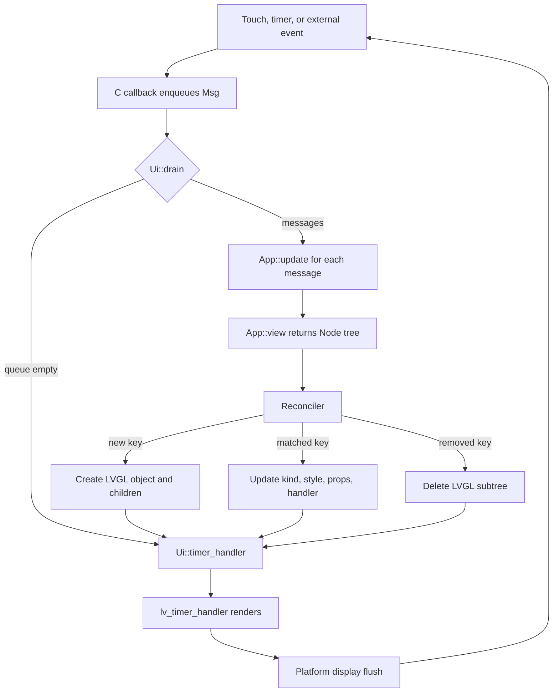

# RFC 0002: Mosaico UI Layer — Declarative Rust Composition over LVGL 9.6 (Implemented)

> Status: **Implemented on 2026-10-19. U0–U4 are complete with host and RISC-V target gates green; the gallery runs on LVGL's native SDL2 backend. Phase B hardware acceptance remains separate. See the execution ledger for evidence.**
> Plan ID: `lvgl-mosaico-ui-v1`; revision: `1`.
> Baseline date: `2026-10-19` UTC.
> Baseline revision: `5e3b9efab4d32ff514d2820354dcdef4bff857e2`.
> Classification: `CONFIRMED` current capabilities and gaps; `UNVERIFIED_RISK` for unproven failure paths. No defect severity is assigned by this RFC.
> Plan: `docs/plans/mosaico-ui-layer-plan.md`.
> Execution ledger: [mosaico-ui-layer-execution-ledger.md](mosaico-ui-layer-execution-ledger.md).
> Related plan: [RFC 0001 Configurable Rust Component Library](component-library-development-plan.md).
> Implementation authorization: **not granted by authoring this RFC**.

Navigation: [Purpose](#1-purpose-and-runtime-rule) · [Baseline](#2-baseline) · [Runtime flow](#3-runtime-flow) · [Entry points](#4-operational-entry-points) · [Responsibilities](#5-component-responsibilities) · [API](#6-data-model-and-api) · [Reconciliation](#7-reconciliation-rules) · [Failure behavior](#8-state-failure-and-recovery) · [Acceptance](#9-testing-and-acceptance) · [Milestones](#10-milestones-and-estimates) · [Risks](#11-risks-and-open-decisions) · [Handoff](#12-handoff-boundaries)

## 1. Purpose and runtime rule

RFC 0002 defines a product-facing Rust UI layer for LVGL 9.6. Application code describes a screen as a typed `Node<Msg>` tree, updates one application state value through messages, and leaves object creation, property updates, child reordering and deletion to a reconciler. LVGL remains the renderer, layout engine and animation engine.

The first consumer is the ESP-Mosaico S31 display terminal. The layer is host-tested against the existing LVGL simulator path and cross-checked for the `riscv32imafc-unknown-none-elf` target. Hardware display, touch, RTOS tasks, the grok-ball renderer, C3 communication, Lua applications, Mi Home and voice integration are downstream phases.

The primary runtime rule:

**One UI thread has exclusive access to LVGL. C event callbacks only enqueue messages. `App::update` changes application state. `App::view` returns a new `Node` tree. The reconciler is the only code that creates, updates or deletes LVGL objects.**

This rule prevents reentrant object mutation during LVGL event dispatch and keeps the retained LVGL engine intact.

### Goals

- A settings-style screen built without `lvgl::sys` or raw pointers in application code.
- Typed properties, typed events, keyed dynamic lists, theme tokens and a documented raw escape.
- No `std` dependency on the target; `alloc` is the only required allocator capability.
- A host gallery that exercises mount, interaction, repeated update, list reorder and unmount.
- A stable public API boundary for the later S31 control interface and C3 event source.

### Non-goals

- Reimplementing LVGL's renderer, layout engine, animation system or display drivers.
- Flutter's constraint layout, element/render-object tree, Dart compatibility or a virtual DOM runtime.
- Replacing the imperative `lvgl` crate API. RFC 0002 is an optional crate above it.
- Every LVGL widget. The initial set is Obj, Row, Column, Label, Button, Slider, Bar, Switch and Image.
- Display flush, touch polling, tick generation, RTOS task creation or hardware bring-up.
- The grok-ball renderer, Lua runtime, C3 protocol, Mi Home, BLE, PC media, voice and OTA.
- PPA/DMA2D acceleration, partial-refresh policy or display pipeline changes.
- Hot reload, JSX/Dart syntax, a runtime widget registry or a component marketplace.
- Pixel-perfect reproduction of the official Mosaico UI.

## 2. Baseline

### 2.1 Current checkout

| Item | Observed baseline |
| --- | --- |
| Workspace | `lvgl`, `lvgl-sys`, `lvgl-codegen`; resolver `2`; each manifest at `0.7.0` |
| Revision | `5e3b9efab4d32ff514d2820354dcdef4bff857e2` |
| Vendored C | LVGL `9.6.0` under `lvgl-sys/vendor/lvgl-9.6` |
| Build configuration | `lvgl-sys/vendor/include-9.6/lv_conf.h`; `LV_USE_OS LV_OS_NONE`; `LV_USE_STDLIB_MALLOC LV_STDLIB_CLIB`; `LV_DEF_REFR_PERIOD 33` |
| Host simulator | `lvgl/sdl` feature and `embedded-graphics-simulator` examples |
| Existing high-level API | Generated widget wrappers, `Widget<'a>` trait, `Obj<'a>`, `Screen<'a>`, `Display::register*`, `input_device::Pointer`, `support::Event`, `on_event` |
| Target consumer | `riscv32imafc-unknown-none-elf`; `lvgl-demo` already registers a PARTIAL RGB565 display and a pointer input device |
| Existing planning record | RFC 0001 covers build configuration, component selection, packaging and an optional composition layer at W4 |

The checkout contains untracked `AGENTS.md` and `docs/` from earlier work. RFC 0002 adds only new plan artifacts and an index entry. It does not modify tracked source, existing plans or build files.

### 2.2 Current capability gaps

| Gap | Current state | RFC 0002 response |
| --- | --- | --- |
| Declarative tree | Widgets are constructed imperatively one object at a time | `Node<Msg>` descriptor tree |
| State/event flow | Event closures mutate captured state directly | `Msg` queue and `App::update` |
| Retained updates | No in-place property comparison | `MountedTree` with key, kind, style and property snapshots |
| Dynamic lists | Caller creates and deletes objects manually | Keyed sibling reconciliation and reorder |
| Style vocabulary | Per-call `Style` objects and raw setters | Resolved `Style` with theme defaults and whole-style update |
| Lifetime model | `Widget<'a>` values borrow the parent | Private raw handles retained by `Ui`; safe handles do not escape |
| Reentrancy protection | Callbacks execute during LVGL dispatch | Callbacks enqueue only; reconciliation runs after dispatch |
| Test harness | Examples are per-widget demos | Gallery, reconciliation tests, list churn tests and snapshot checks |

### 2.3 Relationship to RFC 0001

RFC 0001 defines the native configuration, component selection, packaging and an optional composition layer. RFC 0002 defines the product UI contract used by Mosaico screens.

- RFC 0002 can start against the current `lvgl` 0.7.0 imperative wrappers and `lvgl-sys`.
- When RFC 0001 W4 becomes available, `lvgl-ui` consumes its typed component descriptors behind the same `Node<Msg>` API.
- RFC 0002 does not require RFC 0001 to complete before U0.
- RFC 0002 does not change RFC 0001 feature names, build modes or release boundaries.
- A conflict between the two plans is resolved in favor of the narrower public contract: RFC 0002 uses only the widgets and build capabilities it declares.

### 2.4 Crate placement

A new workspace member keeps the layer optional:

```text
lv_binding_rust/
  lvgl/
  lvgl-sys/
  lvgl-codegen/
  lvgl-ui/                 # new crate, no_std + alloc
    src/
      lib.rs
      app.rs               # App, Msg, Ui
      node.rs              # Node, Key, WidgetKind, Style
      theme.rs             # Theme tokens
      events.rs            # EventQueue, HandlerSlot
      reconciler.rs        # MountedTree, mount/update/unmount
      widgets/             # typed constructors and property application
      raw.rs               # documented raw escape
    examples/
      gallery.rs
      settings.rs
    tests/
      reconcile.rs
      snapshot.rs
      lifecycle.rs
  examples/                # existing per-widget examples
```

`lvgl-ui` depends on `lvgl`, `lvgl-sys`, `alloc` and `cstr_core`. It does not depend on `esp-hal`, `esp-rtos`, `lvgl-demo`, `std` or a platform SDK. U0.1 freezes the target feature set: `lvgl/alloc` and `lvgl/unsafe_no_autoinit` are required on target; host-only `embedded_graphics` and SDL paths remain simulator features.

## 3. Runtime flow

### 3.1 End-to-end flow



The platform calls `Ui::timer_handler` and `Ui::drain`. `Ui::drain` processes at most a configured number of messages, then performs one reconciliation for the resulting application state. `Ui::timer_handler` is a thin wrapper over `lv_timer_handler`; the platform may call `lv_timer_handler` directly.

### 3.2 Phase boundaries

| Phase | Scope | State crossing the boundary | Exit condition |
| --- | --- | --- | --- |
| U0–U4 (RFC 0002) | `lvgl-ui` crate, host gallery, reconciliation tests | `Node<Msg>`, `Ui<Msg>`, `Style`, `Theme`, `UiError` | Host tests, target check, documented API |
| B: S31 control interface | Display, touch, RTOS task, grok-ball, fan screens | Platform supplies `Display`, pointer input, tick cadence, `Ui` instance | Touch-to-photon measurement on hardware |
| C: C3 link and product services | UART protocol, PC media, HA/MQTT, voice, Lua decision | External events enter through `Ui::post` or the platform message source | Product-level acceptance |

RFC 0002 does not implement Phase B or C. It defines the API those phases consume.

### 3.3 Boundary responsibilities

| Component | Input | Output | Failure behavior |
| --- | --- | --- | --- |
| `lvgl-sys` | C headers, configuration, target compiler | Raw FFI | Build failure stops compilation |
| `lvgl` | FFI, display/input registration | Imperative widget and display APIs | Existing `LvError`/panic policy |
| `lvgl-ui` | `Node<Msg>` trees, messages | Updates to LVGL objects, `UiError` | Validation before mutation; rollback of newly created subtrees |
| Platform UI task | Display, pointer, tick, external events | Calls `Ui::timer_handler`, `Ui::drain`, `Ui::post` | Platform decides task restart or fault display |
| Application screens | Application state | `Node<Msg>` tree | No LVGL calls; invalid properties return an error |

## 4. Operational entry points

The exact commands are registered during U0 after the new crate and examples exist. The intended entry points:

| Gate | Invocation | Purpose |
| --- | --- | --- |
| `G-UI-TEST` | `cargo test -p lvgl-ui -- --test-threads=1` | Reconciliation, lifecycle, queue and snapshot tests |
| `G-UI-GALLERY` | `GALLERY_FRAMES=300 cargo run -p lvgl-ui --example gallery --features simulator` | Interactive settings/list/theme gallery; `GALLERY_FRAMES` bounds the run for smoke checks |
| `G-UI-TARGET` | `cargo check -p lvgl-ui --target riscv32imafc-unknown-none-elf --no-default-features --features alloc,no-autoinit` | Target compilation with the workspace toolchain; `no-autoinit` forwards `lvgl/unsafe_no_autoinit`, which the target feature set requires |
| `G-UI-TREE` | `cargo tree -p lvgl-ui --target riscv32imafc-unknown-none-elf -e features` | Confirm no `std`, `sdl` or platform dependency on target |
| `G-UI-FMT` | `cargo fmt --all -- --check` | Formatting |
| `G-UI-CLIPPY` | `cargo clippy -p lvgl-ui --all-targets -- -D warnings` | Lint |
| `G-UI-DOC` | Link and fence check over the new plan and crate docs | Documentation consistency |

Host tests that register LVGL global state run serially. The existing `lvgl` tests and RFC 0001 gates remain separate.

Diagnostic state is exposed through `Ui::stats()`:

```rust
pub struct UiStats {
    pub mounted_nodes: usize,
    pub messages_processed: u64,
    pub messages_dropped: u64,
    pub reconciled_updates: u64,
    pub created_nodes: u64,
    pub deleted_nodes: u64,
}

pub struct DrainStats {
    pub processed: usize,
    pub dropped: u64,
    pub reconciled: bool,
}
```

The platform logs `UiError` values and these counters. The crate does not install a logger. The platform measures reconcile duration around `Ui::drain` or `Ui::update`; `lvgl-ui` does not require a clock.

## 5. Component responsibilities

| Component | Responsibilities | Must not do |
| --- | --- | --- |
| `Node<Msg>` | Describe kind, key, style, children and event mapping | Create LVGL objects, read LVGL state, block |
| `App` | Hold application state; update state from messages; build the view | Call LVGL, spawn tasks, access display or input drivers |
| `Ui<Msg>` | Hold theme, event queue, mounted tree and stats; expose drain/timer/post | Let safe handles escape, run callbacks on other threads |
| `Reconciler` | Validate keys, create/update/delete objects, reorder children, manage handler slots | Execute application logic or block |
| `HandlerSlot<Msg>` | Retain one event closure per mounted node; push messages | Mutate LVGL or the mounted tree |
| `Theme` | Supply token colors, fonts, spacing and sizing values | Read platform state |
| Platform adapter (Phase B) | Register display/input, supply tick, call `Ui` methods | Access the mounted tree directly |
| Custom widget (Phase B) | Draw and update one opaque subtree, such as grok-ball | Reconcile its internal children through `lvgl-ui` |

## 6. Data model and API

### 6.1 Application contract

```rust
pub trait App {
    type Msg: 'static;

    fn update(&mut self, msg: Self::Msg);
    fn view(&self, theme: &Theme) -> Node<Self::Msg>;
}
```

`update` changes state only. `view` reads state and returns a descriptor tree. Neither method calls LVGL. A panic in either method follows the platform panic policy; it must not unwind through a C callback.

### 6.2 Node and key

```rust
pub enum Key {
    Auto,
    Named(&'static str),
    Id(u64),
}

pub struct Node<M> {
    key: Key,
    kind: WidgetKind<M>,
    style: Style,
    children: Vec<Node<M>>,
    handlers: Handlers<M>,
}
```

`Key::Auto` matches by position among `Auto` siblings. `Named` and `Id` match by value. Duplicate keys among siblings return `UiError::DuplicateKey` before mutation. Dynamic lists use `Named` or `Id`; static rows use `Auto`. Any insert, remove or reorder in a list requires `Named` or `Id`; positional matching applies only to static children.

### 6.3 Widget kinds

| Kind | Container | Initial properties | Phase |
| --- | --- | --- | --- |
| `Obj` | Yes | Size, style, alignment | U1 |
| `Row` | Yes | Gap, flex flow, style | U1 |
| `Column` | Yes | Gap, flex flow, style | U1 |
| `Label` | No | Text, long mode, style | U1 |
| `Button` | No | Text, click event, style | U1 |
| `Slider` | No | Range, value, value-changed event | U2 |
| `Bar` | No | Range, value, style | U2 |
| `Switch` | No | Checked, changed event | U2 |
| `Image` | No | Static image source, scale | U2 |
| `Custom` | Opaque | Platform-provided create/update hooks | U3 |

Widget kinds are compared by discriminant during update. A kind change deletes the old object and creates a new one at the same position.

### 6.4 Style and theme

`Style` contains resolved values, not optional overrides:

```rust
pub struct Style {
    pub bg: Color,
    pub fg: Color,
    pub border: Color,
    pub border_width: i16,
    pub radius: i16,
    pub pad: i16,
    pub gap: i16,
    pub width: Size,
    pub height: Size,
    pub flex_grow: u8,
    pub align: Align,
    pub opacity: u8,
    pub font: &'static Font,
}
```

`Theme` supplies token values for background, surface, text, muted text, accent, danger, body font and title font. The application resolves those tokens into `Style` values while building the view; constructors use `Style::default()` until the application applies a theme-derived style. The reconciler compares the whole `Style` value and applies all style properties only when the value changes. Per-field style diffing is deferred.

`Size` is one of `Px(i16)`, `Percent(u8)` or `Content`. Row and Column map `gap` to LVGL flex padding. `flex_grow` maps to LVGL flex grow. The layer does not implement constraints, wrapping or intrinsic sizing beyond LVGL's flex and grid behavior.

### 6.5 Handlers and messages

```rust
pub enum Handlers<M> {
    None,
    Click(M),
    ValueChanged(Box<dyn Fn(i32) -> M>),
    Event(Box<dyn Fn(&Event) -> Option<M>>),
}
```

The exact enum is frozen in U1. A handler closure is stored in a `HandlerSlot<M>`:

```rust
struct HandlerSlot<M> {
    callback: RefCell<Box<dyn FnMut(&Event) -> Option<M>>>,
    suppress_next: Cell<bool>,
}
```

The slot is allocated in a `Box` with a stable address. LVGL user data holds the raw pointer; the delete callback reconstructs and drops the box. The slot is registered once with `lv_obj_add_event_cb`. Updating a node replaces the closure in the slot; it does not add another callback. The slot is released by the delete callback when the object is deleted.

Programmatic property updates set `suppress_next` for value-bearing widgets. The event callback consumes the flag without enqueueing a message, preventing feedback loops when the reconciler writes a slider value that the application just supplied.

### 6.6 Ui contract

```rust
pub struct Ui<M: 'static> { /* private */ }

impl<M: 'static> Ui<M> {
    pub fn new(display: &Display, theme: Theme) -> Result<Self, UiError>;
    pub fn mount<A: App<Msg = M>>(&mut self, app: &A) -> Result<(), UiError>;
    pub fn drain<A: App<Msg = M>>(&mut self, app: &mut A, max_messages: usize) -> Result<DrainStats, UiError>;
    pub fn update<A: App<Msg = M>>(&mut self, app: &A) -> Result<(), UiError>;
    pub fn post(&mut self, msg: M) -> Result<(), UiError>;
    pub fn timer_handler(&mut self) -> u32;
    pub fn unmount(&mut self);
    pub fn stats(&self) -> UiStats;
}
```

`Ui::new` creates a root container on the active screen and applies the root style. `mount` reconciles the first tree. `drain` pops up to `max_messages`, calls `App::update` for each, then calls `App::view` once and reconciles. `update` performs view and reconcile without draining messages. `post` enqueues a message from the platform or a callback. `timer_handler` wraps `lv_timer_handler` and returns its next-delay value. `unmount` deletes the root container and clears the mounted tree.

`Ui<M>` is `!Send` and `!Sync` through `Rc`/`RefCell`/`Cell` members. Safe LVGL handles do not escape the crate. One `Ui` instance mounts on one LVGL screen. Application navigation uses a different root node or a container inside that screen; loading a different LVGL screen requires `unmount` followed by a new `Ui` on that screen. `Ui` keeps the display pointer used for root creation; the platform retains the `Display` handle and keeps it alive until `Ui::unmount` and `Ui` drop complete.

### 6.7 Typical application

```rust
pub enum Msg {
    SpeedChanged(i32),
    Save,
}

pub struct Settings {
    speed: i32,
}

impl App for Settings {
    type Msg = Msg;

    fn update(&mut self, msg: Msg) {
        match msg {
            Msg::SpeedChanged(value) => self.speed = value,
            Msg::Save => { /* persist through a later service boundary */ }
        }
    }

    fn view(&self, theme: &Theme) -> Node<Msg> {
        Node::column()
            .gap(12)
            .child(Node::label("Fan").style(Style::title(theme)))
            .child(
                Node::slider(0, 100, self.speed)
                    .key(Key::Named("speed"))
                    .on_value_changed(Msg::SpeedChanged),
            )
            .child(
                Node::button("Save")
                    .key(Key::Named("save"))
                    .on_click(Msg::Save),
            )
    }
}
```

### 6.8 Raw escape

`Node::raw` accepts a documented `unsafe` factory for a widget that the typed layer does not cover. The factory creates one object under the supplied parent and may register callbacks. The mounted node is opaque: the reconciler does not inspect or reconcile its children. The raw object's lifetime ends with its parent or with an explicit `Custom` update hook. Application code that needs grok-ball uses a safe wrapper implemented in the platform crate; raw pointers do not appear in screen code.

## 7. Reconciliation rules

### 7.1 Mount

1. Validate sibling keys recursively before creating any object.
2. Create the root object under the active screen, apply root style and size.
3. Create children in order, apply kind properties and style, register handler slots.
4. On failure, delete the partially created subtree in reverse order and leave the previous tree unchanged.
5. Store the mounted tree only after all nodes are created.

### 7.2 Update

1. Validate the new tree's sibling keys.
2. Match children by `Named`/`Id` keys; match `Auto` children by position among `Auto` siblings.
3. For a matched key with the same kind, update style, text, range/value, switch state, image source and handler closure. Recurse into children.
4. For a matched key with a different kind, delete the old subtree and create the new subtree at the same index.
5. For a new key, create the subtree.
6. For an unmatched old key, delete the old subtree.
7. Reorder keyed children with `lv_obj_move_to_index` to match the new order.
8. Record created/deleted counts in `UiStats`; the platform measures reconcile duration around `Ui::drain` or `Ui::update`.

### 7.3 Property updates

- Label text is converted to `CString` and copied by `lv_label_set_text` only when the text differs.
- Slider/bar values are written only when the value differs; `suppress_next` is set before the write.
- Switch state is written only when it differs; `suppress_next` is set before the write.
- Image source updates recreate the image descriptor only when the source differs.
- Style updates apply all resolved style properties when the `Style` value differs.
- Handler updates replace the closure inside `HandlerSlot`; the native callback registration remains.

### 7.4 Deletion and lifetime

- Deleting an object deletes its LVGL children. The mounted tree removes the corresponding child records without calling LVGL delete again.
- Handler slots are released by the LVGL delete callback, not by Rust `Drop` after the object is gone.
- `Ui::unmount` deletes only the root object and then clears the mounted tree. No safe handle remains.
- Raw/custom subtrees are opaque; their callbacks and deletion belong to the custom widget implementation.
- A display deletion requires `Ui::unmount` and completion of pending flushes before `Display::delete` or `lvgl::deinit`.

### 7.5 Reentrancy

- C event callbacks enqueue messages only. They do not call `App::update`, `App::view`, `Ui::update` or any LVGL mutator.
- `Ui::drain` runs outside `lv_timer_handler`.
- A callback that tries to mutate the mounted tree receives `UiError::Reentrant` through a checked borrow; the mutation is rejected.
- `Ui::timer_handler` may dispatch LVGL callbacks that enqueue messages; reconciliation happens after it returns.

## 8. State, failure and recovery

### 8.1 In-memory state

| State | Location | Why it exists | Lifetime |
| --- | --- | --- | --- |
| Mounted tree | `Ui<M>` | Retain object handles, keys, kind tags, style snapshots and child order | Mount to unmount |
| Handler slots | One per mounted node | Replace callbacks without duplicate native registrations | Object creation to LVGL deletion |
| Event queue | `Ui<M>` | Decouple C callbacks from structural mutation | Ui creation to drop |
| Theme | `Ui<M>` | Provide token values for view construction | Ui creation to drop |
| Application state | Caller | Screen data and service state | Application-defined |
| Stats | `Ui<M>` | Diagnose leaks, churn and queue loss | Ui creation to drop |

The UI layer does not write flash, NVS or files. Phase B/C services handle persistence.

### 8.2 Failure modes

| Failure | Detection | Effect | Recovery |
| --- | --- | --- | --- |
| Duplicate sibling key | Key validation before mutation | `UiError::DuplicateKey`; old tree unchanged | Fix the view |
| Invalid property | Validation before object creation/update | `UiError::InvalidProperty`; node unchanged | Fix the view |
| LVGL allocation failure | Object creation returns null | New subtree deleted; `UiError::Allocation` | Platform decides retry or fault screen |
| Event queue full | Bounded queue | Oldest message dropped; `messages_dropped` incremented | Keep latest input; log counter |
| Reentrant mutation | Checked borrow during callback | `UiError::Reentrant`; mutation rejected | Move work into `App::update` |
| Callback panic | Platform panic handler | Abort; no unwind through C | Fix application code |
| Stale mounted handle | Private handles; no safe escape | Compile-time/lifetime prevention | Re-mount after display reset |
| Display deletion with mounted tree | Platform contract | Undefined access | `Ui::unmount` before display deletion |

### 8.3 Runtime rules future changes must preserve

- LVGL access stays on one UI thread.
- `App::view` stays pure; it does not read LVGL or block.
- C callbacks only enqueue messages.
- The reconciler is the only code that creates, updates or deletes LVGL objects.
- Sibling keys are unique.
- No temporary Rust string or style reference is retained by C.
- Deleting a parent removes its children; the mounted tree does not double-delete.
- Raw subtrees remain opaque to the reconciler.
- Target builds use `no_std` plus `alloc`; the UI layer does not introduce `std`, `sdl` or platform SDK dependencies.

## 9. Testing and acceptance

### 9.1 Test layers

| Layer | Cases | Oracle |
| --- | --- | --- |
| Key validation | Duplicate `Named`, duplicate `Id`, mixed `Auto`/keyed siblings | Error before mutation; old tree unchanged |
| Mount/update | Create, same-kind update, kind replacement, child append/remove | Object count, property snapshots, rendered pixels |
| Keyed lists | 100 items; move one item; remove one; insert one | Only affected objects created/deleted/moved |
| Property suppression | Programmatic slider/switch update | No feedback message queued |
| Handler replacement | Replace click closure between updates | One native callback; new closure runs |
| Lifecycle | 1,000 mount/update/unmount cycles | No object leak, no allocator growth beyond baseline |
| Queue | Burst messages, overflow, `max_messages` cap | Dropped counter, bounded drain time |
| Reentrancy | Callback attempts mutation | `Reentrant`; tree remains valid |
| Raw subtree | Create/update/delete | Reconciler does not traverse it |
| Snapshot | Static settings screen and list page | Region hashes match expected output |
| Target check | `riscv32imafc-unknown-none-elf`, `--no-default-features --features alloc` | Compiles; dependency tree has no `std`/`sdl` |

### 9.2 Acceptance criteria

- `examples/settings.rs` builds a settings screen with Label, Button, Slider, Row/Column and a keyed list; the example source contains no `lvgl::sys`.
- `examples/gallery.rs` runs on the host simulator; button click, slider drag, keyed list reorder and theme switch behave as described.
- `cargo test -p lvgl-ui -- --test-threads=1` passes.
- `cargo check -p lvgl-ui --target riscv32imafc-unknown-none-elf --no-default-features --features alloc` passes with the workspace toolchain.
- `cargo tree` for the target shows no `std`, `sdl`, `esp-hal` or `esp-rtos`.
- 1,000 mount/unmount cycles show no object-count or allocator growth beyond the recorded baseline.
- A 100-item keyed list update that changes one item creates one object, deletes none and moves none.
- A 100-item reorder moves two objects, creates none and deletes none.
- `UiStats` reports created/deleted/processed/dropped counts that match the test scenarios.
- Public API documentation and the plan link checks pass.

No performance threshold is fixed before a baseline measurement. U4 records host reconcile time, host allocation counts, target binary size delta and target dependency tree. Phase B records hardware touch-to-photon latency and frame time.

## 10. Milestones and estimates

| Wave | Work package | Deliverable | Exit gate | Estimate |
| --- | --- | --- | --- | --- |
| U0 | U0.1 Baseline and API freeze | Crate skeleton, module layout, frozen public names, gallery shell, gate registration | `G-UI-FMT`, `G-UI-TARGET`, empty gallery compiles | 2–3 days |
| U1 | U1.1 Core tree | `Node`, `Key`, `WidgetKind`, `Style`, `Theme`, `App`, `Ui`, mount/update/unmount for Obj/Row/Column/Label/Button | `G-UI-TEST`, static settings screen | 5–7 days |
| U2 | U2.1 Dynamic content | Slider, Bar, Switch, Image, keyed lists, conditionals, handler replacement | List churn tests, gallery interactions | 5–7 days |
| U3 | U3.1 Lifecycle and escapes | Rollback, reentrancy, suppression, raw/custom subtree, `UiStats`, error docs | Failure tests, 1,000-cycle test | 3–5 days |
| U4 | U4.1 Acceptance | Snapshot tests, target check, dependency audit, docs, API examples | All RFC 0002 gates | 3–5 days |

Total: **18–27 working days** for one experienced Rust engineer. Core crate estimate: **1,500–2,500 lines**; tests and examples: **500–1,000 lines**; documentation and gallery: **300–500 lines**. The range assumes the existing `lvgl`/`lvgl-sys` APIs remain usable and no native build changes are required.

Phase B (S31 display/touch/RTOS integration) is estimated separately at **1–2 weeks** after U4. Grok-ball is a separate **2–4 week** effort for six expressions at 240–320 px and 20–30 fps. Phase C (C3 link and services) follows Phase B.

## 11. Risks and open decisions

### 11.1 Risks

| Risk | Impact | Mitigation |
| --- | --- | --- |
| Existing `Widget<'a>` values borrow their parent | A retained tree cannot store safe widget values | Store private raw handles; expose no safe handles; audit all `unsafe` blocks |
| Callback executes during LVGL dispatch | Structural mutation can invalidate objects | Callbacks enqueue only; reconcile after `lv_timer_handler` |
| Programmatic value writes retrigger events | Feedback loops and repeated messages | `suppress_next` per value-bearing node; test |
| Per-update `Node` allocations fragment the heap | Long-run instability on MCU | Rebuild only on state changes; measure allocations; add a reusable node arena if the baseline requires it |
| Keyed diff complexity | Bugs in reorder/create/delete order | Start with positional matching plus keyed lists; no general tree diff |
| Raw/custom subtree lifetime | Dangling callbacks or double deletion | Opaque subtree contract; platform-owned custom widget; explicit unmount |
| `no_std` C strings | Temporary pointer retained by LVGL | Use `CString`; LVGL copies label text; never retain a Rust slice in C |
| `lv_timer_handler` cadence belongs to platform | Host and S31 loops diverge | `Ui::timer_handler` is a convenience; platform controls the loop |
| RFC 0001 overlap | Conflicting APIs or feature names | New crate; stable `Node` API; RFC 0001 W4 adopted behind it |
| Host/target divergence | Host tests pass while target fails | Target compile gate and dependency-tree audit in U4 |
| Panic across FFI | Undefined behavior | Platform panic policy aborts; callbacks do not panic |
| SDL/CI availability | Gallery not runnable in every environment | Host tests use a memory display; gallery is a separate gate |

### 11.2 Open decisions

| ID | State | Decision | Stop condition |
| --- | --- | --- | --- |
| D-UI-01 | `UNKNOWN` | Builder methods first, `ui!` macro later | Builder API cannot express the settings screen without raw access |
| D-UI-02 | `UNVERIFIED_RISK` | Rebuild `Node` on state change; measure allocations; add arena only if required | Allocation growth per steady-state update exceeds the recorded baseline |
| D-UI-03 | `CONFIRMED` choice pending U1 | Positional matching for `Auto`; keyed matching for `Named`/`Id` | Keyed list test cannot preserve object identity |
| D-UI-04 | `CONFIRMED` choice pending U1 | Resolved `Style`; whole-style update on change | Style update cost dominates the recorded reconcile baseline |
| D-UI-05 | `CONFIRMED` choice pending U1 | One `HandlerSlot` per node; replace closure in place | Callback replacement leaks or double-registers |
| D-UI-06 | `UNKNOWN` | Unsafe raw factory in U3; safe custom widget wrapper in Phase B | Raw factory requires application code to hold LVGL pointers |
| D-UI-07 | `CONFIRMED` | New `lvgl-ui` crate; no blocking dependency on RFC 0001 | RFC 0001 changes the target metadata contract in a way that breaks `lvgl-ui` |

## 12. Handoff boundaries

### 12.1 UI layer ready

RFC 0002 is ready for Phase B when U4 exits with:

- A stable `Node<Msg>`/`App`/`Ui` API and published examples.
- Host reconciliation, lifecycle and snapshot tests passing.
- Target compilation and dependency-tree checks passing.
- Documented `UiError`, `UiStats`, raw escape and lifecycle rules.
- A gallery that demonstrates the settings screen and keyed list behavior.

### 12.2 Phase B: S31 control interface

The platform crate supplies:

- A registered LVGL `Display` with its flush callback and display buffer.
- Pointer input registration and the S31 input queue.
- A UI task that calls `Ui::timer_handler` at the selected cadence and `Ui::drain` when input or external events arrive.
- A `Theme` matching the Mosaico visual tokens.
- A custom widget wrapper for grok-ball, implemented with the raw/custom contract.

The UI layer does not register display drivers, touch drivers, RTOS tasks or tick callbacks. It does not depend on `esp-hal` or `esp-rtos`.

Phase B acceptance adds hardware measurements: touch-to-photon P50/P95, frame time, idle redraw rate, and no queue overflow under fast taps. Those measurements do not change the RFC 0002 host gates.

### 12.3 Phase C: C3 link and product services

Phase C delivers external events through `Ui::post` or the platform's message source. Application screens add fan, PC media, Home Assistant and C3 status nodes. The reconciler and public API remain unchanged.

Lua applications, Mi Home, BLE, voice, grok-ball asset generation and C3 protocol design are outside RFC 0002. Their interfaces enter through the platform adapter or custom widget boundary defined here.
