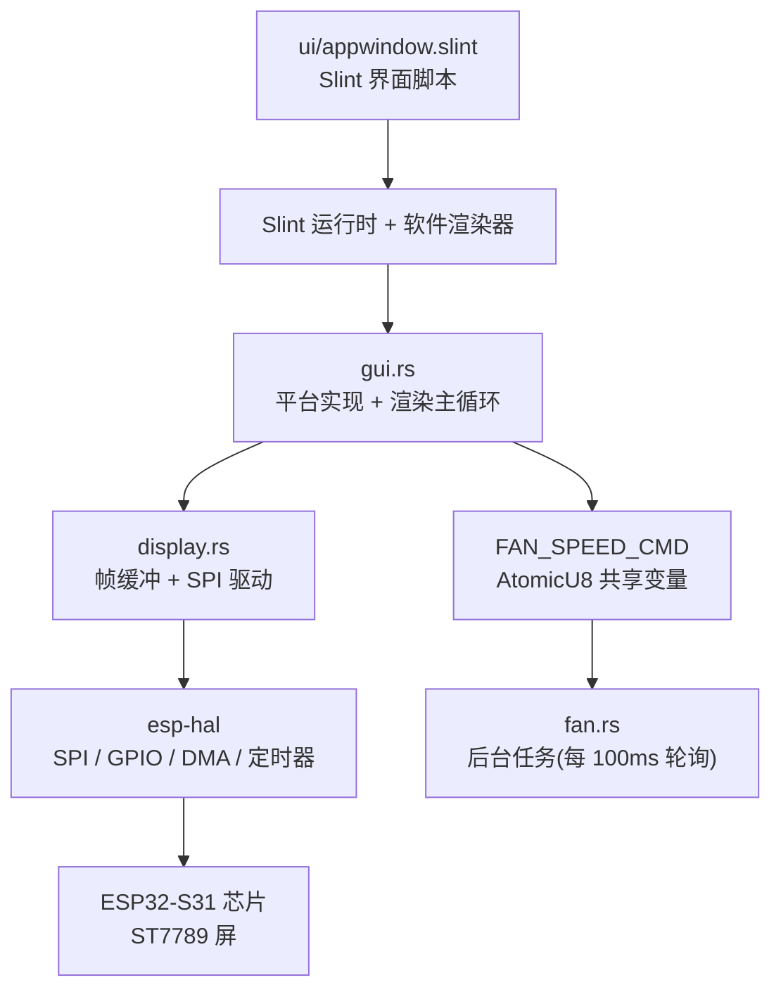
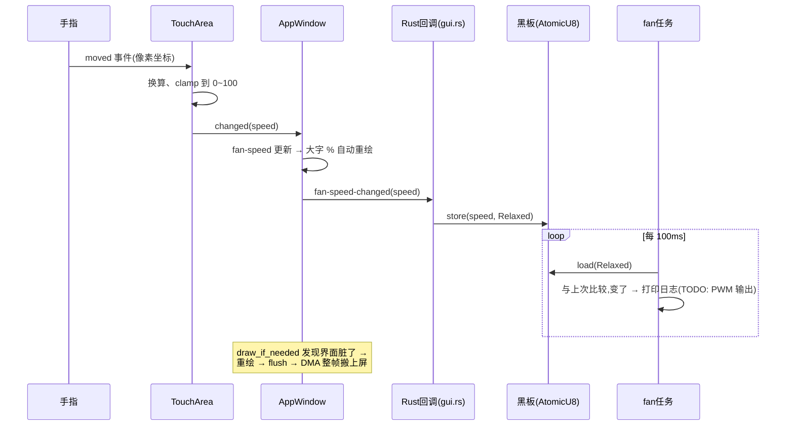

# my-slint-fan 系统讲解(JS/TS 开发者向)

> 目标读者:会写 JavaScript/TypeScript、没碰过嵌入式、想逐行读懂本仓库的人。
> 与 `fable.md` 的关系:本文用真实术语直接讲解,不包装寓言;寓言可作为轻松读物保留,也可以不读。
> 读完本文,你应当能逐行读懂 `src/main.rs` 的每一步在做什么、为什么这么做。
> 进阶续篇:`dependencies.md` 把 `Cargo.toml` 里的每个依赖拆开,讲它们各自的实现原理,最后串成全栈。

---

## 0. 这份固件在做什么

一句话:**让 ESP32-S31 开发板驱动一块 240×320 彩色屏,屏上显示一个 Slint 写的界面(风扇调速滑块 + RGB 灯开关);拖动滑块时把目标档位写进一个共享变量,一个后台任务每 100ms 读一次并打印日志。**

风扇真的转起来了吗?还没有——PWM 输出是 TODO(`fan.rs`)。当前固件打通的是完整的**显示链路 + 异步任务框架**:屏亮了、UI 能交互了、任务间能通信了。



---

## 1. 认识环境:语言、芯片、工具链

### 1.1 芯片:ESP32-S31-Korvo-1

乐鑫官方多媒体开发板,核心参数与本项目直接相关的:

| 参数   | 值                                       | 为什么重要                               |
| ------ | ---------------------------------------- | ---------------------------------------- |
| CPU    | 双核 RISC-V @ 320MHz                     | 指令集与你的 Mac(ARM)不同                |
| 指令集 | RV32IMAFC(**A**=原子指令,**F**=硬件浮点) | 有原子指令才能干净地跑 Slint,见 1.3 历史 |
| Flash  | 16MB                                     | 程序烧在这里,用约 698KB                  |
| PSRAM  | 16MB 片内                                | 目前未用,未来放 800×480 大屏帧缓冲       |
| 外设   | SPI2、TIMG0、GPIO×N、LEDC、RMT、ADC…     | 本章后续逐个登场                         |

### 1.2 Rust 目标三元组

`Cargo.toml` 里 `rust-toolchain.toml` 指定的编译目标是:

```
riscv32imafc-unknown-none-elf
```

逐词读:

| 段                  | 含义                                                  |
| ------------------- | ----------------------------------------------------- |
| `riscv32`           | 32 位 RISC-V 架构                                     |
| `i` `m` `a` `f` `c` | 指令集扩展:整数、乘除、**原子**、单精度浮点、压缩指令 |
| `unknown`           | 不指定操作系统厂商(因为没有)                          |
| `none`              | **没有操作系统**——这是 `no_std` 的根源                |
| `elf`               | 产物是一种自包含的可执行文件格式                      |

JS/TS 对照:你在 V8/Node 里跑 JS,字节码解释器是别人给的;这里你编译出的 ELF 是芯片上运行的**唯一程序**,下面什么都没有。

### 1.3 依赖栈一句话表

| crate                    | 职责                              | 对应 JS 世界                           |
| ------------------------ | --------------------------------- | -------------------------------------- |
| `esp-hal`                | 硬件抽象层:把外设包装成 Rust 类型 | `navigator.*` API 的硬化版(编译期独占) |
| `esp-rtos` + `embassy-*` | 异步运行时:任务、定时器、执行器   | 事件循环 + `setTimeout` 调度器         |
| `esp-alloc`              | 堆分配器(72KB)                    | V8 的堆(但你从没亲手建过它)            |
| `esp-println` + `log`    | 串口日志                          | `console.log`,但走一根真实的线         |
| `esp-backtrace`          | panic 时打印调用栈                | 未捕获异常页(但只有串口能看)           |
| `slint` + `slint-build`  | 声明式 UI + 编译 `.slint`         | React + JSX 编译                       |
| `esp-bootloader-esp-idf` | 提供应用描述符,供烧录工具校验     | —                                      |

**一段历史(README 里有完整版)**:这个项目先在 ESP32-C3 上做过。C3 的指令集**没有原子指令**,esp-hal 只能用「我运行期间别人不许动」的临界区来模拟,与 Slint 要求的另一种互斥方式冲突,编译期直接翻脸,只能锁旧版本依赖。换到 S31(有 `A` 扩展)后问题消失,依赖全部用最新版。教训:**硬件能力边界 = 软件可能边界**,选芯片前查指令集,和选浏览器前查 caniuse 是同一个动作。

---

## 2. 裸机与 no_std:从 console.log 到第一行代码

### 2.1 没有操作系统意味着什么

你在浏览器/Node 里写的代码,脚下垫着:V8(解释器 + 堆 + GC)→ 操作系统(线程、文件、网络)→ 内核 → 固件。裸机上这一切都没有:

- 没有**进程/线程**——只有「通电后从固定地址开始逐条执行指令」;
- 没有**文件系统**——`"index.html"` 这种路径不存在;
- 没有**堆**——`new` 不工作,直到你亲手划一块内存当堆;
- 没有**定时器**——`setTimeout` 不工作,直到你配置一个硬件定时器。

裸机的全部意义:**你的代码就是整座系统,每一层便利都要自己搭。**

### 2.2 头部三行

```rust
#![no_std]   // 放弃标准库:没有堆、线程、文件这些需要 OS 支撑的东西
#![no_main]  // 放弃「main 由运行时调用」的惯例——没有运行时
```

- `no_std` 之后 Rust 只剩最小内核 `core`(基本类型、`Option`、`Result` 等)。堆上的类型(`Box`、`Rc`、`String`)要额外用 `extern crate alloc;` 引入。
- `no_main` 之后程序入口由框架宏接管:本项目的 `#[esp_rtos::main]`(`main.rs:31`)。

### 2.3 内存三块

| 区域       | 大小何时定                    | 本项目实例                         |
| ---------- | ----------------------------- | ---------------------------------- |
| **栈**     | 编译期,函数调用自动取用/归还  | 函数局部变量                       |
| **静态区** | 编译期,尺寸写死               | `FRAME_BUFFER` 150KB、`SPI_BUS` 等 |
| **堆**     | 编译期划好范围,运行期动态分配 | Slint 内部的所有 `Box`/`Rc`        |

堆是嵌入式特有的麻烦:JS 里 GC 替你收垃圾,Rust 用编译期所有权检查保证「谁借谁还」,但**堆这块地在哪**还是要你亲自划:

```rust
esp_alloc::heap_allocator!(size: 72 * 1024);   // main.rs:34
```

72KB,写死。太小会崩(分配失败),太大浪费(静态区被挤占)。这是嵌入式第一课:**一切皆预算**——字节、毫秒、带宽,每一样都要谈判。

---

## 3. main.rs 逐段精读(启动的 8 步)

`main.rs` 共 79 行,按注释分成 8 步。下面逐段讲。

### 3.1 第一步:堆分配器

```rust
esp_alloc::heap_allocator!(size: 72 * 1024);
```

必须在 `main` 开头、任何分配之前:紧接着的 Slint 初始化就要 `Box`。如果这一步忘了,后面的第一个分配就会 panic。

### 3.2 第二步:芯片初始化与「外设所有权」

```rust
let config = esp_hal::Config::default().with_cpu_clock(CpuClock::max());
let peripherals = init(config);
```

- `CpuClock::max()`:CPU 主频拉满 320MHz。
- `init(config)` 返回一个 `Peripherals` 结构体,里面装着**全岛所有外设的唯一所有权**:`peripherals.GPIO46`、`peripherals.SPI2`、`peripherals.DMA_AXI_CH0`…每张「地契」仅此一份,全局只能调用一次。

接下来是这个设计最精彩的部分。把 46 号引脚交给 SPI 当时钟线:

```rust
let spi = Spi::new(peripherals.SPI2, /*...*/)
    .with_sck(peripherals.GPIO46)
    .with_mosi(peripherals.GPIO47)
    .with_dma(peripherals.DMA_AXI_CH0);
```

`with_sck()` 这类方法**吃掉自己、返回新值**,目的是把「GPIO46 已被消费」记进类型系统:任何第二处想用 GPIO46 的代码,编译器直接拒绝盖章。外设天然独占,所有权模型恰好是它的镜像——**两个 npm 包抢同一个串口是运行时撞车,这里是船根本开不出港。**

### 3.3 第三步:日志

```rust
esp_println::logger::init_logger_from_env();
info!("my-slint-fan 启动(ESP32-S31-Korvo-1)");
```

`info!` 把一行文本交给 UART0 外设(芯片的 TX/RX 两腿),经板载 USB 转 UART 芯片,从 USB 线爬到你的终端。`espflash --monitor` 就是竖起耳朵听这条线。习惯它:**你的日志不是飘在虚空,它走一根真实的线,以有限的波特率爬过来。**

### 3.4 第四步:异步运行时(定时器 + 中断 + 执行器)

```rust
let timg0 = esp_hal::timer::timg::TimerGroup::new(peripherals.TIMG0);
esp_rtos::start(timg0.timer0, peripherals.FROM_CPU_INTR0);
```

三个真实概念,别揉成一团:

| 概念                 | 是什么                          | 干什么                                      |
| -------------------- | ------------------------------- | ------------------------------------------- |
| **TIMG0**            | 硬件定时器组                    | 永远数微秒,是「现在几点」的唯一权威         |
| **FROM_CPU_INTR0**   | 中断线                          | 到点了硬件「拍肩」唤醒 CPU,不依赖代码自觉   |
| **执行器(executor)** | esp-rtos/embassy 里的软件调度器 | 维护一张「到点叫我」的预约表,在任务之间倒手 |

工作机制:`Timer::after(100ms).await` 时,任务把自己登记进定时器队列,执行器看没活干了就让 CPU 睡觉;水钟到点,中断拍肩,CPU 醒来查表、唤醒该醒的任务。**这就是事件循环**——浏览器里它是宫殿自带的,这里是你亲手请上岛、住在你代码里的。

`#[esp_rtos::main]`(`main.rs:31`)把 async `main` 包成执行器上的第一个任务;执行器真正开始转,是在上面 `esp_rtos::start(...)` 这一行。

### 3.5 第五步:SPI 总线和 DMA

```rust
let spi = Spi::new(
    peripherals.SPI2,
    SpiConfig::default()
        .with_frequency(Rate::from_hz(board::LCD_SPI_HZ))  // 40_000_000
        .with_mode(Mode::_0),
)
```

**SPI** 是最古老的通信方式之一:主设备敲时钟线(每敲一下,数据线上流过一个比特),8 下鼓点一个字节。本项目敲到 40MHz。屏幕(ST7789)只认这个节奏。

- `with_dma(peripherals.DMA_AXI_CH0)`:**DMA 是芯片里的专职搬运工**。刷屏要把 150KB 搬过去,让 CPU 自己逐字节敲鼓会累死。你只需说「从这搬多少字节到 SPI」,DMA 引擎自己按鼓点节奏送,CPU 腾出手。esp-hal 1.2.0-rc.0 起,带 DMA 的 `write()` 会自动分块,不用手工管理 DMA 缓冲。
- JS 对照:DMA 之于 CPU,就像 `fetch` 之于主线程——I/O 交给专职通道。区别是 `fetch` 对面是网络,DMA 对面是一根焊死的线。

### 3.6 第六步:唤醒屏幕

```rust
let mut cs = Output::new(peripherals.GPIO48, Level::High, OutputConfig::default());
let dc = Output::new(peripherals.GPIO49, Level::Low, OutputConfig::default());
let mut backlight = Output::new(peripherals.GPIO50, Level::High, OutputConfig::default());
cs.set_low();              // 总线上只有屏幕一个听众,常驻拉低(常开)
display::attach(spi, dc);
display::init(&mut backlight);
```

ST7789 有四根关键腿:

| 线       | 本意                                                  | 本项目                      |
| -------- | ----------------------------------------------------- | --------------------------- |
| **SCLK** | 时钟                                                  | GPIO46                      |
| **MOSI** | 数据(主出从入)                                        | GPIO47                      |
| **CS**   | 片选:拉低=跟你说话,拉高=无视后续鼓点                  | GPIO48,常驻拉低(唯一从设备) |
| **DC**   | 口令/数据切换:**低=下一个字节是命令,高=接下来是数据** | GPIO49                      |

初始化命令序列在 `display.rs::init()`,见 4.2。

### 3.7 第七步:Slint 平台层

```rust
let window = gui::init_platform();
```

Slint 是声明式 UI 框架(脚本在 `ui/appwindow.slint`)。它来自大陆,不认识这座岛:不知道「窗口」画到哪、「现在几点」。于是 `gui.rs` 提供一个**平台实现**——你正在给 UI 框架手写浏览器免费提供的那层东西。详见 4.3。

### 3.8 第八步:后台任务 + 主渲染循环

```rust
spawner.spawn(fan::fan_control_task().unwrap());
gui::run_ui(window).await   // 永不返回
```

从这以后,系统里有两条协作式车道:

1. **渲染主循环**(就是 main 任务本身):16ms 一轮,推进动画、按需重绘、刷屏(4.3);
2. **风扇管理员**(spawn 出的第二个任务):100ms 一轮,查共享变量(4.4)。

关键规则——**协作式调度**:任务只在 `await` 处让出 CPU。谁一直埋头算、不 `await`,全岛就排队等它。没有抢占、没有并行,这正是它比线程简单的原因,也是它的代价。注意当前固件虽然芯片双核,执行器实际只跑单车道(Slint 用了 `unsafe-single-threaded` 特性,所有 Slint 调用必须在同一线程)。

---

## 4. 每个模块精读

### 4.1 board.rs——引脚映射表

这个文件没有逻辑,全是常量,是「门牌号地图」。全部来自官方用户指南的管脚分配表:

| 常量                          | 值         | 用途                   |
| ----------------------------- | ---------- | ---------------------- |
| `LCD_WIDTH` / `LCD_HEIGHT`    | 240 / 320  | 屏幕尺寸               |
| `LCD_SPI_HZ`                  | 40_000_000 | SPI 时钟               |
| `LCD_SCLK_GPIO`…`LCD_BL_GPIO` | 46…50      | 屏幕 5 根线            |
| `RGB_LED_GPIO`                | 37         | 板上 WS2812(TODO)      |
| `ADC_BUTTON_GPIO`             | 42         | 4 颗按键电阻分压(TODO) |
| `PA_EN_GPIO`                  | 7          | 功放使能               |

两个背景:① 主板配套的 4.3 寸 800×480 RGB 并行大屏,esp-hal 1.2.0-rc.0 还没有 S31 的 LCD_CAM 驱动,点不亮,所以临时外接 SPI 小屏验证显示链路;② GPIO46-50 属于摄像头区,不用摄像头时空闲,所以借用——哪天接摄像头就要换脚。

### 4.2 display.rs——屏幕驱动(最难,放慢读)

**帧缓冲**:一整面「画墙」。

```rust
static mut FRAME_BUFFER: [Rgb565Pixel; 240 * 320] = [Rgb565Pixel(0); 240 * 320];
// 76,800 × 2 字节 = 153,600 字节 ≈ 150KB 静态内存
```

为什么不逐像素直接发?画一帧要 76,800 次「算一个点、敲一组鼓」,CPU 会累死在桥上。正确做法:**先在内存里画完整幅画,再一次性 DMA 搬过去**。JS 对照:这就是 `<canvas>` 的像素数组。

**RGB565**:每像素 16 位怎么分颜色?红 5 位、绿 6 位、蓝 5 位(人眼对绿最敏感)。共 65,536 色。为什么不是 24 位真彩?墙大一半、桥也搬不动。**颜色在岛上论字节买。** `Rgb565Pixel` 是 Slint 给 u16 的包装,渲染器直接按这个格式写进数组。

**大小端(最容易踩的坑)**:同一个 16 位数,RISC-V CPU 习惯低字节在前(小端),ST7789 读账时习惯高字节在前(大端)。不处理直接搬,颜色整体错乱成诡异的色偏——经典的「屏幕花了」。

```rust
pub fn flush() {
    // 1. 整帧交换字节序:小端 → 大端
    for px in fb.iter_mut() { px.0 = px.0.swap_bytes(); }
    // 2. 设窗口 + 拉高 DC + DMA 整帧发送
    set_window(0, 0, 239, 319);
    dc().set_high();
    b.write(bytes).expect("SPI 刷屏失败");
    // 3. 再交换回来,供下一帧按小端渲染
    for px in fb.iter_mut() { px.0 = px.0.swap_bytes(); }
}
```

**为什么交换两次而不是一次?** 因为帧缓冲是**共享**的:渲染器(小端视角)和屏幕(大端视角)要轮番使用它。发之前换过去,发完必须换回来,否则 Slint 下一帧画上去的颜色在屏幕端就是反的。傻,但诚实。

**命令/数据协议**:`cmd()` 函数实现 DC 礼节——拉低发命令字节,拉高发数据。`set_window` 依次发 `0x2A`(列范围)、`0x2B`(行范围)、`0x2C`(开始写像素)。

**初始化序列**(`init()`),每一步都不能省:

| 命令             | 含义                                        | 为什么等                                     |
| ---------------- | ------------------------------------------- | -------------------------------------------- |
| `0x01` SWRESET   | 软复位                                      | 等 150ms——屏幕真的在重启(电容充电、晶振起振) |
| `0x11` SLPOUT    | 退出睡眠(屏幕出厂默认在睡)                  | 等 120ms                                     |
| `0x3A` + `0x55`  | 像素格式 = 16 位 RGB565                     | 等 10ms                                      |
| `0x36` + `0x00`  | 扫描方向:原点左上、竖排                     | —                                            |
| `0x21` INVON     | 颜色表反转(IPS 面板极性怪癖,不反转颜色错乱) | —                                            |
| `0x13` NORON     | 正常显示模式                                | 等 10ms                                      |
| `0x29` DISPON    | 开显示                                      | 等 100ms                                     |
| 背光 `set_low()` | 掀幕布(本模块低电平点亮)                    | —                                            |

在浏览器里你从不等一个 DOM「醒来」;这里的等待是**等物理**:屏幕里的电荷、玻璃下的液晶,都需要真实的毫秒。

**两个实现细节**:① `SPI_BUS`、`DC_PIN` 是 `static mut Option<...>`,`attach()` 存进去,渲染循环取出——模块顶部的 `#![allow(static_mut_refs)]`(main.rs:3)就是为这类写法开的绿灯(单线程执行器下安全);② `Rgb565Pixel` 数组按 u8 切片后整体 `write`,esp-hal 自动按 DMA 上限分块搬运。

**算一笔账**:153,600 字节 × 8 位 ÷ 40,000,000 ≈ **30.7ms** 搬一帧。所以持续全帧重刷上限约 32fps,到不了 60fps——这就是 4.3 里 `draw_if_needed`(没变化就不重画)存在的意义。

### 4.3 gui.rs——Slint 集成与渲染循环

**平台实现**:给 Slint 的两项「免费服务」:

```rust
impl Platform for EspPlatform {
    fn create_window_adapter(&self) -> Result<Rc<dyn WindowAdapter>, PlatformError> {
        Ok(self.window.clone())          // 「去哪里画画」→ 指向那个软件窗口
    }
    fn duration_since_start(&self) -> Duration {
        Duration::from_micros(self.start.elapsed().as_micros() as u64)  // 「现在几点」→ 接上水钟
    }
}
```

动画时间戳、绘制目标、刷新时机——浏览器白送的东西,这里是你亲手拧的螺丝。`init_platform()` 只能调用一次、必须先于任何 UI 组件创建(`slint::platform::set_platform` 是全局单例)。

**渲染循环**(`run_ui`):

```rust
loop {
    slint::platform::update_timers_and_animations();   // 推进动画时间线
    window.draw_if_needed(|renderer| {                 // 布景有变才重画
        renderer.render(display::frame_buffer(), 240); // 软件渲染器画进帧缓冲
        display::flush();                               // DMA 整帧搬到屏幕
    });
    Timer::after(16.millis()).await;                    // 16ms ≈ 60fps 意愿
}
```

这就是岛上版 `requestAnimationFrame`。`draw_if_needed` 结合 4.2 的账:静止界面零重绘,CPU 全睡;持续动画上限约 32fps。

**共享变量(黑板)**:

```rust
pub static FAN_SPEED_CMD: AtomicU8 = AtomicU8::new(0);
```

滑块回调(UI 侧)写它,风扇任务(另一个任务)读它。为什么不是 `static mut SPEED: u8`?两个任务可能同时碰一个变量,普通写读之间没有原子性保证(对多字节变量、被编译器重排的指令是真实威胁)。**`AtomicU8` 承诺这一个字节的读写是一笔完成的**——底层是 RISC-V `A` 扩展的原子指令。

`Ordering::Relaxed` 的意思是:「我只保证这个数本身不分家,不关心它与其他内存写入的先后」。对风扇档位够了。JS 对照:事件循环单线程,回调天然互斥,你从不需要这个;嵌入式多任务之间没有这层保护,芯片用原子指令补上。若要共享的不是一个数而是一大块数据,就得升级为锁(`embassy-sync` 已在依赖里备着)。

### 4.4 fan.rs——后台任务

```rust
#[embassy_executor::task]
pub async fn fan_control_task() {
    let mut applied: Option<u8> = None;
    loop {
        let target = FAN_SPEED_CMD.load(Ordering::Relaxed);
        if Some(target) != applied {
            applied = Some(target);
            info!("风扇档位更新: {}%", target);
        }
        Timer::after_millis(100).await;
    }
}
```

- `#[embassy_executor::task]` 把 async 函数变成一个「任务构造器」。embassy-executor 0.10 起构造器返回 `Result`(任务池可能满),所以 main.rs 里是 `spawn(fan_control_task().unwrap())`。
- 结构就是**轮询**:100ms 查一次,变了就干活(将来把 TODO 里的 LEDC PWM 写上:`duty = target * max_duty / 100`),其余时间睡在 `await` 里,把车道让给渲染循环。
- 删除 `Timer::after_millis(100).await` 会怎样?这个 `loop` 永远不 `await`,变成死循环霸占车道——协作式调度下,渲染循环永远没机会跑,整个 UI 冻死。**`await` 就是协作式调度的「让」字。**
- PWM 是什么(给 TODO 铺垫):GPIO 门只会全开(3.3V)或全关(0V),没有「开 60%」。办法是**极快地开关**,快过机械惯性,风扇只感受到平均值——每秒开关几万次、60% 时间开着,就是 60% 电压。这和 60fps 动画「快过视觉暂留就是连续」是同一个魔法。芯片有专职节拍器外设 **LEDC** 干这事。

### 4.5 ui/appwindow.slint——声明式 UI

```slint
component SpeedSlider inherits Rectangle {
    in-out property <int> value: 0;
    callback changed(int);
    ta := TouchArea {
        moved => {
            root.value = clamp(round((ta.mouse-x - 4px) / (root.width - 8px) * 100), 0, 100);
            root.changed(root.value);
        }
    }
}
```

用读 React 的眼光读:

| Slint                                   | React/Vue                   | 说明                          |
| --------------------------------------- | --------------------------- | ----------------------------- |
| `property`                              | props/state                 | 数据变了,绑定它的 UI 自动重算 |
| `in-out property`                       | 受控组件的 value + onChange | 组件内部要回写它              |
| `callback` + `=>`                       | 自定义事件 emit / $emit     | 组件向父级报信                |
| `TouchArea` 的 `moved`/`clicked`        | onTouch/onClick             | 手势处理                      |
| 表达式绑定 `text: root.fan-speed + "%"` | JSX 表达式 `{speed}%`       | 声明「是什么」而非「怎么画」  |

再往下,`AppWindow` 把 `fan-speed` 设为 `in-out`,Rust 侧用 `ui.on_fan_speed_changed(|speed| ...)` 注册回调——这就是 props 提升 + 事件监听。一个 Slint 规矩:**组件必须先定义后使用**(所以 `SpeedSlider` 在 `AppWindow` 之前)。

### 4.6 build.rs 与 Cargo.toml 要点

- `build.rs`:`slint_build::compile_with_config(..., EmbedResourcesKind::EmbedForSoftwareRenderer)`。Slint 1.17 起用软件渲染器优化格式把字体/图片**内嵌进固件**——没有文件系统,资源全编译进 ELF。JS 对照:JSX 编译成函数调用,`.slint` 编译成 Rust 类型,`slint::include_modules!()` 引入。
- Slint features:`renderer-software`(软件渲染器——没有 GPU,76,800 个像素全靠两个 CPU 核用算盘打)、`unsafe-single-threaded`(承诺只在单线程调 Slint)、`libm`(no_std 数学库)、`compat-1-2`。
- `esp_bootloader_esp_idf::esp_app_desc!()`:写入 ESP-IDF 格式的应用描述符,espflash 4.x 烧录时校验。

---

## 5. 一次滑动:数据流全链路

把上面所有模块串起来,手指拖一下滑块发生了什么:



四步关键跳跃:① `.slint` 回调跨越语言边界进 Rust;② 跨任务通信不用共享内存对象,用一块一个字节的原子黑板;③ 两个任务节奏不同(16ms vs 100ms),互不阻塞;④ 屏幕更新靠脏检查,而不是无脑 60fps 重刷。

---

## 6. 编译、烧录、运行

```bash
rustup target add riscv32imafc-unknown-none-elf
brew install espflash
cargo build --release
espflash flash target/riscv32imafc-unknown-none-elf/release/my-slint-fan --chip esp32s31 --monitor
# 或 cargo run(runner 已配置在 .cargo/config.toml)
```

两个概念:

- **烧录**:espflash 把 ELF 通过 USB 线写进板上 flash。芯片里有一位原住民——**Bootloader**(出厂固化):通电后它先醒,然后跳到你的程序入口。「按住 Boot 再按 Reset」是让它停下、进入下载模式,空出货架等你摆渡。
- **`--monitor`**:烧完立刻监听 UART 日志。你会看到 `my-slint-fan 启动(ESP32-S31-Korvo-1)`、`ST7789 初始化完成(240x320)`、`风扇控制任务启动`,以及每次拖滑块的 `风扇档位更新: NN%`。

内存预算(release 实测):flash ≈ 698KB(16MB 的 ~4%),静态 RAM ≈ 222KB(帧缓冲 150KB + 堆 72KB + 其余)。SRAM 充裕,PSRAM 未动。

---

## 7. 出错怎么办:Result、expect、panic

嵌入式没有 try/catch 兜底,错误观和 Web 相反:

1. **可预期的失败**,编译期就逼你处理——到处是 `Result`,要么 `match` 要么 `?`,公证人(编译器)盯着;
2. **漏网的不可能之事**,用 `expect("SPI 配置错误")` 立遗嘱:断言失败 → panic → `esp-backtrace` 把调用栈一行行从 UART 发到你的终端 → 停机。

串口监视器里那几行 backtrace,就是整个系统最后的声音。没有错误页面——「页面」这种东西不存在。

---

## 8. 自测(答案在末尾)

1. 为什么 `heap_allocator!` 必须是 `main` 里的第一件事?
2. DC 拉低与拉高时,发送同一个字节 `0x29` 分别对屏幕意味着什么?
3. `flush()` 为什么要两次 `swap_bytes`,而不是一次?
4. `FAN_SPEED_CMD` 为什么是 `AtomicU8` 而不是 `static mut u8`?`Relaxed` 表达了怎样的「不在乎」?
5. 删掉 `fan_control_task` 里的 `Timer::after_millis(100).await`,会遭殃到什么程度?为什么?
6. `draw_if_needed` 省的是什么?结合「整帧 ~31ms」算持续动画的帧率上限。
7. 浏览器免费提供、而这个固件由你亲手实现的三个基础设施是什么?

---

## 9. 术语速查表

| 术语                 | 一句话解释                            | JS/TS 对照                                  |
| -------------------- | ------------------------------------- | ------------------------------------------- |
| 裸机 bare-metal      | 无操作系统,程序即全部                 | 没有 V8、没有浏览器的机器                   |
| `no_std` / `no_main` | 放弃标准库/放弃常规入口               | —                                           |
| HAL                  | 把外设包装成安全 Rust 类型的库        | `navigator.*` 的编译期独占版                |
| 外设 peripheral      | 芯片内独立硬件电路:SPI、定时器、GPIO… | 硬件版的 Web API 底层                       |
| GPIO                 | 可输入/输出的引脚,3.3V/0V             | —                                           |
| SPI                  | 时钟+数据两线为主的串行总线           | 一根焊死的极快串行线                        |
| CS / DC              | 片选 / 命令数据切换引脚               | —                                           |
| UART                 | 串口,字节流                           | `console.log` 走的那根线                    |
| DMA                  | 独立于 CPU 的内存搬运引擎             | `fetch` 之于主线程                          |
| RGB565               | 5+6+5=16 位颜色格式                   | `#rrggbb`,每像素省 1/3                      |
| 大小端               | 多字节数的高低位存储顺序              | `DataView` 的 endianness                    |
| 中断 interrupt       | 硬件级「拍肩」,强制 CPU 转去处理      | 事件触发的硬件原语                          |
| 执行器 executor      | 调度 async 任务的软件                 | 事件循环                                    |
| `Timer::after`       | 异步定时睡眠                          | `await new Promise(r => setTimeout(r, ms))` |
| 协作式调度           | 任务只在 `await` 让出 CPU             | 单线程事件循环的天然语义                    |
| AtomicU8             | 单字节的不可分割读写                  | 单线程回调的天然互斥(这里靠硬件指令)        |
| 帧缓冲               | 显存:整屏像素数组                     | `<canvas>` 像素数组                         |
| 软件渲染器           | 用 CPU 逐像素绘制                     | 手搓浏览器渲染管线                          |
| 三元组 target triple | 编译目标:架构-厂商-系统-格式          | —                                           |
| espflash             | 烧录工具                              | 部署流水线(物理版)                          |
| Bootloader           | 固化在芯片的引导程序                  | —                                           |
| panic / backtrace    | 不可恢复错误 + 串口打印调用栈         | 未捕获异常页(仅串口可见)                    |
| PWM                  | 极快开关,靠占空比模拟模拟量           | —                                           |
| LEDC / RMT           | 芯片上打 PWM 节拍 / 发精确脉冲的外设  | —                                           |
| WS2812               | 「听得懂脉冲宽度语言」的可寻址 RGB 灯 | —                                           |

---

## 10. 自测答案

1. **为什么堆必须最先初始化?** 紧接着 `init()`、日志、Slint 平台层都要在堆上分配(`Box`/`Rc`)。分配器没就位,第一个分配就是 panic。
2. **DC 与 `0x29`:** DC 拉低时 `0x29` 是命令 DISPON(开显示);DC 拉高时它是数据字节,写进屏幕的显存而不是命令寄存器。同一个字节,语境决定语义。
3. **两次交换:** 帧缓冲是渲染器(小端)与屏幕(大端)共享的。搬出去前换成大端;搬完必须换回来,否则下一帧 Slint 画进去的颜色对屏幕来说是反的。
4. **AtomicU8:** 两个任务并发读写同一变量,普通读写无原子性保证。`Relaxed` 只保证这一个字节的读写不分家,不保证与其他内存操作的顺序——对风扇档位足够。
5. **删掉 `await`:** `loop` 永不 `await`,霸占车道;协作式调度下渲染循环永远得不到 CPU,UI 冻结。
6. **`draw_if_needed`:** 省的是脏检查——界面没变化就整帧跳过(渲染 + 30.7ms 的 DMA)。持续全帧动画理论上限 ≈ 1000/30.7 ≈ 32fps,所以 60fps 只是「意愿」,静止界面才是常态。
7. **三个基础设施:** 时钟来源(TIMG0+中断)、调度器/事件循环(esp-rtos+embassy 执行器)、绘制目标与动画时钟(Slint Platform 实现)。浏览器分别白送 `performance.now()`、事件循环、DOM+渲染引擎。
