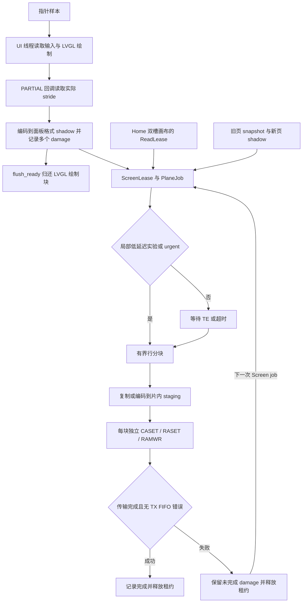

# 显示管线：局部更新与 RGB888

CO5300 使用 40 MHz 四线 SDR QSPI。默认固件采用 RGB565；`display-rgb888`
构建使原生 LVGL 使用 RGB888 绘制，并以 BGR888 字节存储 shadow、snapshot 和面板输入。
设置页滑块等原生控件保留 24 位颜色精度，上传只覆盖发生变化的区域。
Home、Lua framebuffer、相机及既有 RGB565 图片继续提供 RGB565 像素，在 shadow 或
驱动边界编码为所选面板格式；扩展到 RGB888 不会恢复这些来源已经丢失的颜色精度。

显示源在整个上传过程中保持不可变。LVGL 的 PARTIAL 绘制块可以在复制结束后复用，
shadow 和 snapshot 必须等到对应屏幕租约释放后才能重写。常规 Cargo 依赖为发布的
`rs_lvgl / rs_lvgl_sys / rs_lvgl_ui / rs_lvgl_codegen 0.8.0`，来自 crates.io。
历史 40 / 53.3 MHz 对照采用的本地上游快照及其依赖边界保留在对应测量节。

团子行为在 Rust 运行时中处理传感器、触摸与计时器，随固件更新；前台 Lua/TS 应用引擎独立选择。下文旧阶段的 Lua 大脑耗时仅适用于相应历史制品。

## 运行路径与边界



`lvgl_port.rs` 从 `lv_display_get_buf_active(display).header.stride()` 读取当前
PARTIAL 缓冲的实际行距。`copy_to_shadow` 只编码回调包含的像素，随即调用
`lv_display_flush_ready`；原生像素指针不会保存到上传任务。
`ScreenLease::pixels` 和 `SnapshotLease::pixels` 返回的 `PixelSource` 借用租约本身。
普通 LVGL handler、主动指针读取和外部 framebuffer 写入在 shadow 被借用时暂停。
`DisplayPort` 的析构要求所有租约和原生对象先释放。

`PixelSource` 区分数值 RGB565、RGB565 LE、RGB565 BE 和 BGR888，显式携带尺寸与
字节行距。RGB565 的位扩展复制高位，反向量化保持原始 16 位值。BGR888 到 BGR888
传递完整的三个颜色字节。现有 EmbedScope 最终画面捕获协议仍输出 RGB565，
`embedscope/frame.rs` 在诊断边界执行量化，诊断截图不能证明 RGB888 的低位颜色精度。

## Damage、页面恢复与输入

`Damage` 保存最多 16 个 inclusive 矩形。扩大到驱动的四列、两行窗口，
额外像素取自已经初始化的 shadow。CO5300 V0.00 §7.5.21（p159）及
§7.5.22（p161）要求列、行起点和范围均为偶数；四列沿用本板原有的更严格约束。
仅当包围矩形的像素量不大于分别发送时合并；
矩形数量达到上限时回退为覆盖全部变化的包围矩形。

`PlaneUi::submit` 合并被替换 Screen job 的 damage。上传失败时 plane 累积
`pending_screen`；下一次 Screen 提交覆盖这些区域。完成 Home 或 Slide 上传后，
`pending_screen` 标为全屏，使缓存的普通页面能够恢复完整内容。
失败本身不生成新帧，重试仍需要后续 job。SPI 超时沿用驱动的 `faulted` 状态，
后续上传拒绝执行，直到硬件重新初始化；普通可重试错误会在当前矩形上重试一次。

Home 的每个双槽画布保存完整的 480×480 RGB565 视口。`FoxRenderer::render_panel`
在视口内放置原尺寸角色，`status::render_panel` 在发布前合入固定位置的连接图标；
设备 RGB565 路径在滤波、调色板与混合完成后才将最终数值编码为 RGB565 BE，
槽位显式标记其存储格式。槽位使用 128 字节对齐的 PSRAM 分配，plane 从
`ReadLease::source` 借用格式与字节；LVGL 和 host 路径仍读取原生 RGB565 数值。
`ReadLease` 保护同一张完整帧直到传输结束。plane 从面板原点按整宽行块发送完整
Home，启动、页面返回、上传失败后的下一帧和唤醒均覆盖全部旧像素。失败帧不确认
亮度恢复。独立状态带上传和 `HomeRows` 已移除，避免主体上传先擦黑连接图标。
角色源图仍为 352×336，皮肤坐标与面板视口坐标分别由渲染器和显示源描述。
普通 LVGL 页继续按 damage 局部上传。

指针样本设置 pending 标记，UI 线程在 shadow 空闲时主动调用 LVGL indev 读取，
无需等待下一次 indev timer。两轮之间完成的短按通过 latch 先报告 press，下一轮
补发 release。原生刷新与 indev timer 周期均为 16 ms；这不等于设备达到 60 FPS。
静态页无需提交像素，输入处理继续按 UI 循环执行。

## 上传、面板配置与内存

`board-s31/src/pixels.rs::RowChunks` 按整行对分块。锁定 HAL 的单次 DMA 上限为
32,736 B，当前驱动按每块片内 staging 的 16,384 B 容量限制窗口。
源区域可以从奇数行开始，但高度必须为偶数；驱动另行验证实际目的行起点与高度。
480×480 的完整 Home 或普通全屏 RGB565 / RGB888 分别需要 30 / 48 块，
像素字节数为 460,800 / 691,200 B；整宽窗口分别容纳 16 / 10 行。
合并前的 352×336 Home 使用 46 / 30 行分块，
原 31 行 RGB888 块违反独立 RASET 窗口的两行要求；当前路径同样强制偶数行窗口。
`PixelRows` 为 push 提供不可变的逐行编码源。push 每帧由
`transition::rows` 把旧页与新页的对应列段拼成整行，按整宽行块自上而下发送，
窗口数与全屏相同，写入顺序也与全屏一致；这条路径总是经 staging 打包。
新页只绘制一次，每个动画位置仍需传完整屏幕。
当前实现不额外分配 push 合成帧。
转场准备先保存旧 shadow，再完成当前页面尚未执行的 reconcile 并绘制新页。
动画的 280 ms 时钟在新页绘制结束后启动，准备页面的耗时不占用转场时长。
这也覆盖常规消息处理之后才到达的诊断切页和团子行为导航，避免下一轮才准备新页，
导致第一帧后直接跳到接近终点。

全部像素来源先复制或编码到驱动独占的两块各 16,384 B、128 B 对齐的片内
staging，再传给锁定 HAL 的 `half_duplex_write_async`。第一块准备完成后，先轮询
本块 DMA future 使其开始传输，再在另一块准备下一批像素；两个 future 完成后才交换
缓冲角色。源帧租约和当前 staging 的借用均持续到对应传输结束。短于 32 B 的异步命令
使用 HAL FIFO 路径。旧的 PSRAM 直传和 PSRAM staging 路径已移除。
每个像素块独立设置 CASET/RASET 并使用 RAMWR，未采用依赖连续写游标的 RAMWRC。

每次像素传输后检查 SPI 的 `DMA_OUTFIFO_EMPTY_ERR` 和
`MST_TX_AFIFO_REMPTY_ERR`；即使 HAL 返回成功，只要其中一位置位，也返回
`Error::DmaFifo`。plane 按上传失败处理，不确认本帧成功。此检查覆盖实测中 HAL
在 TX AFIFO 读空后仍返回成功的情况；它不代替面板像素读回或光学验收。

阻塞启动写入仍经 HAL 内部 TX 缓冲。TX 缓冲为 4,096 B，因此冷启动清黑按容量
选择 RGB565 四行或 RGB888 两行的小带，不能直接套用异步 DMA 分块尺寸。
默认 RGB565 配置为 `COLMOD=0x55, MADCTL=0x00`；RGB888 为
`COLMOD=0x77, MADCTL=0x08`，匹配 BGR888 字节顺序。
冷启动、RGB565 bootloader handoff 接管和 sleep-out 均应用运行时格式；冷启动与
sleep-out 都在 SLPOUT 稳定后写 MADCTL/COLMOD，与 bootloader 顺序一致。
bootloader handoff 协议仍为 RGB565。已有 GRAM 内容、颜色顺序和唤醒效果需要面板验收。

当前 TX 4,096 B 与两块 staging 32,768 B 共使用 36,864 B（36 KiB）片内缓冲，
不含分配元数据和对齐开销。此前两块 PSRAM staging 合计 65,472 B 的配置已停用；
早期文档中的 56 KiB 片内节省不再适用于当前配置。默认双核 RGB565 的
draw buffer 使用 480 行、460,800 B（450 KiB）PSRAM，仍为 PARTIAL 模式；
较大的容量减少同一脏区因缓冲容量不足而重复准备对象和绘制任务的次数。
这项配置替代了此前的 32 行、30,720 B 内部 draw buffer，另释放其内部 RAM。
RGB888 保留 24 行、34,560 B 内部 draw buffer，单核保留 48 行内部缓冲。
与 RGB565 相比，RGB888 的 shadow 与 snapshot 合计增加
460,800 B（450 KiB）PSRAM；两种格式都使用同一组片内 staging。
堆元数据、线程栈、最大连续块和无线/音频争用后的实际余量以设备记录为准。

`display-low-latency` 是单独的 A/B 实验：仅 Screen damage 像素总量不超过半屏时
跳过 TE。整页、push 和 Home 继续等待 TE，urgent 沿用既有旁路。
阈值仅控制等待策略，不使较大的 damage 回退成整屏。
`display-metrics` 在每个 job 记录 `display.frame`：完成状态、格式、总耗时、
TE 等待、提交字节、直接来源字节、窗口数、编码时间和传输时间。
`direct_bytes` 为历史输出字段，当前全部经片内 staging，因此其值为零。
`pack_us` 是实际 CPU 打包时间之和；`transfer_us` 包括窗口命令、DMA 等待和
调度，轮换后也覆盖与本次 DMA 重叠的下一块打包，不能再将两者相加作为串行总耗时。
`bytes`/`windows` 记录尝试提交的工作量，失败或重试不能当作成功到达面板的净像素量。

## 主机复现与证据

```sh
# RGB888：生产页面、真实 LVGL 指针与回调、内存面板
cargo sim-display --locked --offline -- target/display-rgb888-20261112/simulator-rgb888
# 相同操作的 RGB565 对照
cargo run -p os --example display_pipeline --features display-simulator --locked --offline -- target/display-rgb888-20261112/simulator-rgb565
# Pillow 导出自包含播放器、PNG 与 GIF
python3 tools/assets/export_display_replay.py \
  --rgb888 target/display-rgb888-20261112/simulator-rgb888/replay.json \
  --rgb565 target/display-rgb888-20261112/simulator-rgb565/replay.json \
  --out target/display-rgb888-20261112/review
```

`display_pipeline` 回放设置音量、设置亮度与返回启动器的 push。
每个局部上传后逐字节比较内存面板与完整 shadow；每个 push 中间位置另用
不依赖 `transition::bands` 的逐像素映射核对旧、新页位置。
两个设置页均等待松手动画结束，再执行 10 轮空闲循环，要求零像素提交。
播放器的展示速度由 HTML/GIF 指定，不能作为上传帧率或实际触控延迟。

首次性能对照前的主机验证结果（历史源码见表后说明）：

| 检查 | 结果 |
| --- | --- |
| 默认 RGB565 board / OS 库 | 20 / 386 通过；OS 2 项 ignored |
| RGB888 + simulator board / OS 库 | 20 / 388 通过；OS 2 项 ignored |
| 完整 workspace（含 doctest） | 587 通过、2 ignored、0 失败 |
| 原生 UI 可靠性集 | 4 通过 |
| Python 主机脚本 | 130 通过，含 2 项设备日志分析回归 |
| 独立驱动集 | 首轮实现阶段 103 通过 |
| RGB565 / RGB888 回放 | 各 107 帧、107 次完整画面对照通过 |
| RGB565 / RGB888 / RGB888 + 局部 TE 旁路 / 默认无诊断固件 | `d02aabd` 四种构建和资源预算通过 |
| RGB888 examples、EmbedScope、TS、recovery | 前期构建通过 |

完整 workspace、RGB888 OS、board、原生 UI 与 Python 的最新主机测试对应
`f0136e5`，原始日志及 SHA256 见
`target/display-device-20261112/host-validation.json`。随后 `d02aabd` 只修改设备端
转场准备流程，四种固件重新构建并上机复核；它不进入主机回放路径。

本轮修改的 Rust 文件通过 rustfmt，diff 无空白错误。全仓 `cargo fmt --all -- --check`
仍报告先前提交中 6 个 companion/preview 文件的格式差异，详情保存在
`workspace-rustfmt.log`；这些文件没有纳入本轮显示改动。

主机回放得到的音量、亮度拖动提交量为 RGB888 50,328–60,504 B，
RGB565 33,552–40,336 B。40 MHz quad SDR 的纯像素数据时间分别为
2.516–3.025 ms 和 1.678–2.017 ms。全屏 push 分别为 691,200 / 460,800 B，
纯数据时间为 34.56 / 23.04 ms。以上时间均为字节量计算，未计命令、DMA、
TE、调度、PSRAM 争用和屏幕光学响应。

本地证据位于 `target/display-rgb888-20261112/`：`validation.json` 保存构建/测试
命令与日志指纹，`simulator-validation.json` 保存回放命令，两个
`simulator-*/replay.json` 保存逐帧区域与数据量；`review/index.html` 包含完整 PNG
回放。固件 ELF 按配置另存，避免后一次构建覆盖前一次候选。
这些主机证据未覆盖真实 DMA 完成、面板扫描、设备内存余量和光学效果。

## 设备对照入口

`display-metrics` 同时提供 `display-test` 控制台实验入口：`status` 返回启动时
17 次连续 GPIO TE 边沿观察的周期摘要；`page home|launcher|settings` 在常规 UI
消息处理前变更页面，经同一轮 reconcile 和页面生命周期后再渲染；
`pattern colors|gradient|off` 由 UI 线程管理原生 LVGL 测试图；
`swipe x0 y0 x1 y1 duration_ms` 经普通输入队列注入有界轨迹。
`tone prepare|play|clean` 管理独立临时 WAV，并使用正常音频服务播放。
`play` 仅排入独立诊断任务；采样工具确认音频状态已达到 `playing` 后才开始并发
测量，正常 `audio-play` 命令的完成回复不用于启动并发测试。
这些入口仅存在于测量构建，测试完成后清理 WAV。

每帧的 `display.frame`、`display.cost`、`display.input` 以 `id` 关联，另记录
shadow lease 的 `display.busy` 起止和 CPU 绘制时长。每行保持在控制台 158 字节
文本预算内。`pixel` 是首个像素 DMA 调用前的软件时间戳，**不是逻辑分析仪测得
的首个线上字节**；TE 周期同样包含 GPIO 唤醒与调度误差。物理输入时间从 CST9220
报告读取完成算起；合成轨迹从注入队列算起。输入合并时同时报告最早、最新样本，
BUSY 占比只计算输入到 LVGL 读取期间与先前 lease 的交集，不计本帧上传占用。

`tools/device/display_probe.py capture` 保存原始控制台记录并产生分布摘要，
`analyze` 可离线重算；摘要显式列出截断记录和未配对帧。最终画面的 EmbedScope
截图仍是 RGB565，不能据此验收 RGB888 低位精度或扫描过程中的撕裂。
EmbedScope 的最终画面镜像会在每帧上传后量化／复制，尤其会延长 push 的租约。
性能 A/B 统一使用 `display-metrics` 且关闭 `embedscope`；带 EmbedScope 的截图构建
单独记录身份和证据，不能将两种构建的耗时混为一组。

上游 R-11 已在 `lv_binding_rust` 本地提交
`066f96b583e1e3dd83d6492fae961b48dd4eb8d9` 实现
`.invalidation_alignment(4, 2)` 可在 LVGL invalidation 阶段统一本板的绘制与 DIRECT
同步区。当前 PARTIAL 的持久 shadow 保证扩展列与行已初始化，未更改依赖来源，未迁移 DIRECT。

以下命令只构建。配对比较先保持 TE 策略相同，再独立比较局部低延迟实验：

```sh
# 40 MHz RGB565 + metrics
cargo fw --features display-metrics --locked --offline
# 40 MHz RGB888 + metrics，保留 TE
cargo fw --features display-rgb888,display-metrics --locked --offline
# 40 MHz RGB888 + metrics + 局部 TE 旁路
cargo fw-rgb888 --locked --offline
```

设备接入后的验收包括：

1. 纯红绿蓝、灰阶、高精度渐变、照片、透明边缘、四角小窗及非整行局部刷新，
   核对颜色通道、低位精度、源 stride、窗口边界和残影。
2. 冷启动、bootloader splash 接管、反复 sleep/wake；完整画面恢复后才恢复亮度。
3. 音量/亮度连续拖动、极短点击、松手、快速往返导航和 Home 状态更新；记录
   帧间隔及触摸到提交/首字节的 p50/p95，并检查按下/释放完整性。
4. 同格式 TE 开/关对照，采集实际 TE 周期和 SCLK，结合光学记录判断撕裂，
   不以最终画面截图替代扫描过程验收。
5. 无线与音频同时运行，记录 PSRAM/DMA 耗时、堆最低水位及最大连续块；
   失败重试、未完成 damage 和唤醒全屏恢复单独核对。

40 MHz 下全屏 RGB888 已超过 16.67 ms 的纯传输预算，当前工作不设整屏 60 FPS
承诺。局部控件的画质、输入等待和提交工作量是本轮设备对照的重点；增加 shadow、
DIRECT 或合成流水的必要性由这些设备数据决定。

## 设备对照结果（2026-11-12）

最终对照使用同一份 `d02aabd` 源码和设备上的同一套 NAND 资源，分别构建
`display-metrics`、`display-rgb888,display-metrics`，再单独增加
`display-low-latency`。所有性能构建关闭 EmbedScope，使用普通 USB 控制台；
Wi-Fi 为 idle、无 IP，蓝牙关闭，不能据此声称无线吞吐验收通过。
每种格式记录 8 秒 Home、启动器/设置往返 10 轮、音量滑块往返 10 轮及一轮音频并发 push。
滑块轨迹为 `(94,165) → (370,165)` 及反向，每程 500 ms，从普通输入队列注入。

以下均为设备日志中的分布，时间单位 ms。输入时间从合成样本入队到首个像素 DMA
调用前的软件时间戳，**不等于物理手指到线上首字节或光子的延迟**。
“最早/最新”分别对应本帧合并输入中的两个端点，不能只选其中改善的一项。

| 指标 | RGB565 | RGB888（保留 TE） |
| --- | ---: | ---: |
| Home 单次上传总耗时 p50 / p95 | 32.80 / 40.28 | 38.03 / 44.98 |
| Home 完成间隔 p50 / p95 | 51.01 / 72.65 | 49.65 / 68.31 |
| push 单次上传总耗时 p50 / p95 | 43.29 / 47.93 | 59.11 / 63.29 |
| push 完成间隔 p50 / p95 | 50.14 / 51.69 | 66.75 / 67.57 |
| 滑块每次提交字节 p50 | 40,336 | 60,504 |
| 滑块最早合并输入延迟 p50 / p95 | 89.17 / 95.18 | 86.41 / 95.22 |
| 滑块最新合并输入延迟 p50 / p95 | 48.67 / 67.65 | 46.03 / 66.82 |
| 滑块 BUSY 等待占比 p50 | 15.6% | 16.9% |
| 音频并发 push 完成间隔 p50 / p95 | 49.78 / 51.62 | 66.73 / 67.41 |

push 分别有 120 / 98 个中间帧、100 / 78 个连续完成间隔；滑块分别有
241 / 240 个能关联到合并输入的帧。上述 Home、push、slider 和音频并发日志
均无截断计量行、未配对帧或失败上传。统计保留长帧，没有按 200 ms 等任意时长删除样本。

RGB888 局部 TE 旁路的上传 p50 / p95 为 5.71 / 5.92 ms（保留 TE 为
13.33 / 20.16 ms）。最早合并输入 p50 从 86.41 降至 73.63 ms，改善 12.79 ms；
最新输入 p50 从 46.03 降至 42.33 ms，改善 3.70 ms；两者 p95 分别为
79.07 / 52.72 ms。旁路组有 279 个关联输入的帧。尚无 10 轮物理拖动的光学验收，
因此它仍是独立候选开关。BUSY 占比降至 9.3%，不满足继续引入 DIRECT / 双 shadow
的 >30% 触发条件。

阶段性串行基线 `ce09229` 的 Home 上传 p50 为 RGB565 38.56 ms、RGB888
51.87 ms；push 为 62.00 / 86.40 ms。当前总上传时间较短，但双 staging 后
pack 与 DMA 重叠并共享 PSRAM，单项 `pack_us` 并未下降；这些数据不能单独归因为
转换循环的加速。Home 完成间隔仍有长尾，未证明整体帧率稳定提高。
串行基线的动画时钟/页面准备有缺陷，不能用它的少量中间帧比较转场帧间隔。

用户在 `f0136e5` 的自动并发测试中报告转场明显跳动。日志显示某次偏移由
28 px 在约 50 ms 内跳到 464 px：诊断/脚本导航在常规 drain 之后标记 dirty，
下一轮才完成目标页面准备。`d02aabd` 在 snapshot 之后、启动动画时钟之前补齐
reconcile。重新测得 20 次 RGB565 转场每次均有 6 个中间帧，原先为 3–4 个；
修复后的完整画面序列与光学无撕裂是不同的验收项。

两种格式均从 `screen-off → restoring → active` 恢复，`frame_ready=1`；
启动时固件内观察到的 TE 周期均值约 16.69 ms，采样无超时。
测试后内部空闲堆快照 RGB565 为 96,520 B、RGB888 为 85,000 B，最大连续块
均为 65,512 B；这不是运行期最低水位或无线负载下余量。
两个并发测试均在音频进入 playing 后开始导航，结束时仍在播放，underrun / overrun
计数均为 0；最终配对两组尚无明确听感反馈，不能代替“无可闻断音”验收。

默认继续使用 RGB565、40 MHz 并保留 TE 等待。RGB888 的 push p50 66.75 ms
和 p95 67.57 ms 均未达到预先写定的 ≤50 / ≤67 ms 门槛；静态低位画质收益
也尚未获得稳定目视确认。局部控件保留高精度和按 damage 上传的实现继续保留，
默认格式无需依赖未完成的光学验收。四种候选的固件和资源预算均通过。

首次性能对照后装回的默认镜像来自 `d02aabd`，仅 `firmware` 与默认 Lua/dual-core features，
关闭 RGB888、局部 TE 旁路、metrics 和 EmbedScope。镜像为 5,363,008 B，SHA256 为
`63f040b2dabe7d233ce5837acae6785c14db6980774375cb4f70a5670e7dd770`，
已通过 Recovery 完整读回、安装后 Ready、再次重启后的 Ready 和连续三轮 2 秒灭屏唤醒。
该次安装状态为 `Ready generation=224, ready=1, sys=1, data=1, frame=1, vm=1`，
`power active, cycle=3, frame_ready=1`。测试 WAV 已删除，音量恢复至测试前的 100，
音频关闭，页面回到 Home。`final-default-r2/final-health.json` 保存最终身份和状态。

原始记录、逐项分布、构建 feature、ELF/BIN SHA256、Recovery 完整读回和 Ready
凭据保存在 `target/display-device-20261112/`：`device-comparison.json` 为汇总，
`decision-results.json` 保存固定阈值与判定，`evidence-ledger.json` 保存来源与安装凭据，
`manual-observations.json` 单独保存人工反馈。每个 `reconciled-*` 子目录包含原始日志。
实际 SCLK/脉宽、TE 到可见扫描的相位、10 轮撕裂光学记录、无线吞吐、真实 SPI
超时/面板断开和音频听感仍未验收；不会从固件时间戳或最终截图推断这些结果。

## 窗口边界与 Home 恢复回归（2026-11-12）

本节记录显示分支合并完整 Home 视口之前的源码与实机结果。

RGB888 Home 曾出现静止后仍保留的横向切割线。同一源帧冻结后，串行和并行
打包均复现；软件源画布中没有这些线。原 31 行独立 RASET 窗口违反两行边界。
改为 30 行块、damage 扩展到四列两行后，实机静止画面、动画、拖动及返回均确认
无横线。RGB888 色条的 RGB 顺序、白灰及残影检查通过。

随后导航出现另一种残留：Home 右侧留下绿白点或旧应用片段。全屏色条覆盖能够
清除；旧路径 8 轮导航的最后一轮再次出现，8 次外围清黑均报告成功。
同一源帧的串行主体重传没有清掉残留，软件源捕获也没有对应图案。
这一结果没有确定具体丢失的窗口命令或面板内部行为。

Home 完整恢复已改为 `HomeRows`，将黑背景、主体和状态带编码成同一批整宽行。
RGB888 的首帧由原来的 699,360 B / 115 窗口变为 691,200 B / 22 窗口；
普通动画仍为 354,816 B / 12 窗口，不增加全屏缓冲。
`home-restore-full-rows-r3` 的 20 轮导航完成 656 帧，日志无失败、截断或未配对记录。
目视反馈为切换瞬间闪过，停稳后自行消失，未再报告停稳后持续残留。
这不构成切换过程无撕裂验收。后续关闭 EmbedScope 的 R4 12 轮复验中，
停稳后仍报告右侧绿白点或旧应用片段；横向切割线未复发。整宽恢复本身没有
解决该现象，其收益为减少窗口命令并从同一租约恢复完整画面。

R5 区分了导航与冻结：手动返回 Home 后单独冻结，画面干净；经普通触摸输入队列
完成 10 轮往返再冻结，画面也干净。诊断 `page` 入口原本在本轮 `Ui::drain`
之后直接 `app.go`，随即进入 Home 渲染；此时 `Ui::tick` 仍遍历旧对象树，
不会替代 reconcile。入口现已移到常规 drain 前，使模型、对象树及生命周期在
渲染前完成同一轮更新。R6 保留其他条件，原直接跳页路径完成 20 轮、766 帧，
没有失败上传、截断行或未配对计量记录；最后冻结画面目视确认干净。
这些对照支持将残留按诊断入口时序回归处理，没有新增 rs_lvgl 改动需求。
冻结、同帧重传及灯光控制已从待交付源码移除。此结果不认证所有转场均无光学撕裂。

R3 使用 EmbedScope 每帧镜像，全屏 Screen/Slide job 中位耗时约 209 / 208 ms，
其中传输约 44 / 49 ms；复制和量化显著延长租约。正常转场复验关闭 EmbedScope，
不能将镜像构建的少量中间帧当作无诊断固件的转场表现。
R3 的 RTC 用量因既有 EmbedScope 记录超过常规基线 52 B，仅作为诊断构建例外，
资源策略没有更改；最终普通构建必须通过原策略。

新增测试覆盖整个 480×480 的单像素窗口扩展、两种格式的 Home 行块连续性、
奇数源行到偶数目的行的映射，以及从非黑旧页恢复完整 Home 后的每个像素。
完整 workspace 592 通过、2 ignored；RGB888 + simulator OS 库 388 通过、
2 ignored；原生 UI 4 通过，两种格式回放各 107/107 完整画面对照通过。
这些结果对应 `home-restore-rows-work/` 的源码快照与日志，性能表仍对应历史 `d02aabd`。

移除临时诊断并调整入口顺序后的 `./tools/check.sh` 全部通过：workspace
592 通过、2 ignored，原生 UI 4 通过，Python 130 通过；驱动、Lua/TS 构建、
引擎互斥、资源包、Recovery 构建及 3,241 个 C 符号检查通过。
该脚本合计 1,131 次 Rust 测试执行通过、4 ignored，包含重复配置下的执行次数。
原始日志为 `final-production-check/check.log`，本轮修改文件 rustfmt 和 diff 检查通过。
Recovery 仅构建验证，实机安装只替换 main。

## 普通固件回归收尾（2026-11-12）

源码提交 `7910b8ac5c0a2bf10e693ff073f53d01333829da` 的普通 RGB565 和 RGB888
均已重新构建并通过原资源预算；RGB888 + simulator 库另有 388 通过、2 ignored。
构建均关闭计量、局部 TE 旁路、EmbedScope 与临时实验控制，保留 40 MHz 和 TE 等待。
`final-production-check/validation.json` 保存最终检查命令和日志指纹。

默认 RGB565 安装镜像为 5,359,376 B，SHA256：
`086472b2a0266662b8d75fe3cc4d6b291c3371482b4631cc6a423234ea73c281`。
Recovery 完整读回确认成功，安装及再次重启后均为 `Ready generation=264`、
`ready=1, sys=1, data=1, frame=1, vm=1`。三轮两秒灭屏均经过
`screen-off → restoring → active`，最终 `cycle=3, frame_ready=1`。
控制台确认 `display-test` 入口不可用，音量 100、音频 off、Wi-Fi idle、BT off。
`final-default-r3/` 保存构建身份、安装日志、重启前后 Ready 和最终健康凭据。
该普通固件的团子拖动、启动器/设置往返及返回后画面已人工确认操作正常、无残留或横线。

普通 RGB888 留存于 `final-rgb888-r7/`，镜像为 5,359,408 B，SHA256：
`4f67f6700ad4c35b2400bedfe0909b19de0ff40b1ec6c96db13254f25461eb7e`。
该普通镜像仅构建留存；本轮 RGB888 实机残留复验对应 R6 测量镜像，身份与
人工反馈见 `home-lines-investigation.json`。默认格式及前述未测光学项目的判定未改变。

## 完整 Home 视口与爬行动作合并（2026-11-12）

`codex/dango-v0.5.1` 的最终实现 `743dd55` 包含宽松换侧识别、固定路线爬行、
原尺寸旋转、快速半圈掉落与配套惊慌表情。完整视口与连接图标在同一帧合成；
显示分支的两行窗口、DMA 打包重叠、LVGL 局部 damage、页面准备与诊断入口时序
继续执行原有路径。两类来源都通过 `PixelSource` 明确像素格式、尺寸与行距。

Home 每次上传完整视口，单帧像素量相对原局部主体有所增加。前述性能表对应
历史 `d02aabd`，其 Home 上传时长、完成间隔和局部字节数不代表本次完整视口。
默认仍为 RGB565、40 MHz、保留 TE 等待。

图标回归使用实际 `FoxWidget` 发布帧，在 RGB565 与 RGB888 下执行驱动的编码和
行块规划，逐窗口检查连接图标，完整上传后逐字节对照源帧，覆盖从非黑旧页返回
Home 的恢复。合并与安装证据保存在 `target/merge-companion-20261112/`。

合并检查的 workspace 测试为 597 通过、2 ignored；完整 `tools/check.sh` 合计
1,141 次 Rust 测试执行通过、4 ignored，包含不同引擎配置重复执行，Python 为
130 通过。RGB888 + simulator 库另有 393 通过、2 ignored；两种面板格式的页面
回放各完成 107 次完整画面对照，计量、局部 TE 旁路与 EmbedScope 组合的设备
交叉编译通过。70°换侧及快速半圈各生成 110 帧模拟 IMU 原生预览，像素结果不
代表实体传感器方向或光学帧率验收。

普通 RGB565 实机验收对应合并源码 `31d85d527a761e2dc1a0f77301de771c1fa74c9d`。
Recovery 完整读回验证通过；安装及再次重启后均为 `Ready generation=269`，
三轮灭屏唤醒通过，四套皮肤均可加载，八个设备资源文件与合并源码逐字节一致。
人工慢转约 70–100°后，角色保持原尺寸爬到新侧并停稳；快速半圈后能完成
惊慌抓握、掉落压扁、无奈和恢复的完整动作，画面正常。该反馈覆盖上述两种
动作的实体表现；普通 RGB888 仍仅构建留存。该合并阶段未重新测量完整视口的
实机帧率与光学撕裂，后续 RGB565 时钟对照记录如下。

## RGB565 40 / 53.3 MHz 实机对照（2026-11-12）

S31ONE03 按 40 MHz、53.3 MHz、40 MHz 的顺序运行。每轮采集两段约 20 秒
Home 动画、24 次启动器与设置之间的 push 转场，以及 12 次设置列表滚动。
计量开启，EmbedScope、截图镜像、局部 TE 旁路关闭，音频关闭，Wi-Fi idle、BT off。
Home 每次上传完整 480×480 RGB565 帧，即 460,800 B；场景与资源没有切换格式。

上游基于本地 `066f96b583e1e3dd83d6492fae961b48dd4eb8d9`，包含未提交的
`tick_inc` 余数累计、返回下次到期时间的 `timer_handler()`、DrawBuffer 堆上分配及
格式修复。四个 rs_lvgl crate 统一替换为同一快照，源码清单指纹为
`8e0ae937614eac520c71b425b4f8a5b4227229064bfab1b0c0c34d584639de3a`。
本工程的设备时钟使用 `lv_tick_set_cb`；本轮没有把 `tick_inc` 修复记为设备帧率收益。

`display-clock-53mhz` 仅选择实验频率。锁定 HAL 按不超过请求值的规则选择分频，
请求 `53,333,334 Hz` 才得到 160 MHz÷3；请求 `53,333,333 Hz` 会选择 ÷4。
后两轮从运行时寄存器读回 `pre=1, N=3, H=1` 与 `pre=1, N=4, H=2`，
均未旁路分频；53.3 MHz 与复测 40 MHz 的固件源码补丁和上游快照完全相同。
首轮 40 MHz 只有启动日志中的读回尝试；早期日志未保留到 USB，后续仅增加诊断状态
中的寄存器读取。寄存器及 HAL 源码证明软件配置，SCLK 电气频率和脉宽未测。
53.3 MHz 超出 CO5300 公开写时序，继续作为实验开关。

| 场景 | 40 MHz 首轮 | 53.3 MHz | 40 MHz 复测 |
| --- | ---: | ---: | ---: |
| Home 第一段平均完成帧率 | 13.34 FPS | 12.91 FPS | 11.19 FPS |
| Home 第二段平均完成帧率 | 13.27 FPS | 13.11 FPS | 13.51 FPS |
| push 动画期间平均完成帧率 | 19.98 FPS | 20.44 FPS | 19.89 FPS |
| 设置列表滚动平均完成帧率 | 7.72 FPS | 8.54 FPS | 7.91 FPS |
| push 完成间隔 p50 / p95 | 49.93 / 51.34 ms | 49.85 / 51.26 ms | 49.99 / 51.24 ms |

完成帧率取连续同类帧的完成间隔均值的倒数；push 排除各次转场之间的停留时间，
列表滚动保留同类连续帧的间隔。该口径来自固件像素上传完成时间戳，包含计量开销，
没有测量面板可见扫描。Home 的自然动作状态未固定，复测首段较慢，所有样本均保留。
三个完整采样日志分别记录 837、833、800 帧，无截断记录、未配对记录或失败上传。

Home 的渲染周期仍为 50 ms，目标上限 20 FPS，当前渲染中位耗时约 40–41 ms。
整帧打包中位耗时约 32 ms，打包与传输重叠，因此两项耗时不能相加。
push 的传输统计中位数从约 31.5 ms 缩短至 28.9 ms，完成间隔中位数仍约 50 ms；
设置列表的 LVGL 绘制中位耗时约 81–92 ms。当前收益受绘制、像素编码及 TE 调度共同限制，
单独升频没有建立 Home 或 push 的显著帧率收益，也没有达到 60 FPS。

人工观察已确认复测的 **40 MHz Home 可见轻微撕裂**。53.3 MHz 的光学表现没有
获得独立确认；没有把该反馈归为升频故障，也没有认定 TE 等待能够消除撕裂。
这轮只测量现有上传策略，没有修改撕裂处理。原始反馈与频率确认保存在
`target/rgb565-clock-20261112/manual-observations.json`。

主机验证为 workspace 597 通过、2 ignored，原生 UI 4 通过，RGB565 页面回放
107 次完整画面对照通过。两个计量频率与普通 40 MHz 均完成交叉编译和原资源预算检查。
测量完成后恢复普通 RGB565、40 MHz、保留 TE 等待，关闭计量和诊断；继续使用同一
上游快照。制品、写入读回、重启与唤醒记录见 `target/rgb565-clock-20261112/`。
常规 Cargo.lock 恢复到实验前内容，实验依赖解析结果与各制品一起保存。

## 40 MHz 编码与绘制开销复核（2026-11-12）

本轮统一使用 crates.io 的四个 rs_lvgl 0.8.0 crate、RGB565、40 MHz 和常规 TE
等待，关闭 EmbedScope、局部 TE 旁路与音频。各轮控制台均记录 Wi-Fi connected、
BT off；没有测量 Wi-Fi 吞吐。每轮包含两段约 15 秒 Home、16 次 push 和 12 次
设置列表滚动。帧率取连续同类成功上传的完成间隔均值的倒数，push 排除各次转场
之间的停留时间；计量构建的结果不代表普通固件或面板可见扫描帧率。

| 制品 / 采样 | draw 行数 | Home 两段 FPS | push FPS | 设置滚动 FPS |
| --- | ---: | ---: | ---: | ---: |
| baseline-08 / base-a | 24 | 13.57 / 13.67 | 19.95 | 7.93 |
| wire-30 / wire-a | 24 | 12.99 / 13.17 | 20.02 | 8.03 |
| loop-probe / loop-a | 24 | 12.76 / 12.68 | 19.91 | 8.08 |
| draw48 / draw48-a | 48 | 12.70 / 12.66 | 19.91 | 10.01 |
| 同一 loop-probe 制品 / draw24-b | 24 | 12.81 / 12.60 | 20.01 | 8.17 |
| draw32 / draw32-a | 32 | 13.00 / 12.94 | 20.02 | 8.62 |
| 同一 draw32 制品 / draw32-b | 32 | 12.66 / 12.73 | 19.83 | 8.31 |

`base-a` 的 Home 目标周期为 50 ms，`wire-a` 及后续为 33 ms。实际完成间隔仍高于
目标，没有达到 30 FPS。原生数值 RGB565 的字节打包改为对齐 word 访问后，独立
实验没有建立帧率收益。Home 最终存储直接编码为 BE、使用对齐 PSRAM 后，每帧
460,800 B 均从租约直传，仍为 15 个独立窗口；打包计量中位数约从 31.6 ms 降到
0.5 ms，绘制中位数约从 41 ms 降到 33 ms。整体 Home 帧率没有建立收益，不能把
打包节省等同于完成帧率提升。滤波、混色、状态图标及诊断截图仍按前述格式边界执行。

24 → 48 → 同一 24 行制品的设置页对照中，刷新像素均为 133,120，flush 从
12 次降到 6 次，再恢复 12 次；绘制中位数为 85.75 → 61.91 → 85.16 ms。
32 行两轮均为 9 次 flush，像素数相同，绘制中位数为 81.21 / 84.82 ms，帧率
收益较小。48 行额外占用的内部 RAM 会压缩无线服务余量：

| 实机配置 | draw buffer | BT off 内部空闲堆 | BT discoverable 内部空闲堆 |
| --- | ---: | ---: | ---: |
| brain-alloc，48 行 | 46,080 B | 72,136 B | 15,000 B |
| draw32，32 行 | 30,720 B | 87,496 B | 30,360 B |

两轮无线检查均在 Wi-Fi connected 下执行一次扫描、启用蓝牙可发现并完成四次
页面切换，结束后恢复 BT off。该检查没有建立蓝牙连接，没有覆盖音频流或峰值堆。
本阶段选择双核 RGB565 32 行，以保留更多内部堆；后续改用 PSRAM 的选择与对照见
下一节。RGB888 仍为 24 行，单核仍为 48 行。

`display.loop` 对 Home 记录输入、页面准备、brain tick 与像素绘制的墙钟区间。
最终两轮输入中位耗时约 29.6–30.9 ms、brain tick 约 5.3 ms、像素绘制约
34 ms。每轮通常处理 8 个传感器事件；同步传感器处理约 28–29 ms。日志包含线程
抢占与内存等待，不能直接当作纯 CPU 时间；不同区间的分位数不能相加解释单帧。
事件仍按原顺序全部交给默认 Lua brain，未合并或丢弃。typed dispatcher 省去命令
包装表，默认脚本发布表情时读取标量状态；回调可保留的事件及其嵌套表仍逐次新建，
`snapshot_at` 仍返回原记录。该改动的 Home 帧率收益没有从波动中独立确认。
解码主体缓存与 Lua 执行期提频均做过设备对照，未保留在最终实现。

字体计量覆盖自定义 descriptor 和 bitmap 回调，并在同一 polling / handler 窗口
内累计。`draw32-a/b` 的设置滚动分别取得 74 / 71 组按 `end` 配对的
`display.draw`、`display.font`，均无缺失；逐帧字体回调合计中位数为
3.775 / 3.865 ms。当前没有以这些数据建立全字体 A8 展开的必要性。
先前 `alloc-a` 把字体字段附在 draw 行后，触及 158 B 文本预算，83 条设置页记录
的字体调用次数被截断；这些旧次数无效。frame/cost 分析器报告的零截断不覆盖该
旧字体字段。当前分行记录保留完整耗时和调用次数。

部分 DMA 区间的软件时间戳小于名义 40 MHz 所需的纯像素时间。相关采样同时记录
`src=2, div=2, pre=1, n=4`，HAL 配置仍对应 40 MHz，没有据此证明运行时升频，
也没有确定计时异常的根因。SCLK 电气频率、脉宽与光学扫描仍未测。人工拖动和
设置页返回对直传候选反馈为画面正常；回复到达时设备为同像素路径的 loop-probe。
该观察不构成长期无撕裂或最终普通制品的独立验收。

最终源码通过完整 `tools/check.sh`：1,151 次 Rust 测试执行通过、4 ignored，
包含不同配置的重复执行；Python 130 通过。RGB888 + simulator 库另有 396 通过、
2 ignored，RGB565 / RGB888 页面回放各完成 107 次完整画面对照。EmbedScope
主机测试 9 通过，两种面板格式与计量组合的设备交叉检查通过。修改的 Rust 文件
格式检查与 diff 空白检查通过；独立驱动和引擎专用构建仍有既有 dead-code 警告。

完整矩阵、未采用的实验和字体记录完整性见
`target/display-30fps-20261112/results.json`，检查命令与日志指纹见
`final-validation.json`。普通 RGB565 制品为 `final-normal/`，关闭计量和 EmbedScope，
保留 40 MHz、TE 等待与默认 Lua；安装、完整读回和重启唤醒结果分别记录在
`final-normal-install.json` 与 `final-health.json`。这些本地证据目录不纳入版本控制。

## 40 MHz 绘制分段与团子滤波复核（2026-11-13）

继续使用 crates.io rs_lvgl 0.8.0、RGB565、名义 40 MHz、正常 TE、默认 Lua，
Wi-Fi connected、BT off、音频与 EmbedScope 关闭。新增传感器/VM 与 LVGL 区间
计量后，先重测基线，再测试候选；这一轮 Home 基线约 11.85 FPS，不能与上一节
较少计量的约 13 FPS 直接比较。完成帧率仍取连续同类成功上传完成间隔均值的倒数，
不代表面板光学帧率。

首先使用临时 C collector 定位 LVGL 绘制。collector 关闭时，在同样的
133,120 脏像素下，改变绘制缓冲得到：

| 绘制缓冲 | 每次刷新 flush 数 | 两轮设置滚动 FPS | handler 中位耗时 |
| --- | ---: | ---: | ---: |
| 32 行、30 KiB Internal | 9 | 8.50 / 8.51 | 77.1 / 79.6 ms |
| 64 行、60 KiB PSRAM | 5 | 9.58 / 9.36 | 61.7 / 63.2 ms |
| 480 行、450 KiB PSRAM | 1 | 11.34 / 11.20 | 49.6 / 49.9 ms |

缓冲位置与容量同时改变，不能把全部收益归为其中一项。TOP 计量下对象绘制调用数
从 170 降到 26，符合小条带重复执行对象、事件、描述符及任务准备的判断；这不是
唯一对象数量，也不能把递归重叠的 inclusive 时间相加。启用 TOP/BLEND 的构建
比 collector 关闭时更慢，相关数据只用于归因，不作为最终性能。完整容量缓冲仍为
PARTIAL 模式，保留 damage、shadow/snapshot 租约及局部上传；它不会强制每次
重画或上传整屏。当前默认采用 480 行 PSRAM；RGB888 与单核配置保持原缓冲。

团子普通呼吸滤波保留原采样量化与双线性混色，只直接清黑确定两个横向采样点都在
源图以外的边缘。旋转路径不变，没有增加分配。独立标量 oracle 覆盖正负缩放、
平移、完全离屏、源图/面板尺寸及两种 RGB565 存储编码，并检查输出尾部未改写。
同一临时诊断配置的对照中，Home 绘制中位耗时约 33.3 → 30.0 ms，完成帧率
约 11.6–11.8 → 12.4–12.6 FPS。

移除临时 C bridge、恢复原 Lua hook 后，最终计量制品重跑两轮标准流程：每轮两段
15 秒 Home、16 次 push、12 次设置列表滚动。

| 采样 | Home 第一段 / 第二段 FPS | push FPS | 设置滚动 FPS |
| --- | ---: | ---: | ---: |
| 本轮计量基线 probe-a，32 行 Internal | 11.84 / 11.87 | 19.92 | 8.64 |
| 最终计量 final-a，480 行 PSRAM + 黑边裁剪 | 12.28 / 12.33 | 19.93 | 11.45 |
| 同一最终制品 final-b | 12.33 / 12.39 | 20.00 | 11.06 |

设置滚动完成帧率提高约 28–32%，最终 handler 中位数 47.9 / 49.1 ms，
相同 133,120 像素只需一次 flush。Home 绘制中位数 30.2–30.4 ms，完成帧率
提高约 4%；push 未建立收益。两轮各测量段均无失败上传、截断或未配对 frame/cost。
final-b 在测量结束后的状态查询中缺少一条 cost 记录，未纳入性能样本；完整日志
仍保留该缺失，没有把它记成零缺失。

最终 Home 每轮通常仍处理 8 个传感器事件，传感器 Lua 处理中位数约 29–30 ms，
全部 VM 调用墙钟约 33–34 ms。resident thread 时钟读数接近墙钟，说明此处主要
开销不来自其他线程的等待；该时钟包含运行于此线程期间的 ISR，不能当作通用的
纯 CPU 时间。事件顺序、事件数量、自定义 brain 输入数值类型及回调预算均未改。
整数开方和单次 hook 取时两项实验未建立设备收益，已从最终源撤回。

新缓冲增加 460,800 B PSRAM 分配，释放原有 30,720 B 内部 draw 分配，
不改变 shadow/snapshot 数量。最终计量版在 Wi-Fi connected 下执行一次扫描、
BT discoverable 及四次页面切换后，内部空闲堆为 61,176 B；随后恢复 BT off。
这不是蓝牙连接、音频流、峰值堆或长期压力证明。临时 C 源、Cargo feature 和
Rust collector bridge 均未进入最终固件；实际链接的 registry provider 生成配置
与插桩前冻结的 lv_conf.h 逐字节一致，无需修改 rs_lvgl 生产源码。

最终可执行源码通过 `tools/check.sh`：1,159 次 Rust 测试执行通过、4 ignored，
Python 130 通过；RGB888 + simulator 库 400 通过、2 ignored，双格式回放各有
107 帧与 107 次完整画面对照通过，EmbedScope 主机 9 项及双格式固件计量组合
交叉检查通过。随后补充的原生边界回归在双格式下各通过一次，直接读取并确认
RGB565 的 PARTIAL 容量为 460,800 B；同一 feature 配置用于上述 107 帧回放。
该用例在整屏、非零起点窄列/窄行、右下角、再次整屏及同轮两个远离脏区之间切换，
独立逐像素核对 shadow 与增量面板、扩行邻近像素和租约状态，并检查空刷新不提交。
实际窄区 stride 为 RGB565 2/26/2 B、RGB888 3/39/3 B，没有假定为整屏 stride。
修改文件的直接 rustfmt 检查与 diff 空白检查通过；递归 rustfmt
仍会报告未修改的 animate.rs 导入格式差异。全套命令、制品、源码补丁、原始日志、
未保留实验与计量完整性保存在 `target/display-deep-20261112/`，入口为
`README.md`、`final-validation.json`、`results.json` 与 `decisions.json`。
普通制品及安装读回分别使用 `final-normal/` 与 `final-normal-install.json`，
重启唤醒记录使用 `final-health.json`，人工光学反馈单独记入 `manual-observations.json`。
实际 SCLK 电气频率、脉宽和光学扫描仍未测，本轮未达到 30 FPS。


## Rust 行为运行时对照（2026-11-13）

团子行为已收敛为固件内的 Rust `Runtime`，不再构造 Lua/TS 常驻大脑。
传感器、触摸、个性、平衡转向、表情与效果由原生状态机处理；前台应用引擎仍
独立选择 Lua 或 TS。脚本行为的初始化、替换、持久选择、上传协议、LED 租约、
姿态覆盖和打包资源一并移除；`brain-status` 只读返回
`active=rust source=firmware`。旧设备行为文件不读取，也不自动删除。

以下保留旧传输路径的历史对照。该路径未检查发送 FIFO 错误，表中的完成 FPS
是软件报告值，不能据此证明完整像素帧的同等提升。v0.6.1 的修正与复核见本节末。

对照按 Lua A → Rust A → Lua B → Rust B 交替安装执行。
每轮包括两个 15 秒 Home 分段、8 轮设置/启动器 push 和 12 次设置页滚动。
保持同一皮肤资源、实时传感器、名义 40 MHz、RGB565、TE、33 ms 目标节奏和
450 KiB PSRAM PARTIAL 缓冲。rs_lvgl 四个包均为 registry 0.8.0；冻结的
目标 `lv_conf.h` SHA256 为
`e9cd6ca5d48a7b6e86bdfe02537a314c728b9c9ea77cb2247e98a7ae388b4e18`，
两版逐字节一致。Wi-Fi connected，蓝牙和音频 off，EmbedScope 关闭。

| 场景 | Lua A / B | Rust A / B |
| --- | --- | --- |
| Home 分段 1，软件报告 FPS | 12.27 / 12.78 | 24.08 / 24.92 |
| Home 分段 2，软件报告 FPS | 12.43 / 12.34 | 24.16 / 24.15 |
| push，软件报告 FPS | 19.88 / 19.99 | 20.01 / 20.02 |
| 设置列表滚动，软件报告 FPS | 11.31 / 11.14 | 12.08 / 12.03 |
| Home UI loop 中位耗时 | 72.1–73.1 ms | 34.2–34.4 ms |

四个 Home 分段按连续完成间隔合并，Lua 为 12.45 FPS，Rust 为 24.33 FPS，
软件报告值提高约 95%，但完整传输的比例未经校验。两版每帧均尝试提交
460,800 B；角色尺寸、颜色与输入队列配置未改。
Rust 的 Home 完成间隔 p50 为 32.7–35.5 ms，p95 为 65.3–68.0 ms；
这仍不足以认定稳定 30 FPS。转场与设置滚动改善有限，不能将 Home 的增益外推至整机。

Lua 版每轮 VM 墙钟合计中位数为 33.0–33.6 ms，Rust 版已无 VM 调用。
新旧计量均记录输入、页面准备、行为 tick 与像素绘制；Rust 不再输出 VM 记录。
各区间有包含关系，不能相加中位数。Rust 每轮传感器事件中位数从 8 降为 4，
对应循环加快后的每轮输入累积量减少；迁移未新增事件合并或丢弃。像素绘制区间仍约 32 ms，
后续优化需围绕绘制、呈现节奏和传输同步继续测量。

四轮测量分段合计 2,980 帧；frame/cost、Home 细分和设置绘制计量均无截断、
重复、未配对或软件报告失败。这里的 FPS 来自软件记录的上传完成时间；
当时没有校验发送 FIFO 错误，不能把无报告失败等同于像素完整传输。
前述 `display.clock` 的低于名义纯数据下限的 DMA 时间戳现象在后续排查中对应到
TX AFIFO 读空错误，不能用这些 `transfer_us` 反推实际总线速度。
SCLK 电气测量和光学帧率仍缺测。
这些限制不改变 UI loop 区间直接观测到的耗时下降。

完整 `tools/check.sh` 通过 1,148 次 Rust 测试执行、4 次既有忽略和 128 项 Python 测试。
补充 RGB888 库 388 项、RGB565 缓冲边界测试和 EmbedScope 9 项通过；两种格式各
107 帧的增量/整帧回放一致，两种颜色格式的 metrics/EmbedScope 固件检查通过。
Lua 与 TS 前台引擎各自的宿主测试、release 固件构建和符号隔离通过；本轮实体设备
保留 Lua 前台引擎，未执行 TS 前台固件的实体复测。运行时命令仅消费一次，关机前后
两个待处理阶段均验证清除；AI 键现有即时处理避免重复分派。

证据位于 `target/display-native-brain-20261113/`：`results.json`、`detail-results.json`、
`host-validation.json` 和每次安装的完整读回/Ready 回执。
最终普通镜像为 `final-normal/main.bin`，5,269,136 B，SHA256
`2557946df62ad312ada5eb90339e0c5f3e533952785c566ba0ed8ffa4e7b0650`；
仅启用 `firmware`，不包含 metrics 或 EmbedScope，比上一轮普通镜像小 74,848 B
（73.09 KiB）。最终镜像的重启、唤醒和人工画面结果另行记录在同目录的健康与目视回执。

该普通制品已完成 Recovery 整镜像读回、重启和 3 轮灭屏唤醒，最终为
`Ready generation=419, ready=1, cycle=3, frame_ready=1`。设备上的前台 Lua Snake
启动、持续运行和停止通过；四个旧脚本行为修改命令均返回未知命令。
首次应用停止验收遇到启动自动更新互斥，等待检查结束后已独立重测通过，原始尝试保留。
人工拖动、转向、快速翻转和设置返回的最终目视验收单独记录，不由串口健康状态推定。

### v0.6.1 FIFO 修正与设备复核

v0.6.0 发布后，人工观察到拖动或转动设备时出现横向错层，停稳后恢复。
在旧 PSRAM 供给路径中，设备曾对 32,640 B 窗口在 388 µs 后返回成功；
同次 DMA 的数据长度配置正确，但 `DMA_INT_RAW=262144`，即
`MST_TX_AFIFO_REMPTY_ERR` 置位。计量启动样本共发现 6,214 个此类窗口。
这确认存在未被旧驱动上报的传输错误，不能将异常短耗时解释为更快的有效传输。

改用两块 16 KiB 片内 staging 并检查 FIFO 错误后，修复计量候选采集的 13,548 个
Home 更新全部完成，FIFO 错误为零。最长连续分段含 13,534 帧、约 600 秒，
软件完成率约 22.55 FPS；像素提交至完成耗时中位数约 31.61 ms，p95 约 32.06 ms。
缓冲位置与窗口容量在这次修复中同时变化，未分别隔离两者贡献；该结果仍不是
光学帧率，也不证明稳定 30 FPS。修复后的 Lua / Rust 同条件传输对照尚未重做。

人工对 `Ready generation=439` 修复计量候选的拖动、慢转、快翻、设置滚动和返回
确认“当前修复候选画面正常，无撕裂或残留”。候选主镜像为 5,305,968 B，SHA256
`57cc69f76f0143d9006ba0a846c51de797105f0aeb61d0e80f8e05f23f0c4efa`。
派生验证回执位于 `target/display-fifo-fix-20261113/candidate-validation.json`；临时诊断
代码、收集服务与原始调试文件已在人工确认后移除。发布普通构建关闭诊断，镜像身份、
串口健康与人工观察另行验证，不能以计量候选的通过代替普通制品的验收。
